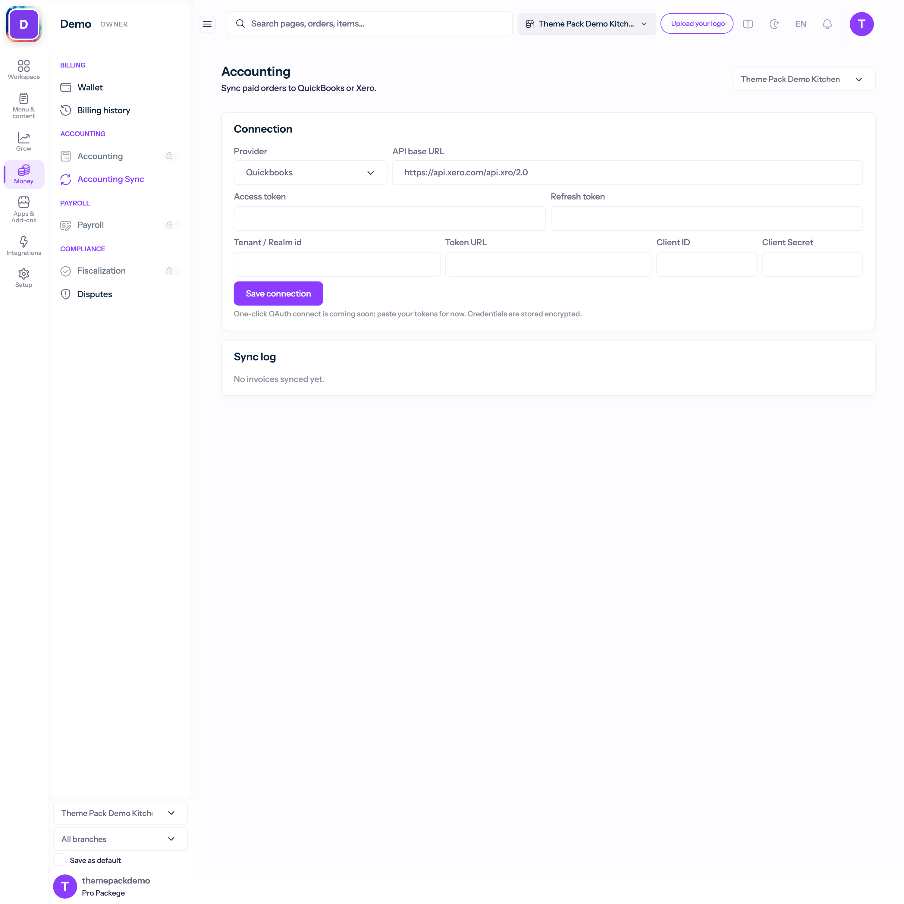

# Accounting (your books)

The built-in accounting module keeps a double-entry general ledger for each
restaurant: a chart of accounts, journal entries, expenses you record by hand,
and financial reports including a VAT summary. It is separate from
**Accounting sync**, which pushes data to QuickBooks or Xero.

Accounting is a paid feature. If your plan does not include it, the sidebar
shows a locked **Accounting** entry instead of the page.

## Opening the books

Click **Accounting** in the sidebar under **Money → Accounting**. The page is
titled **Accounting**; use the store selector in the page header to switch
restaurant. A tab strip across the top moves between the four screens:

| Screen | Address | What it is |
| --- | --- | --- |
| Accounting | `books` | Dashboard |
| Expenses | `books/expenses` | Record and list spending |
| Journals | `books/journals` | General-ledger entries |
| Financial Reports | `books/reports` | Trial balance, P&L, balance sheet, VAT, period close |

The first time you open any of these, a default chart of accounts is created
for the restaurant if it does not already have one. Re-opening never duplicates
it.

## The chart of accounts

The default chart is bilingual (English and Arabic) and numbered by type:

- **1xxx Assets** — Cash & Bank (Cash on Hand, Bank Account, Payment Gateway
  Clearing), Accounts Receivable, Inventory, VAT Receivable (Input).
- **2xxx Liabilities** — Accounts Payable, VAT Payable (Output), Wages Payable,
  Tips Payable, Gift Card Liability.
- **3xxx Equity** — Retained Earnings.
- **4xxx Revenue** — Food & Beverage Sales, Delivery Fees, Discounts & Refunds.
- **5xxx / 6xxx Expenses** — Cost of Goods Sold and Food Cost; Operating
  Expenses covering Wages & Salaries, Tips Expense, Rent, Utilities, Payment
  Processing Fees and Other Expenses.

There is no add/edit/archive screen for accounts in the dashboard in this
release — you post against the accounts above.

## Dashboard

The **Accounting** screen shows four figures for the current month to date:

- **Cash position** — the combined balance of Cash on Hand, Bank Account and
  Payment Gateway Clearing.
- **Revenue (MTD)**
- **Net income (MTD)**
- **VAT due (MTD)**

Below them is a six-month revenue-versus-expense trend.

## Recording expenses

On the **Expenses** screen, the **New expense** form takes:

- **Account** — one of your active expense accounts.
- **Description** — up to 500 characters.
- **Amount** — required.
- **VAT** — the tax portion, defaults to 0.
- **Date** — required.
- **Paid from** — **Cash / Bank** or **Accounts Payable** (money you still owe).
- **Repeat** — **One-off**, **Weekly** or **Monthly**. A repeating expense
  regenerates on that interval and its copies are marked *recurring* in the
  list.
- **Receipt** — an optional JPG, PNG or PDF up to 5 MB.

Click **Record expense**. The expense is posted to the ledger and appears in the
table below, showing the 200 most recent by date. Each row links to its stored
receipt and has a **Delete** button with a confirmation prompt.

## Journals

The **Journals** screen lists the 100 most recent general-ledger entries, newest
first. Each shows its journal number, date, memo, and the debit and credit lines
per account. Journals are generated by the system from your trading activity and
your expenses; there is no manual journal-entry form in this release.

## Financial reports

The **Financial Reports** screen takes a **From** and **To** date (defaulting to
the start of this month through today) and produces four statements:

- **Profit & Loss** — revenue lines, total revenue, expense lines, total
  expenses and net income.
- **Balance Sheet** — total assets, total liabilities, retained earnings and
  total equity, with a **Balanced** or **Out of balance** badge.
- **VAT Report** — output VAT, input VAT and net VAT due. The rate shown is your
  platform tax-charge setting (15% if none is configured).
- **Trial Balance** — every account with its debit and credit totals, plus a
  **Balanced** badge.

## Closing a period

At the bottom of the reports screen, **Period close** shows the latest closed
period and lets you close a month:

1. Pick a month.
2. Click **Close period**.

Closing a month locks every period **up to and including** it — the ledger then
refuses new postings dated inside a closed month. Reopening a period is
supported by the system but has no button on this page in this release.

## Scope and limits

- The books are per restaurant. Journals, expenses and reports never mix data
  from another restaurant, and an expense that is not yours returns "not found".
- Reports can be filtered by branch through the URL, but the screen only offers
  date filters.
- Deleting an expense removes the row from this list; use period close when you
  need figures to stop moving.

## Related pages

- [Reports](analytics.md) — sales-side reporting, separate from the ledger.
- [Inventory](inventory.md) — stock and cost tracking.
- [Plans, billing and subscriptions](plans-billing.md) — what your plan
  includes.
