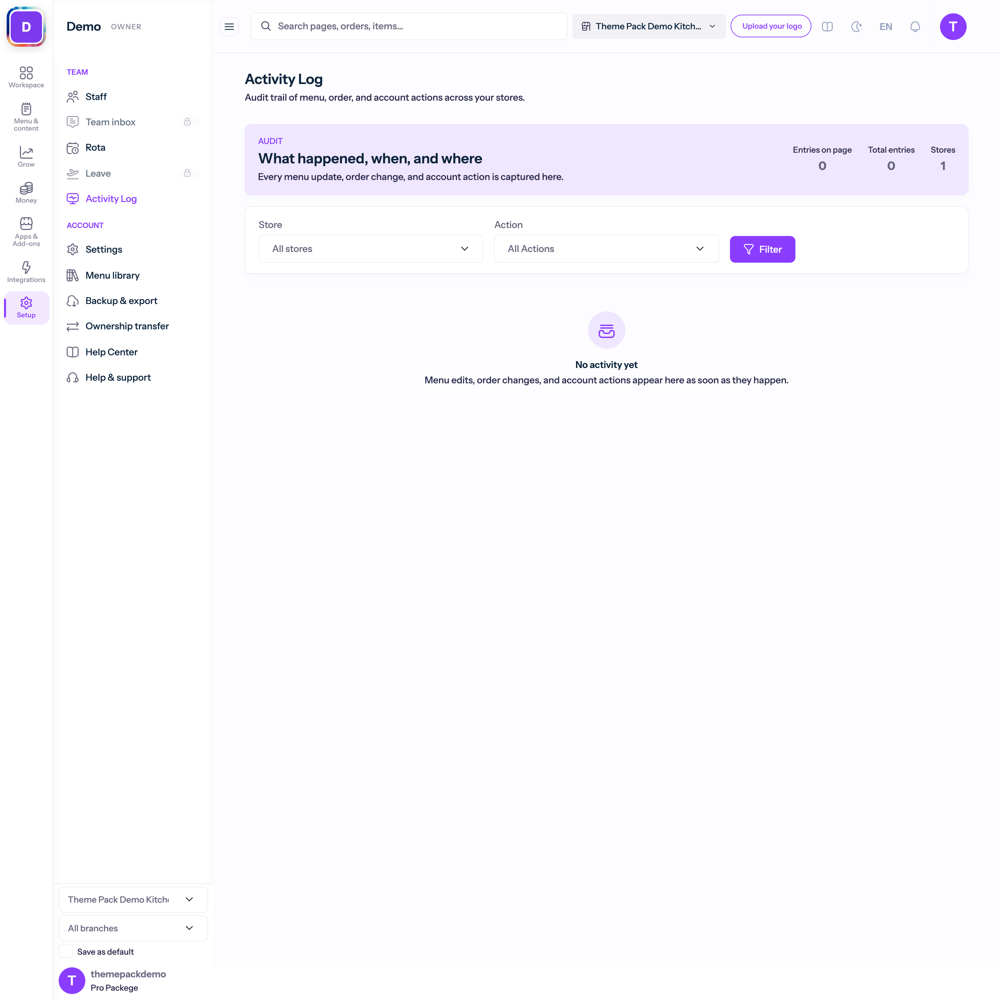

# Activity log

The activity log is an audit trail of what happened across your account: menu
edits, order status changes, settings saves, staff actions, and more — who did
it, when, and from which IP address. Use it to answer questions like "who
deleted that menu item?" or "when was this order marked complete?".

Open **Activity log** in the sidebar (under the **Team** group, activity
icon), or go to `/activity-log` directly.

The page is owner-only. Staff members cannot open it — they get an "access
denied" (403) error — but their actions in the dashboard and staff app still
show up in your log. See [Staff and roles](staff.md).

## What gets recorded

An entry is written automatically whenever an important action happens in any
of your restaurants. Recorded actions include:

- **Menu** — items created, updated, or deleted (see
  [Menu items](menu-items.md)).
- **CSV** — menu imports (see
  [Menu import and export](menu-import-export.md)).
- **Orders** — new orders, status changes, table transfers, and bill requests,
  including actions from the staff app and kitchen display (see
  [Orders](orders.md)).
- **Restaurant** — restaurant settings saved, restaurant cloned.
- **Other account actions** — staff accounts created, waitlist and loyalty
  actions, floor map saves, kitchen ticket bumps, wallet top-ups, and add-on
  purchases. These appear in the feed but do not have their own filter option
  yet.

You see entries for two kinds of activity: actions you performed yourself, and
any logged action on a restaurant you own — regardless of who performed it.
So a manager updating an order or a kitchen staffer bumping a ticket shows up
in your log too.

Entries never contain passwords, payment card numbers, or API keys. Logging
runs quietly in the background: if it ever fails, your original action still
completes normally.

## Reading an entry

The feed lists entries newest first, 50 per page. Each entry shows:

- A plain-language description of the action, for example "Updated menu item"
  or "Changed order status".
- The restaurant it happened in (when the action is tied to one).
- When it happened, as relative time ("2 hours ago"); hover over the time to
  see the exact date and time.
- Extra details when available — for example the item name for a menu edit,
  the new status for an order change, or `via` showing where the action came
  from (staff app, AI agent, and so on).
- The IP address the action came from.

A summary strip at the top shows how many entries are on the current page, the
total number of entries, and how many restaurants you have.

## Filtering

Two dropdowns sit above the feed:

- **Restaurant** — limit the feed to one of your restaurants, or leave it on
  **All restaurants**.
- **Action** — limit to one action family: **Menu items**, **Categories**,
  **Orders**, **Restaurant**, **CSV**, **Coupons**, or **Reviews**. The filter
  matches the whole family, so choosing **Menu items** shows creates, updates,
  and deletes together. The **Categories**, **Coupons**, and **Reviews** options
  are reserved for future use — no activity is recorded for these action
  families yet, so selecting them returns no entries.

Click **Filter** to apply. When a filter is active, a **Clear** button appears
to reset the view. Filters are kept as you page through results, so you can
browse a long filtered history without reapplying them.

There is no filter by date, by staff member, or by keyword yet, and no export
button — to find something specific, narrow by restaurant and action family,
then page through.

## Common questions

**How far back does the log go?** Entries are kept from the moment the feature
was enabled on your account; there is no automatic cleanup, so older pages
stay available.

**Why is an entry missing a restaurant name?** Some actions are account-level
rather than restaurant-level — for example an add-on purchase or a wallet
top-up — so no restaurant is attached.

**Can staff see the log?** No. The page returns an access denied error for
staff accounts, even for managers.

**Can I delete entries?** No. The log is read-only by design — that is what
makes it a reliable audit trail.
