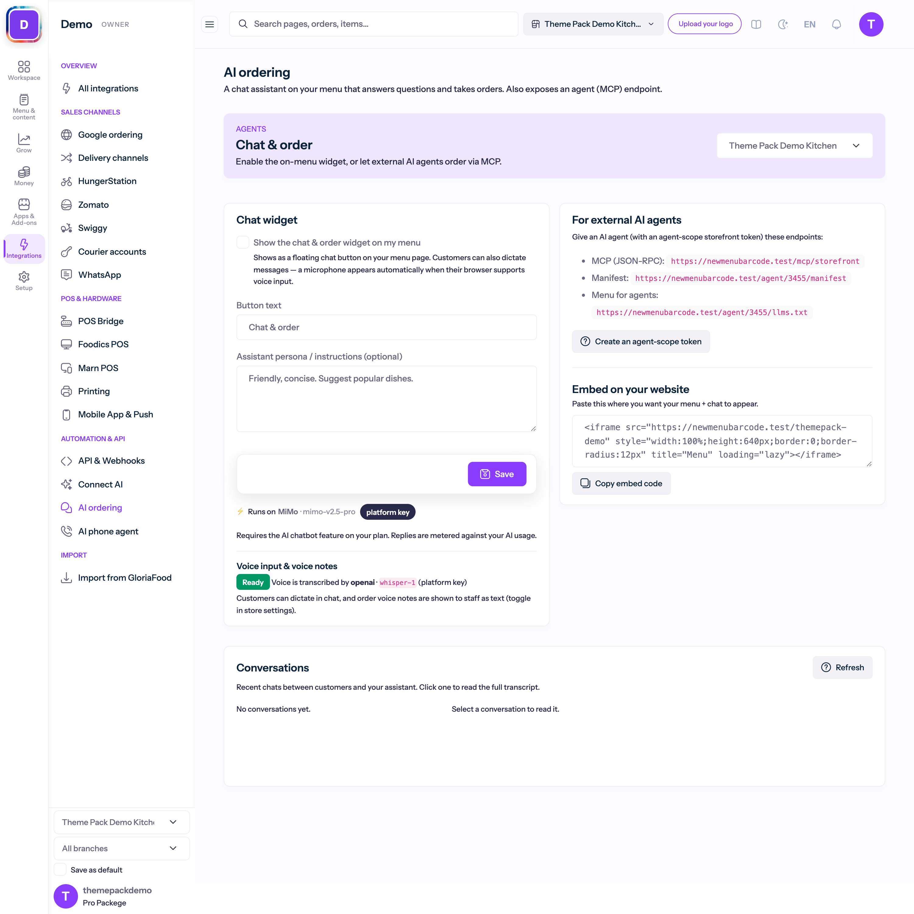

# AI agent settings

Your restaurant can have an AI ordering assistant: a chat helper that answers
menu questions and takes orders for you, over several channels. All of its
settings live on one page — open **AI ordering** in the dashboard sidebar
(page path `ai-ordering`). If you own more than one restaurant, use the
dropdown at the top of the page to pick which restaurant you are configuring;
every setting on this page is per restaurant.

The assistant requires the **AI chatbot** feature on your plan. Every reply it
generates is metered against your AI usage, the same as other AI features.

## What the assistant can do

The assistant is deliberately limited to safe, menu-related actions:

- Search your menu by name or description, including vegan, halal and price
  filters. Sold-out items are flagged, never hidden.
- Show full item details — variants and extras.
- Check a cart: prices are always taken from your live menu, so the assistant
  cannot invent items or prices.
- Place an **unpaid** order for pickup or on-table dining. Agent orders appear
  in your normal order flow (kitchen display, inventory, notifications) marked
  with source "agent". The customer pays the usual way; the assistant never
  handles cards or payment details.
- Look up order status from a tracking token, share your restaurant info and
  give an estimated wait time based on current kitchen load.
- On phone channels (WhatsApp and SMS) it can also show the customer their own
  recent orders and reorder their last order. This is keyed to the verified
  sender's phone number only — one customer can never see another's history.

Built-in guardrails:

- Orders are capped at 40 items, with at most 30 of any single line.
- For large carts (10 or more units, or a subtotal of 200 or more) the
  assistant reads the order back and asks for explicit confirmation before
  placing it.
- If a customer is abusive, the assistant answers with a fixed polite refusal
  without calling the AI at all.
- If a customer asks for a human, the conversation is flagged for handoff (see
  "Reading conversations" below) and the assistant tells them a team member
  will follow up.

## Turning on the chat widget

The **Chat widget** card controls the on-menu chat assistant:

1. Open **AI ordering** in the sidebar and pick the restaurant.
2. Tick **Show the chat & order widget on my menu**.
3. Optionally set the **Button text** (up to 120 characters; the default is
   "Chat & order").
4. Optionally write **Assistant persona / instructions** (up to 2,000
   characters), for example "Friendly, concise. Suggest popular dishes."
5. Click **Save**.

When the toggle is on, the chat bubble renders on your public menu page — the
widget ships on all standard menu themes. The WhatsApp and SMS channels below,
and the external-agent endpoints, work as well.

Web chat is rate-limited to 30 messages per minute per visitor.

## Channels

The same assistant, with the same abilities and limits, is available on
several channels. The **Conversations** panel labels each chat with its
channel.

- **Web** — the on-menu chat widget described above.
- **WhatsApp** — if you have enabled the WhatsApp chatbot for the restaurant
  (see [WhatsApp](whatsapp.md), Automations section), inbound WhatsApp
  messages run through the same ordering assistant, so customers can search
  the menu and place an order directly in WhatsApp. If the AI chatbot feature
  is not on your plan, WhatsApp falls back to a simple Q&A reply.
- **SMS** — if your restaurant has an SMS number connected, customers can text
  it and order by SMS. Inbound messages are verified as genuinely coming from
  your SMS provider, and opt-out (STOP) keywords are always honoured before
  any reply is sent.
- **External AI agents (MCP)** — third-party AI assistants can browse your
  menu and place orders through machine-readable endpoints, shown in the
  **For external AI agents** card:
  - MCP (JSON-RPC): `/mcp/storefront`
  - Manifest: `/agent/{store-id}/manifest`
  - Menu for agents: `/agent/{store-id}/llms.txt`

  External agents authenticate with an agent-scope storefront token. The
  **Create an agent-scope token** button takes you to the API tokens page;
  see [API tokens & abilities](../dev/api/auth-tokens.md) for details.

Instagram, Messenger, Telegram and a voice channel are specced but not yet
available.

## Embedding your menu on another website

The **Embed on your website** section of the external-agents card gives you a
ready-made iframe snippet that shows your menu (with chat, once the widget
renders in your theme) inside any other site. Click the code to select it, or
use **Copy embed code**, then paste it into your website's HTML.

## Reading conversations

The **Conversations** panel at the bottom of the AI ordering page lists the
most recent chats (up to 60) between customers and your assistant, across all
channels. Each row shows the channel, the number of messages and, if the chat
led to an order, the order number. Click a conversation to read the full
transcript; use **Refresh** to reload the list.

A red **Handoff** badge means the customer asked for a human — check these
regularly and follow up yourself, because the assistant only flags the chat,
it does not notify staff any other way.

Privacy: stored transcripts are PII-redacted — phone numbers and similar
personal details in customer messages are masked before saving.

## Language

The assistant detects the customer's language from their messages and replies
in that language for the rest of the conversation. You do not need to
configure anything; see [Translations](translations.md) for the menu content
itself.

## Related pages

- [WhatsApp](whatsapp.md) — provider setup and the WhatsApp chatbot toggle
- [Orders](orders.md) — where agent-placed orders arrive
- [AI menu generator](ai-menu-generator.md) — a separate AI feature for
  building your menu
- [API tokens & abilities](../dev/api/auth-tokens.md) — agent-scope tokens for
  external agents
