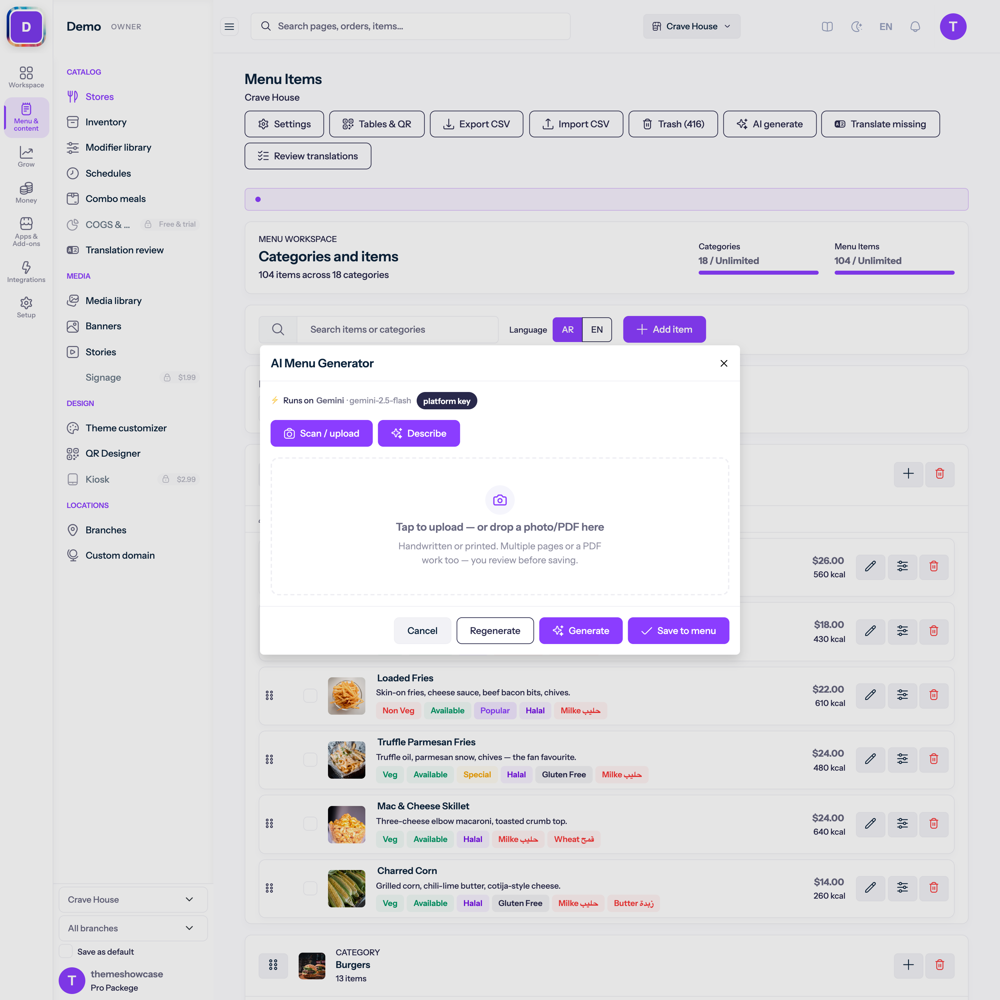

# AI menu generator and menu scan

Instead of typing your menu in item by item, you can let AI build it for you.
There are two ways: scan an existing menu (a photo or PDF of your printed
menu), or describe your restaurant and let AI propose a menu from scratch.
Either way you always review and edit the result before anything is saved.

You will find the tool in the menu workspace: open **Stores** in the
sidebar, click **Change menu** on the restaurant, then click the **AI generate**
button at the top of the page. A dialog opens with two tabs: **Scan / upload**
and **Describe**.

For the manual way of managing items, see [Managing menu
items](menu-items.md) and [Menu categories](menu-categories.md).

## Scan a photo or PDF

Use the **Scan / upload** tab when you already have a menu — printed,
handwritten, or as a PDF file.

1. Tap the upload area (or drag files onto it). You can pick photos, a PDF,
   or several files at once — for example both sides of a folded menu
   photographed separately.
2. Click **Generate**. Each page is read in turn and you see progress like
   "Reading page 2/3". Multi-page input is combined into a single draft:
   categories with the same name are merged, and an item that appears on more
   than one page is kept once (missing prices or descriptions on one page are
   filled in from another).
3. Review the draft (see below) and click **Save to menu**.

What the scanner does and does not do:

- It keeps the language of your menu as written — nothing is translated.
- It never invents prices. If a price is unreadable, the field is left empty
  and highlighted in the review step so you can fill it in.
- It picks up size pricing (for example "Small 10 / Large 15") as variants,
  and paid add-ons (for example "+ cheese 2") as extras, but only when they
  are actually printed on the menu.

Limits: each file can be up to 15 MB, a PDF is read up to 15 pages, and up to
30 pages can be combined in one run. If one page fails to read, the others
still go through.

## Describe your restaurant

Use the **Describe** tab when you are starting fresh and have no menu to scan.

1. Write a short description of your restaurant or cuisine, for example
   "A cozy Italian trattoria with pizzas, pastas, and desserts". You can be
   specific — mention dishes, how many categories you want, or a price range,
   and the AI will follow it.
2. Optionally tick **Also suggest variants (e.g. sizes) and paid extras** if
   you want the AI to add size options and add-ons where they make sense.
3. Click **Generate**.

Unlike scanning, this mode is creative: the AI invents a fitting menu
(typically 3 to 6 categories with 4 to 8 items each) with suggested prices.
The menu is written in the same language as your description. Treat the
prices as placeholders — review and adjust them before saving.

## Review the draft before saving

Nothing is added to your menu until you confirm. The review screen shows the
generated categories and items, and everything is editable:

- Change category names, item names, and prices directly in the fields.
- Items with no price are highlighted; leave a price blank to save the item
  as free (price 0).
- Variants and extras appear as small chips under an item — click the × on a
  chip to remove one.
- Remove an item with the × on its row, or click **Add item** inside a
  category to add one manually.
- Not happy with the result? Click **Regenerate** to go back and try again.

Click **Save to menu** to create the categories and items. They are appended
after your existing categories and count against your plan's category and
item limits — if you hit a limit mid-save, the rest are skipped and the
confirmation message tells you so.

## AI photos for new items

If AI image generation is enabled on your platform, the review screen shows a
checkbox: **Generate AI photos for these items (runs in the background after
saving)**. Tick it and, after the menu is saved, photos are generated for up
to 40 of the new items while you keep working. A progress banner on the menu
page shows how far along it is, and the photos appear on your items as they
finish. Items that already have a photo are skipped.

If you do not see the checkbox, image generation is not configured on your
platform — you can still upload your own photos as described in [Managing
menu items](menu-items.md).

## Translating the generated menu

The generator keeps (or writes) your menu in one language. If your menu is
set up with more than one language, a **Translate missing** button appears
next to **AI generate**. It opens a dialog where you first confirm which
language your menu is currently written in, then AI fills in the missing
translations in the background — pick the source language carefully, since
translating from the wrong language gives wrong or empty results. Progress is
shown on the button, and a **Review translations** page lists the
machine-translated fields for checking.

Note: an earlier version could show English twice in language lists because
of a duplicated language entry. This has been fixed — languages are now
unique, so each language appears once in the translate dialog.

## Troubleshooting

- "No menu items could be read from the input" — the photo was too blurry or
  the text too small. Retake the photo closer and flatter, or try one page at
  a time.
- "That file is not an image or PDF" / "A file is too large (max 15 MB
  each)" — only images and PDFs are accepted, up to 15 MB per file.
- A message about reaching your AI limit — AI usage is metered by your plan;
  try again later or upgrade.
- "The AI service is unavailable right now" — a temporary provider issue;
  wait a moment and click **Generate** again.
- "Some were skipped — you reached your plan limit" after saving — the draft
  had more categories or items than your plan allows; the rest were saved.
