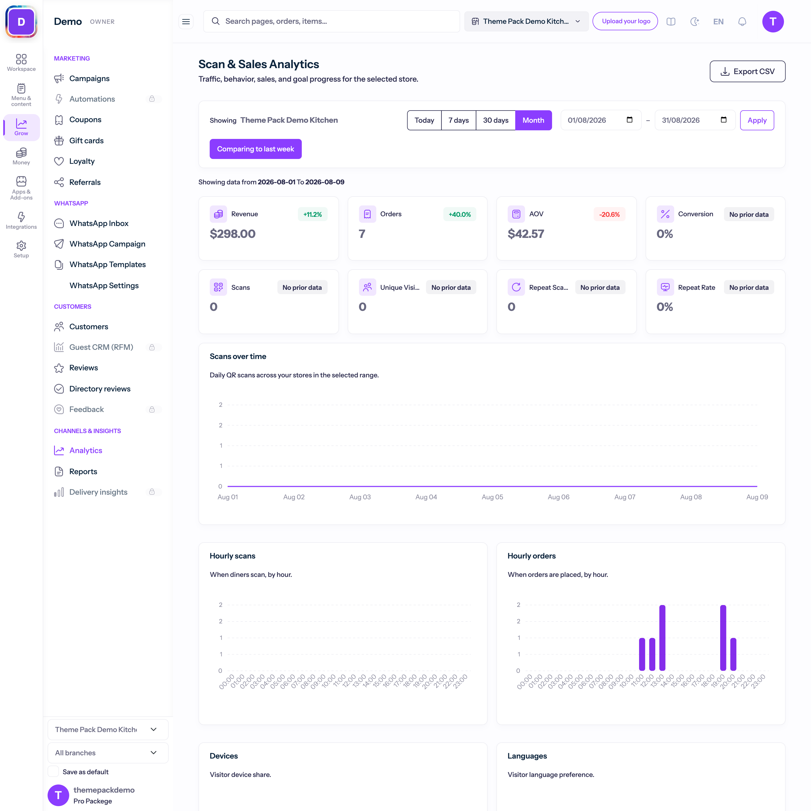

# Analytics and reports

The **Analytics** page in the sidebar shows how your menu is doing: QR scan
traffic, orders and revenue, how each item performs, and where diners drop out
between browsing and paying. Everything on the page is scoped to your own
restaurants — if you own several, the numbers are combined across all of them.

Until diners scan your QR code or place orders you will see a "No analytics
yet" placeholder. See [QR codes](qr-codes.md) for getting your codes in front
of guests and [Managing orders](orders.md) for taking orders.

## Choosing a date range

At the top of the page the shared **period bar** (the same one as the
dashboard) controls almost every number and chart: preset chips for
**Today**, **7 days**, **30 days**, and **Month**, plus a custom from–to
range with **Apply** and a compare toggle. Changing the period reloads the
page immediately. The same range is used for the **Export CSV** button next
to it.

A date window is always applied — there is no "all time" view. Directly under
the period bar the page prints the window it actually used: **"Showing data
from <date> to <date>"**. Read this line to know exactly which slice you are
looking at, because the analytics buckets are coarser than the period presets:
**Today** is analysed as the last 7 days, and a **custom** range is analysed
as this month. An unrecognised range falls back to the last 7 days rather
than widening.

## KPI cards and period comparison

The top of the page shows eight cards: **Revenue**, **Orders**, **AOV**
(average order value), **Conversion**, **Scans**, **Unique visitors**,
**Repeat scanners**, and **Repeat rate**.

How they are counted:

- **Revenue, Orders, AOV** — only successful orders count: an order that is
  completed or paid. AOV is revenue divided by that order count.
- **Conversion** — successful orders divided by scans, as a percentage.
- **Scans** — every visit to your public menu through the QR link.
- **Unique visitors** — distinct visitors (measured by IP address).
- **Repeat scanners / Repeat rate** — visitors who scanned more than once in
  the range, and what share of unique visitors they are.

Each card carries a trend pill comparing the current range against the equal
period before it — for example, Last 7 days is compared with the 7 days before
that, and This month with last month. The pill shows the percentage change and
direction ("+12.4% vs prev"). If the previous period had no data the card says
"No prior data" instead. There is no custom "compare any two dates" picker;
comparison is always against the immediately preceding period.

If you have a goal set, the matching card also shows a progress bar with the
percentage of the goal reached, measured against the selected range's total.
Only one goal type is tracked at a time. To set or change a goal, use the goal
form on the [dashboard](dashboard-overview.md#setting-a-goal) — choose Scans,
Orders, or Revenue and enter your target number. Setting the value to 0 clears
the goal.

## Scan analytics

Below the cards, a set of charts breaks down your traffic:

- **Scans over time** — daily scans across the selected range.
- **Hourly scans** — which hours of the day diners scan, so you can see your
  peak menu-browsing times.
- **Devices** — visitor share by Mobile, Tablet, and Desktop.
- **Languages** — visitors' preferred browser language, useful for deciding
  which [translations](translations.md) to invest in.
- **Traffic sources** — appears when your scan links carry a source tag. Add
  `?src=window-sticker` (or a standard `?utm_source=...`) to the QR link you
  print for each placement, and this list shows the top sources for the
  period. Untagged scans are grouped as "Direct".

## Order and sales analytics

Sales numbers live in the KPI cards (Revenue, Orders, AOV, Conversion) and in
the **Hourly orders** chart, which shows when orders are placed by hour of
day — compare it with Hourly scans to see whether browsing peaks turn into
ordering peaks.

Revenue uses each order's total, in the currency configured for your
restaurant. Unpaid, cancelled, or still-pending orders are not counted as
revenue until they are completed or paid.

## Per-item performance

The **Top items** table ranks your menu items by orders (ties broken by
views) and shows the top 10 for the range:

- **Views** — how many times the item's detail view was opened on your public
  menu.
- **Carts** — how many times it was added to a cart.
- **Orders** — total quantity sold in successful orders.
- **Cart conv** — adds-to-cart as a percentage of views.
- **Order conv** — quantity sold as a percentage of views.

An item with many views but a low order conversion usually has a photo,
description, or price problem — diners look but do not buy.

Below the table, the **Category heatmap** shows relative view and
add-to-cart intensity for up to 12 categories, so you can see which sections
of the menu attract attention and which are being skipped.

## Menu engineering matrix

The **Menu engineering** card classifies every item on a menu by popularity
(units ordered) and profit margin (price minus cost), using the classic
four-quadrant model:

- **Star** — sells well and earns well. Protect and promote these.
- **Plowhorse** — popular but low margin. Consider a small price increase or
  cheaper recipe.
- **Puzzle** — high margin but rarely ordered. Better photo, placement, or
  description may help.
- **Dog** — unpopular and low margin. Candidates to rework or remove.

If you own more than one restaurant, a selector on the card switches between
them. The matrix looks at the last 12 months of orders regardless of the page
date range. Items are split at the median, so you always get a mix of high
and low performers rather than everything landing in one class.

If your items have no cost recorded, the matrix degrades gracefully and shows
**Popular** / **Unpopular** instead of the four margin-based classes, and the
Margin column shows a dash.

The **View→order** column shows sold quantity as a percentage of views, and a
warning marker flags underperformers: items viewed at least 10 times with a
view-to-order rate under 10%.

## Conversion funnel

The **Conversion funnel** section shows how diners move through four stages
and where they drop off:

1. **Browse** — item detail views on your public menu.
2. **Add to cart** — items added to carts.
3. **Order placed** — all orders created in the range.
4. **Order paid** — orders that were completed or paid.

Each step shows its count and the drop-off percentage from the step before.
A big drop between Browse and Add to cart points at menu content (photos,
prices); a drop between Placed and Paid points at checkout or payment issues.

## Exporting a CSV report

Click **Export CSV** at the top of the page to download a spreadsheet-ready
report for the selected range. The file contains three sections:

- **Overview** — the range, a **Window** row with the exact from–to dates the
  numbers cover (the same window printed on the page), and the generation
  time.
- **Summary metrics** — scans, unique visitors, repeat rate, revenue, order
  count, AOV, and conversion rate.
- **Menu item performance** — every item with price, views, adds-to-cart,
  orders, both conversion rates, and a status column: **Best Seller** (order
  conversion of 20% or more), **Dead Item** (more than 5 views but zero
  orders), or **Healthy**.

The file opens directly in Excel or Google Sheets. Scheduled or PDF exports
are not available; the export is on-demand CSV only.

## Weekly digest and scan-drop alerts

Two email reports can be switched on under **Settings** in the sidebar:

- **Weekly Analytics Email Digest** — every Monday morning you receive last
  week's scans, unique visitors, revenue, order count, and conversion rate.
- **Daily Scan Drop Alerts** — a daily check emails you when today's scans
  drop 40% or more below your average over the last 7 full days, so you catch
  a broken QR code or a printing mistake quickly.

Both are off by default. Set each to **Enabled** and save.

## Multi-currency orders

If you take orders in more than one currency, each order **stamps the currency
it was placed in** and freezes the exchange rate that was true at that moment.
Reports never blind-sum different currencies into one meaningless total: revenue
is split by the order's own currency, and where a single figure is needed each
order is converted at the rate frozen when it was placed — not today's rate — so
historical totals stay stable. A single-currency store sees exactly one currency
and none of this complexity.

## Related pages

- [Dashboard overview](dashboard-overview.md) — the at-a-glance numbers on
  your home screen.
- [Managing orders](orders.md) — statuses that decide what counts as a
  successful order.
- [Inventory](inventory.md) — ingredient-level costs and food-cost reporting.
- [QR codes](qr-codes.md) — creating and placing the codes that generate
  scans.
