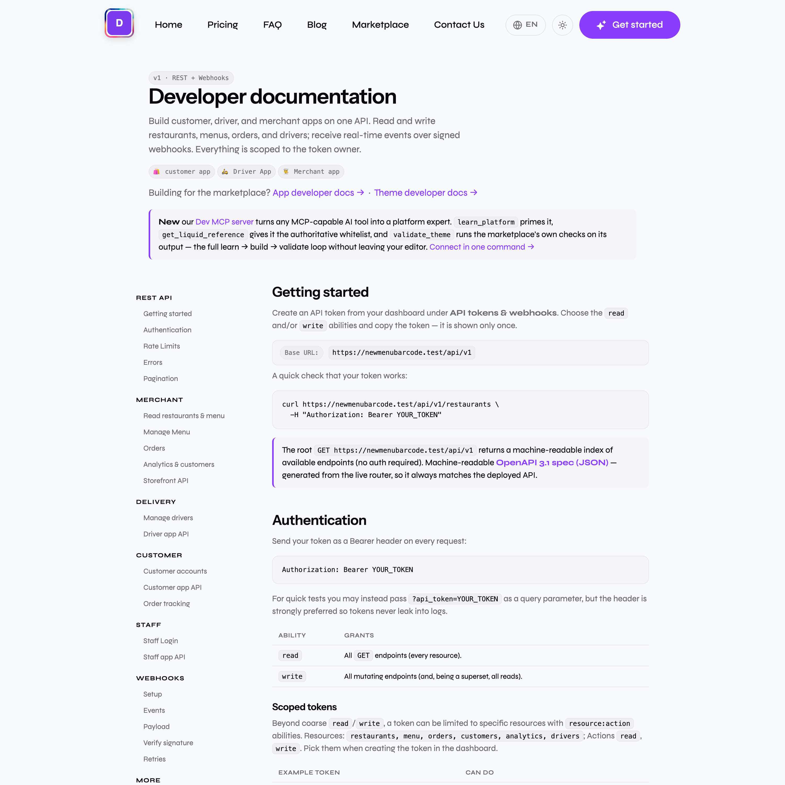

# API tokens (for owners)

API tokens let outside software work with your restaurant data — for example
a POS system that reads orders, a website that shows your menu, or an AI
assistant that manages items for you. You create and revoke all tokens from
one dashboard page, and you never have to write code yourself: you create the
token, then hand it to whoever builds the integration.

There are two kinds of token, for two different jobs:

- **API tokens** — belong to your account and can reach all of your
  restaurants. Use these for trusted back-office tools (POS, reporting,
  automation). Keep them secret.
- **Storefront tokens** — belong to one restaurant and are meant for
  public-facing use, such as a headless website or an AI ordering agent.

## Where to find it

Open **API & Webhooks** in the dashboard sidebar. The page shows a
**Create Token** form, an **MCP server** card, your existing **Tokens**,
**Storefront tokens**, **Webhook endpoints**, and a **Recent deliveries**
log. The **API documentation** button at the top opens the public developer
docs, which is what you send to the person building the integration.

## Create an API token

1. In the **Create Token** card, enter a **Name** that says what the token is
   for, e.g. "POS integration". You can have several tokens; naming them
   makes it safe to revoke one without breaking the others.
2. Pick one or more **Abilities** (hold Cmd/Ctrl to multi-select). If you
   pick nothing, the token gets `read`. See the next section for what each
   ability means.
3. Optionally set **Expires in days** (1 to 3650). Leave it empty and the
   token never expires.
4. Click **Create Token**.

The new token appears once in a green banner at the top of the page. Copy it
immediately — it is stored in a scrambled form and can never be shown again.
If you lose it, revoke it and create a new one.

The **Tokens** table shows each token's name, abilities, expiry date, and
when it was last used. "Last used: Never" is a good sign a token can be
revoked safely.

## Abilities

Abilities control what a token is allowed to do:

- **read (all)** — can view everything: restaurants, menu, orders,
  customers, analytics, drivers. Cannot change anything.
- **write (all)** — can view and change everything. Write always includes
  read.
- **Scoped abilities** — limit the token to one area, in the form
  `resource:action`. The resources are `restaurants`, `menu`, `orders`,
  `customers`, `analytics`, and `drivers`, each with a `:read` and a
  `:write` variant. For example, a kitchen-display integration only needs
  `orders:read`; a menu-sync tool needs `menu:write`.

Give each integration the smallest ability that does the job. A token with
`orders:write` cannot touch your menu or customer data even if it leaks.

Every token, whatever its abilities, is limited to your own restaurants — it
can never see another account's data. API calls are rate-limited to 120
requests per minute.

## Create a storefront token

Storefront tokens are per-restaurant and made for public use, so a leaked
menu-reading token cannot harm anything else.

1. In the **Storefront tokens** card, choose the **Store** the token is
   for. (If you have no restaurant yet, create one first.)
2. Pick one or more **Scopes**:
   - `menu:read` — browse the menu only. Safe to embed in a public website
     or app. This is the default.
   - `order:write` — place orders on that restaurant. More powerful; only
     give it to software you trust.
   - `agent` — lets an AI agent operate the restaurant's storefront through
     the agent endpoint. The [AI agents](ai-agents.md) page explains this
     setup.
3. Optionally add a **Label** such as "Website" so you can tell tokens apart
   later.
4. Click **Create storefront token** and copy the value from the green
   banner — like API tokens, it is shown only once.

The table below the form lists each storefront token's restaurant, label,
scopes, and last use.

## Revoke a token

Click **Revoke** next to any token in the **Tokens** or **Storefront tokens**
table and confirm. Revocation is immediate: the next request made with that
token is rejected. Revoking cannot be undone — if the integration should keep
working, create a replacement token first, update the integration, then
revoke the old one. That create-then-revoke swap is also the way to rotate
tokens on a schedule.

## MCP server

The **MCP server** card on the same page shows the endpoint for connecting an
MCP-compatible AI client (such as Claude) so it can operate your restaurant
in natural language. It authenticates with the same API tokens: a `read`
token allows the viewing tools, and changing orders or menu items requires a
token with the `write` ability.

## Webhooks

The same page also manages **Webhook endpoints** — URLs that get notified
when an order is created, changes status, or is paid, with a **Test** button
and a delivery log. Setting the receiving side up is developer work; see
[Webhooks](../dev/api/webhooks.md).

## For developers

## API request logs

Owner API calls are recorded to a **request log** so you can see how your
tokens are being used — the endpoint called, the token, the response status and
when. It is the first place to look when an integration misbehaves: you can tell
whether a request even reached us, which token made it, and whether it was
rejected (for example a `401` for a bad token or a `429` for hitting the rate
limit). Old log entries are pruned automatically so the log stays a recent,
useful window rather than growing without bound.

Hand these pages to whoever builds against your tokens:

- [API tokens & abilities](../dev/api/auth-tokens.md) — how to send the
  token and what the error codes mean.
- [Storefront API](../dev/api/storefront.md) — the public per-restaurant
  API that storefront tokens unlock.
- [Webhooks](../dev/api/webhooks.md) — verifying signatures and handling
  retries.

Related owner pages: [AI agents](ai-agents.md),
[Dashboard overview](dashboard-overview.md).
