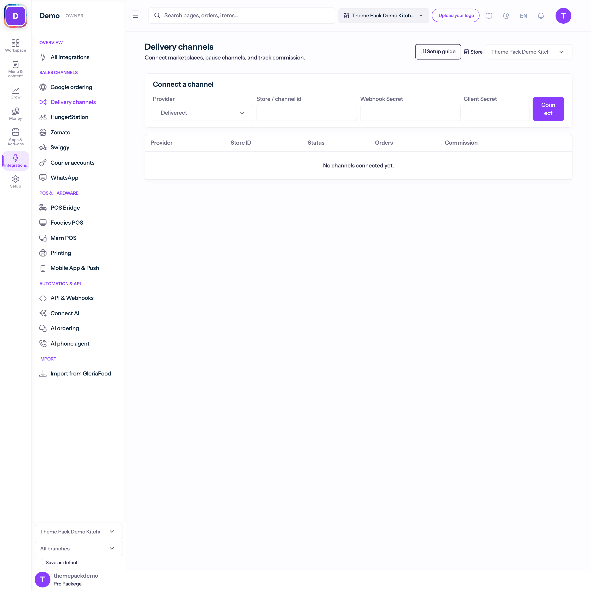

# Apps and integrations

Your account can be extended by third-party apps and by a small set of built-in tracking integrations. Apps are built by outside developers, run on their own servers, and connect to your account through scoped, revocable permissions. This page explains how to find and install apps, what happens when you install or uninstall one, how embedded apps work, how paid apps are billed, and how to set up analytics and font integrations safely.

## What an app is

An app is a registered third-party product that connects to your account. Its code runs entirely on the developer's servers — installing it does not add any code to your site. What the app gets is scoped API access: a set of named permissions it can use to read or change specific things in your account on your behalf, plus, optionally, a webhook subscription so it is notified when events happen (for example when an order is paid).

Only apps that have been reviewed and approved by the platform ever appear to you. Apps that are pending, rejected, or draft are never listed or installable.

## Finding and installing apps

The apps list lives at the `/apps` address in your dashboard. It shows every approved app as a card with the app's name, description, and the exact permissions it is requesting, and marks whether you currently have it installed.

To install an app:

1. Open the apps page and find the app you want.
2. Read the permissions listed on the card. These are the scopes the app will be granted.
3. Click Install.

Installing grants the app its listed permissions immediately. If the app publishes a webhook subscription, a delivery endpoint is created for your account at the same time so the app starts receiving the events it asked for. Paid apps also take their first payment at this point (see Billing below) — if that payment fails, the install is cancelled cleanly and no access is granted.

A card shows an Installed badge once the app is active. Reinstalling an app you previously removed reactivates the original record rather than creating a duplicate.

## Uninstalling an app

Click Uninstall on an installed app's card and confirm. Uninstalling is immediate and does three things:

- Revokes every access token the app holds for your account, so the developer loses API access right away.
- Notifies the app that it has been uninstalled (through a signed `app.uninstalled` webhook) so the developer can clean up their side.
- Stops all future webhook deliveries to that app.

A record of the installation is kept afterwards as an audit trail; it does not grant any access.

## Embedded apps

Some apps include an embedded interface — a screen from the app that appears inside your dashboard rather than on a separate website. You can only open an embedded app after you have installed it.

Embedded apps run inside a sandboxed frame and never hold a long-lived password in your browser. Instead, the dashboard hands the app a fresh session token that lasts 60 seconds and is refreshed automatically while you have the screen open. Only the app's own website can receive that token, and an intercepted token expires within a minute. This is the mechanism apps use to make API calls on your behalf while you are looking at their screen.

## Billing for apps

Apps declare one of three billing models, and every charge is taken from your account [wallet](wallet.md) — the same balance used for top-ups and other metered features.

- Free — no charge to install or use.
- Recurring — a fixed price charged each billing period. The first period is charged when you install; the standard period is 30 days unless the app states otherwise. Renewals are charged automatically at the end of each period.
- Usage — metered by the app. There is no fixed fee; the app reports how much you have used (for example number of messages or API calls) and you are charged per unit for what it reports.

Because charges come from your wallet, keep enough balance to cover paid apps. Key behaviours to know:

- If a recurring renewal cannot be covered by your wallet, the app is suspended rather than uninstalled. Its access stops, but the permission grant is preserved. Once you top up your wallet, the app is reactivated at its next charge — you do not have to reinstall or re-approve it.
- Usage charges are only ever reported by the app you installed, only for your account, and are recorded so the same reported usage is never charged twice.
- A failed charge at install time cancels the install; you are not left with a half-installed app.

Top up your wallet from the Wallet page before installing a paid app if your balance is low. See [Wallet](wallet.md) and [Plans and billing](plans-billing.md) for how billing works across your account.

## Structured integrations (analytics and fonts)

Separately from apps, each restaurant can turn on a small set of validated tracking and styling integrations. These replace the old free-text custom-code fields: instead of pasting raw scripts, you enter only an official ID or name, and the platform emits the correct official snippet for you. This is deliberate — it means an integration can never be used to inject arbitrary code into your public menu.

Three integrations are supported per restaurant:

- Google Analytics — a measurement ID in the official `G-`, `AW-`, or `GTM-` format.
- Meta Pixel — a numeric Pixel ID.
- Web font — a Google font family name to apply to your menu.

There is no in-dashboard form UI for editing these three values yet. They are read and written through a small owner-authenticated API, reached from the restaurant edit page's Advanced tab (Tracking and code) via the **Open integrations** link.

**For your developer:** the **Open integrations** link opens `GET /integrations-structured/{storeId}`, which returns the current `ga_id`, `meta_pixel_id`, and `font_family` as JSON; the same path accepts a `POST` to update them (owner session required). Validation is enforced on save: only IDs matching the official formats listed above are accepted, anything else is rejected, and leaving a field blank turns that integration off. You do not need to call these endpoints yourself for day-to-day use — nothing breaks if the values are never set.

## The Integrations settings page

Note that the sidebar Integrations item (under Account) is a different feature: it stores per-restaurant credentials for connected service providers, not third-party apps and not the analytics integrations above. If you are looking to install an app, use the apps page described at the top of this document; if you are setting up analytics or a font, use the restaurant edit page's Advanced tab.

## For developers

Building an app is a separate, technical task. Apps authenticate with OAuth, request scopes, receive signed webhooks, and (for metered apps) report usage server-to-server. Those topics are covered in the developer documentation and API reference rather than here. As an owner, you never handle an app's keys or code — you only grant or revoke its access from the apps page. See [API tokens](api-tokens.md) for related account-level access controls.
