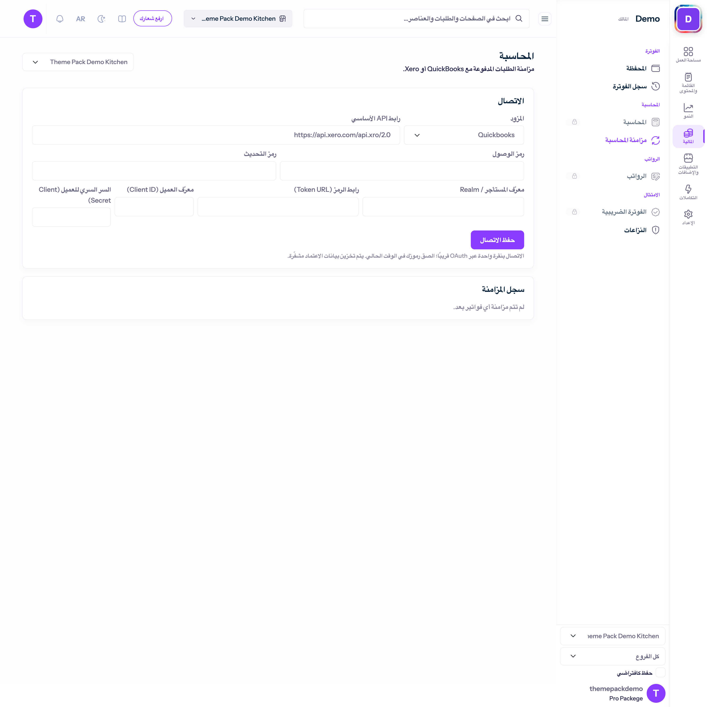

# المحاسبة (دفاترك)

تحتفظ وحدة المحاسبة المدمجة بدفتر أستاذ عام مزدوج القيد لكل مطعم: دليل
حسابات، وقيود يومية، ومصروفات تسجّلها يدويًا، وتقارير مالية تشمل ملخص ضريبة
القيمة المضافة. وهي منفصلة عن **مزامنة المحاسبة** التي تدفع البيانات إلى
QuickBooks أو Xero.

المحاسبة ميزة مدفوعة. إذا كانت باقتك لا تتضمنها، فسيعرض الشريط الجانبي مدخل
**المحاسبة** مقفلًا بدلًا من الصفحة.

## فتح الدفاتر

انقر **المحاسبة** في الشريط الجانبي ضمن **المالية ← المحاسبة**. عنوان
الصفحة هو **المحاسبة**؛ استخدم محدد المتجر في ترويسة الصفحة للتبديل بين
المطاعم. يوجد شريط تبويبات في الأعلى للتنقل بين الشاشات الأربع:

| الشاشة | العنوان | ماهيتها |
| --- | --- | --- |
| Accounting | `books` | لوحة المعلومات |
| Expenses | `books/expenses` | تسجيل المصروفات وعرضها |
| Journals | `books/journals` | قيود دفتر الأستاذ العام |
| Financial Reports | `books/reports` | ميزان المراجعة، الأرباح والخسائر، الميزانية العمومية، ضريبة القيمة المضافة، إقفال الفترة |

في المرة الأولى التي تفتح فيها أيًا من هذه الشاشات، يُنشأ دليل حسابات
افتراضي للمطعم إذا لم يكن لديه واحد بالفعل. ولا تؤدي إعادة الفتح إلى تكراره
أبدًا.

## دليل الحسابات

الدليل الافتراضي ثنائي اللغة (الإنجليزية والعربية) ومرقّم حسب النوع:

- **1xxx الأصول** — النقد والبنك (النقد في الصندوق، الحساب البنكي، تسوية بوابة
  الدفع)، الذمم المدينة، المخزون، ضريبة القيمة المضافة المستحقة (المدخلات).
- **2xxx الخصوم** — الذمم الدائنة، ضريبة القيمة المضافة المستحقة الدفع
  (المخرجات)، الأجور المستحقة الدفع، الإكراميات المستحقة الدفع، التزام بطاقات
  الهدايا.
- **3xxx حقوق الملكية** — الأرباح المحتجزة.
- **4xxx الإيرادات** — مبيعات الطعام والمشروبات، رسوم التوصيل، الخصومات
  والمستردات.
- **5xxx / 6xxx المصروفات** — تكلفة البضاعة المباعة وتكلفة الطعام؛ والمصروفات
  التشغيلية التي تشمل الأجور والرواتب، ومصروف الإكراميات، والإيجار، والمرافق،
  ورسوم معالجة المدفوعات، ومصروفات أخرى.

لا توجد شاشة لإضافة الحسابات أو تعديلها أو أرشفتها في لوحة التحكم في هذا
الإصدار — أنت تُرحّل القيود مقابل الحسابات الواردة أعلاه.

## لوحة المعلومات

تعرض شاشة **المحاسبة** أربعة أرقام للشهر الحالي حتى تاريخه:

- **الوضع النقدي** — الرصيد المجمّع للنقد في الصندوق والحساب البنكي وتسوية
  بوابة الدفع.
- **الإيرادات (منذ بداية الشهر)**
- **صافي الدخل (منذ بداية الشهر)**
- **ضريبة القيمة المضافة المستحقة (منذ بداية الشهر)**

وأسفلها اتجاه للإيرادات مقابل المصروفات على مدى ستة أشهر.

## تسجيل المصروفات

في شاشة **المصروفات**، يأخذ نموذج **مصروف جديد** ما يلي:

- **الحساب** — أحد حسابات المصروفات النشطة لديك.
- **الوصف** — حتى 500 حرف.
- **المبلغ** — مطلوب.
- **VAT** — الجزء الضريبي، وقيمته الافتراضية 0.
- **التاريخ** — مطلوب.
- **مدفوع من** — **نقدًا / بنك** أو **الحسابات الدائنة** (مال ما زلت مدينًا به).
- **تكرار** — **لمرة واحدة** أو **أسبوعي** أو **شهري**. يتكرّر المصروف
  المتكرّر على ذلك الفاصل الزمني وتُوسَم نسخه بأنها *متكررة* في القائمة.
- **الإيصال** — ملف JPG أو PNG أو PDF اختياري حتى 5 ميجابايت.

انقر **تسجيل المصروف**. يُرحَّل المصروف إلى دفتر الأستاذ ويظهر في الجدول
أدناه، الذي يعرض أحدث 200 مصروف حسب التاريخ. يرتبط كل صف بإيصاله المخزّن
وله زر **حذف** مع مطالبة تأكيد.

## القيود اليومية

تسرد شاشة **القيود اليومية** أحدث 100 قيد في دفتر الأستاذ العام، الأحدث أولًا.
يعرض كل قيد رقمه وتاريخه ومذكرته وسطور المدين والدائن لكل حساب. تُنشأ
القيود من قِبل النظام من نشاطك التجاري ومصروفاتك؛ ولا يوجد نموذج قيد يدوي
في هذا الإصدار.

## التقارير المالية

تأخذ شاشة **التقارير المالية** تاريخ **من** وتاريخ **إلى** (والافتراضي من
بداية هذا الشهر حتى اليوم) وتُنتج أربعة بيانات:

- **الأرباح والخسائر** — سطور الإيرادات، وإجمالي الإيرادات، وسطور المصروفات،
  وإجمالي المصروفات، وصافي الدخل.
- **الميزانية العمومية** — إجمالي الأصول، وإجمالي الخصوم، والأرباح المحتجزة،
  وإجمالي حقوق الملكية، مع شارة **متوازن** أو **غير متوازن**.
- **تقرير ضريبة القيمة المضافة** — ضريبة المخرجات، وضريبة المدخلات، وصافي الضريبة المستحقة.
  المعدّل المعروض هو إعداد فرض الضريبة في منصتك (15٪ إذا لم يُهيَّأ أي معدّل).
- **ميزان المراجعة** — كل حساب مع إجمالي مدينه ودائنه، إضافةً إلى شارة
  **متوازن**.

## إقفال فترة

في أسفل شاشة التقارير، يعرض **إغلاق الفترة** آخر فترة مُقفَلة ويتيح لك إقفال
شهر:

1. اختر شهرًا.
2. انقر **إغلاق الفترة**.

يؤدي إقفال شهر إلى قفل كل الفترات **حتى ذلك الشهر شاملًا إياه** — عندئذٍ يرفض
دفتر الأستاذ أي قيود جديدة مؤرّخة داخل شهر مُقفَل. أما إعادة فتح فترة فمدعومة
من النظام لكنها بلا زر في هذه الصفحة في هذا الإصدار.

## النطاق والحدود

- الدفاتر لكل مطعم على حدة. لا تختلط القيود والمصروفات والتقارير أبدًا مع
  بيانات مطعم آخر، ويُرجع المصروف الذي ليس ملكك "not found".
- يمكن تصفية التقارير حسب الفرع عبر الرابط، لكن الشاشة لا توفر سوى مرشّحات
  التاريخ.
- يؤدي حذف مصروف إلى إزالة الصف من هذه القائمة؛ استخدم إقفال الفترة عندما
  تريد أن تتوقف الأرقام عن التغيّر.

## صفحات ذات صلة

- [التقارير](analytics.md) — التقارير الخاصة بجانب المبيعات، منفصلة عن دفتر
  الأستاذ.
- [المخزون](inventory.md) — تتبّع المخزون والتكلفة.
- [الباقات والفوترة والاشتراكات](plans-billing.md) — ما تتضمنه باقتك.
