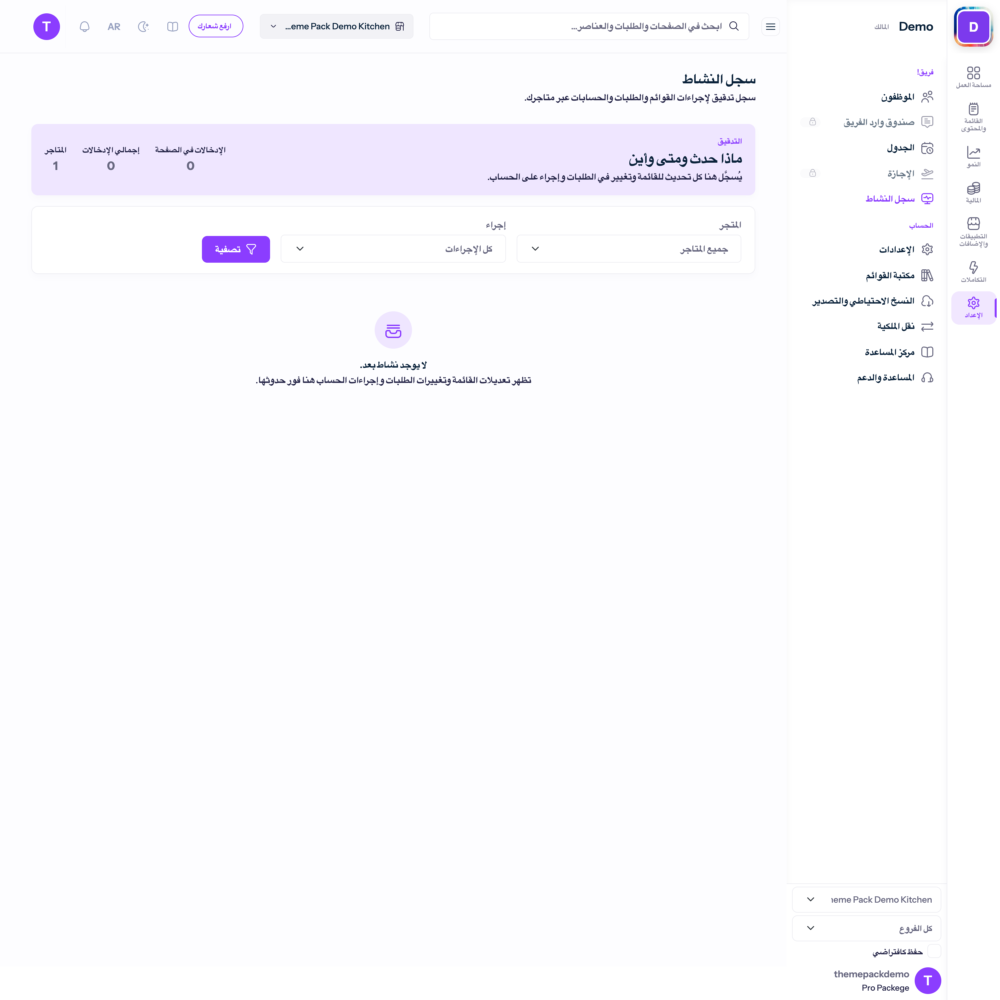

# سجل النشاط

سجل النشاط هو مسار تدقيق لما حدث عبر حسابك: تعديلات القائمة، وتغييرات حالة
الطلبات، وحفظ الإعدادات، وإجراءات الموظفين، وغير ذلك — مَن فعلها، ومتى، ومن
أي عنوان IP. استخدمه للإجابة عن أسئلة مثل "مَن حذف ذلك الصنف من القائمة؟"
أو "متى وُسِم هذا الطلب بأنه مكتمل؟".

افتح **سجل النشاط** في الشريط الجانبي (ضمن مجموعة **الفريق**، أيقونة
النشاط)، أو انتقل إلى `/activity-log` مباشرة.

الصفحة متاحة للمالك فقط. لا يستطيع الموظفون فتحها — إذ يحصلون على خطأ "access
denied" (403) — لكن إجراءاتهم في لوحة التحكم وتطبيق الموظفين تظل تظهر في
سجلك. راجع [الموظفون والأدوار](staff.md).

## ما الذي يُسجَّل

يُكتب قيد تلقائيًا كلما حدث إجراء مهم في أي من مطاعمك. تشمل الإجراءات
المسجّلة:

- **القائمة** — أصناف أُنشئت أو حُدّثت أو حُذفت (راجع
  [أصناف القائمة](menu-items.md)).
- **CSV** — عمليات استيراد القائمة (راجع
  [استيراد القائمة وتصديرها](menu-import-export.md)).
- **الطلبات** — الطلبات الجديدة، وتغييرات الحالة، وتحويلات الطاولات، وطلبات
  الفاتورة، بما في ذلك الإجراءات من تطبيق الموظفين وشاشة المطبخ (راجع
  [الطلبات](orders.md)).
- **المطعم** — حفظ إعدادات المطعم، واستنساخ المطعم.
- **إجراءات حساب أخرى** — إنشاء حسابات الموظفين، وإجراءات قائمة الانتظار
  والولاء، وحفظ خريطة الصالة، ودفع تذاكر المطبخ، وشحن المحفظة، وشراء
  الإضافات. تظهر هذه في التغذية لكن ليس لها خيار تصفية خاص بها بعد.

ترى قيودًا لنوعين من النشاط: إجراءات نفّذتها بنفسك، وأي إجراء مُسجَّل على
مطعم تملكه — بغض النظر عمّن نفّذه. لذا فإن مديرًا يحدّث طلبًا أو عامل مطبخ
يدفع تذكرة يظهر في سجلك أيضًا.

لا تحتوي القيود أبدًا على كلمات المرور أو أرقام بطاقات الدفع أو مفاتيح API.
يجري التسجيل بهدوء في الخلفية: وإذا فشل يومًا، فإن إجراءك الأصلي يكتمل بشكل
طبيعي رغم ذلك.

## قراءة القيد

تسرد التغذية القيود الأحدث أولًا، 50 في كل صفحة. يعرض كل قيد:

- وصفًا بلغة واضحة للإجراء، مثل "Updated menu item" أو "Changed order status".
- المطعم الذي حدث فيه (عندما يكون الإجراء مرتبطًا بواحد).
- متى حدث، كوقت نسبي ("2 hours ago")؛ مرّر مؤشر الفأرة فوق الوقت لرؤية
  التاريخ والوقت الدقيقين.
- تفاصيل إضافية عند توفرها — مثل اسم الصنف لتعديل قائمة، أو الحالة الجديدة
  لتغيير طلب، أو `via` الذي يبيّن مصدر الإجراء (تطبيق الموظفين، وكيل الذكاء
  الاصطناعي، وهكذا).
- عنوان IP الذي جاء منه الإجراء.

يعرض شريط ملخص في الأعلى عدد القيود في الصفحة الحالية، والعدد الإجمالي
للقيود، وعدد المطاعم لديك.

## التصفية

توجد قائمتان منسدلتان فوق التغذية:

- **المطعم** — قصر التغذية على أحد مطاعمك، أو اتركها على **All
  restaurants**.
- **إجراء** — القصر على عائلة إجراءات واحدة: **عناصر القائمة** أو
  **الفئات** أو **الطلبات** أو **المطعم** أو **CSV** أو **الكوبونات**
  أو **التقييمات**. تطابق التصفية العائلة بأكملها، لذا فإن اختيار **Menu
  items** يعرض عمليات الإنشاء والتحديث والحذف معًا. أما خيارات
  **الفئات** و**الكوبونات** و**التقييمات** فمحجوزة للاستخدام المستقبلي — إذ
  لا يُسجَّل أي نشاط لعائلات الإجراءات هذه بعد، فلا يُرجع اختيارها أي قيود.

انقر **تصفية** للتطبيق. عندما يكون هناك مرشّح نشط، يظهر زر **مسح** لإعادة
تعيين العرض. تُحفَظ المرشّحات أثناء تصفّحك للنتائج، بحيث يمكنك تصفّح تاريخ
طويل مُصفّى دون إعادة تطبيقها.

لا توجد بعد تصفية حسب التاريخ أو حسب الموظف أو حسب كلمة مفتاحية، ولا زر
تصدير — للعثور على شيء محدد، ضيّق النطاق حسب المطعم وعائلة الإجراء، ثم تصفّح
الصفحات.

## أسئلة شائعة

**إلى أي مدى في الماضي يعود السجل؟** تُحفَظ القيود من لحظة تفعيل الميزة على
حسابك؛ ولا يوجد تنظيف تلقائي، لذا تظل الصفحات الأقدم متاحة.

**لماذا يخلو قيد من اسم مطعم؟** بعض الإجراءات على مستوى الحساب لا على مستوى
المطعم — مثل شراء إضافة أو شحن المحفظة — لذا لا يُرفَق بها أي مطعم.

**هل يستطيع الموظفون رؤية السجل؟** لا. تُرجع الصفحة خطأ رفض وصول لحسابات
الموظفين، حتى للمديرين.

**هل يمكنني حذف القيود؟** لا. السجل للقراءة فقط بحسب التصميم — وهذا ما يجعله
مسار تدقيق موثوقًا.
