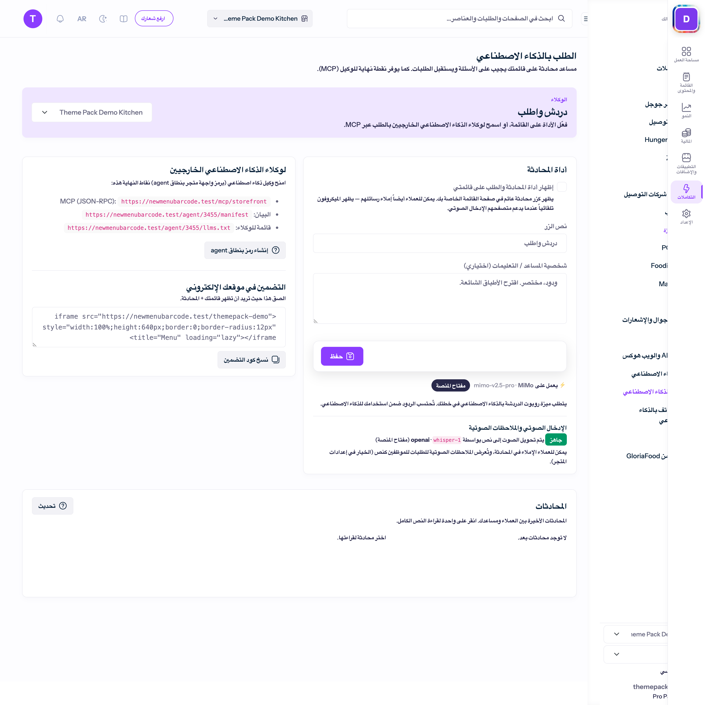

# إعدادات وكيل الذكاء الاصطناعي

يمكن أن يكون لمطعمك مساعد طلب بالذكاء الاصطناعي: مساعد محادثة يجيب عن أسئلة
القائمة ويستقبل الطلبات نيابةً عنك عبر عدة قنوات. تُوجد كل إعداداته في صفحة
واحدة — افتح **الطلب بالذكاء الاصطناعي** في الشريط الجانبي للوحة التحكم (مسار الصفحة
`ai-ordering`). إذا كنت تملك أكثر من مطعم، فاستخدم القائمة المنسدلة في أعلى
الصفحة لاختيار المطعم الذي تهيّئه؛ فكل إعداد في هذه الصفحة يخص كل مطعم على
حدة.

يتطلّب المساعد ميزة **AI chatbot** في باقتك. ويُحتسب كل رد يولّده مقابل
استخدامك للذكاء الاصطناعي، شأنه شأن سائر ميزات الذكاء الاصطناعي.

## ما يستطيع المساعد فعله

المساعد محدود عمدًا بإجراءات آمنة متعلقة بالقائمة:

- البحث في قائمتك بالاسم أو الوصف، بما في ذلك مرشّحات النباتي والحلال والسعر.
  تُوسَم الأصناف النافدة، ولا تُخفى أبدًا.
- عرض تفاصيل الصنف الكاملة — المتغيرات والإضافات.
- التحقق من سلة: تُؤخذ الأسعار دائمًا من قائمتك المباشرة، لذا لا يمكن للمساعد
  اختلاق أصناف أو أسعار.
- تقديم طلب **غير مدفوع** للاستلام أو تناول الطعام على الطاولة. تظهر طلبات
  الوكيل في مسار طلباتك المعتاد (شاشة المطبخ، المخزون، الإشعارات) موسومة
  بالمصدر "agent". يدفع العميل بالطريقة المعتادة؛ ولا يتعامل المساعد أبدًا مع
  البطاقات أو تفاصيل الدفع.
- الاستعلام عن حالة الطلب من رمز تتبّع، ومشاركة معلومات مطعمك، وإعطاء وقت
  انتظار تقديري بناءً على حِمل المطبخ الحالي.
- على قنوات الهاتف (WhatsApp وSMS) يمكنه أيضًا أن يُظهر للعميل طلباته الأخيرة
  الخاصة به ويعيد طلب آخر طلب له. يرتبط هذا برقم هاتف المُرسِل المُتحقَّق منه
  فقط — فلا يمكن لعميل أن يرى تاريخ آخر أبدًا.

ضمانات مدمجة:

- تُحدَّد الطلبات بحد أقصى 40 صنفًا، وبما لا يزيد على 30 من أي سطر واحد.
- بالنسبة للسلال الكبيرة (10 وحدات أو أكثر، أو مجموع فرعي 200 أو أكثر) يقرأ
  المساعد الطلب مجددًا ويطلب تأكيدًا صريحًا قبل تقديمه.
- إذا كان العميل مسيئًا، يجيب المساعد برفض مهذب ثابت دون استدعاء الذكاء
  الاصطناعي إطلاقًا.
- إذا طلب العميل التحدّث إلى إنسان، تُوسَم المحادثة للتحويل (راجع "قراءة
  المحادثات" أدناه) ويخبره المساعد بأن أحد أعضاء الفريق سيتابع معه.

## تشغيل أداة الدردشة

تتحكم بطاقة **أداة المحادثة** في مساعد الدردشة الظاهر على القائمة:

1. افتح **الطلب بالذكاء الاصطناعي** في الشريط الجانبي واختر المطعم.
2. ضع علامة على **Show the chat & order widget on my menu**.
3. اضبط اختياريًا **نص الزر** (حتى 120 حرفًا؛ والافتراضي "Chat &
   order").
4. اكتب اختياريًا **Assistant persona / instructions** (حتى 2,000 حرف)، مثل
   "Friendly, concise. Suggest popular dishes."
5. انقر **حفظ**.

عندما يكون المفتاح مفعّلًا، تظهر فقاعة الدردشة على صفحة قائمتك العامة —
تتوفر الأداة على جميع سمات القائمة القياسية. كما تعمل قناتا WhatsApp وSMS
أدناه، ونقاط وصول الوكيل الخارجي.

يُقيَّد معدّل الدردشة على الويب بـ 30 رسالة في الدقيقة لكل زائر.

## القنوات

يتوفر المساعد نفسه، بالقدرات والحدود نفسها، على عدة قنوات. تُعنون لوحة
**المحادثات** كل محادثة بقناتها.

- **الويب** — أداة الدردشة الظاهرة على القائمة والموصوفة أعلاه.
- **WhatsApp** — إذا فعّلت روبوت WhatsApp للمطعم (راجع [WhatsApp](whatsapp.md)،
  قسم الأتمتة)، فإن رسائل WhatsApp الواردة تمرّ عبر مساعد الطلب نفسه، بحيث
  يمكن للعملاء البحث في القائمة وتقديم طلب مباشرة في WhatsApp. وإذا لم تكن
  ميزة AI chatbot في باقتك، يعود WhatsApp إلى رد بسيط للأسئلة والأجوبة.
- **SMS** — إذا كان لمطعمك رقم SMS مربوط، يمكن للعملاء مراسلته والطلب عبر
  SMS. يُتحقَّق من أن الرسائل الواردة قادمة فعلًا من مزود SMS الخاص بك،
  وتُحترَم دائمًا كلمات إلغاء الاشتراك (STOP) قبل إرسال أي رد.
- **وكلاء ذكاء اصطناعي خارجيون (MCP)** — يمكن لمساعدي الذكاء الاصطناعي من
  جهات خارجية تصفّح قائمتك وتقديم الطلبات عبر نقاط وصول قابلة للقراءة آليًا،
  معروضة في بطاقة **For external AI agents**:
  - MCP (JSON-RPC): `/mcp/storefront`
  - Manifest: `/agent/{store-id}/manifest`
  - Menu for agents: `/agent/{store-id}/llms.txt`

  يُصادَق على الوكلاء الخارجيين برمز واجهة متجر بنطاق agent. ينقلك زر
  **Create an agent-scope token** إلى صفحة رموز API؛ راجع
  [رموز API والصلاحيات](../../dev/api/auth-tokens.md) للتفاصيل.

قنوات Instagram وMessenger وTelegram وقناة صوتية مُحدَّدة المواصفات لكنها
غير متاحة بعد.

## تضمين قائمتك في موقع آخر

يمنحك قسم **التضمين في موقعك الإلكتروني** في بطاقة الوكلاء الخارجيين مقتطف iframe
جاهزًا يعرض قائمتك (مع الدردشة، بمجرد ظهور الأداة في سمتك) داخل أي موقع آخر.
انقر على الشيفرة لتحديدها، أو استخدم **نسخ كود التضمين**، ثم الصقها في HTML
موقعك.

## قراءة المحادثات

تسرد لوحة **المحادثات** في أسفل صفحة AI ordering أحدث المحادثات (حتى 60)
بين العملاء ومساعدك، عبر جميع القنوات. يعرض كل صف القناة وعدد الرسائل، وإن
أدت المحادثة إلى طلب، رقم الطلب. انقر على محادثة لقراءة النص الكامل؛ استخدم
**تحديث** لإعادة تحميل القائمة.

تعني شارة **التحويل** الحمراء أن العميل طلب التحدّث إلى إنسان — راجع هذه
بانتظام وتابع معها بنفسك، لأن المساعد يكتفي بوسم المحادثة، ولا يُشعر
الموظفين بأي طريقة أخرى.

الخصوصية: النصوص المخزّنة مُنقّاة من المعلومات الشخصية — تُخفى أرقام الهواتف
والتفاصيل الشخصية المشابهة في رسائل العملاء قبل الحفظ.

## اللغة

يكتشف المساعد لغة العميل من رسائله ويرد بتلك اللغة في بقية المحادثة. لست
بحاجة إلى تهيئة أي شيء؛ راجع [الترجمات](translations.md) لمحتوى القائمة نفسه.

## صفحات ذات صلة

- [WhatsApp](whatsapp.md) — إعداد المزود ومفتاح روبوت WhatsApp
- [الطلبات](orders.md) — حيث تصل الطلبات التي يقدّمها الوكيل
- [مولّد القائمة بالذكاء الاصطناعي](ai-menu-generator.md) — ميزة ذكاء
  اصطناعي منفصلة لبناء قائمتك
- [رموز API والصلاحيات](../../dev/api/auth-tokens.md) — رموز بنطاق agent للوكلاء
  الخارجيين
