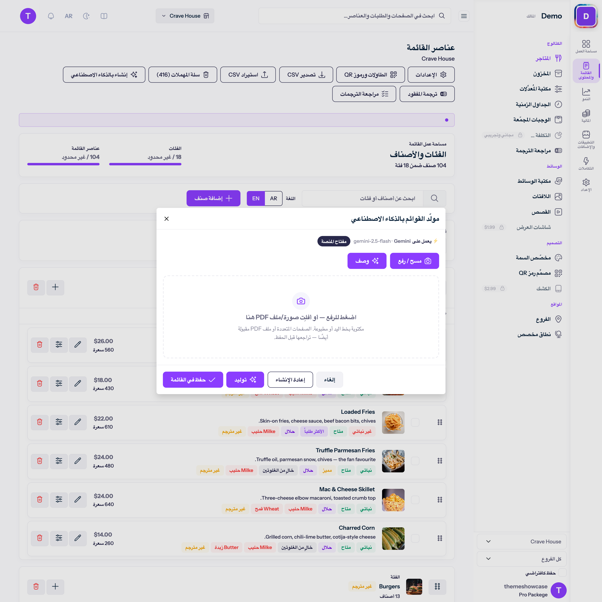

# مولّد القائمة بالذكاء الاصطناعي ومسح القائمة

بدلًا من إدخال قائمتك صنفًا صنفًا، يمكنك أن تدع الذكاء الاصطناعي يبنيها لك.
هناك طريقتان: مسح قائمة موجودة (صورة أو ملف PDF لقائمتك المطبوعة)، أو وصف
مطعمك ودع الذكاء الاصطناعي يقترح قائمة من الصفر. في كلتا الحالتين تُراجع
النتيجة وتحرّرها دائمًا قبل حفظ أي شيء.

ستجد الأداة في مساحة عمل القائمة: افتح **المتاجر** في الشريط الجانبي،
وانقر **تعديل القائمة** على المطعم، ثم انقر زر **إنشاء بالذكاء الاصطناعي** في أعلى الصفحة.
تُفتح نافذة بتبويبين: **مسح / رفع** و**وصف**.

للطريقة اليدوية في إدارة الأصناف، راجع [إدارة أصناف القائمة](menu-items.md)
و[فئات القائمة](menu-categories.md).

## مسح صورة أو ملف PDF

استخدم تبويب **مسح / رفع** عندما تكون لديك قائمة بالفعل — مطبوعة أو
مكتوبة بخط اليد أو كملف PDF.

1. انقر منطقة الرفع (أو اسحب الملفات إليها). يمكنك اختيار صور أو PDF أو عدة
   ملفات دفعة واحدة — مثل وجهَي قائمة مطوية مصوّرَين بشكل منفصل.
2. انقر **توليد**. تُقرأ كل صفحة بالتتابع وترى تقدمًا مثل "Reading page
   2/3". يُدمج الإدخال متعدد الصفحات في مسودة واحدة: تُدمج الفئات ذات الاسم
   نفسه، ويُحتفَظ بالصنف الذي يظهر في أكثر من صفحة مرة واحدة (وتُملأ الأسعار
   أو الأوصاف الناقصة في صفحة من صفحة أخرى).
3. راجع المسودة (انظر أدناه) وانقر **حفظ في القائمة**.

ما يفعله الماسح وما لا يفعله:

- يحافظ على لغة قائمتك كما كُتبت — لا يُترجَم شيء.
- لا يختلق الأسعار أبدًا. إذا كان السعر غير مقروء، يُترَك الحقل فارغًا
  ويُبرَز في خطوة المراجعة كي تملأه.
- يلتقط تسعير الأحجام (مثل "Small 10 / Large 15") كمتغيرات، والإضافات
  المدفوعة (مثل "+ cheese 2") كإضافات، لكن فقط عندما تكون مطبوعة فعلًا على
  القائمة.

الحدود: يمكن أن يصل حجم كل ملف إلى 15 ميجابايت، وتُقرأ حتى 15 صفحة من ملف
PDF، ويمكن دمج حتى 30 صفحة في تشغيل واحد. وإذا فشلت قراءة إحدى الصفحات، تمرّ
الأخريات رغم ذلك.

## وصف مطعمك

استخدم تبويب **وصف** عندما تبدأ من جديد وليس لديك قائمة لمسحها.

1. اكتب وصفًا قصيرًا لمطعمك أو مطبخك، مثل "A cozy Italian trattoria with
   pizzas, pastas, and desserts". يمكنك أن تكون محددًا — اذكر الأطباق، وكم
   فئة تريد، أو نطاقًا سعريًا، وسيتبع الذكاء الاصطناعي ذلك.
2. اختياريًا، ضع علامة على **Also suggest variants (e.g. sizes) and paid
   extras** إذا أردت أن يضيف الذكاء الاصطناعي خيارات أحجام وإضافات حيث تكون
   منطقية.
3. انقر **توليد**.

على عكس المسح، هذا الوضع إبداعي: يخترع الذكاء الاصطناعي قائمة مناسبة (عادةً
من 3 إلى 6 فئات بها من 4 إلى 8 أصناف لكل فئة) بأسعار مقترحة. تُكتب القائمة
باللغة نفسها التي كُتب بها وصفك. تعامل مع الأسعار كعناصر نائبة — راجعها
وعدّلها قبل الحفظ.

## راجع المسودة قبل الحفظ

لا يُضاف شيء إلى قائمتك حتى تؤكّد. تعرض شاشة المراجعة الفئات والأصناف
المُولَّدة، وكل شيء قابل للتحرير:

- غيّر أسماء الفئات وأسماء الأصناف والأسعار مباشرة في الحقول.
- تُبرَز الأصناف بلا سعر؛ اترك السعر فارغًا لحفظ الصنف مجانًا (السعر 0).
- تظهر المتغيرات والإضافات كشرائح صغيرة أسفل الصنف — انقر × على شريحة
  لإزالة واحدة.
- أزِل صنفًا بـ × على صفه، أو انقر **إضافة صنف** داخل فئة لإضافة صنف يدويًا.
- غير راضٍ عن النتيجة؟ انقر **إعادة الإنشاء** للعودة والمحاولة مجددًا.

انقر **حفظ في القائمة** لإنشاء الفئات والأصناف. تُلحَق بعد فئاتك الحالية
وتُحتسَب ضمن حدود الفئات والأصناف في باقتك — إذا بلغت حدًا في منتصف الحفظ،
يُتخطّى الباقي وتخبرك رسالة التأكيد بذلك.

## صور الذكاء الاصطناعي للأصناف الجديدة

إذا كان توليد الصور بالذكاء الاصطناعي مفعّلًا في منصتك، تعرض شاشة المراجعة
مربع اختيار: **Generate AI photos for these items (runs in the background
after saving)**. ضع علامة عليه، وبعد حفظ القائمة، تُولَّد صور لما يصل إلى 40
من الأصناف الجديدة بينما تواصل عملك. يعرض شريط تقدّم في صفحة القائمة مدى
تقدمه، وتظهر الصور على أصنافك عند اكتمالها. تُتخطّى الأصناف التي لها صورة
بالفعل.

إذا لم ترَ مربع الاختيار، فإن توليد الصور غير مهيَّأ في منصتك — لا يزال
بإمكانك رفع صورك الخاصة كما هو موضّح في [إدارة أصناف القائمة](menu-items.md).

## ترجمة القائمة المُولَّدة

يحافظ المولّد على قائمتك (أو يكتبها) بلغة واحدة. إذا كانت قائمتك مُعدّة بأكثر
من لغة، يظهر زر **ترجمة المفقود** بجوار **إنشاء بالذكاء الاصطناعي**. يفتح نافذة
تؤكّد فيها أولًا اللغة التي كُتبت بها قائمتك حاليًا، ثم يملأ الذكاء
الاصطناعي الترجمات الناقصة في الخلفية — اختر لغة المصدر بعناية، لأن الترجمة
من اللغة الخطأ تعطي نتائج خاطئة أو فارغة. يُعرَض التقدم على الزر، وتسرد صفحة
**مراجعة الترجمات** الحقول المترجمة آليًا للتحقق منها.

ملاحظة: كان بإمكان إصدار سابق عرض الإنجليزية مرتين في قوائم اللغات بسبب مدخل
لغة مكرّر. وقد أُصلح هذا — أصبحت اللغات فريدة الآن، لذا تظهر كل لغة مرة واحدة
في نافذة الترجمة.

## استكشاف الأخطاء وإصلاحها

- "No menu items could be read from the input" — كانت الصورة ضبابية جدًا أو
  النص صغيرًا جدًا. أعِد التقاط الصورة من مسافة أقرب وأكثر استواءً، أو جرّب
  صفحة واحدة في كل مرة.
- "That file is not an image or PDF" / "A file is too large (max 15 MB
  each)" — تُقبل الصور وملفات PDF فقط، حتى 15 ميجابايت لكل ملف.
- رسالة عن بلوغ حدك من الذكاء الاصطناعي — يُحتسب استخدام الذكاء الاصطناعي حسب
  باقتك؛ حاول لاحقًا أو قم بالترقية.
- "The AI service is unavailable right now" — مشكلة مؤقتة في المزود؛ انتظر
  لحظة وانقر **توليد** مجددًا.
- "Some were skipped — you reached your plan limit" بعد الحفظ — احتوت
  المسودة على فئات أو أصناف أكثر مما تسمح به باقتك؛ حُفظ الباقي.
