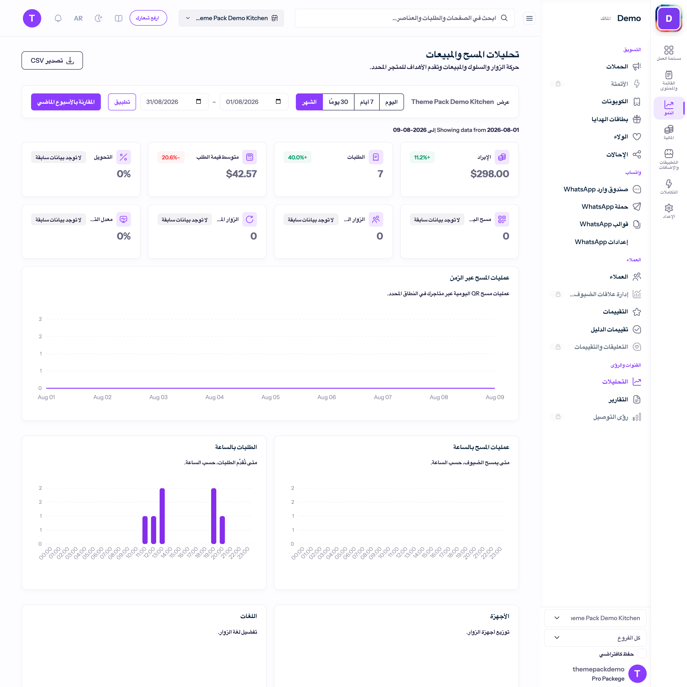

# التحليلات والتقارير

تعرض صفحة **التحليلات** في الشريط الجانبي أداء قائمتك: حركة مسح رمز QR،
والطلبات والإيرادات، وأداء كل صنف، وأين يتوقف الزبائن بين التصفّح والدفع. كل
ما في الصفحة مقصور على مطاعمك أنت — فإذا كنت تملك عدة مطاعم، تُجمَع الأرقام
عبرها جميعًا.

إلى أن يمسح الزبائن رمز QR أو يقدّموا طلبات، سترى عنصرًا نائبًا يقول "No
analytics yet". راجع [رموز QR](qr-codes.md) لعرض رموزك أمام الضيوف
و[إدارة الطلبات](orders.md) لاستقبال الطلبات.

## اختيار نطاق تاريخي

في أعلى الصفحة، يتحكم **شريط الفترة** المشترك (نفسه الموجود في لوحة التحكم)
في كل رقم ورسم بياني تقريبًا: شرائح جاهزة لـ **اليوم** و**7 days** و**30
days** و**الشهر**، إضافةً إلى نطاق مخصص من–إلى مع **تطبيق** ومفتاح مقارنة.
يؤدي تغيير الفترة إلى إعادة تحميل الصفحة فورًا. ويُستخدم النطاق نفسه لزر
**تصدير CSV** المجاور له.

يُطبَّق دائمًا إطار زمني — لا يوجد عرض "كل الأوقات". وأسفل شريط الفترة
مباشرة، تطبع الصفحة الإطار الذي استخدمته فعلًا: **"Showing data from <date>
to <date>"**. اقرأ هذا السطر لتعرف بالضبط أي شريحة تنظر إليها، لأن حاويات
التحليلات أخشن من إعدادات الفترة الجاهزة: يُحلَّل **اليوم** بوصفه آخر 7
أيام، ويُحلَّل النطاق **المخصص** بوصفه هذا الشهر. ويعود النطاق غير المعروف
إلى آخر 7 أيام بدلًا من التوسّع.

## بطاقات مؤشرات الأداء ومقارنة الفترات

يعرض أعلى الصفحة ثماني بطاقات: **الإيراد** و**الطلبات** و**AOV** (متوسط قيمة
الطلب) و**التحويل** و**مسح الباركود** و**الزوار الفريدون** و**الزوار المتكررون**
و**معدل التكرار**.

كيفية احتسابها:

- **Revenue وOrders وAOV** — تُحتسب الطلبات الناجحة فقط: طلب مكتمل أو مدفوع.
  ومتوسط قيمة الطلب هو الإيرادات مقسومة على عدد تلك الطلبات.
- **التحويل** — الطلبات الناجحة مقسومة على عمليات المسح، كنسبة مئوية.
- **مسح الباركود** — كل زيارة لقائمتك العامة عبر رابط QR.
- **الزوار الفريدون** — الزوار المتمايزون (يُقاسون بعنوان IP).
- **Repeat scanners / Repeat rate** — الزوار الذين مسحوا أكثر من مرة في
  النطاق، وحصّتهم من الزوار الفريدين.

تحمل كل بطاقة شارة اتجاه تقارن النطاق الحالي بالفترة المساوية التي سبقته —
مثلًا تُقارَن آخر 7 أيام بالـ 7 أيام السابقة لها، وهذا الشهر بالشهر الماضي.
تعرض الشارة نسبة التغيّر واتجاهه ("+12.4% vs prev"). وإذا لم يكن للفترة
السابقة بيانات، تقول البطاقة "No prior data" بدلًا من ذلك. لا يوجد محدد
مخصص "قارن أي تاريخين"؛ فالمقارنة دائمًا مع الفترة السابقة مباشرة.

إذا حددت هدفًا، تعرض البطاقة المطابقة أيضًا شريط تقدّم بنسبة الهدف المُحقَّق،
مقيسة مقابل إجمالي النطاق المحدد. يُتتبَّع نوع هدف واحد فقط في المرة. لتحديد
هدف أو تغييره، استخدم نموذج الهدف في [لوحة التحكم](dashboard-overview.md#setting-a-goal)
— اختر Scans أو Orders أو Revenue وأدخل رقمك المستهدف. يؤدي تعيين القيمة إلى
0 إلى مسح الهدف.

## تحليلات المسح

أسفل البطاقات، تفصّل مجموعة من الرسوم البيانية حركتك:

- **عمليات المسح عبر الزمن** — عمليات المسح اليومية عبر النطاق المحدد.
- **عمليات المسح بالساعة** — أي ساعات اليوم يمسح فيها الزبائن، كي ترى أوقات ذروة
  تصفّح قائمتك.
- **الأجهزة** — حصة الزوار حسب الجوال واللوحي وسطح المكتب.
- **اللغات** — لغة متصفّح الزوار المفضّلة، وهي مفيدة لتقرير أي
  [ترجمات](translations.md) تستثمر فيها.
- **مصادر الزيارات** — تظهر عندما تحمل روابط المسح لديك وسم مصدر. أضف
  `?src=window-sticker` (أو `?utm_source=...` القياسي) إلى رابط QR الذي
  تطبعه لكل موضع، وتعرض هذه القائمة أهم المصادر للفترة. أما عمليات المسح غير
  الموسومة فتُجمَّع كـ "Direct".

## تحليلات الطلبات والمبيعات

توجد أرقام المبيعات في بطاقات مؤشرات الأداء (Revenue وOrders وAOV
وConversion) وفي رسم **الطلبات بالساعة** الذي يعرض متى تُقدَّم الطلبات حسب
ساعة اليوم — قارنه بـ Hourly scans لترى ما إذا كانت ذُرى التصفّح تتحوّل إلى
ذُرى طلب.

تستخدم الإيرادات إجمالي كل طلب، بالعملة المهيّأة لمطعمك. أما الطلبات غير
المدفوعة أو الملغاة أو التي لا تزال معلّقة فلا تُحتسب كإيرادات حتى تكتمل أو
تُدفَع.

## أداء كل صنف

يرتّب جدول **أبرز العناصر** أصناف قائمتك حسب الطلبات (وتُحسم التعادلات بالمشاهدات)
ويعرض أعلى 10 للنطاق:

- **المشاهدات** — كم مرة فُتح عرض تفاصيل الصنف على قائمتك العامة.
- **السلات** — كم مرة أُضيف إلى سلة.
- **الطلبات** — إجمالي الكمية المباعة في الطلبات الناجحة.
- **تحويل السلة** — الإضافات إلى السلة كنسبة مئوية من المشاهدات.
- **تحويل الطلب** — الكمية المباعة كنسبة مئوية من المشاهدات.

الصنف ذو المشاهدات الكثيرة والتحويل المنخفض للطلبات عادةً ما تكون به مشكلة في
الصورة أو الوصف أو السعر — إذ ينظر الزبائن دون أن يشتروا.

أسفل الجدول، تعرض **خريطة حرارية للفئات** كثافة المشاهدة والإضافة إلى السلة
النسبية لما يصل إلى 12 فئة، كي ترى أي أقسام القائمة تجذب الانتباه وأيها
يُتخطّى.

## مصفوفة هندسة القائمة

تصنّف بطاقة **هندسة القائمة** كل صنف في قائمة حسب الرواج (الوحدات
المطلوبة) وهامش الربح (السعر ناقص التكلفة)، مستخدمةً النموذج الكلاسيكي ذا
الأرباع الأربعة:

- **نجم** — يُباع جيدًا ويربح جيدًا. احمِ هذه وروّج لها.
- **حصان الجر** — رائج لكن هامشه منخفض. فكّر في زيادة سعرية صغيرة أو وصفة
  أرخص.
- **لغز** — هامش مرتفع لكنه نادر الطلب. قد تساعد صورة أفضل أو موضع أفضل أو
  وصف أفضل.
- **كلب** — غير رائج وهامشه منخفض. مرشّح لإعادة الصياغة أو الإزالة.

إذا كنت تملك أكثر من مطعم، يبدّل محدد على البطاقة بينها. تنظر المصفوفة في آخر
12 شهرًا من الطلبات بغض النظر عن النطاق التاريخي للصفحة. تُقسَم الأصناف عند
الوسيط، لذا تحصل دائمًا على مزيج من الأصناف عالية الأداء ومنخفضته بدلًا من أن
يقع كل شيء في فئة واحدة.

إذا لم تكن لأصنافك تكلفة مسجّلة، تتدهور المصفوفة بلطف وتعرض **الأكثر طلباً** /
**غير رائج** بدلًا من الفئات الأربع القائمة على الهامش، ويعرض عمود الهامش
شرطة.

يعرض عمود **View→order** الكمية المباعة كنسبة مئوية من المشاهدات، وتُبرِز
علامة تحذير الأصناف ضعيفة الأداء: الأصناف المُشاهَدة 10 مرات على الأقل بمعدل
مشاهدة-إلى-طلب دون 10٪.

## قمع التحويل

يعرض قسم **مسار التحويل** كيف يتنقّل الزبائن عبر أربع مراحل وأين
يتوقفون:

1. **تصفّح** — مشاهدات تفاصيل الأصناف على قائمتك العامة.
2. **أضف إلى السلّة** — الأصناف المُضافة إلى السلال.
3. **Order placed** — كل الطلبات المُنشأة في النطاق.
4. **طلب مدفوع** — الطلبات التي اكتملت أو دُفعت.

تعرض كل خطوة عددها ونسبة التوقّف مقارنةً بالخطوة السابقة. يشير الانخفاض
الكبير بين Browse وAdd to cart إلى محتوى القائمة (الصور، الأسعار)؛ ويشير
الانخفاض بين Placed وPaid إلى مشكلات في الدفع أو إتمام الطلب.

## تصدير تقرير CSV

انقر **تصدير CSV** في أعلى الصفحة لتنزيل تقرير جاهز لجداول البيانات للنطاق
المحدد. يحتوي الملف على ثلاثة أقسام:

- **نظرة عامة** — النطاق، وصف **Window** بتواريخ من–إلى الدقيقة التي تغطّيها
  الأرقام (نفس الإطار المطبوع على الصفحة)، ووقت التوليد.
- **المقاييس الموجزة** — عمليات المسح، والزوار الفريدون، ومعدّل التكرار،
  والإيرادات، وعدد الطلبات، ومتوسط قيمة الطلب، ومعدّل التحويل.
- **أداء عناصر القائمة** — كل صنف مع السعر والمشاهدات والإضافات إلى السلة
  والطلبات وكلا معدّلي التحويل وعمود حالة: **الأكثر مبيعا** (تحويل طلب 20٪ أو
  أكثر)، أو **صنف راكد** (أكثر من 5 مشاهدات وصفر طلبات)، أو **جيّد**.

يُفتح الملف مباشرة في Excel أو Google Sheets. لا تتوفر التصديرات المجدوَلة
أو بصيغة PDF؛ فالتصدير حسب الطلب بصيغة CSV فقط.

## الملخص الأسبوعي وتنبيهات انخفاض المسح

يمكن تشغيل تقريرَين عبر البريد الإلكتروني ضمن **الإعدادات** في الشريط
الجانبي:

- **ملخص التحليلات الأسبوعي بالبريد** — كل صباح إثنين تتلقّى عمليات مسح
  الأسبوع الماضي، والزوار الفريدين، والإيرادات، وعدد الطلبات، ومعدّل التحويل.
- **تنبيهات انخفاض المسح اليومية** — فحص يومي يراسلك عندما تنخفض عمليات مسح اليوم
  بنسبة 40٪ أو أكثر دون متوسطك على مدى آخر 7 أيام كاملة، كي تكتشف رمز QR
  معطّلًا أو خطأ طباعة بسرعة.

كلاهما مُطفأ افتراضيًا. اضبط كلًا منهما على **مفعّل** واحفظ.

## صفحات ذات صلة

- [نظرة عامة على لوحة التحكم](dashboard-overview.md) — الأرقام السريعة على
  شاشتك الرئيسية.
- [إدارة الطلبات](orders.md) — الحالات التي تحدد ما يُحتسب طلبًا ناجحًا.
- [المخزون](inventory.md) — التكاليف على مستوى المكوّنات وتقارير تكلفة الطعام.
- [رموز QR](qr-codes.md) — إنشاء الرموز التي تولّد عمليات المسح ووضعها.
