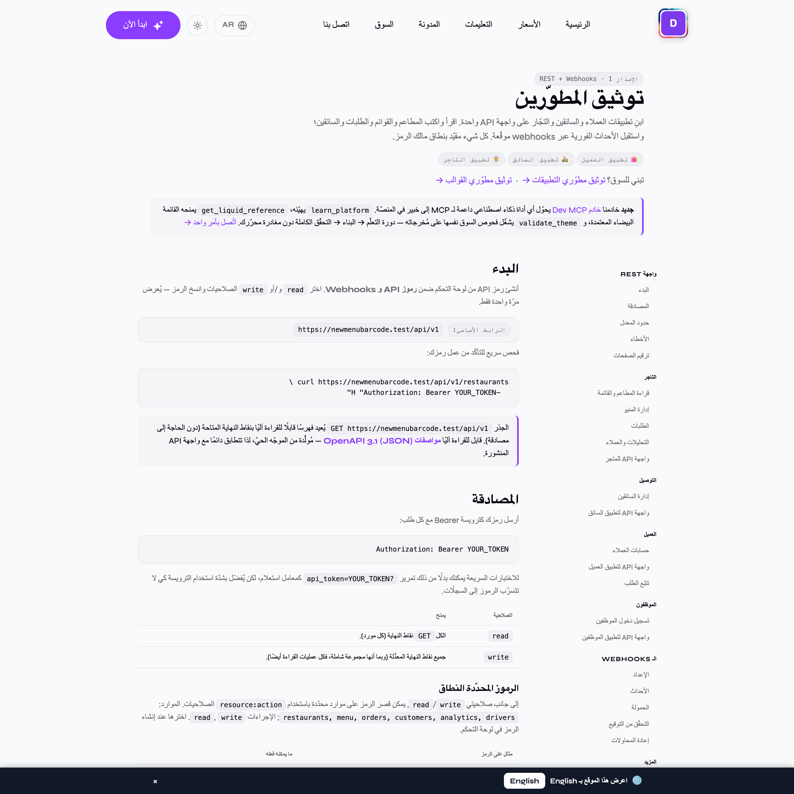

# رموز API (للمالكين)

تتيح رموز API للبرمجيات الخارجية العمل مع بيانات مطعمك — مثل نظام نقاط بيع
يقرأ الطلبات، أو موقع ويب يعرض قائمتك، أو مساعد ذكاء اصطناعي يدير الأصناف
نيابةً عنك. تُنشئ جميع الرموز وتلغيها من صفحة واحدة في لوحة التحكم، ولست
مضطرًا أبدًا إلى كتابة شيفرة بنفسك: تنشئ الرمز، ثم تسلّمه لمن يبني التكامل.

هناك نوعان من الرموز، لوظيفتين مختلفتين:

- **API tokens** — تخص حسابك ويمكنها الوصول إلى جميع مطاعمك. استخدمها لأدوات
  المكتب الخلفي الموثوقة (نقاط البيع، التقارير، الأتمتة). واحتفظ بها سرية.
- **رموز واجهة المتجر** — تخص مطعمًا واحدًا ومخصصة للاستخدام العام، مثل موقع
  ويب مستقل عن الواجهة (headless) أو وكيل طلب بالذكاء الاصطناعي.

## أين تجدها

افتح **واجهة API والويب هوكس** في الشريط الجانبي للوحة التحكم. تعرض الصفحة نموذج
**إنشاء رمز**، وبطاقة **MCP server**، ورموزك الموجودة **الرموز**،
و**رموز واجهة المتجر**، و**Webhook endpoints**، وسجل **أحدث عمليات التسليم**.
يفتح زر **API documentation** في الأعلى وثائق المطوّرين العامة، وهي ما ترسله
لمن يبني التكامل.

## إنشاء رمز API

1. في بطاقة **إنشاء رمز**، أدخل **الاسم** يبيّن الغرض من الرمز، مثل "POS
   integration". يمكنك امتلاك عدة رموز؛ وتسميتها يجعل إلغاء أحدها آمنًا دون
   تعطيل الأخرى.
2. اختر واحدة أو أكثر من **الصلاحيات** (اضغط Cmd/Ctrl للتحديد المتعدد). إذا
   لم تختر شيئًا، يحصل الرمز على `read`. راجع القسم التالي لمعرفة معنى كل
   صلاحية.
3. اضبط اختياريًا **تنتهي خلال أيام** (من 1 إلى 3650). اتركها فارغة فلا
   ينتهي الرمز أبدًا.
4. انقر **إنشاء رمز**.

يظهر الرمز الجديد مرة واحدة في شريط أخضر أعلى الصفحة. انسخه فورًا — إذ
يُخزَّن بشكل مشفّر ولا يمكن عرضه مجددًا أبدًا. إذا فقدته، فألغِه وأنشئ رمزًا
جديدًا.

يعرض جدول **الرموز** اسم كل رمز وصلاحياته وتاريخ انتهائه ومتى استُخدم آخر
مرة. علامة "Last used: Never" مؤشر جيد على أن الرمز يمكن إلغاؤه بأمان.

## الصلاحيات

تتحكم الصلاحيات في ما يُسمح للرمز بفعله:

- **read (all)** — يمكنه عرض كل شيء: المطاعم، القائمة، الطلبات، العملاء،
  التحليلات، السائقون. ولا يمكنه تغيير أي شيء.
- **write (all)** — يمكنه عرض كل شيء وتغييره. تتضمّن الكتابة القراءة دائمًا.
- **Scoped abilities** — تقصر الرمز على مجال واحد، بصيغة `resource:action`.
  الموارد هي `restaurants` و`menu` و`orders` و`customers` و`analytics`
  و`drivers`، ولكل منها متغيّر `:read` ومتغيّر `:write`. مثلًا، لا يحتاج
  تكامل شاشة المطبخ سوى `orders:read`؛ وتحتاج أداة مزامنة القائمة إلى
  `menu:write`.

امنح كل تكامل أصغر صلاحية تؤدي المهمة. فالرمز الذي يحمل `orders:write` لا
يمكنه المساس بقائمتك أو بيانات عملائك حتى لو تسرّب.

كل رمز، مهما كانت صلاحياته، مقصور على مطاعمك أنت — ولا يمكنه أبدًا رؤية
بيانات حساب آخر. وتُقيَّد استدعاءات API بمعدّل 120 طلبًا في الدقيقة.

## إنشاء رمز واجهة متجر

رموز واجهة المتجر خاصة بكل مطعم ومصنوعة للاستخدام العام، لذا فإن رمز قراءة
قائمة مُتسرّب لا يمكنه إلحاق الضرر بأي شيء آخر.

1. في بطاقة **رموز واجهة المتجر**، اختر **المطعم** المخصص له الرمز.
   (إذا لم يكن لديك مطعم بعد، فأنشئ واحدًا أولًا.)
2. اختر واحدًا أو أكثر من **النطاقات**:
   - `menu:read` — تصفّح القائمة فقط. آمن للتضمين في موقع أو تطبيق عام. وهو
     الافتراضي.
   - `order:write` — تقديم الطلبات على ذلك المطعم. أقوى؛ لا تمنحه إلا
     للبرمجيات التي تثق بها.
   - `agent` — يتيح لوكيل ذكاء اصطناعي تشغيل واجهة متجر المطعم عبر نقطة
     وصول الوكيل. تشرح صفحة [وكلاء الذكاء الاصطناعي](ai-agents.md) هذا
     الإعداد.
3. أضف اختياريًا **العنوان** مثل "Website" كي تميّز الرموز لاحقًا.
4. انقر **إنشاء رمز واجهة المتجر** وانسخ القيمة من الشريط الأخضر — مثل
   رموز API، تُعرَض مرة واحدة فقط.

يسرد الجدول أسفل النموذج مطعم كل رمز واجهة متجر ووسمه ونطاقاته وآخر استخدام
له.

## إلغاء رمز

انقر **إلغاء** بجوار أي رمز في جدول **الرموز** أو **رموز واجهة المتجر**
وأكّد. الإلغاء فوري: يُرفَض الطلب التالي المُقدَّم بذلك الرمز. ولا يمكن
التراجع عن الإلغاء — إذا كان ينبغي أن يستمر التكامل في العمل، فأنشئ رمزًا
بديلًا أولًا، وحدّث التكامل، ثم ألغِ القديم. وهذا التبديل (أنشئ ثم ألغِ) هو
أيضًا طريقة تدوير الرموز وفق جدول زمني.

## خادم MCP

تعرض بطاقة **MCP server** في الصفحة نفسها نقطة الوصول لربط عميل ذكاء اصطناعي
متوافق مع MCP (مثل Claude) كي يشغّل مطعمك بلغة طبيعية. يُصادَق عليه برموز
API نفسها: يسمح رمز `read` بأدوات العرض، ويتطلّب تغيير الطلبات أو أصناف
القائمة رمزًا يحمل صلاحية `write`.

## الويب هوكس

تدير الصفحة نفسها أيضًا **Webhook endpoints** — روابط تُخطَر عند إنشاء طلب
أو تغيّر حالته أو دفعه، مع زر **Test** وسجل تسليم. أما إعداد الجهة المستقبِلة
فهو عمل تطويري؛ راجع [الويب هوكس](../../dev/api/webhooks.md).

## للمطوّرين

سلّم هذه الصفحات لمن يبني على رموزك:

- [رموز API والصلاحيات](../../dev/api/auth-tokens.md) — كيفية إرسال الرمز ومعنى
  رموز الأخطاء.
- [Storefront API](../../dev/api/storefront.md) — واجهة API العامة الخاصة بكل
  مطعم التي تفتحها رموز واجهة المتجر.
- [الويب هوكس](../../dev/api/webhooks.md) — التحقق من التواقيع ومعالجة إعادة
  المحاولات.

صفحات ذات صلة للمالك: [وكلاء الذكاء الاصطناعي](ai-agents.md)،
[نظرة عامة على لوحة التحكم](dashboard-overview.md).
