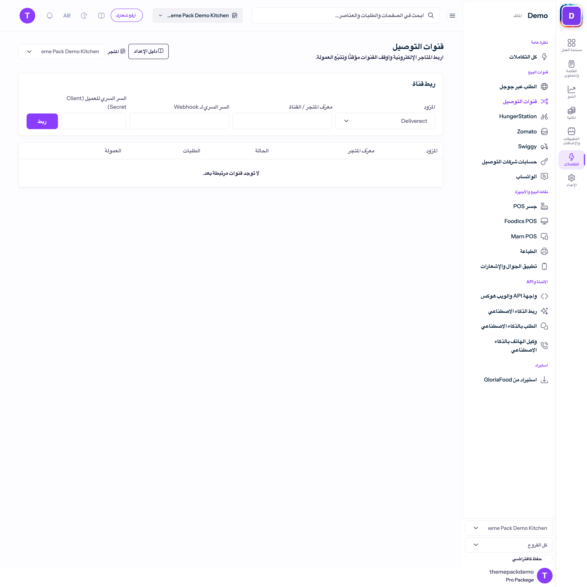

# التطبيقات والتكاملات

يمكن توسيع حسابك عبر تطبيقات من جهات خارجية ومجموعة صغيرة من تكاملات التتبّع المدمجة. تبنيها جهات مطوّرة خارجية، وتعمل على خوادمها الخاصة، وتتصل بحسابك عبر أذونات محددة النطاق وقابلة للإلغاء. تشرح هذه الصفحة كيفية العثور على التطبيقات وتثبيتها، وما يحدث عند تثبيت تطبيق أو إلغاء تثبيته، وكيف تعمل التطبيقات المضمّنة، وكيف تُفوتَر التطبيقات المدفوعة، وكيفية إعداد تكاملات التحليلات والخطوط بأمان.

## ما هو التطبيق

التطبيق منتج خارجي مُسجَّل يتصل بحسابك. تعمل شيفرته بالكامل على خوادم المطوّر — فتثبيته لا يضيف أي شيفرة إلى موقعك. ما يحصل عليه التطبيق هو وصول API محدد النطاق: مجموعة من الأذونات المسمّاة يمكنه استخدامها لقراءة أشياء محددة في حسابك أو تغييرها نيابةً عنك، إضافةً إلى اشتراك ويب هوك اختياري كي يُخطَر عند وقوع الأحداث (مثلًا عند دفع طلب).

لا تظهر لك سوى التطبيقات التي راجعتها المنصة ووافقت عليها. أما التطبيقات المعلّقة أو المرفوضة أو المسودة فلا تُدرَج أو تُثبَّت أبدًا.

## العثور على التطبيقات وتثبيتها

تُوجد قائمة التطبيقات على العنوان `/apps` في لوحة التحكم لديك. تعرض كل تطبيق مُوافَق عليه كبطاقة تحمل اسم التطبيق ووصفه والأذونات الدقيقة التي يطلبها، وتشير إلى ما إذا كنت قد ثبّته حاليًا.

لتثبيت تطبيق:

1. افتح صفحة التطبيقات وابحث عن التطبيق الذي تريده.
2. اقرأ الأذونات المدرجة على البطاقة. هذه هي النطاقات التي سيُمنَحها التطبيق.
3. انقر Install.

يمنح التثبيت التطبيق أذوناته المدرجة فورًا. إذا نشر التطبيق اشتراك ويب هوك، تُنشأ نقطة تسليم لحسابك في الوقت نفسه كي يبدأ التطبيق باستقبال الأحداث التي طلبها. كما تأخذ التطبيقات المدفوعة أول دفعة لها عند هذه النقطة (راجع الفوترة أدناه) — وإذا فشلت تلك الدفعة، يُلغى التثبيت بشكل نظيف ولا يُمنَح أي وصول.

تعرض البطاقة شارة Installed بمجرد أن يصبح التطبيق نشطًا. وتؤدي إعادة تثبيت تطبيق أزلته سابقًا إلى إعادة تفعيل السجل الأصلي بدلًا من إنشاء نسخة مكرّرة.

## إلغاء تثبيت تطبيق

انقر Uninstall على بطاقة تطبيق مُثبَّت وأكّد. إلغاء التثبيت فوري ويفعل ثلاثة أشياء:

- يلغي كل رمز وصول يحمله التطبيق لحسابك، فيفقد المطوّر وصول API على الفور.
- يُخطِر التطبيق بأنه أُلغي تثبيته (عبر ويب هوك موقّع `app.uninstalled`) كي يتمكن المطوّر من التنظيف في جانبه.
- يوقف كل عمليات تسليم الويب هوك المستقبلية إلى ذلك التطبيق.

يُحتفَظ بسجل التثبيت بعد ذلك كمسار تدقيق؛ وهو لا يمنح أي وصول.

## التطبيقات المضمّنة

تتضمّن بعض التطبيقات واجهة مضمّنة — شاشة من التطبيق تظهر داخل لوحة التحكم لديك بدلًا من موقع منفصل. لا يمكنك فتح تطبيق مضمّن إلا بعد تثبيته.

تعمل التطبيقات المضمّنة داخل إطار معزول ولا تحتفظ أبدًا بكلمة مرور طويلة الأمد في متصفّحك. بدلًا من ذلك، تسلّم لوحة التحكم للتطبيق رمز جلسة جديدًا يدوم 60 ثانية ويُجدَّد تلقائيًا ما دامت الشاشة مفتوحة لديك. لا يمكن أن يستقبل ذلك الرمز إلا موقع التطبيق نفسه، وينتهي أي رمز مُعترَض خلال دقيقة. هذه هي الآلية التي تستخدمها التطبيقات لإجراء استدعاءات API نيابةً عنك بينما تنظر إلى شاشتها.

## الفوترة على التطبيقات

تعلن التطبيقات عن أحد ثلاثة نماذج فوترة، وتُؤخذ كل رسوم من [محفظة](wallet.md) حسابك — الرصيد نفسه المستخدم لعمليات الشحن والميزات الأخرى المُقاسة.

- Free — لا رسوم للتثبيت أو الاستخدام.
- Recurring — سعر ثابت يُحصَّل كل دورة فوترة. تُحصَّل الدورة الأولى عند التثبيت؛ والدورة القياسية 30 يومًا ما لم ينص التطبيق على خلاف ذلك. وتُحصَّل التجديدات تلقائيًا في نهاية كل دورة.
- Usage — مُقاسة من قِبل التطبيق. لا توجد رسوم ثابتة؛ يبلّغ التطبيق عن مقدار ما استخدمته (مثلًا عدد الرسائل أو استدعاءات API) وتُحصَّل منك رسوم لكل وحدة عمّا يبلّغ عنه.

بما أن الرسوم تأتي من محفظتك، احتفظ برصيد كافٍ لتغطية التطبيقات المدفوعة. السلوكيات الرئيسية التي ينبغي معرفتها:

- إذا تعذّر تغطية تجديد متكرّر من محفظتك، يُعلَّق التطبيق بدلًا من إلغاء تثبيته. يتوقف وصوله، لكن يُحفَظ منح الإذن. وبمجرد أن تشحن محفظتك، يُعاد تفعيل التطبيق عند رسمه التالي — دون حاجة إلى إعادة تثبيته أو الموافقة عليه من جديد.
- لا يبلّغ عن رسوم الاستخدام إلا التطبيق الذي ثبّته، ولحسابك فقط، وتُسجَّل بحيث لا يُحصَّل الاستخدام المُبلَّغ عنه نفسه مرتين أبدًا.
- تؤدي رسوم فاشلة عند التثبيت إلى إلغاء التثبيت؛ فلا تبقى لديك تطبيق مثبَّت نصفيًا.

اشحن محفظتك من صفحة Wallet قبل تثبيت تطبيق مدفوع إذا كان رصيدك منخفضًا. راجع [المحفظة](wallet.md) و[الباقات والفوترة](plans-billing.md) لمعرفة كيفية عمل الفوترة عبر حسابك.

## التكاملات المُهيكَلة (التحليلات والخطوط)

بمعزل عن التطبيقات، يمكن لكل مطعم تشغيل مجموعة صغيرة من تكاملات التتبّع والتنسيق المُتحقَّق منها. تحل هذه محل حقول الشيفرة المخصصة النصية القديمة: فبدلًا من لصق نصوص برمجية خام، تُدخل فقط معرّفًا أو اسمًا رسميًا، وتُصدِر المنصة المقتطف الرسمي الصحيح نيابةً عنك. هذا مقصود — إذ يعني أنه لا يمكن استخدام تكامل أبدًا لحقن شيفرة اعتباطية في قائمتك العامة.

تُدعَم ثلاثة تكاملات لكل مطعم:

- Google Analytics — معرّف قياس بالصيغة الرسمية `G-` أو `AW-` أو `GTM-`.
- Meta Pixel — معرّف Pixel رقمي.
- Web font — اسم عائلة خط Google لتطبيقه على قائمتك.

لا توجد بعد واجهة نموذج داخل لوحة التحكم لتحرير هذه القيم الثلاث. تُقرأ وتُكتَب عبر واجهة API صغيرة مُصادَق عليها من المالك، يُوصَل إليها من تبويب Advanced في صفحة تحرير المطعم (Tracking and code) عبر رابط **فتح التكاملات**.

**لمطوّرك:** يفتح رابط **فتح التكاملات** المسار `GET /integrations-structured/{storeId}`، الذي يُرجع القيم الحالية `ga_id` و`meta_pixel_id` و`font_family` بصيغة JSON؛ ويقبل المسار نفسه طلب `POST` لتحديثها (تلزم جلسة مالك). يُفرَض التحقق عند الحفظ: تُقبل فقط المعرّفات المطابقة للصيغ الرسمية المدرجة أعلاه، ويُرفَض أي شيء آخر، ويؤدي ترك حقل فارغًا إلى إيقاف ذلك التكامل. لست بحاجة إلى استدعاء نقاط الوصول هذه بنفسك للاستخدام اليومي — لا يتعطّل شيء إن لم تُضبَط القيم أبدًا.

## صفحة إعدادات التكاملات

لاحظ أن عنصر Integrations في الشريط الجانبي (ضمن Account) ميزة مختلفة: فهو يخزّن اعتمادات مزودي الخدمات المتصلة لكل مطعم، لا التطبيقات الخارجية ولا تكاملات التحليلات المذكورة أعلاه. إذا كنت تبحث عن تثبيت تطبيق، فاستخدم صفحة التطبيقات الموصوفة في أعلى هذا المستند؛ وإذا كنت تُعدّ التحليلات أو خطًا، فاستخدم تبويب Advanced في صفحة تحرير المطعم.

## للمطوّرين

بناء تطبيق مهمة منفصلة وتقنية. تُصادِق التطبيقات عبر OAuth، وتطلب النطاقات، وتستقبل ويب هوكس موقّعة، و(للتطبيقات المُقاسة) تبلّغ عن الاستخدام من خادم إلى خادم. تُغطّى هذه الموضوعات في وثائق المطوّرين ومرجع API لا هنا. وبصفتك مالكًا، لا تتعامل أبدًا مع مفاتيح تطبيق أو شيفرته — بل تمنح وصوله أو تلغيه فقط من صفحة التطبيقات. راجع [رموز API](api-tokens.md) لضوابط الوصول ذات الصلة على مستوى الحساب.
