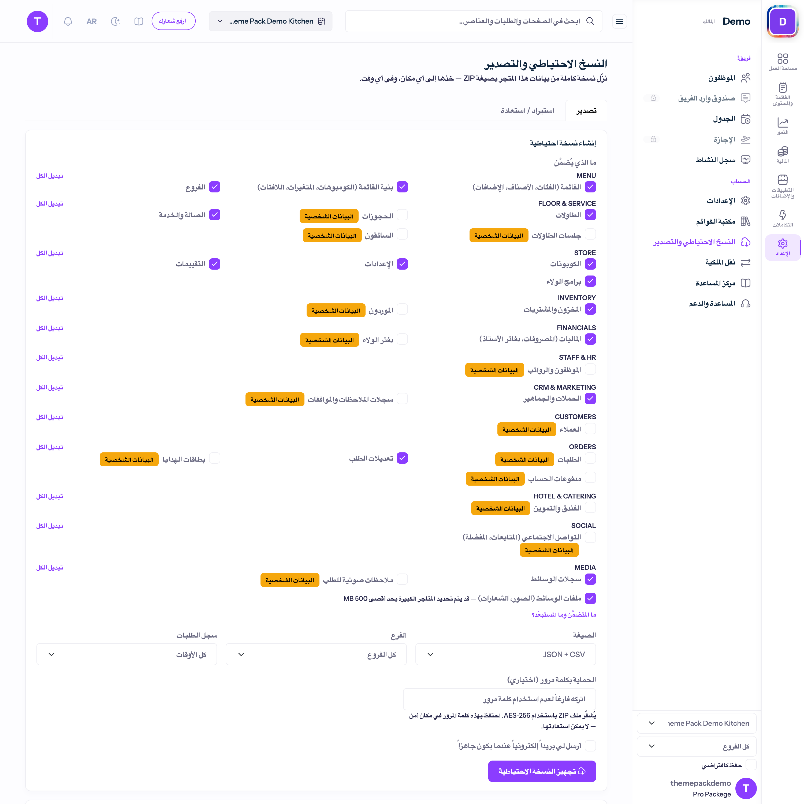

# النسخ الاحتياطي والتصدير والاستعادة

نزّل نسخة كاملة من بيانات مطعمك كملف ZIP متى شئت، أو دع نسخة تُجهَّز تلقائيًا
كل أسبوع أو شهر، أو استعِد نسخة احتياطية إلى متجر مع معاينة لما سيتغيّر
بالضبط قبل كتابة أي شيء. افتح **النسخ الاحتياطي والتصدير** في الشريط الجانبي للوحة
التحكم ضمن **الإعداد ← الحساب** (أيقونة التنزيل السحابي)؛ وتوجد الصفحة أيضًا
على `/backup` في نطاق لوحة التحكم لديك. تعمل دائمًا على المتجر المحدد حاليًا
في مبدّل المتاجر بلوحة التحكم. لا يمكن استخدامها إلا لمالك المتجر — إذ لا
تستطيع حسابات الموظفين الوصول إلى الصفحة، ويُعاد التحقق من كل تنزيل مقابل
الملكية.

## إنشاء نسخة احتياطية

افتح تبويب **تصدير** واستخدم بطاقة **إنشاء نسخة احتياطية**:

1. **ما الذي يُضمَّن** — قائمة مربعات اختيار بكل مجموعة بيانات، مُصنّفة
   (القائمة، المتجر، المخزون، الماليات، الموظفون والموارد البشرية، إدارة
   علاقات العملاء والتسويق، العملاء، الطلبات، الصالة والخدمة، الفنادق
   والتموين، وسائل التواصل، الوسائط). لكل مجموعة رابط **تبديل الكل**. وتحمل
   مجموعات البيانات التي تحتوي على بيانات شخصية (العملاء، الطلبات، الحجوزات،
   الموظفون، الموردون، بطاقات الهدايا وما شابه) شارة **البيانات الشخصية**،
   ويؤدي وضع علامة على أي منها إلى إظهار تذكير بأنه ينبغي ألّا تصدّر إلا
   البيانات الشخصية المسموح لك بالاحتفاظ بها ونقلها.
2. **ملفات الوسائط** — يمكن تجميع الصور والشعارات الفعلية داخل ملف ZIP. تُحدَّد
   المتاجر الكبيرة جدًا بحد أقصى 500 ميجابايت من الوسائط لكل تصدير؛ ويُصدَّر
   كل ما عدا ذلك ويبيّن البيان (manifest) ما جرى تخطّيه.
3. **الصيغة** — **JSON + CSV** (الافتراضي)، أو **JSON only**، أو **CSV
   only**. صيغة JSON هي التي يستعيد منها المستورِد؛ أما CSV فتُفتَح في جدول
   بيانات.
4. **الفرع** — صدّر **كل الفروع** أو ضيّق البيانات المرتبطة بالفروع إلى
   فرع واحد.
5. **سجل الطلبات** — **كل الأوقات** أو **آخر 90 يومًا** أو **آخر 30 يوما**
   أو **نطاق مخصص** بتاريخي من/إلى.
6. **Password-protect (optional)** — أدخل كلمة مرور لتشفير ملف ZIP بـ
   AES-256. احتفظ بكلمة المرور بأمان: فلا يمكن استرجاعها. وإذا تعذّر على
   الخادم التشفير، يُعطَّل الحقل ويوضّح ذلك.
7. **Email me when it's ready** — ضع علامة لتلقّي بريد إلكتروني برابط تنزيل
   بمجرد بناء الأرشيف.

انقر **تجهيز النسخة الاحتياطية**. تُبنى الأرشيفات في الخلفية؛ وتعرض قائمة **Your
backups** أدناه كل أرشيف بحالته وحجمه وزر تنزيل بمجرد أن يصبح جاهزًا. تحتفظ
الصفحة بأحدث 20 نسخة احتياطية لكل متجر، ويمكنك حذف أي نسخة لم تعد بحاجة
إليها. ويُقيَّد معدّل إنشاء النسخ الاحتياطية وتنزيلها، لذا قد تطلب منك دفعة
كبيرة من الطلبات الانتظار.

ما في ملف ZIP: مجموعات البيانات التي وضعت علامة عليها إضافةً إلى بيان يسرد
ما جرى شحنه بالضبط. تُستبعَد دائمًا الاعتمادات السرية (مفاتيح الدفع والبوابة،
والرموز، والشهادات) والسجلات النظامية — فهذا تصدير منتقى وقابل للنقل، لا
تفريغ خام لقاعدة البيانات.

## النسخ الاحتياطية التلقائية

تُعدّ بطاقة **النسخ الاحتياطي التلقائي** جدولًا متكررًا واحدًا لكل متجر:

- **التكرار** — **أسبوعي** أو **شهري**.
- نفس خيارات مجموعة البيانات والصيغة والفرع وتاريخ الطلبات كالنسخة اليدوية،
  إضافةً إلى إشعار **أرسل لي بريداً إلكترونياً**.
- النسخ الاحتياطية التلقائية لا تكون محمية بكلمة مرور أبدًا.

تعرض البطاقة ما إذا كان الجدول **تشغيل** ومتى موعد التشغيل التالي؛ ويزيله
**إيقاف**. تظهر الأرشيفات المجدوَلة في قائمة **نسخك الاحتياطية** نفسها مثل
اليدوية.

## الاستيراد / الاستعادة

يستعيد تبويب **استيراد / استعادة** نسخة ZIP احتياطية إلى المتجر الحالي —
مفيد لاستعادة البيانات أو نقل متجر بين الحسابات (راجع
[نقل الملكية](ownership-transfer.md) لنقل المتجر نفسه).

1. ارفع نسخة ZIP احتياطية (حتى 500 ميجابايت). يُتحقَّق من الملف ولا يُكتَب
   شيء بعد.
2. يظهر الاستيراد في القائمة مع **معاينة**: خطة تجربة (dry-run) لما سيُنشأ
   ويُحدَّث، مجموعة بيانات تلو أخرى، إضافةً إلى تحذير إن كان الأرشيف من متجر
   مختلف.
3. راجع الخطة، ثم **أكّد** لتطبيقها. يُشغَّل الاستيراد في الخلفية؛ وتعرض
   القائمة تقدّمه وحالته النهائية. يمكنك التخلّص من استيراد مرفوع في أي لحظة
   قبل التأكيد.

إذا تعذّرت قراءة ملف كنسخة احتياطية صالحة، يُرفَض الرفع مع بيان السبب ولا
يتغيّر شيء.

## صفحات ذات صلة

- [استيراد القائمة وتصديرها (CSV)](menu-import-export.md) — الأداة الأخف
  القائمة على CSV فقط لتحرير القائمة وحدها بالجملة.
- [نقل الملكية](ownership-transfer.md) — تسليم متجر كامل إلى حساب آخر، أو نقل
  فرع بين متاجرك أنت.
- [مكتبة الوسائط](media-library.md) — حيث توجد الصور المُصدَّرة.
