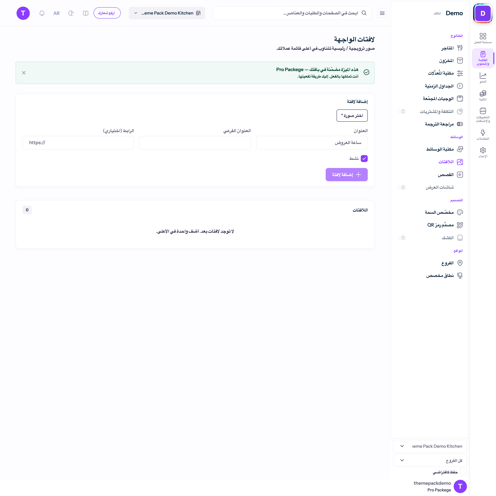

# اللافتات والعروض اليومية

هناك طريقتان للترويج للعروض على قائمة عملائك: **لافتات واجهة المتجر** (صور
ترويجية تتناوب في أعلى القائمة) و**العروض اليومية** (إشارة على مستوى الصنف
تضع الأطباق في قسم مميّز باسم "Today's specials"). تُدار كلتاهما من لوحة
التحكم لديك وتظهران تلقائيًا على القائمة العامة.

## لافتات واجهة المتجر

اللافتات صور ترويجية أو رئيسية — "Happy hour" أو "Ramadan offer" أو "New
burger" — تتناوب في شريط تمرير أعلى قائمة عملائك. افتح **اللافتات** في الشريط
الجانبي للوحة التحكم لإدارتها. إذا كان لديك أكثر من مطعم، فاختر المطعم من
القائمة المنسدلة في أعلى الصفحة أولًا؛ إذ تخص اللافتات مطعمًا واحدًا.

لكل لافتة:

- **صورة** (مطلوبة) — تُختار من مجلد *banner* في مكتبة الوسائط لديك. انقر
  **اختر صورة** لفتح المُنتقي؛ ويمكنك رفع صور جديدة هناك أيضًا (JPG أو
  PNG أو WebP أو GIF، حتى 8 ميجابايت لكل صورة).
- **العنوان** و**العنوان الفرعي** — نص اختياري يُركَّب فوق الصورة.
- **Link (optional)** — رابط كامل (https://...). إذا حُدِّد، يفتح النقر على
  اللافتة الرابط في تبويب جديد.
- **نشط** — لا تظهر على واجهة المتجر إلا اللافتات النشطة. أزِل العلامة
  لإخفاء لافتة دون حذفها (تعرض شارة "Hidden" في القائمة).

### إضافة لافتة

1. افتح **اللافتات** في الشريط الجانبي واختر المطعم.
2. في بطاقة **إضافة لافتة**، انقر **اختر صورة** واختر صورة أو ارفعها.
3. املأ العنوان والعنوان الفرعي والرابط إن أردتها.
4. اترك علامة **نشط** موضوعة وانقر **إضافة لافتة**.

تُضاف اللافتات الجديدة إلى نهاية التناوب.

### التحرير أو إعادة الترتيب أو الحذف

- **تعديل** — انقر **تعديل** على بطاقة لافتة لتغيير صورتها أو نصها أو رابطها
  أو حالتها النشطة في نافذة، ثم انقر **حفظ**.
- **إعادة الترتيب** — اسحب بطاقات اللافتات لأعلى أو لأسفل في القائمة. يُحفَظ
  الترتيب تلقائيًا ويتحكم في ترتيب الشرائح على القائمة.
- **حذف** — انقر **حذف** وأكّد. لا يؤدي حذف لافتة إلى حذف صورتها؛ إذ
  تبقى الصورة في مكتبة الوسائط لديك لإعادة الاستخدام.

### أين تظهر اللافتات

تظهر اللافتات على سمات القائمة الحديثة: تعرضها Aurora وNebula وPulse
وVelvet وVivid في شريط تمرير مشترك فوق القائمة، بينما تملك Crave وGlow
وMatcha شريط لافتات منسّقًا خاصًا بها. أما القوالب الأقدم (Classic وModern
وDark وما شابهها) فلا تعرض اللافتات. وإذا لم توجد لافتات نشطة، لا يُعرَض شيء
— لا يوجد عنصر نائب فارغ. راجع [سمات القائمة](themes.md) لاختيار سمة.

يُعرَض نص اللافتة كما كُتب؛ ولا يُترجَم عندما يبدّل العميل لغة القائمة.

## العروض اليومية

العرض اليومي صنف عادي في القائمة مع وضع علامة على مربع **عرض اليوم**.
افتح مساحة عمل قائمتك (راجع [إدارة أصناف القائمة](menu-items.md))، وحرّر
صنفًا، وضع علامة على **عرض اليوم** في صف مربعات الإشارات الغذائية. يحصل
الصنف على شارة "Special" في مُنشئ القائمة.

على السمات الحديثة (Aurora وNebula وPulse وCrave وGlow وMatcha) تُسحَب كل
الأصناف الموسومة كعروض يومية إلى قسم مخصص باسم "Today's specials" قرب أعلى
القائمة، منسّق حسب كل سمة (مثل "Chef's Daily Selection" على Aurora
وNebula). لا يظهر القسم إلا عندما يكون هناك صنف واحد موسوم على الأقل، ويعرض
عددًا محدودًا من الأصناف — من ستة إلى ثمانية بحسب السمة. تظل العروض النافدة
تظهر لكنها تُوسَم بأنها نافدة ولا يمكن فتحها.

لإخفاء قسم العروض بالكامل (أو نقله)، افتح **المتاجر**، وحرّر المطعم،
واستخدم عنصر التحكم **ترتيب أقسام القائمة العامة**: لكل قسم، بما في ذلك
**عروض اليوم**، مربع اختيار **مرئي** وسهما أعلى/أسفل.

## الجدولة

لا يوجد مُجدوِل تاريخ للافتات: تظهر اللافتة كلما كان مربع **نشط** لديها
موضوعًا، لذا أطفئها بنفسك عند انتهاء العرض. أما لافتة إعلان نصية بإطار
تاريخي تلقائي من/إلى فقد حُدِّدت مواصفاتها لكنها مخطَّطة، وغير متاحة بعد.

العروض اليومية أيضًا إشارة يدوية — إذ لا يُعاد ضبط قسم "Today's specials"
بين ليلة وضحاها. إذا أردت أن يظهر عرض في أوقات معينة فقط، فادمج مربع
**عرض اليوم** مع حقول **الإتاحة المجدولة** الخاصة بالصنف (إطار
وقت من/إلى إضافةً إلى مربعات اختيار أيام الأسبوع) في نافذة الصنف. يُعرَض
إطار التوفر على بطاقة الصنف في القائمة. راجع [إدارة أصناف القائمة](menu-items.md)
لنافذة الصنف.

## صفحات ذات صلة

- [إدارة أصناف القائمة](menu-items.md) — إشارات الأصناف والصور والتوفر
  المجدوَل.
- [سمات القائمة](themes.md) — أي سمة يراها عملاؤك.
- [مكتبة الوسائط](media-library.md) — رفع صور اللافتات وإدارتها.
- [الحملات](campaigns.md) — الترويج للعروض عبر رسالة بدلًا من القائمة.
