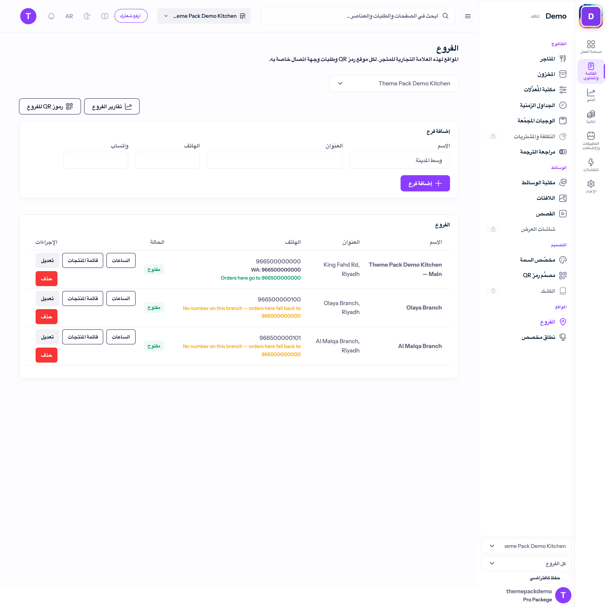

# الفروع المتعددة

إذا كانت علامتك التجارية للمطعم تدير أكثر من موقع، فإن الفروع تتيح لك إدارتها جميعًا تحت حساب واحد. تشترك كل الفروع في القائمة نفسها لكن يمكن أن يكون لكل فرع عنوانه وهاتفه وساعات عمله ورموز QR وتسعير كل صنف وتوفره وطلباته وتقاريره الخاصة.

تصل إلى الفروع من عنصر **الفروع** (أيقونة دبوس الخريطة) في الشريط الجانبي للوحة التحكم. وإذا كنت تدير موقعًا واحدًا فقط دائمًا، يمكنك تجاهل هذه الميزة — إذ للمطعم دائمًا فرع افتراضي واحد ويتصرف تمامًا كما في السابق.

## إنشاء الفروع

افتح **الفروع** في الشريط الجانبي. في الأعلى، اختر المطعم الذي تديره (إذا كنت تملك أكثر من مطعم). ثم استخدم نموذج **إضافة فرع** واملأ:

- **الاسم** (مطلوب) — اسم الموقع، مثل "Downtown" أو "Airport Road".
- **العنوان** و**الهاتف** و**WhatsApp** — كلها تفاصيل اتصال اختيارية لذلك الموقع.

تُنشأ الفروع الجديدة نشطة. ويُمنَح كل فرع تضيفه الموضع التالي في القائمة، فتبقى في ترتيب ثابت.

لتحرير فرع، استخدم زر **تعديل** في صفه. إلى جانب الاسم وتفاصيل الاتصال، يمكنك ضبط:

- **نشط** — تشغيل الفرع بأكمله أو إيقافه.
- **المنطقة الزمنية** — يُستخدم لمعرفة ما إذا كان الفرع مفتوحًا الآن.
- **يستقبل الطلبات** — إيقاف الطلبات عبر الإنترنت مؤقتًا أو استئنافها دون إلغاء تفعيل الفرع.
- **رسالة الإغلاق** — نص يُعرَض للعملاء عندما لا يستقبل الفرع الطلبات.

### ساعات العمل

لكل فرع شبكة ساعات عمل أسبوعية، تُفتح من زر **الساعات** في صف الفرع (صف لكل يوم به وقت فتح ووقت إغلاق ومربع اختيار "closed"). تُدعَم الأطر الليلية — إذ يُعامَل وقت الإغلاق الأبكر من وقت الفتح (مثل 18:00 إلى 02:00) على أنه يمتد عبر منتصف الليل. وإذا تركت الساعات فارغة، يُعامَل الفرع على أنه مفتوح دائمًا.

تُحسَب حالة الفرع المباشرة من هذه الإعدادات وتُعرَض كواحدة من: **مفتوح** أو **مغلق** (خارج الساعات) أو **متوقف مؤقتًا** (لا يستقبل الطلبات) أو **غير نشط** (الفرع مُطفأ).

### حذف فرع

استخدم زر **حذف** في صف الفرع. يجب أن يحتفظ المطعم دائمًا بفرع واحد على الأقل، لذا لا يمكنك حذف الأخير. عند حذف فرع، لا تُزال أي طاولات مخصصة له — بل تُطوى مجددًا إلى الفرع الافتراضي كي تبقى مرئية في شاشتَي [رموز QR](qr-codes.md) و[خريطة الصالة](floor-map.md).

## قوائم الفروع وظهورها

يقدّم كل فرع القائمة نفسها افتراضيًا. لجعل موقع مختلفًا، استخدم زر **قائمة المنتجات** في صف الفرع (شاشة "Branch menu & pricing"). لكل صنف يمكنك:

- **إيقاف الصنف في هذا الموقع** — أزِل علامة "Available here" ليُخفى الصنف من قائمة ذلك الفرع ولا يمكن طلبه هناك.
- **تجاوز السعر** — أدخل سعر فرع لتحصيل مبلغ مختلف في هذا الموقع. اتركه فارغًا لاستخدام السعر الأساسي للصنف.

تحتفظ الأصناف التي لا تلمسها هنا بسلوكها الافتراضي: متاحة في كل مكان بالسعر الأساسي. فأنت تهيّئ الاستثناءات فقط.

في جانب العميل، يسافر الفرع مع رمز QR أو الرابط (انظر أدناه). وعندما يتصفّح العميل فرعًا محددًا، تعرض القائمة الأصناف المتاحة في ذلك الفرع فقط وتستخدم أسعار ذلك الفرع.

## رموز QR للفروع

من صفحة Branches، تمنحك **رموز QR للفروع** رمز/رابط QR لكل موقع على حدة. يربط كل واحد ربطًا عميقًا بواجهة متجرك العامة مع إرفاق الفرع (بـ `?branch_id=` على رابط المتجر)، بحيث يفتح مسح رمز موقع قائمة ذلك الفرع وتسعيره وتوفره. اطبع رمز كل فرع لطاولاته الخاصة. لإدارة QR العامة راجع [رموز QR](qr-codes.md).

## تقارير الفروع

تمنحك **تقارير الفروع** (من صفحة Branches، أو أيقونة الرسم البياني) مقارنة جنبًا إلى جنب لكل فروع مطعم واحد. اختر نطاقًا تاريخيًا من **آخر 7 أو 30 أو 90 يومًا**. لكل فرع يعرض الجدول:

- **الحالة** (مفتوح / مغلق / متوقف مؤقتًا / غير نشط)
- **الطلبات** في الفترة
- **الإيراد**
- **المتوسط لكل طلب**
- **الصنف الأعلى** — الصنف الأكثر مبيعًا في ذلك الفرع حسب الكمية

يجمع ملخص الإجماليات في الأعلى الطلبات والإيرادات عبر كل الفروع. هذا عرض للمقارنة — لنظرة أعمق في أرقام فرع واحد، استخدم صفحتَي [التحليلات](analytics.md) و[الطلبات](orders.md) الرئيسيتين مع تحديد فرع.

## سياق الفرع في لوحة التحكم

يحتوي تذييل الشريط الجانبي على مبدّل متجر وفرع. عندما يكون لديك أكثر من فرع، يمكنك اختيار الفرع الذي تُقصَر عليه لوحة التحكم بأكملها، أو اختيار **كل الفروع**. يظل اختيارك ثابتًا للجلسة، فتصفّي صفحات مثل Orders وAnalytics إلى الفرع الذي اخترته.

يمكنك أيضًا حفظ الاختيار الحالي كافتراضي لك عند التبديل، بحيث يكون فرع (ومتجر) محددًا مسبقًا في كل مرة تسجّل فيها الدخول. وإذا أصبح افتراضي محفوظ غير صالح لاحقًا — مثلًا حُذف الفرع — تعود لوحة التحكم بهدوء إلى "all branches" بدلًا من عرض خطأ.

تقبل بعض الصفحات أيضًا `?branch_id=` صريحًا في الرابط، ما يتجاوز اختيار الجلسة لتلك الصفحة فقط. وقيمة `branch_id` بـ 0 أو فارغة تعني "all branches".

## الموظفون وفرعهم الافتراضي

عند إضافة [موظف](staff.md) أو تحريره، يمكنك تثبيته على فرع واحد. الموظف المثبّت على فرع مقيّد بذلك الفرع في كل مكان في لوحة التحكم — إذ لا يمكنه التبديل إلى مواقع أخرى. ويجب أن ينتمي الفرع الذي تخصصه إلى المطعم نفسه الذي ينتمي إليه الموظف.

اترك الفرع فارغًا لمنح الموظف وصولًا عبر كل الفروع؛ وفي تلك الحالة يمكنه اختيار **فرع افتراضي** لنفسه من المبدّل، وهو ما يحدد فرعًا مسبقًا عند تسجيل الدخول فقط دون تقييده به.

يتدفق تخصيص فرع الموظف أيضًا إلى [تطبيق الموظفين](staff-app.md)، الذي له مبدّل فروع متعدد خاص به للموظفين الذين يعملون عبر مواقع.

## صفحات ذات صلة

- [الموظفون](staff.md) — تخصيص الموظفين للفروع
- [رموز QR](qr-codes.md) — إدارة QR للطاولات والفروع
- [الطلبات](orders.md) و[التحليلات](analytics.md) — التصفية حسب الفرع المحدد
- [خريطة الصالة](floor-map.md) و[شاشة المطبخ](kds.md) — عمليات مدركة للفروع
