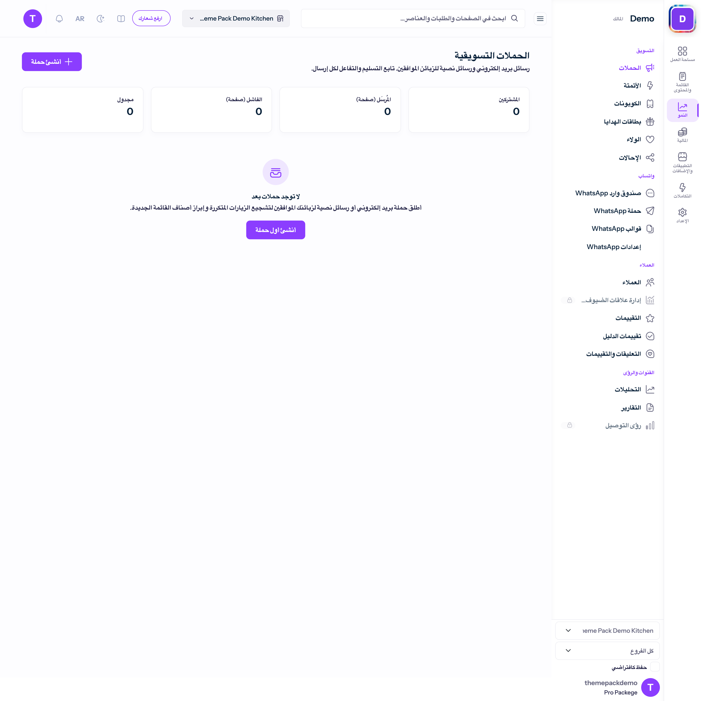

# حملات البريد الإلكتروني والرسائل النصية

تتيح لك الحملات إرسال بثّ لمرة واحدة عبر البريد الإلكتروني أو الرسائل النصية
— عروض، وأصناف جديدة في القائمة، ورسائل "نفتقدك" — إلى العملاء الذين وافقوا
على تلقّي رسائلك. تجدها في الشريط الجانبي للوحة التحكم ضمن مجموعة **النمو**
باسم **الحملات** (أيقونة مكبّر الصوت). وتتابع الصفحة نفسها التسليم لكل
إرسال.

لا تذهب الحملات أبدًا إلا للعملاء الذين وافقوا. وهذا مفروض من النظام، لا من
النموذج فقط — إذ لا تُرسَل رسالة أبدًا لعميل بلا موافقة تسويقية، حتى لو ظهر
في قائمة عملائك.

## من يستقبل الحملة

جمهورك هم عملاء المطعم المحدد الذين لديهم **موافقة تسويقية**. يمنحها العملاء
بأنفسهم، عادةً بوضع علامة على مربع الاشتراك التسويقي عند تسجيل حساب على
قائمتك العامة. تعرض صفحة **العملاء** في الشريط الجانبي العملاء الذين
وافقوا، وتعرض ترويسة صفحة Campaigns إجمالي عدد المشتركين لديك.

عند الإرسال، تحلّ الحملة الجمهور من جديد، فيُستبعَد تلقائيًا كل من ألغى
اشتراكه منذ جدولتك لها.

## إنشاء حملة

1. افتح **الحملات** في الشريط الجانبي وانقر **أنشئ حملة**.
2. في لوحة **الجمهور**، اختر المطعم، والقناة (**البريد الإلكتروني** أو **SMS**)،
   وشريحة:
   - **جميع الموافقين** — كل عميل وافق من ذلك المطعم.
   - **Recent (≤ 30d)** — العملاء الذين طلبوا أو انضمّوا في آخر 30 يومًا.
   - **Lapsed (> 30d)** — العملاء الذين مضى على آخر طلب لهم (أو تسجيلهم، إن
     لم يطلبوا قط) أكثر من 30 يومًا.
3. في لوحة **الرسالة**، اكتب محتواك:
   - **الموضوع** — لحملات البريد الإلكتروني فقط، حتى 255 حرفًا. مطلوب
     للبريد الإلكتروني.
   - **المحتوى** — الرسالة نفسها. استخدم `{name}` في أي موضع في الموضوع أو
     المتن ليُستبدَل باسم كل عميل (أو "Customer" إن لم يُخزَّن اسم).
   - بالنسبة إلى SMS، أبقِها قصيرة — مقطع SMS واحد هو 160 حرفًا، ويضيف
     النظام "Reply STOP to unsubscribe." إلى نهاية كل رسالة SMS تسويقية.
4. في لوحة **جدولة**، إما أن تترك **مجدول في** فارغًا للإرسال فورًا،
   أو تختار تاريخًا ووقتًا مستقبليين.
5. انقر **إطلاق الحملة**.

لا توجد معاينة لحجم الجمهور لكل شريحة في صفحة الإنشاء، ولا يمكن تحرير حملة أو
إلغاؤها بعد الإطلاق، لذا تأكّد جيدًا من الشريحة والرسالة قبل النقر.

## كيف يعمل الإرسال

يحدث الإرسال في الخلفية، فإطلاق حملة كبيرة لا يجمّد لوحة التحكم لديك. وعندما
تُشغَّل الحملة، تبني قائمة المستلمين من عملائك الذين وافقوا، ثم ترسل كل رسالة
على حدة. ويُعاد إرسال الرسالة الفاشلة مرة واحدة بعد تأخير قصير. ويحصل كل
مستلم على حالة تسليم خاصة به (معلّق أو مُرسَل أو فاشل) يمكنك فحصها في التقرير.

تُتخطّى الرسائل وتُوسَم فاشلة عندما لا يكون للعميل عنوان بريد إلكتروني (حملات
البريد) أو رقم هاتف (حملات SMS).

## تقارير الحملات

تعرض قائمة الحملات كل حملة بقناتها وشريحتها وشارة حالتها (مجدوَلة، جارٍ
الإرسال، مُرسَلة)، وأعداد المُرسَل/الفاشل. انقر **الإبلاغ** على أي حملة
لرؤية:

- حجم الجمهور، وإجماليات المُرسَل والفاشل، ومعدّل التسليم.
- القناة، والموضوع، والشريحة، والجدول، ومتن الرسالة الكامل.
- **سجل التسليم** لكل مستلم باسم كل عميل، والبريد أو الهاتف المُستخدَم،
  والطابع الزمني، والحالة، ورسالة الخطأ لأي فشل (مثل "Customer email is
  empty").

لا يتوفر تتبّع الفتح والنقر — يغطّي التقرير التسليم فقط.

## إلغاء الاشتراك والانسحاب

- **البريد الإلكتروني** — يتضمّن كل بريد حملة رابط إلغاء اشتراك. الرابط
  صالح لمدة 30 يومًا؛ ويؤدي النقر عليه إلى إزالة الموافقة التسويقية للعميل
  وعرض صفحة تأكيد باسم مطعمك. ويُتخطّى في كل الحملات المستقبلية (البريد
  وSMS) حتى يشترك من جديد.
- **SMS** — تنتهي كل رسالة SMS تسويقية بـ "Reply STOP to unsubscribe."
  ويؤدي الرد بـ STOP (أو UNSUBSCRIBE أو CANCEL أو END أو QUIT) إلى تسجيل
  انسحاب لذلك الرقم، وتتخطّاه رسائل SMS التسويقية المستقبلية بصمت. ويؤدي
  الرد بـ START (أو SUBSCRIBE أو YES) إلى إزالة الانسحاب. تتطلّب معالجة
  الكلمات المفتاحية توجيه ويب هوك الوارد لمزود SMS إلى المنصة؛ فإذا كنت
  تستخدم حساب Twilio الخاص بك، فاطلب من مسؤول منصتك تأكيد تهيئته.

لا تتأثر الرسائل الإجرائية (تأكيدات الطلبات، وتحديثات الحالة، ورموز تسجيل
الدخول) بحالات الانسحاب التسويقي — فهي مرتبطة بإجراء اتخذه العميل، لا
بالموافقة التسويقية.

## إعداد SMS

يحتاج SMS إلى اعتمادات المزود قبل خروج الرسائل الحقيقية:

1. انتقل إلى **التكاملات ← نظرة عامة ← كل التكاملات** في الشريط الجانبي.
2. على بطاقة **Twilio SMS**، أدخل **Account SID** و**رمز المصادقة** و**From
   number**، وضع علامة على **تفعيل المزوّد**، وانقر **حفظ**.
3. استخدم **اختبار الاتصال** للتأكد من أن الاعتمادات تعمل.

تحظى مفاتيحك الخاصة بالأولوية؛ وبدونها، تعود عمليات الإرسال إلى مزود SMS
الافتراضي للمنصة إن كان مهيّأً. وإذا لم يوجد أي منهما، تُحاكى عمليات إرسال
SMS (تُسجَّل لكن لا تُسلَّم) — مفيد للاختبار، لكن تذكّر أن حالة "sent" في تلك
الحالة تعني أنه لم تخرج رسالة حقيقية. وتنطبق أسعار SMS القياسية من مزودك على
كل رسالة.

لا تحتاج حملات البريد الإلكتروني إلى أي إعداد — إذ تستخدم تسليم البريد
الحالي في المنصة.

## إشعارات SMS الإجرائية

إلى جانب الحملات التسويقية، تشغّل قناة SMS إشعارات تلقائية يمكنك تشغيلها لكل
مطعم. افتح صفحة تحرير المطعم، وانتقل إلى تبويب **التسويق**، وابحث عن
**تنبيهات العملاء عبر الرسائل النصية**:

- **رسالة نصية عند استلام الطلب** — ترسل للعميل تأكيدًا برقم الطلب والإجمالي بمجرد
  وصول طلبه.
- **رسالة نصية لتحديث الحالة** — ترسل للعميل رسالة كلما غيّرت حالة طلبه (راجع
  [الطلبات](orders.md)).

يستخدم كلاهما رقم الهاتف الذي أدخله العميل عند إتمام الطلب ويتطلّبان اعتمادات
SMS في Integrations. يمكن للعملاء أيضًا تسجيل الدخول إلى قائمتك العامة برمز
SMS لمرة واحدة بدلًا من كلمة مرور؛ ويُقيَّد معدّل طلب الرمز لمنع إساءة
الاستخدام. ويُسجَّل كل نشاط SMS — الحملات والتنبيهات ورموز تسجيل الدخول —
بحالة كي يمكن تتبّع الإخفاقات.

## صفحات ذات صلة

- [الطلبات](orders.md) — حالات الطلبات التي تُطلق رسائل SMS لتحديث الحالة.
- [الكوبونات](coupons.md) — أنشئ رمز خصم لتضمينه في حملة.
- [برنامج الولاء](loyalty.md) — طريقة أخرى لإعادة الزبائن.
