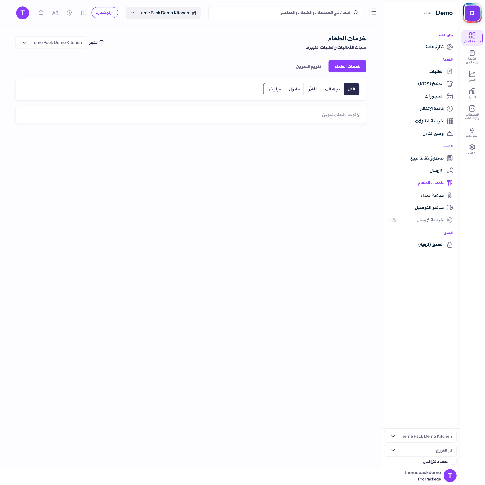

# طلبات التموين والفعاليات

يتيح التموين للزبائن إرسال استفسار إليك بشأن طلب كبير أو فعالية — تاريخ،
وعدد أشخاص، وملاحظة — بدلًا من تقديم طلب عادي. تردّ أنت بعرض سعر، وبمجرد
قبولك له تُنشئ المنصة طلبًا مجدوَلًا حقيقيًا لتاريخ الفعالية.

التموين ميزة مدفوعة. إذا كانت باقتك لا تتضمنها، فسيعرض الشريط الجانبي مدخل
**خدمات الطعام** مقفلًا بدلًا من الصفحة.

## تشغيل نموذج الطلب

يظهر نموذج التموين العام على صفحة قائمتك فقط عند ضبط خيار المتجر
`catering_enabled` لذلك المطعم، **و** كان التموين مشمولًا في باقتك.

لا يوجد حقل لـ `catering_enabled` في نماذج لوحة التحكم في هذا الإصدار — اطلب
من مشغّل المنصة تفعيله لمتجرك. الإعدادات ذات الصلة يضبطها المشغّل أيضًا:

- `catering_min_lead_days` — كم يومًا من الإشعار المسبق تحتاج. يرفض النموذج
  العام تاريخ فعالية أبكر من ذلك، برسالة "Catering needs at least N day(s)
  notice."
- `catering_min_spend` — قيمة عرض سعر دنيا. يُرفَض قبول عرض دونها برسالة
  "Catering minimum spend is …".
- `catering_deposit_enabled` — ما إذا كان يمكن تحصيل عربون لطلب.

## النموذج العام

عند التفعيل، يظهر قسم **التموين والمناسبات** على صفحة القائمة بالحقول:

- **اسمك** (مطلوب)
- **الهاتف** و**البريد الإلكتروني**
- **تاريخ ووقت المناسبة** (مطلوب — يبدأ المُنتقي عند أبكر تاريخ يسمح به وقت
  الإشعار المسبق لديك)
- **عدد الأشخاص** (مطلوب، 1 على الأقل، والافتراضي 20)
- مربع نص حر، "Tell us about your event"

يؤدي الإرسال إلى إنشاء طلب بحالة **تم الطلب**. ويُقيَّد النموذج بمعدّل 10
عمليات إرسال في الدقيقة.

## صفحة الطلبات

انقر **خدمات الطعام** في الشريط الجانبي ضمن **مساحة العمل ← التنفيذ**. عنوان
الصفحة **خدمات الطعام** وتعرض مطعمًا واحدًا في المرة؛ بدّل المتاجر بالمحدد في
ترويسة الصفحة.

ترى حتى 100 طلب، الأحدث تاريخ فعالية أولًا، مع أزرار تصفية لـ **الكل**
و**تم الطلب** و**المقدَّر** و**مقبول** و**مرفوض**. تعرض كل بطاقة اسم
العميل وشارة الحالة، وتاريخ الفعالية ووقتها، وعدد الأشخاص، والهاتف والبريد
اللذين قدّمهما، ورسالته، وعرض السعر بمجرد إرسالك له، ورابطًا إلى الطلب بمجرد
وجود واحد.

## عرض السعر والقبول والرفض

على بطاقة **تم الطلب** أو **المقدَّر**:

- **عرض السعر** — اكتب إجماليًا وانقر **عرض السعر**. تصبح الحالة **المقدَّر**. يمكنك
  إعادة عرض السعر لطلب بقدر ما تحتاج؛ ويفوز الرقم الأحدث.
- **رفض** — تجعل الحالة **مرفوض**. لا يوجد زر تراجع.

على بطاقة **المقدَّر**:

- **Accept → create order** — تُنشئ طلب استلام للفعالية، مجدوَلًا في تاريخ
  الفعالية ووقتها، مع نسخ اسم العميل وهاتفه وفرعه وملاحظته، وموسومًا كطلب
  تموين. ينتقل الطلب إلى **مقبول** ويرتبط الآن بذلك الطلب.

يمكن لأمرين حجب القبول:

- عرض السعر دون الحد الأدنى للإنفاق المهيّأ لديك.
- المطعم بلا أي أصناف في القائمة إطلاقًا — يُطلَب منك إضافة صنف قبل القبول.

إذا لم يحدد الطلب أصنافًا مسبقًا، يُنشأ الطلب بسطر واحد: صنف مخصص للتموين إن
وُجد لديك، وإلا فأول صنف نشط في قائمتك. عدّل الطلب بعد ذلك في صفحة
[الطلبات](orders.md).

بما أن الطلب مجدوَل لتاريخ الفعالية، يظل معلّقًا ولا يُطلَق في المطبخ عند
قبولك له — بل يُفرَج عنه في وقت إطلاقه الخاص.

## التقويم ومسار العمل

يعرض تبويب **تقويم التموين** (المتاح من شريط التبويبات في صفحة
Catering):

- **فعاليات هذا الشهر** — كل طلب بتاريخ فعالية في الشهر المختار، مع الوقت
  والاسم وعدد الأشخاص والحالة. غيّر الشهر بمُنتقي الشهر في ترويسة الصفحة.
- لوحة مسار عمل بعمود لكل مرحلة: Requested وQuoted وAccepted وFulfilled
  وClosed وDeclined — حتى 50 بطاقة لكل عمود.

يوجد زران إضافيان على اللوحة:

- **تنفيذ** على فعالية مقبولة — يوسمها **تم التنفيذ**. لا يمكن تنفيذ سوى
  الفعاليات المقبولة.
- **إغلاق** على فعالية مُنفَّذة — يوسمها **مغلق**.

## النطاق والحدود

- تخص الطلبات مطعمًا واحدًا. ويُرجع معرّف طلب ليس ملكك "not found".
- الرفض والإغلاق باتجاه واحد من هذه الصفحة؛ لا يوجد زر إعادة فتح.
- يمكن حفظ ملاحظات عرض السعر عبر إجراء عرض السعر لكنها لا تُعرَض مجددًا في
  قائمة الطلبات في هذا الإصدار.

## صفحات ذات صلة

- [الطلبات](orders.md) — حيث يصل طلب التموين المقبول.
- [أصناف القائمة](menu-items.md) — إنشاء أصناف التموين الحصرية التي يعتمد
  عليها الطلب المقبول.
- [الفروع](branches.md) — تخصيص طلب لموقع.
