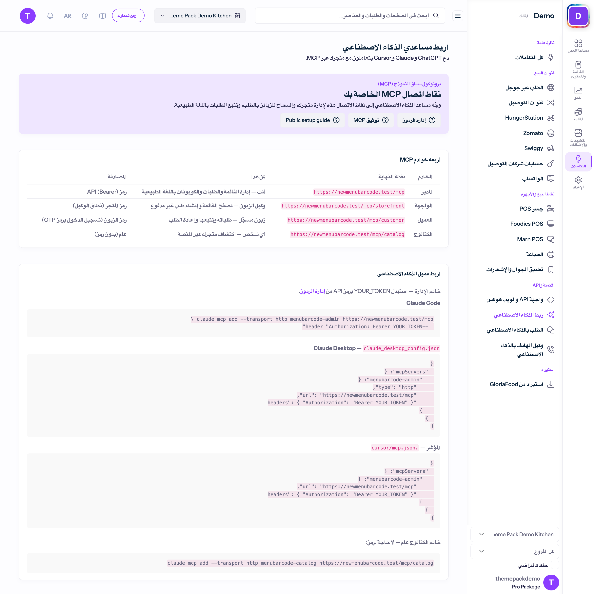

# ربط الذكاء الاصطناعي

صفحة **ربط الذكاء الاصطناعي** (على `/connect-ai` في لوحة التحكم لديك) هي المكان الوحيد
الذي يجمع كل ما يحتاجه مساعد الذكاء الاصطناعي للعمل مع حسابك. إذا كنت تستخدم
أداة ذكاء اصطناعي تتحدث MCP (بروتوكول Model Context Protocol) — مثل Claude
وCursor وقائمة متنامية من غيرها — فإن هذه الصفحة تمنحك عناوين نقاط الوصول
ومقتطفات التهيئة الجاهزة للصقها. لا تكتب أي شيفرة برمجية.

## الخوادم الأربعة

تسرد الصفحة أربع نقاط وصول MCP، كل منها موجّه لشخص مختلف:

- **المدير** — من أجلك *أنت*. اربط مساعد الذكاء الاصطناعي الخاص بك وأدِر
  قائمتك وطلباتك وكوبوناتك بلغة طبيعية. يُصادَق عليه بأحد
  [رموز API](api-tokens.md) العادية الخاصة بك.
- **الواجهة** — لوكيل ذكاء اصطناعي تابع *لأحد الزبائن*: يمكنه تصفّح قائمتك
  وتقديم طلب غير مدفوع نيابةً عنه. يُصادَق عليه برمز واجهة متجر خاص بكل متجر
  يحمل النطاق `agent`.
- **العميل** — *لزبون مُسجَّل الدخول*: طلباته الخاصة وتتبّعها وإعادة طلبها.
  يُسجّل وكيل الزبون دخوله بالطريقة نفسها التي يسجّل بها الزبون، برمز
  لمرة واحدة.
- **الكتالوج** — اكتشاف عام لمتجرك، دون أي رمز على الإطلاق. لا يكلّف ربطه شيئًا
  ويجعل متجرك قابلًا للاكتشاف عبر أدوات الذكاء الاصطناعي.

## ما الموجود في الصفحة

- **جدول نقاط الوصول** — عناوين الخوادم الأربعة مع بيان الموجَّه إليه كلٌّ
  منها وطريقة المصادقة.
- **تهيئة العميل الجاهزة للصق** — مقتطفات عاملة لعملاء الذكاء الاصطناعي
  الشائعين (أمر طرفية من سطر واحد أو كتلة JSON صغيرة، بحسب العميل). استبدل
  العنصر النائب برمز حقيقي وتكون قد اتصلت.
- **رموز الوكيل الخاصة بكل متجر لديك** — قائمة برموز واجهة المتجر التي
  أصدرتها، مع نطاقاتها، بحيث ترى بلمحة أي المتاجر مفتوحة لوكلاء الزبائن.
  أما الرموز نفسها فتُنشأ وتُلغى من صفحة [رموز API](api-tokens.md).

## أين تتعمّق أكثر

صُمِّمت Connect AI عمدًا لتكون الباب الأمامي السهل. أما التفاصيل التقنية —
ما الأدوات التي يوفّرها كل خادم MCP، وصيغ الطلبات، وواجهة API الكاملة —
فتوجد في وثائق المطوّرين المرتبطة من الصفحة (زر **MCP documentation**، الذي
يفتح مرجع `/developers`). سلّم هذا الرابط لمن يبني على حسابك؛ أما أنت فلا
تحتاج سوى هذه الصفحة ورمز.

صفحات ذات صلة للمالك: [رموز API](api-tokens.md)، [وكلاء الذكاء الاصطناعي](ai-agents.md)،
[التطبيقات والتكاملات](apps-integrations.md).
