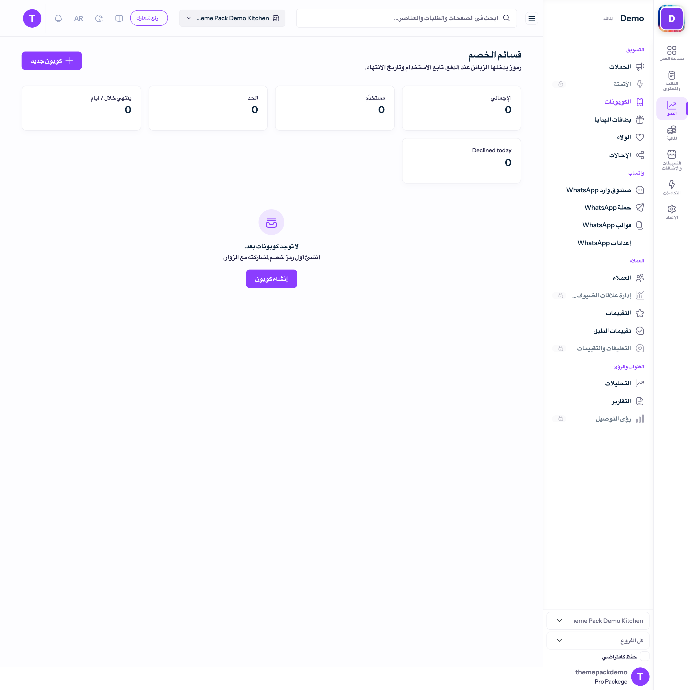

# الكوبونات

الكوبونات رموز خصم يُدخلها عملاؤك عند إتمام الطلب على قائمتك العامة. تنشئها
وتديرها في لوحة التحكم ضمن **الكوبونات** في الشريط الجانبي (أيقونة التذكرة).
يخصم الكوبون إما نسبة مئوية أو مبلغًا ثابتًا من مجموع الطلب الفرعي، ويمكنك
تحديد عدد مرات استخدامه ووقت انتهائه.

## تشغيل الكوبونات لمطعم

لا يظهر مربع الرمز الترويجي على قائمتك العامة إلا عندما تكون الكوبونات مفعّلة
لذلك المطعم:

1. افتح صفحة تحرير المطعم وانتقل إلى تبويب **الطلبات** ("Checkout and
   service options").
2. شغّل مفتاح **الكوبونات**.
3. احفظ.

عند إطفاء المفتاح، لا يرى العملاء أبدًا حقل رمز ترويجي، حتى لو كانت لديك
كوبونات نشطة. يظهر الحقل في السلة، موسومًا **الرمز الترويجي** مع زر **تطبيق**،
على كل قالب قائمة حديث — راجع [مصفوفة قدرات السمات](theme-capability-matrix.md)
لمعرفة ما يدعمه كل قالب.

## إنشاء كوبون

1. افتح **الكوبونات** في الشريط الجانبي وانقر **كوبون جديد**.
2. املأ النموذج:
   - **رمز الكوبون** — حتى 32 حرفًا، مثل `WELCOME10`. يُخزَّن بأحرف كبيرة
     ويجب أن يكون فريدًا. وهذا هو الرمز الدقيق الذي يكتبه الزبائن عند إتمام
     الطلب.
   - **النوع** — **نسبة مئوية** (نسبة مئوية من المجموع الفرعي) أو **Fixed
     amount** (مبلغ ثابت مخصوم).
   - **Percent off / Amount off** — قيمة الخصم.
   - **الحد الأقصى للاستخدام** — كم مرة يمكن استخدام الرمز إجمالًا. اتركه فارغًا
     ليكون غير محدود فعليًا (9999).
   - **الحد الأقصى لكل عميل** — كم مرة يجوز لزبون واحد استخدام هذا الرمز. اتركه
     فارغًا لعدم وجود حد لكل زبون. تُسجَّل عمليات الاستبدال في سجل استبدال
     ببوابة تفرّد على مستوى قاعدة البيانات، فلا يمكن لطلبين متزامنين أبدًا
     دفع زبون تجاوز الحد.
   - **تاريخ الانتهاء** — آخر يوم يعمل فيه الرمز. اتركه فارغًا لعدم وجود انتهاء.
3. انقر **إنشاء كوبون**.

عند تحرير كوبون له حد لكل زبون، تسرد بطاقة **استخدامات القسائم** أسفل
النموذج من استبدله ومتى.

### حدود أخرى مفروضة عند إتمام الطلب

يمكن أن تحمل الرموز أيضًا **حدًا أدنى لمبلغ الطلب** (لا يُطبَّق الرمز إلا
عندما يبلغ مجموع السلة الفرعي ذلك الرقم) و**قفلًا على فرع** (لا يعمل الرمز
إلا في فرع واحد). ويفرضهما الخادم كلاهما كلما ضُبطا على رمز، لكن نموذج
الكوبون الحالي لا يعرض حقولًا لهما. كما يُحترَم نوع كوبون **التوصيل المجاني**
(يعفي رسوم التوصيل دون خصم من المجموع الفرعي) عند إتمام الطلب لكن لا يمكن
إنشاؤه من هذا النموذج.

لإيقاف رمز مبكرًا، احذفه أو عدّل تاريخ انتهائه إلى تاريخ ماضٍ.

## قائمة الكوبونات

تعرض صفحة **الكوبونات** كل رموزك، 20 في كل صفحة، الأحدث أولًا. يعرض شريط
الترويسة خمس بطاقات: **الإجمالي** (كل كوبوناتك)، و**مستخدَم** (عمليات الاستبدال)،
و**الحد** (حد الاستبدال المجمّع)، و**ينتهي خلال 7 أيام** (الرموز التي تنتهي خلال
7 أيام)، و**المرفوضة اليوم** — كم زبونًا رُفض له كوبون اليوم لأنه استُنفد.
الصفر مؤشر جيد؛ والعدد غير الصفري يعني أن رمزًا بلغ حده وقد ترغب في رفعه.

يعرض كل صف الرمز، ونوعه (شارة Percentage أو Fixed)، وقيمة الخصم، وعدّاد
**المستخدم / الحد** بشريط تقدّم (إضافةً إلى شارة **Used up** حمراء بمجرد نفاد
الرمز وملاحظة "Max N per diner" عند ضبط حد لكل زبون)، وتاريخ الانتهاء (أخضر
ما دام صالحًا، وأحمر بمجرد انتهائه، و**أبدا** إن لم يوجد). استخدم إجراءات
الصف لـ **تعديل** كوبون أو حذفه (مع مطالبة تأكيد). ويتيح لك التحرير تغيير كل
حقل، بما في ذلك الرمز نفسه.

## ما يراه العملاء عند إتمام الطلب

1. في السلة، يكتب العميل الرمز في حقل **الرمز الترويجي** وينقر **تطبيق**.
2. يفحص الخادم الرمز ويردّ فورًا:
   - رمز غير معروف — "Coupon code is invalid."
   - تجاوز تاريخ انتهائه — "Coupon code is expired."
   - استُنفدت كل عمليات الاستبدال — "Coupon code usage limit exceeded."
3. إذا كان الرمز صالحًا، يُضاف سطر خصم إلى الإجماليات وينخفض الإجمالي الكلي.

يُحسَب الخصم دائمًا في الخادم، لا في المتصفّح أبدًا:

- تأخذ كوبونات **نسبة مئوية** تلك النسبة من مجموع الأصناف الفرعي.
- تأخذ كوبونات **مبلغ ثابت** المبلغ الثابت، محدودًا بالمجموع الفرعي — فلا
  يمكن لكوبون أبدًا دفع طلب دون الصفر.
- تُضاف رسوم التوصيل والضريبة والإكرامية فوق المجموع الفرعي كالمعتاد؛ ثم
  يُطرَح الخصم من الإجمالي النهائي. وتُحسَب الضريبة على المجموع الفرعي قبل
  الخصم.

عند تقديم الطلب، يُتحقَّق من الرمز مجددًا في الخادم و**يُطالَب بالاستبدال
ذريًا** قبل كتابة أي خصم — إذ يمرّ كل مسار تسوية (إتمام طلب واجهة المتجر،
نقاط البيع، تفعيل الإضافات، عرض المحفظة الترويجي) بالمطالبة نفسها. ولا يزيد
عدّاد **مستخدَم** ويُخزَّن الخصم على الطلب إلا مطالبة ناجحة. وتطبيق رمز في
السلة دون إتمام الطلب لا يستنفد عملية استبدال.

بما أن المطالبة ذرية، لا يمكن أبدًا استبدال رمز تجاوز حده حتى عندما يتسابق
طلبان على الخانة الأخيرة. ويُقدَّم الطلب الخاسر في السباق **بالسعر الكامل** —
دون كتابة خصم — وتُحتسب عملية الرفض على بطاقة **المرفوضة اليوم** في صفحة
Coupons. وإذا أبلغ زبون بأنه دفع السعر الكامل رغم إدخاله رمزًا صالحًا، فتفقّد
تلك البطاقة: على الأرجح نفد الرمز لحظة طلبه. وعلى نقاط البيع، يُبلَّغ عن
الرمز المستنفد بشكل متمايز ("usage limit exceeded") عن الرمز غير الصالح.

## النطاق والحدود

- تخص الكوبونات حسابك، لا مطعمًا واحدًا. فإذا كنت تدير عدة مطاعم تحت حساب
  واحد، يعمل الرمز في أي منها فعّل مفتاح **الكوبونات**.
- تُطابَق الرموز مقابل كوبوناتك أنت؛ ولا تعمل أبدًا رموز مالك آخر على قوائمك.
- كوبونات المطعم هذه منفصلة عن كوبونات الاشتراك التي يمكن لمسؤول المنصة
  عرضها عند إتمام طلب الباقة — إذ تديرها المنصة، لا من لوحة التحكم لديك.

## رصيد المتجر (المستردات والدفع بالرصيد)

رصيد المتجر رصيد قابل للإنفاق يحتفظ به عميل مُسجَّل الدخول لدى مطعمك — منفصل
عن نقاط الولاء (النقاط عدّاد مكافآت، والرصيد مال).

- **رد طلب إلى رصيد المتجر.** عند إلغاء أو استرداد طلب قدّمه عميل مُسجَّل
  الدخول، اختر **الموافقة على الاسترداد كرصيد في المتجر** لإعادة قيمته كرصيد بدلًا من طريقة
  الدفع الأصلية. وهي عملية عديمة الأثر التكراري — فرد الطلب نفسه مرتين لا
  يمنح رصيدًا مضاعفًا أبدًا.
- **العملاء يدفعون بالرصيد.** في منطقة حسابه يرى العميل رصيده ويمكنه تفعيل
  **الدفع من رصيد المتجر** عند إتمام الطلب. يُطبَّق الرصيد في جانب الخادم، محدودًا
  برصيده وبالمبلغ المستحق معًا؛ ويُدفَع الباقي بالطريقة المعتادة. والرصيد
  للإنفاق فقط (لا سحب نقدي) في هذا الإصدار.

## استبدال الرمز الترويجي على المحفظة

يمكن للعملاء أيضًا استبدال رمز ترويجي مباشرة على صفحة [المحفظة](wallet.md)
(مسار `wallet/redeem`). ويؤدي إدخال رمز صالح إلى إضافة المبلغ المقابل إلى
رصيد محفظة العميل. يستخدم هذا رموز الكوبونات نفسها لكنه يطبّق القيمة كرصيد
محفظة بدلًا من خصم عند إتمام الطلب.

## صفحات ذات صلة

- [مصفوفة قدرات السمات](theme-capability-matrix.md) — أي قوالب قائمة تعرض
  حقل الرمز الترويجي.
- [إدارة الطلبات](orders.md) — حيث تظهر الطلبات المخصومة وكيف تُعرَض
  الإجماليات.
- [نظرة عامة على لوحة التحكم](dashboard-overview.md) — التنقّل في الشريط
  الجانبي.
- [التحليلات](analytics.md) — تتبّع كيف تؤثر العروض في المبيعات.
