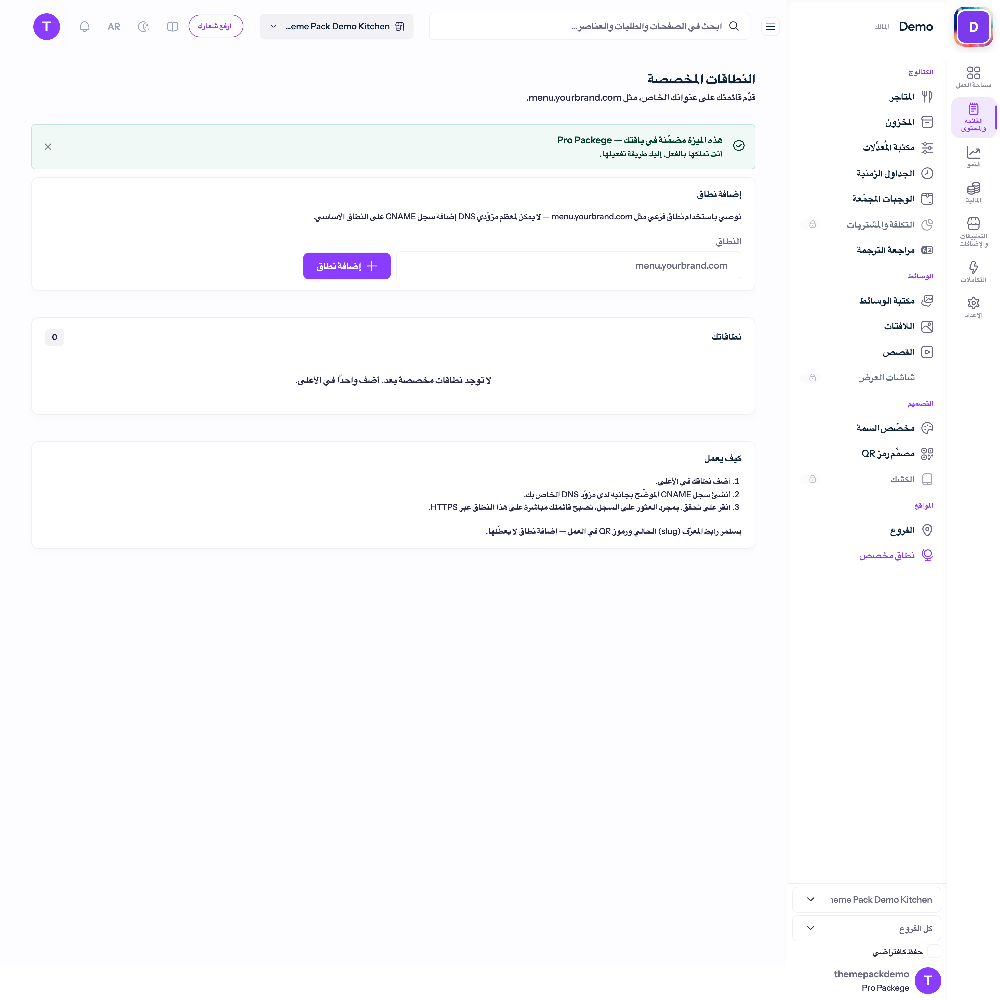

# النطاق المخصص

افتراضيًا، توجد قائمتك على `https://your-domain/your-slug` (راجع [رموز QR
والمشاركة](qr-codes.md)). ومع نطاق مخصص يمكنك تقديم القائمة نفسها على
عنوانك الخاص بدلًا من ذلك — مثل `menu.yourbrand.com`. يغطّي هذا الدليل إضافة
نطاق، وسجل DNS الذي تحتاج إلى إنشائه، والتحقق، وHTTPS.

## كيف يعمل

تضيف نطاقك في لوحة التحكم، وتوجّهه إلى المنصة بسجل DNS واحد لدى مسجّل نطاقك،
وتنقر **تحقق**. وبمجرد أن تتمكن المنصة من رؤية السجل، يصبح النطاق مباشرًا:
فمن يزوره يرى قائمة مطعمك العامة. ويظل رابط الـ slug الأصلي يعمل إلى جانبه،
فلا تتأثر رموز QR والروابط المطبوعة الموجودة.

يمكن أن يكون لكل مطعم نطاقه المخصص الخاص، ويمكن أن يكون لمطعم أكثر من نطاق.
ولا يمكن ربط نطاق معيّن إلا بمطعم واحد على المنصة كلها — فإذا كان النطاق
مأخوذًا بالفعل سترى "That domain is already registered."

## قبل أن تبدأ

تحتاج إلى:

- نطاق تملكه (اشتريته من مسجّل مثل Namecheap أو GoDaddy أو Cloudflare).
- وصول إلى إعدادات DNS لذلك النطاق، كي تضيف سجلًا.

نوصي باستخدام نطاق فرعي مثل `menu.yourbrand.com` أو `order.yourbrand.com`
بدلًا من النطاق المجرّد (`yourbrand.com`). فمعظم مزودي DNS لا يسمحون بنوع
السجل الذي تحتاجه (سجل CNAME) على نطاق مجرّد، لذا فالنطاق الفرعي هو الخيار
الموثوق.

## إضافة نطاقك

1. انتقل إلى **المتاجر** في الشريط الجانبي وافتح صفحة تحرير المطعم.
2. انقر تبويب **النطاقات**.
3. اكتب نطاقك في **إضافة نطاق** (مثل `menu.yourbrand.com`) وانقر **Add
   domain**.

يظهر النطاق في القائمة أدناه بشارة **قيد الانتظار**. وتعرض الصفحة أيضًا **CNAME
target** — عنوان المنصة الذي يجب أن يشير إليه سجل DNS لديك. أبقِ هذه الصفحة
مفتوحة؛ فستحتاج إلى تلك القيمة في الخطوة التالية.

## توجيه DNS لديك

لدى مزود DNS الخاص بك (عادةً الشركة التي اشتريت منها النطاق)، أضف سجل CNAME:

- **Type:** CNAME
- **Host / Name:** جزء النطاق الفرعي، مثل `menu`
- **Value / Points to:** هدف CNAME المعروض في تبويب Domains

احفظ السجل. تسري تغييرات DNS عادةً خلال بضع دقائق، لكن بعض المزودين قد
يستغرقون حتى ساعة.

إذا تعذّر على مزودك إضافة CNAME (مثلًا على نطاق مجرّد)، تقبل المنصة أيضًا سجل
TXT يحتوي على رمز التحقق الخاص بنطاقك كإثبات للملكية. لا يُعرَض الرمز في لوحة
التحكم، لذا إن احتجت إلى هذا المسار، تواصل مع الدعم وسيمكنهم إعطاؤه لك. لاحظ
أن سجل TXT يثبت الملكية فقط — فلا يزال على النطاق أن يشير إلى المنصة كي يصل
الزوار إلى قائمتك.

## التحقق

عد إلى تبويب **النطاقات**، وانقر **تحقق** بجوار نطاقك. تُجري المنصة بحث DNS
مباشرًا:

- إذا عُثر على السجل، تتغيّر الشارة إلى **تم التحقق منه** وسترى "Verified! Your
  menu will serve on this domain." ويصبح النطاق مباشرًا على الفور.
- وإلا، فسترى "DNS not detected yet. Add the CNAME or TXT record and try
  again in a few minutes." وهذا يعني غالبًا أن DNS لم يكمل الانتشار — انتظر
  بضع دقائق وانقر **تحقق** مجددًا. ولا يوجد حد لإعادة المحاولات.

التحقق خطوة لمرة واحدة. وبمجرد أن يعرض نطاق **تم التحقق منه** يبقى مُتحقَّقًا؛
ولست بحاجة إلى إعادة التحقق لاحقًا.

## HTTPS وSSL

لست بحاجة إلى شراء شهادة SSL أو تثبيتها. فبمجرد التحقق من نطاق، تُصدِر خوادم
المنصة شهادة له تلقائيًا وتُقدَّم قائمتك عبر HTTPS. وإذا لم يظهر قفل
المتصفّح خلال نحو 15 دقيقة من التحقق، تواصل مع الدعم.

## ما يراه العملاء

تعرض زيارة نطاقك المخصص قائمة المطعم العامة — الصفحة نفسها مثل رابط الـ
slug، مع عمل الطلب والسمات واللغات جميعها كالمعتاد. تُقدَّم القائمة على جذر
النطاق (`menu.yourbrand.com` نفسه، لا مسارًا فرعيًا).

تظل رموز QR لديك تشفّر رابط المنصة، فلا يتعطّل شيء عند إضافتك نطاقًا. وإذا
أردت أن تعرض المواد المطبوعة عنوانك الخاص بدلًا من ذلك، فحدّثها بعد التحقق من
النطاق.

## إزالة نطاق

في تبويب **النطاقات**، انقر **إزالة** بجوار النطاق. يتوقف النطاق عن تقديم
قائمتك على الفور ويصبح متاحًا للتسجيل مجددًا. ولا يتأثر رابط الـ slug لديك.

## استكشاف الأخطاء وإصلاحها

- **"That domain is already registered"** — النطاق مربوط بمطعم آخر (ربما
  أحد مطاعمك أنت). أزِله هناك أولًا، أو استخدم نطاقًا فرعيًا مختلفًا.
- **يستمر التحقق في الفشل** — تحقّق من أن قيمة CNAME تطابق تمامًا هدف CNAME
  المعروض في لوحة التحكم، دون أخطاء طباعية. استخدم فاحص DNS مثل أداة البحث
  الخاصة بمزودك للتأكد من أن السجل مرئي، ثم حاول مجددًا.
- **النطاق مُتحقَّق منه لكنه يعرض موقعًا آخر** — سجل DNS لديك يشير إلى مكان
  آخر. التحقق عبر سجل TXT يثبت الملكية لكنه لا يوجّه الحركة؛ فيجب أن يشير
  CNAME (أو ما يعادله) إلى المنصة كي يصل الزوار إلى قائمتك.
- **خطأ نطاق غير صالح عند الإضافة** — أدخل اسم النطاق فقط
  (`menu.yourbrand.com`)، دون `https://` أو شرطة مائلة في النهاية.
