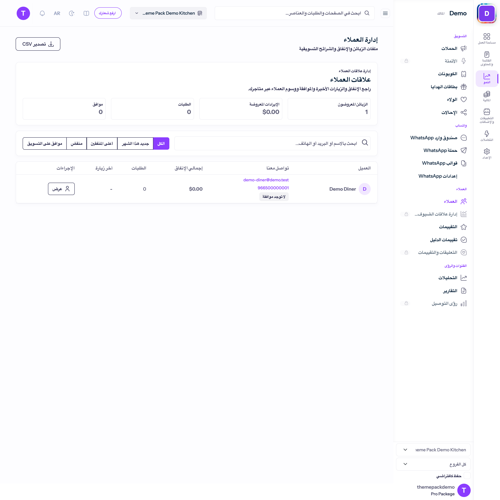

# العملاء (إدارة علاقات العملاء)

يُخزَّن كل زبون يطلب منك أو ينشئ حسابًا كسجل عميل، مقصور على مطعمك. منطقة العملاء في لوحة التحكم هي نظام إدارة علاقات العملاء المدمج لديك: قائمة قابلة للبحث، وملفات لكل عميل بإجمالي الإنفاق مدى الحياة وتاريخ الطلبات، ووسوم وملاحظات، وتصدير CSV. تشرح هذه الصفحة كيف يُلتقَط العملاء، وكيف يسجّل الزبائن الدخول، وكيفية التعامل مع القائمة.

## أين تجدها

في الشريط الجانبي للوحة التحكم، انقر **العملاء**. يفتح هذا قائمة العملاء على `/customers`. ويتطلّب فتحها إذن الموظف `customers` — إذ يُمنَع من الصفحة الموظف الذي يفتقر دوره إليه (يملك المالكون الوصول دائمًا). والقائمة مقصورة تمامًا على مطعمك (مطاعمك) — فلا يمكنك أبدًا رؤية عملاء مالك آخر.

## كيف يُنشأ العملاء

هناك ثلاث طرق يظهر بها سجل عميل في قائمتك:

- **الالتقاط عند إتمام الطلب.** عندما يقدّم ضيف طلبًا ويوفّر اسمًا أو رقم هاتف أو بريدًا إلكترونيًا، يُدرَج سجل عميل تلقائيًا (يُطابَق بالبريد أولًا، ثم الهاتف، كي لا يتكرّر الشخص نفسه). ويُضبَط مصدر السجل على `checkout`.
- **تسجيل حساب.** يصبح الزبون الذي يسجّل حسابًا على صفحة الطلب لديك (انظر أدناه) عميلًا.
- **تسجيل الدخول عبر SMS.** يُعثَر على الزبون الذي يسجّل الدخول برمز هاتف لمرة واحدة أو يُنشأ برقم الهاتف.

لا تُسجَّل الموافقة التسويقية إلا عندما يضع الزبون علامة صريحة على مربع "email/SMS me offers" عند إتمام الطلب — فهي غير موضوعة مسبقًا أبدًا. وعند موافقته، يخزّن السجل `marketing_consent` (و/أو `sms_consent`) إلى جانب طابع زمني للموافقة. ويُحفَظ العميل المُلتقَط بلا موافقة رغم ذلك كي تحتفظ بتاريخ طلباته، لكنه غير موافق تسويقيًا.

## حسابات العملاء وتسجيل الدخول (للزبائن)

يُتحكَّم فيما إذا كان بإمكان الزبائن أو يجب عليهم تسجيل الدخول لكل مطعم. في **الإعدادات** الخاصة بمطعمك (صفحة تحرير المطعم)، لحقل **تسجيل دخول العميل** ثلاثة خيارات:

- **افتراضي** — للضيوف فقط. لا يُعرَض تسجيل دخول؛ ويعمل الطلب تمامًا كما بدون حسابات.
- **اختياري** — يمكن للزبائن الطلب كضيف أو تسجيل الدخول.
- **مطلوب** — يجب على الزبائن تسجيل الدخول قبل الطلب.

مع "Optional"، لا يزال بإمكان الضيوف الطلب دون حساب — إذ يُعرَض تسجيل الدخول إلى جانبه فقط. و"Required" هو الوضع الوحيد الذي يجعل الحساب إلزاميًا قبل الطلب.

يحصل الزبائن المُسجَّلون على صفحة حساب على موقع الطلب لديك على `/{store}/customer/account` حيث يمكنهم:

- تحرير ملفهم (الاسم، البريد، الهاتف، تاريخ الميلاد) وموافقتهم التسويقية/عبر SMS.
- حفظ عناوين التوصيل وإدارتها (يُوسَم أحدها كافتراضي ويُملأ مسبقًا عند إتمام الطلب).
- رؤية تاريخ طلباتهم الكامل وإعادة طلب سابق بنقرة واحدة (تُتخطّى الأصناف غير المتوفرة).

يمكن للزبائن تسجيل الدخول بثلاث طرق: البريد الإلكتروني وكلمة المرور، أو رمز هاتف لمرة واحدة (OTP) عبر SMS، أو تسجيل حساب. وتُعالَج هذه جميعًا على صفحة الطلب العامة، لا في لوحة التحكم لديك.

## قائمة العملاء

تعرض القائمة 20 عميلًا في كل صفحة، مرتّبة حسب أحدث طلب افتراضيًا. يعرض كل صف الاسم والبريد والهاتف وعدد الطلبات وإجمالي المُنفَق وآخر طلب وحالة الموافقة.

**البحث** — اكتب في مربع البحث للمطابقة على الاسم أو البريد أو الهاتف.

**الشرائح** — أزرار تصفية سريعة تضيّق القائمة:

- **جديد هذا الشهر** — العملاء المُنشأون منذ بداية الشهر الحالي.
- **أعلى المنفقين** — مرتّبون حسب إجمالي الإنفاق، الأعلى أولًا.
- **منقضٍ** — لا طلب في الأشهر الثلاثة الأخيرة.
- **موافق على التسويق** — العملاء الذين اشتركوا في التسويق فقط.

يؤدي اختيار شريحة إلى إعادة تحميل القائمة مع تطبيق ذلك المرشّح. امسحه بالبحث من جديد أو بإعادة تحميل الصفحة.

## ملفات العملاء

انقر على عميل لفتح ملفه. يعرض:

- **إحصاءات الترويسة** — القيمة مدى الحياة (LTV / إجمالي المُنفَق)، وإجمالي عدد الطلبات، وتاريخ آخر زيارة.
- **التفاصيل** — البريد، الهاتف، المصدر، تاريخ الموافقة، وشارة تبيّن ما إذا كانت لديه موافقة تسويقية.
- **الوسوم والملاحظات** — قابلة للتحرير. الوسوم عبارة عن تسميات سريعة مفصولة بفواصل (مثل "VIP, Frequent")؛ والملاحظات خاصة وداخلية ولا تُعرَض للعميل أبدًا. انقر **حفظ الملاحظات** لتخزينها.
- **تاريخ الطلبات** — كل طلب قدّمه هذا العميل، مع التاريخ والنوع والطاولة أو العنوان والحالة، إضافةً إلى أعداد الطلبات المكتملة والنشطة.

### كيف تُحسَب الإجماليات

تُحفَظ القيمة مدى الحياة وعدد الطلبات وتاريخ آخر طلب أثناء طلب العميل. فعندما يُؤكَّد طلب أو يُدفَع، يُزاد عدد طلبات العميل، ويُضاف إجمالي الطلب إلى إجمالي مُنفَقه، ويُضبَط تاريخ آخر طلب له على الآن. وهذه هي الأرقام المعروضة في الملف والمستخدمة في شريحتَي Top Spenders وLapsed.

## تصدير العملاء

انقر **تصدير CSV** في القائمة لتنزيل عملائك كجدول بيانات. يُطبَّق أي بحث أو مرشّح شريحة نشط على التصدير — ويغطّي كل عميل يطابق المرشّح، لا الصفحة التي تعرضها فقط — فيمكنك مثلًا التصفية إلى **موافق على التسويق** وتصدير تلك المجموعة وحدها. يتضمّن الملف المعرّف والاسم والبريد والهاتف وعدد الطلبات وإجمالي المُنفَق وآخر طلب والموافقة التسويقية والوسوم والملاحظات وتاريخ الانضمام. احترم قانون الخصوصية عند استخدام بيانات الاتصال المُصدَّرة — سوّق فقط للعملاء الذين وافقوا.

## إرسال العروض والحملات

يخزّن نظام إدارة علاقات العملاء الموافقة كي تسوّق للأشخاص المناسبين، لكن لا يوجد زر "send offer" على ملف العميل أو القائمة نفسها. تُرسَل الرسائل التسويقية من أدوات الحملات والمراسلة المنفصلة (البريد وSMS وWhatsApp)، التي يمكنها استهداف عملائك الموافقين. استخدم شريحة **موافق على التسويق** أو تصدير CSV لبناء جمهورك.

## ما هو مخطَّط لكنه ليس في هذه الصفحة

- إجراء "send offer to this customer/segment" بنقرة واحدة من إدارة علاقات العملاء موصوف في المواصفات الداخلية لكنه غير مبنيّ في صفحات العملاء اليوم؛ استخدم أدوات الحملات بدلًا من ذلك.
- تحرير تفاصيل اتصال العميل الأساسية (الاسم، البريد، الهاتف) من لوحة التحكم غير متاح — إذ لا يمكن للمالكين تحرير سوى الوسوم والملاحظات هنا. ويحرّر الزبائن تفاصيل اتصالهم من صفحة حسابهم.

## صفحات ذات صلة

- [الطلبات](orders.md)
- [إعدادات إتمام الطلب](checkout-settings.md)
- [الحملات](campaigns.md)
