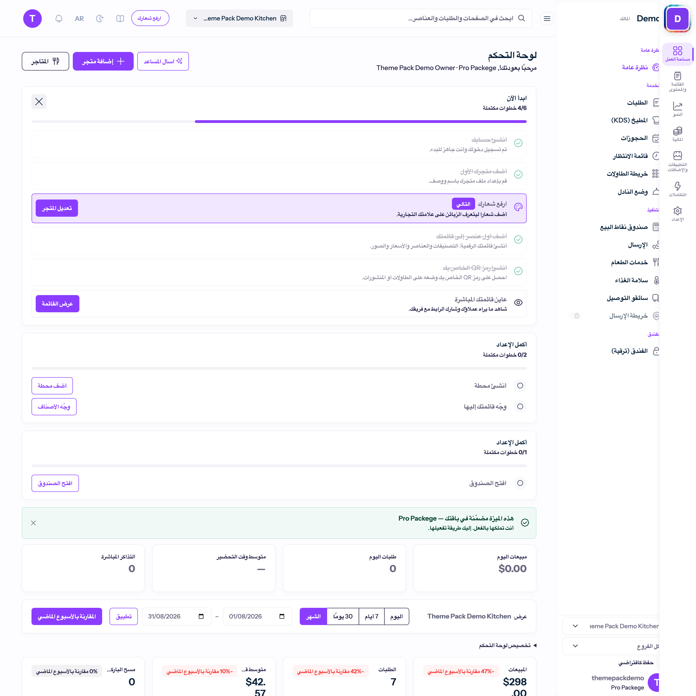

# نظرة عامة على لوحة التحكم

لوحة التحكم الرئيسية هي أول صفحة تراها بعد تسجيل الدخول. توجد على
`/dashboard` (عنصر "Overview" في أعلى الشريط الجانبي) وتلخّص عمليات المسح
والطلبات والمطاعم واستخدام الباقة عبر كل ما تملكه.

## ماذا تعني الإحصاءات

يقصر **شريط الفترة** في الأعلى نطاق الصفحة: شرائح جاهزة لـ **اليوم** و**7
days** و**30 days** و**الشهر**، ونطاق تاريخي مخصص من–إلى مع **تطبيق**،
ومفتاح مقارنة. ويُشارَك نموذج الفترة نفسه مع صفحة [التحليلات](analytics.md).

أسفله، يرى المالكون أربع بطاقات مؤشرات أداء للفترة المحددة، لكل منها شارة
اتجاه مقابل الفترة السابقة ورسم بياني صغير:

- **المبيعات** — الإيرادات من الطلبات الناجحة.
- **الطلبات** — عدد الطلبات.
- **متوسط قيمة الطلب** — المبيعات مقسومة على الطلبات.
- **مسح الباركود** — مشاهدات QR/القائمة.

يرى الموظفون **الطلبات** و**مسح الباركود** و**اليوم الأكثر ازدحاماً** (أعلى عدد مسح يومي)
و**المتاجر** بدلًا من ذلك، ولا يرون أقسام الفوترة.

إذا لم تُضمَّن بعض طلباتك الأقدم في لقطات الإيرادات بعد، يظهر تحذير أسفل
البطاقات: **"Sales figures are still being backfilled — N older orders are
not counted yet."** أرقام المبيعات صحيحة لكل ما هو محتسب؛ اطلب من مزودك
تشغيل عملية تعبئة إجماليات الطلبات لسدّ الفجوة. ويختفي الإشعار بمجرد احتساب
كل طلب.

أبعد إلى الأسفل، يرى المالكون بطاقة **استخدام الخطة** بمقاييس لما تسمح به
باقتك. يعرض كل منها مقدار ما استخدمته مقابل حد باقتك (مثل "3 / 10")، أو
"Unlimited" عندما لا يكون لباقتك حد. وتتضمّن الحدود أي زيادات إضافية اشتريتها.
إذا اقترب مقياس من الامتلاء، فقم بترقية باقتك أو اشترِ إضافة ضمن Account >
Add-ons.

تعرض بطاقة **حالة الحساب** (قابلة للإغلاق) استخدامك الأخير للموارد كخمس
بطاقات: **طلبات القائمة** و**الطلبات** و**عمليات الدفع الفاشلة** و**AI
credits** و**Storage (MB)**. تحتسب **عمليات الدفع الفاشلة** الطلبات التي فشلت
في منتصف الإنشاء وتراجعت — يعرض المتجر السليم 0 أو رقمًا صغيرًا؛ أما ارتفاع
مفاجئ دون أن يتغيّر شيء في جانبك فيستحق إبلاغه لمزودك. وتُحتسب الكوبونات
المرفوضة على حدة، على بطاقة **المرفوضة اليوم** في صفحة [الكوبونات](coupons.md).

## الرسوم البيانية والقوائم

- **نظرة عامة على المسح** — رسم خطي يومي لعمليات المسح للشهر الحالي. للتقارير
  الأعمق (الأجهزة، الساعات، اللغات، الزوار المتكررون)، افتح Grow > Analytics
  في الشريط الجانبي.
- **وصول سريع** — أزرار اختصار إلى Add restaurant وOrders وAnalytics
  وKitchen display وCustomers وSettings.
- **مطاعمك** — أحدث خمسة مطاعم لديك، لكل منها روابط لعرض صفحة
  القائمة العامة وطلباتها. ويفتح "View all" القائمة الكاملة.
- **الفوترة الأخيرة** — آخر معاملات باقتك/إضافاتك. ويرى الموظفون لقطة جمهور
  (الزوار الفريدون والمتكررون والإجماليون) بدلًا من ذلك.

## قائمة تحقق الإعداد

ترى الحسابات الجديدة بطاقة قائمة تحقق للإعداد على لوحة التحكم. لها ست خطوات
تُوضَع عليها العلامة من بيانات حقيقية: إنشاء حسابك، وإضافة أول مطعم، ورفع
شعار، وإضافة صنف، وإنشاء رمز QR، ومعاينة قائمتك المباشرة (تكتمل الخطوتان
الأخيرتان بعد أول مسح لقائمتك). يعرض شريط تقدّم عدد الخطوات المكتملة. ولكل
خطوة غير مكتملة زر ينقلك إلى الصفحة الصحيحة. يمكنك إغلاق قائمة التحقق في أي
وقت؛ وتبقى مخفية بعدها.

## التنبيهات واللافتات

تظهر اللافتات فوق محتوى لوحة التحكم عندما يحتاج شيء إلى الانتباه:

- **العد التنازلي للتجربة** — أثناء وجودك في فترة تجربة مجانية، تعرض لافتة عدد
  الأيام المتبقية. تصبح حمراء عند يومين أو أقل، وتتحوّل إلى "Your free trial
  has expired." بمجرد انتهاء التجربة. وترتبط اللافتة بصفحة الترقية كي تختار
  باقة مدفوعة.
- **فشل الدفع** — إذا فشلت دفعة تجديد اشتراك، تطلب منك لافتة حمراء
  تحديث طريقة دفعك لتجنّب الانقطاع، مع رابط إلى صفحة اشتراكك.
- **الإعلانات** — إشعارات ينشرها فريق المنصة (الصيانة، الميزات الجديدة،
  وما إلى ذلك). لكل منها زر إغلاق؛ وتبقى الإشعارات المُغلَقة مخفية على ذلك
  المتصفّح.

تظهر لافتتا العدّ التنازلي للتجربة وفشل الدفع على كل صفحة في لوحة التحكم.
أما الإشعارات فتظهر على صفحة النظرة العامة فقط.

## تبديل المتجر والفرع

إذا كنت تملك أكثر من مطعم، أو مطعمًا له فروع، فإن لوحة التحكم مقصورة دائمًا
على متجر واحد (وفرع واحد اختياريًا). ويُعرَض الاختيار الحالي في **تذييل
الشريط الجانبي**، فوق اسم حسابك مباشرة.

للتبديل:

1. انقر اسم المتجر في تذييل الشريط الجانبي لفتح المبدّل.
2. اختر متجرًا من القائمة المنسدلة **المطعم**. تُعاد تحميل الصفحة مقصورة على
   ذلك المتجر.
3. إذا كانت للمتجر فروع، فاختر فرعًا من القائمة المنسدلة **الفرع**، أو
   اختر **كل الفروع** لرؤية بيانات مجمّعة.
4. ضع علامة على **حفظ كافتراضي تسجيل الدخول الخاص بي** إذا أردت هذا الاختيار في كل
   مرة تسجّل فيها الدخول.

ملاحظات حول سلوك الاختيار:

- يُتذكَّر الاختيار لجلستك الحالية. ويُطبَّق افتراضي تسجيل الدخول المحفوظ
  (إن وُجد) عند بدء جلسة جديدة.
- يؤدي فتح أي صفحة تخص مطعمًا محددًا (مثل محرّر قائمة مطعم) إلى تبديل الشريط
  الجانبي تلقائيًا إلى ذلك المتجر، فتتبعه بقية لوحة التحكم.
- تُحدّث منتقيات الفروع داخل الصفحات الفردية اختيار الشريط الجانبي أيضًا.
- لا يمكن لحسابات الموظفين المثبّتة على فرع واحد تغيير الفرع — إذ تُقفَل
  القائمة المنسدلة على فرعهم.
- إذا حُذف متجر أو فرع افتراضي محفوظ لاحقًا أو فقدت الوصول إليه، تعود لوحة
  التحكم بهدوء إلى أول متجر لديك وكل الفروع.

## التنقّل في الشريط الجانبي

يُجمَّع الشريط الجانبي في خمسة أقسام. لا تظهر بعض العناصر إلا عندما تكون
الميزة مفعّلة في عملية تثبيتك أو مشمولة في باقتك:

- **مساحة العمل** — Overview، Restaurants، Orders، Customers، Reservations،
  Waitlist، Kitchen (KDS)، Kitchen stations، Modifier library، Banners،
  Media library، Branches، Floor map، Inventory.
- **النمو** — Campaigns، Coupons، Reviews، Loyalty، Referrals، Analytics.
- **الفريق** — Staff، Activity log.
- **المنصة** — POS register (يفتح في تبويب جديد)، Theme customizer،
  AI ordering، HungerStation، وReseller portal (فقط إذا كنت تدير حساب
  موزّع).
- **الحساب** — Integrations، API & Webhooks، Delivery drivers، Wallet،
  Add-ons، Settings.

تحتاج Waitlist وFloor map وReviews وLoyalty إلى مطعم واحد على الأقل قبل أن
تظهر. ويُعرَض اسم حسابك وباقتك الحالية في أسفل الشريط الجانبي تمامًا؛ ويفتح
النقر عليهما Settings.

## تحديد هدف

يمكنك تحديد هدف شهري يتتبّع تقدّمك على لوحة التحكم وصفحة
[التحليلات](analytics.md). أرسل إلى نقطة نهاية هدف لوحة التحكم (مسار
`dashboard/goal`) لحفظ واحد:

- **نوع الهدف** — Scans أو Orders أو Revenue. ونوع واحد فقط نشط في المرة.
- **القيمة المستهدفة** — الرقم المستهدف للشهر (يمسح 0 الهدف).

عندما يكون هناك هدف نشط، تعرض بطاقة مؤشر الأداء المطابقة في صفحة التحليلات
شريط تقدّم بنسبتك المئوية نحو الهدف. وعلى لوحة التحكم، يعكس رسم عمليات المسح
الهدف عندما يكون النوع مضبوطًا على عمليات المسح.

## نصائح

- زر "Add restaurant" في أعلى يمين لوحة التحكم هو أسرع طريقة لإنشاء قائمة QR
  جديدة.
- اسم الباقة المعروض في ترويسة الترحيب (وفي تذييل الشريط الجانبي) هو
  اشتراكك الحالي؛ وتاريخا بدء الباقة وانتهائها في صفحة الاشتراك.
- يرى الموظفون لوحة تحكم مصغّرة: تحلّ ملاحظة مساحة عملهم ("You are managing
  ... as ...") محل ترحيب المالك، وتُخفى أقسام الفوترة.
