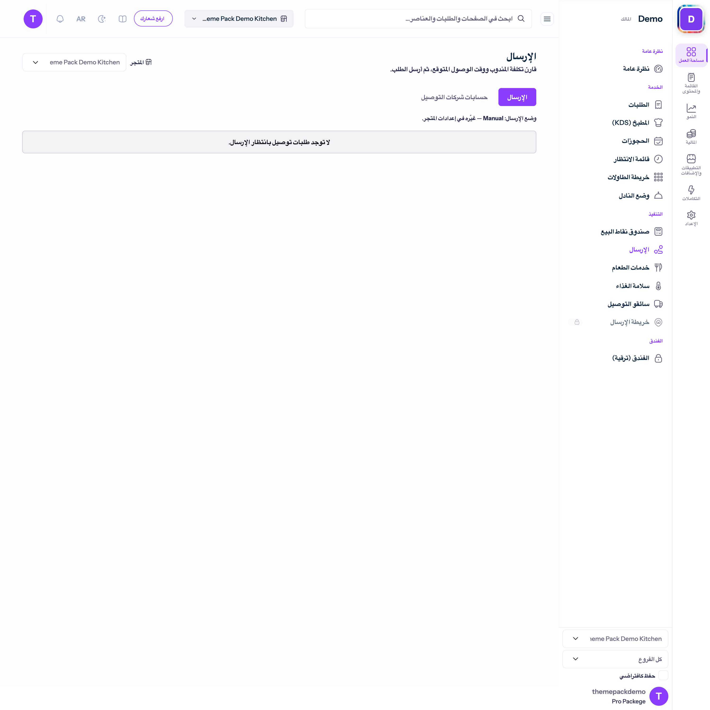

# التوصيل والسائقون



التوصيل أحد أنواع الطلب الثلاثة التي يمكن للعملاء اختيارها عند إتمام الطلب
(إلى جانب الطلب على الطاولة والاستلام). يغطّي هذا الدليل تشغيل التوصيل،
وضبط رسوم التوصيل وحد أدنى لقيمة الطلب، وإدارة سائقي التوصيل الخاصين بك،
ومتابعة توصيلة من التخصيص إلى التسليم، وقراءة تقرير رؤى التوصيل، واستقبال
الطلبات من وسيط HungerStation.

## تشغيل التوصيل

افتح إعدادات مطعمك (حرّر المطعم) وانتقل إلى تبويب **الطلبات**. حقول التوصيل
هناك هي:

- **طلبات التوصيل** — اضبطه على Yes لعرض التوصيل عند إتمام الطلب.
- **رسوم التوصيل** — رسم ثابت يُضاف إلى كل طلب توصيل.
- **الحد الأدنى لقيمة الطلب** — تُحتجَز طلبات التوصيل دون هذا المجموع الفرعي عند
  إتمام الطلب مع إشعار حد أدنى؛ ويجب على العميل إضافة المزيد قبل أن يتمكن من
  تقديم الطلب. اتركه على 0 لعدم وجود حد أدنى.

عندما يختار العميل التوصيل، يلتقط إتمام الطلب رقم هاتفه وعنوان توصيل؛
ويُرفَقان كلاهما بالطلب ويُعرَضان لك وللسائق المخصّص.

مناطق التوصيل — مناطق مسمّاة برسومها الخاصة، أو نصف قطر توصيل حول المطعم —
مخطَّطة لكنها غير متاحة بعد. اليوم يوجد رسم توصيل ثابت واحد وحد أدنى واحد
للمطعم كله، ولا تقيّد المنصة مدى بُعد عنوان العميل.

## إدارة السائقين

افتح **سائقو التوصيل** في الشريط الجانبي (أيقونة الشاحنة). تتيح لك
الصفحة إنشاء سائق، ومشاركة رمز تطبيقه لمرة واحدة، ورؤية نشاط توصيله. ولها
بطاقتان:

**إضافة سائق** — أدخل **الاسم** (مطلوب)، واختياريًا **الهاتف** و**البريد الإلكتروني**
و**المطعم**. اختيار "All restaurants" يتيح للسائق التوصيل لأي من مطاعمك؛
واختيار مطعم يقصره عليه.

عند الحفظ، يُعرَض **رمز تطبيق** لمرة واحدة. انسخه فورًا وسلّمه للسائق — إذ
لا يُخزَّن إلا شكل مجزّأ منه، فلا يمكن عرض الرمز الخام مجددًا. والرمز هو ما
يستخدمه السائق لتسجيل الدخول إلى واجهة API السائق (انظر أدناه).

يسرد جدول **السائقون** كل سائق مع هاتفه ومطعمه و**آخر موقع** (منذ متى
أبلغ آخر موضع GPS، أو "Never")، وشارة حالة. إجراءات الصف:

- **رمز جديد** — يولّد رمزًا بديلًا (يُعرَض مرة واحدة، مثل الأصلي) ويُبطِل
  القديم فورًا. استخدم هذا إذا فُقد رمز أو سُرق هاتف.
- **تعطيل / تفعيل** — يتوقف رمز السائق المعطّل عن العمل فورًا، لكن
  يُحفَظ سجل السائق وتاريخه.
- **إزالة** — يحذف السائق بعد تأكيد.

## تخصيص التوصيلات ودورة حياة التوصيل

يتحرّك طلب التوصيل عبر هذه الحالات: معلّق، مخصّص، مُستلَم، خارج للتوصيل،
وأخيرًا مُسلَّم أو فاشل. ولكل خطوة طابع زمني، ويؤدي الدخول إلى مخصّص أو خارج
للتوصيل أو مُسلَّم أو فاشل إلى إطلاق حدث ويب هوك (`order.driver_assigned`،
`order.out_for_delivery`، `order.delivered`، `order.delivery_failed`) إذا
كانت لديك ويب هوكس مُعدَّة — راجع [ويب هوكس API](../../dev/api/webhooks.md).

عندما تتضمّن باقتك ميزات السائق، تكون صفحة **خريطة الإرسال** (الشريط
الجانبي، بجوار Dispatch) هي الطريقة عبر لوحة التحكم للتخصيص: إذ تعرض
**السائقون** مباشرين (بنقطة حداثة وآخر موضع GPS) إلى جانب **Unassigned
orders**، ويحمل كل طلب غير مخصّص أزرارًا بنقرة واحدة للسائقين المقترحين —
الأقرب أولًا، مع عرض المسافة. ويؤدي الضغط على زر سائق إلى تخصيص التوصيلة.
وتقارن صفحة **الإرسال** منفصلة تكلفة ووقت وصول مندوب طرف ثالث لكل طلب
وترسله إلى خدمة توصيل بدلًا من سائقك الخاص.

لا يمكن تخصيص سوى سائقيك أنت، ولا يمكن تخصيص سائق مقصور على مطعم واحد لطلبات
مطعم آخر.

**لمطوّرك:** التخصيص متاح أيضًا على واجهة API المالك —
`POST /api/v1/stores/{id}/orders/{orderId}/assign` مع معرّف السائق،
مُصادَقًا بأحد رموز API لديك. أما السائقون أنفسهم فيعملون مقابل نقاط الوصول
المُصادَق عليها برمزهم ضمن `/api/v1/driver`: سرد التوصيلات المخصصة
(`?active=1` يخفي المنتهية)، وتحديث الحالة (مُستلَم، خارج للتوصيل، مُسلَّم،
أو فاشل — ولا يمكنهم تخصيص الطلبات)، وإرفاق ملاحظة قصيرة، وإبلاغ موضع GPS.
يفتح زر **Driver app API docs** في صفحة Delivery drivers مرجع نقاط الوصول
الكامل. أما تطبيق سائق محمول مُحزَّم بـ GPS في الخلفية وإشعارات دفع فقد
حُدِّدت مواصفاته لكنه لم يُبنَ بعد؛ واليوم يستخدم تكامل السائق نقاط وصول API
هذه مباشرة.

## التتبّع المباشر

يوجد سطحا تتبّع:

- **صفحة تتبّع العميل** — يحصل كل طلب على رابط تتبّع خاص. يعرض جدول حالة
  الطلب الزمني (مُستلَم، قيد التحضير، جاهز، وللتوصيل: مُستلَم / خارج
  للتوصيل / مُسلَّم) الذي يُحدَّث تلقائيًا. راجع [الطلبات](orders.md)
  للتفاصيل.
- **موضع السائق عبر API** — عندما يبلّغ سائق عن موقعه، تعرض صفحة Delivery
  drivers مدى حداثة آخر موضع له، وتُرجع نقطة وصول التتبّع العامة
  (`GET /api/v1/track/{token}`) اسم السائق وهاتفه وآخر إحداثيات له — لكن
  فقط أثناء كون الطلب مُستلَمًا أو خارجًا للتوصيل، لا قبل أو بعد أبدًا.
  ويمكن لواجهات المتاجر أو التطبيقات المخصصة استخدام هذا لرسم خريطة مباشرة.

## رؤى التوصيل

تجيب رؤى التوصيل عن "متى وأين يحدث طلب التوصيل لديّ؟" وهي تقرير للقراءة فقط —
لا يوجد شيء لتهيئته فيها.

لا يوجد رابط في الشريط الجانبي. افتحها مباشرة على:

```
/delivery-insights
```

تبدّل قائمة منسدلة للمطاعم في الأعلى المطعم الذي تنظر إليه. لا يوجد محدد
فرع ولا مُنتقي نطاق تاريخي؛ إذ تستخدم كل لوحة إطارها الثابت الخاص.

**توقعات الطلب** — الأيام السبعة القادمة، صف لكل يوم: **الطلبات** متوقعة،
و**الإيراد** متوقعة، وعدد **الموظفون** مقترح. وأسفلها، يسرد صف **Tomorrow —
suggested prep** الأصناف بكمية مقترحة. وإذا كان تاريخ طلباتك قصيرًا جدًا،
تقول اللوحة ذلك بدلًا من التخمين.

**شبكة حرارية للطلب** — طلبات التوصيل حسب يوم الأسبوع والساعة على مدى آخر 8
أسابيع، كشبكة من 7 صفوف و24 عمودًا. الأزرق الأغمق يعني طلبات أكثر، ويُظهر
تمرير المؤشر فوق خلية يوم الأسبوع والساعة والعدد بدقة. ويُطبَع إجمالي
الإطار فوق الشبكة. وبلا طلبات توصيل في الإطار تقول ذلك.

**أهم مناطق التوصيل** — الكلمات المفتاحية الأكثر تكرارًا في عناوين توصيلك،
مع عدّاد لكل منها. وهذا مطابقة نصية تقريبية، لا ترميز جغرافي: إذ يجمّع على
الكلمات في العنوان، فعامله كدليل تقريبي للأحياء التي تخدمها لا كخريطة.

**Courier GPS points** — كم إحداثية حقيقية التُقطت من تتبّع المندوب (راجع
[التتبّع المباشر](#live-tracking) أعلاه). يبلّغ عن عدد النقاط المتاحة؛
واللوحة نفسها لا ترسم خريطة، وتشير إلى أن طبقة خريطة تعرضها حيث يكون تتبّع
المندوب نشطًا.

رؤى التوصيل ميزة مقيّدة. لا تُفتَح إلا عندما يكون مفتاح الإيقاف على مستوى
المنصة لـ `demand_forecast` مفعّلًا (إعداد للمشرف الأعلى — يُشحَن **مُطفأً**
افتراضيًا) وتضمّنته باقة مالك المتجر. و`demand_forecast` مقيّد بالباقة —
متاح على الباقات التي تتضمنه. راجع [الباقات والفوترة](plans-billing.md).

## HungerStation

إذا كنت تبيع على HungerStation، يمكن للمنصة استقبال طلبات HungerStation
مباشرة كي تظهر في قائمة طلباتك وشاشة مطبخك مثل أي طلب آخر. افتح
**HungerStation** في الشريط الجانبي (أيقونة الدراجة) واختر المطعم في
الأعلى. تعرض لافتة ما إذا كان ذلك المطعم متصلًا، وللصفحة ثلاث بطاقات:

- **ربط بيانات الاعتماد** — أدخل اعتمادات شريك HungerStation الخاصة بك
  (client id وclient secret من بوابة شركاء HungerStation، إضافةً إلى chain
  id اختياري وسر ويب هوك) واضغط **حفظ وربط**. الاعتمادات لك وحدك
  (استخدم مفاتيحك الخاصة)، وتُخزَّن مشفّرة، ولا تُشارَك أبدًا مع حسابات أخرى.
- **Branch → vendor mapping** — طابق كل [فرع](branches.md) لديك بمعرّف
  البائع الخاص به في HungerStation (وchain id إن كان لديك واحد). تُوجَّه
  الطلبات الواردة إلى المطعم الصحيح عبر هذا التطابق، لذا يجب ملؤه قبل أن
  تتدفق الطلبات.
- **سجل الأحداث** — أحدث 50 حدثًا واردًا وصادرًا من HungerStation (الاتجاه،
  النوع، الطلب، علامة النجاح، الوقت) لاستكشاف الأخطاء.

بمجرد الاتصال، تُنشأ طلبات HungerStation الواردة كطلبات توصيل مع إرفاق رمز
طلب HungerStation؛ وتُطابَق أصناف القائمة بـ SKU، ويُوسَم أي صنف غير معروف
على الطلب بدلًا من إسقاطه بصمت. ولا تُنشئ عمليات تسليم الويب هوك المكرّرة
طلبات مكرّرة أبدًا. وتُبنى أيضًا مزامنة الحالة عائدةً إلى HungerStation وخدمة
دفع الكتالوج.

ملاحظة: التكامل مبنيّ ومُختبَر بالكامل مقابل عميل HungerStation محاكى، لكن
الاتصال المباشر بواجهة API الإنتاجية لـ HungerStation غير مفعّل على مستوى
المنصة. اسأل مسؤول منصتك قبل الاعتماد عليه للطلبات الحقيقية.

## منصات توصيل أخرى

يوجد أساس لاستقبال الطلبات من منصات توصيل أخرى (مثل Uber Eats) عبر ويب هوك
وارد عام (`POST /webhook/delivery/{provider}`)، لكنه هيكل فقط — إذ لا توجد
بعد صفحة إعداد موجّهة للمالك أو اتصال جاهز للإنتاج. وHungerStation هو الوسيط
الوحيد بتكامل كامل اليوم.
