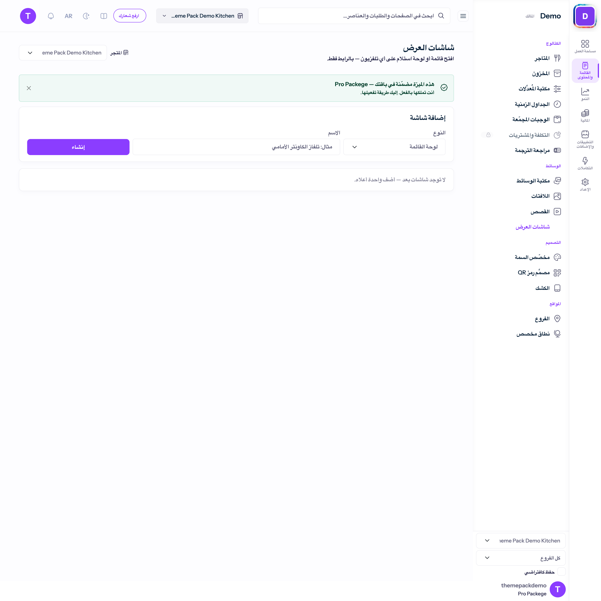

# شاشات اللافتات الرقمية



تضع اللافتات الرقمية شاشة على جدارك دون تثبيت أي شيء عليها. تنشئ شاشة في
لوحة التحكم، وتحصل على عنوان ويب خاص، وتفتح ذلك العنوان في متصفّح التلفاز.
يوجد نوعان: **لوحة قائمة** بخط كبير تتناوب عبر فئاتك، و**لوحة استلام /
حالة** تعرض أي الطلبات قيد التحضير وأيها جاهز.

## فتح الصفحة

لا يوجد رابط في الشريط الجانبي. افتحها مباشرة على:

```
/signage
```

استخدم منتقي المتجر في شريط الإجراءات للتبديل بين المطاعم. لا يوجد محدد فرع
في هذه الصفحة.

## إضافة شاشة

املأ **إضافة شاشة**:

- **النوع** (مطلوب) — **لوحة القائمة** أو **الاستلام / الحالة**.
- **الاسم** — اختياري، حتى 120 حرفًا، مثل "Front counter TV". وبلا اسم، تعرض
  البطاقة النوع بدلًا من ذلك.

اضغط **إنشاء**. يحصل كل شاشة على رمزها العشوائي الخاص، وتُنشأ نشطة.

## بطاقة كل شاشة

تظهر كل شاشة كبطاقة تعرض رمز QR الخاص بها (بتصميم QR لمتجرك — راجع
[رموز QR](qr-codes.md))، واسمها، وشارة **نشط** أو **إيقاف**، ونوع اللوحة،
وعنوانها:

```
/signage/{token}
```

انقر مربع العنوان لتحديده، أو اضغط **فتح** لتشغيل اللوحة في تبويب جديد.
وجّه متصفّح التلفاز إلى ذلك العنوان مرة واحدة واتركه عليه.

الأزرار على البطاقة:

- **إيقاف / تشغيل** — يتوقف عنوان الشاشة غير النشطة عن العمل فورًا.
  ويؤدي إعادة تشغيلها إلى استعادة العنوان نفسه.
- **رمز جديد** — يصدر رمزًا جديدًا بعد تأكيد. **يتوقف العنوان القديم عن
  العمل**، فيتعطّل أي تلفاز لا يزال عليه حتى تفتح الجديد. استخدم هذا إذا تسرّب
  رابط.
- **حذف** — يزيل الشاشة بعد تأكيد.

**الرمز هو الاعتماد الوحيد.** أي شخص لديه الرابط يرى اللوحة، دون تسجيل دخول.
عامله كأنه كلمة مرور: لا تنشره، ودوّره إذا خرج للعلن.

## ماذا تعرض كل لوحة

### لوحة القائمة

فئاتك النشطة بترتيبها المهيّأ، لكل منها أصنافها النشطة المتوفرة وأسعارها.
تُخفى الأصناف النافدة (86'd)، وتُسقَط الفئة التي لم يبقَ بها أصناف بالكامل
بدلًا من عرضها فارغة. تتناوب اللوحة عبر الفئات كل 8 ثوانٍ وتعيد جلب القائمة
كل 60 ثانية، فيصل إيقاف صنف أو تغيير سعر إلى الجدار خلال دقيقة دون أن يلمس
أحد التلفاز.

### لوحة الاستلام / الحالة

عمودان — **جار التحضير** و**جاهز** — مبنيّان من الطلبات المباشرة في تلك
الحالات، حتى 60 في المرة، النشاط الأحدث أولًا. يعرض كل مدخل رقم الطلب و**اسم
العميل الأول فقط**. وتظل الطلبات المجدوَلة التي لم يُفرَج عنها بعد خارج
اللوحة. وتُحدَّث كل 10 ثوانٍ، وتعرض "Screen unavailable" إذا توقف العنوان
عن الصلاحية.

إذا رُفض طلب اللوحة، فذلك ما ستراه — تحقّق من أن الشاشة لا تزال نشطة وأن
الميزة لا تزال مفعّلة.

يمكن تثبيت الشاشات على فرع واحد، وعندئذٍ تعرض لوحة الاستلام طلبات ذلك الفرع
فقط. لا يعرض نموذج لوحة التحكم بعد حقل فرع، لذا فكل شاشة تنشئها اليوم تغطّي
المطعم كله.

تحمل شاشة الاستلام أيضًا كتلة تهيئة اختيارية (إعلان صوتي، دقائق المسح
التلقائي، لون العلامة التجارية والشعار، لوحة ترويجية). لا يوجد محرّر لها في
لوحة التحكم، ولا تعرض صفحة لوحة الاستلام المشحونة تلك الخيارات — إذ لا
يُطبَّق سوى المسح التلقائي، وفقط إذا ضُبطت قيمة خارج لوحة التحكم.

## تشغيلها

اللافتات الرقمية ميزة مقيّدة. لا تعمل اللوحات إلا عند تحقّق كلا الأمرين:

- مفتاح الإيقاف على مستوى المنصة لـ `digital_signage` مفعّل (إعداد للمشرف
  الأعلى — يُشحَن **مُطفأً** افتراضيًا)، و
- تضمّنته باقة مالك المتجر (`digital_signage` مقيّد بالباقة؛ تحقّق من قائمة
  ميزات باقتك).

إذا فشل أي من الفحصين، يُرجع كل عنوان لوحة "not found" — الجواب نفسه لرمز
خاطئ، فلا يتسرّب شيء عن حسابك لمن يحمل الرابط. وتُحظَر صفحة لوحة التحكم
بالفحصين نفسيهما. راجع [الباقات والفوترة](plans-billing.md).

## اللافتات أم لوحة حالة الطلبات؟

كلاهما يضع شاشة في الغرفة، وهما ميزتان منفصلتان:

- تعرض لوحة **الاستلام** ضمن اللافتات أرقام الطلبات مع الأسماء الأولى،
  وتُنشأ لكل شاشة برمزها السري الخاص، ويمكن تثبيتها على فرع.
- تعرض [لوحة حالة الطلبات](order-status-board.md) **أرقام الرموز اليومية
  فقط** — بلا أي أسماء — وتوجد على عنوان عام مبنيّ من slug متجرك، وتُشغَّل من
  إعدادات المطعم.

استخدم لوحة حالة الطلبات عندما تواجه الشاشة صالة طعام عامة وتريد ألّا تكون
على الجدار أي بيانات عملاء.

## صفحات ذات صلة

- [لوحة حالة الطلبات](order-status-board.md) — شاشة Preparing/Ready ذات رقم
  الرمز.
- [فئات القائمة](menu-categories.md) و[أصناف القائمة](menu-items.md) — ما
  تعرضه لوحة القائمة.
- [رموز QR والمشاركة](qr-codes.md) — تصميم QR ذو العلامة التجارية المستخدم
  على بطاقة كل شاشة.
- [الفروع](branches.md) — قصر لوحة الاستلام على فرع.
