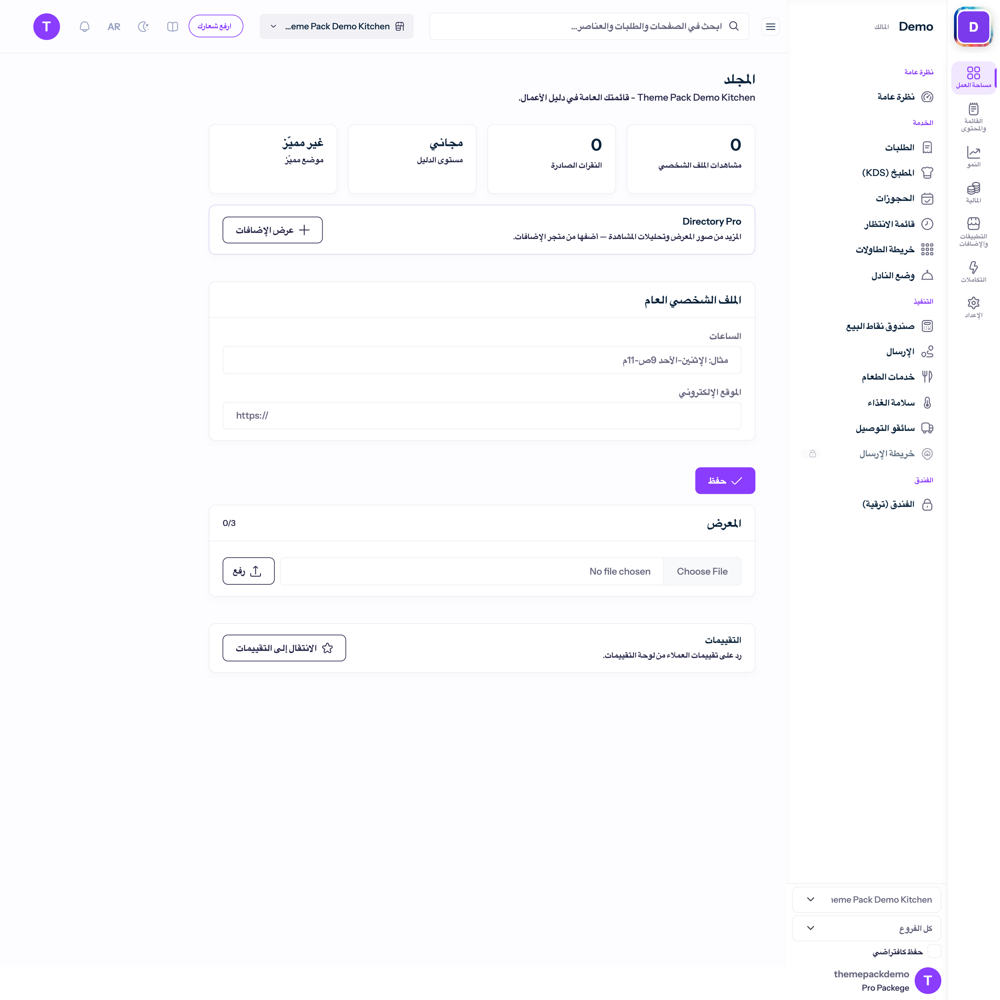

# إدراج دليل الأعمال

دليل الأعمال سطح "استكشاف" عام يتصفّح فيه الزبائن المطاعم حسب المدينة والمطبخ،
في قائمة وعلى خريطة. يمكن أن يكون لمتجرك إدراج هناك بصفحة ملف خاصة به،
ومعرض صور، وساعات عمل، ورابط موقع، ومراجعات — ويمكنك الدفع مقابل موضع إضافي
للتميّز. تغطّي هذه الصفحة ماهية الإدراج، وتبويب **المجلد** في لوحة التحكم
لديك، وما تشتريه الطبقات المدفوعة.

الدليل وحدة على مستوى المنصة: يقرّر مزوّد منصتك ما إذا كان مفعّلًا أصلًا وأي
المدن يغطّي. وإذا كان مُطفأً، تكون الصفحات العامة وتبويب Directory لديك غائبة
ببساطة — ولا يُفقَد شيء في جانبك.

## كيف تظهر الإدراجات للزبائن

يتصفّح الزبائن صفحات استكشاف الدليل حسب المدينة، ويصفّون حسب المطبخ، ويرون
النتائج على خريطة بدبابيس. لكل إدراج صفحة ملف عامة بالأساسيات: الاسم،
والمطابخ، وساعات العمل، وصور المعرض، ورابط صادر إلى قائمتك أو موقعك،
ومراجعات العملاء. ويمكن لأي شخص أيضًا الإبلاغ عن مشكلة في إدراج، ويمكن لعمل
تجاري طلب إزالة إدراج غير مُطالَب به عنه.

تبدأ بعض الإدراجات **غير مُطالَب بها** — مُنشأة من بيانات عامة قبل انضمام
العمل التجاري إلى المنصة. إذا وجدت إدراجًا غير مُطالَب به لمطعمك، فافتحه
واتبع رابط المطالبة به: تسجّل الدخول، وتقدّم المطالبة، وتؤكّد عبر رابط تحقق.
وبمجرد الموافقة، يصبح الإدراج ملكك لإدارته من لوحة التحكم.

## تبويب Directory

افتح **المجلد** في الشريط الجانبي. يظهر التبويب بمجرد أن يكون لمتجرك حضور
في الدليل — إدراج مُطالَب به، أو اشتراك في السوق (راجع
[إدراج السوق](marketplace-listing.md)). يعرض:

- **مشاهدات الملف الشخصي** و**النقرات الصادرة** — كم زبونًا رأى إدراجك ونقر
  للوصول.
- **مستوى الدليل** — Free أو Pro.
- **موضع مميّز** — Featured أو Pending curation أو Not featured.

أسفل الإحصاءات:

- **الملف الشخصي العام** — اضبط **الساعات** (نص حر، مثل "Mon-Sun 9am-11pm")
  و**الموقع الإلكتروني**. أما **المطابخ** فيخصصها فريق الدليل، كي تبقى متسقة عبر
  الدليل كله؛ ويعرض التبويب أيها يحمله إدراجك.
- **المعرض** — ارفع صورًا لطعامك ومكانك. تتضمّن الطبقة المجانية 3 صور؛
  ويرفع **Directory Pro** الحد إلى 12. أزِل صورة بـ × في زاويتها.
- **التقييمات** — تحدث الردود على مراجعات العملاء في لوحة **التقييمات** المعتادة
  لديك؛ ويرتبط التبويب بها مباشرة عبر **الانتقال إلى التقييمات**.

## ما يشتريه الموضع المدفوع

تُرقّي إضافتان إدراجك، وكلتاهما تُشترَى من **متجر الإضافات** (يعرض تبويب
Directory اختصار **عرض الإضافات** عندما تكون في الطبقة المجانية):

- **Directory Pro** — معرض الـ 12 صورة الأكبر وتحليلات المشاهدات.
- **Directory Featured Placement** — يضع إدراجك في المواضع المميّزة أعلى
  النتائج. ويؤدي شراؤه إلى طلب الموضع؛ إذ يرعى فريق الدليل المواضع المميّزة،
  فيعرض تبويبك **بانتظار المراجعة** حتى يصبح مباشرًا، ثم **مميّز**.

لا تلزم أي طبقة لإدراج عادي — إذ يُضمَّن الملف المجاني وساعات العمل ورابط
الموقع ومعرض الـ 3 صور والمراجعات.

## صفحات ذات صلة

- [إدراج السوق](marketplace-listing.md) — البيع عبر سوق التوصيل الخاص
  بالمنصة (اشتراك منفصل).
- [المراجعات والتقييمات والملاحظات](reviews-feedback.md) — قراءة مراجعات
  العملاء والرد عليها.
- [الباقات والفوترة والاشتراكات](plans-billing.md) — شراء الإضافات وإدارتها.
- [مكتبة الوسائط](media-library.md) — إدارة الصور التي ترفعها.
