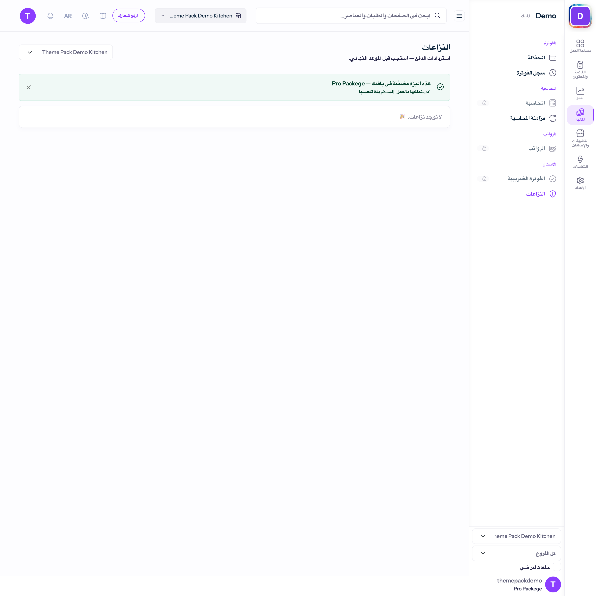

# النزاعات وردّ المبالغ المدفوعة

النزاع (chargeback) هو أن يطلب عميل من جهة إصدار بطاقته عكس دفعة. تسرد صفحة
**النزاعات** النزاعات المرفوعة ضد مدفوعات Stripe الخاصة بك، وتعدّ تنازليًا
مهلة الأدلة، وتتيح لك إرسال أدلتك المكتوبة إلى Stripe دون مغادرة لوحة التحكم.

النزاعات ميزة مدفوعة. إذا كانت باقتك لا تتضمنها، فلن يظهر مدخل **النزاعات**
في الشريط الجانبي.

## فتح الصفحة

انقر **النزاعات** في الشريط الجانبي ضمن **المالية ← الامتثال**. عنوان
الصفحة **النزاعات** وتعرض مطعمًا واحدًا في المرة؛ استخدم محدد المتجر في
ترويسة الصفحة للتبديل.

## من أين تأتي القائمة

تصل النزاعات تلقائيًا من ويب هوكس `charge.dispute.*` الخاصة بـ Stripe — فلا
تضيفها يدويًا. ويُطابَق كل حدث عائدًا إلى الرسم (charge) أو نية الدفع
(payment intent) على إحدى معاملاتك، وهذا ما يُرفَق به النزاع بالمطعم والطلب
الصحيحين. وتُحدّث عمليات تسليم الويب هوك المتكررة النزاع نفسه بدلًا من إنشاء
نسخ مكرّرة، وتحصل على تنبيه أول مرة يُفتَح فيها نزاع.

لا تظهر هنا سوى نزاعات Stripe.

## قراءة القائمة

تُعرَض النزاعات المفتوحة أولًا، مرتّبة حسب أقرب موعد استحقاق للأدلة، حتى 100
صف. يعرض كل صف:

- **مفتوح** — تاريخ رفع النزاع.
- **المبلغ** — العملة والقيمة.
- **السبب** — رمز السبب من Stripe (مثل `fraudulent` أو
  `product_not_received`).
- **الحالة** — حالة Stripe. النزاعات المفتوحة كهرمانية؛ و**won** خضراء؛ وكل
  ما عدا ذلك رمادي.
- **استجب بحلول** — عدّ تنازلي إلى مهلة الأدلة في Stripe. تصبح كهرمانية خلال
  ثلاثة أيام وتعرض **متأخر** بالأحمر الغامق بمجرد تجاوز المهلة.
- **الطلب** — رقم الطلب، عندما يمكن تتبّع النزاع إليه.

يفتح **فتح في Stripe** في أي صف ذلك النزاع في لوحة تحكم Stripe.

## تقديم الأدلة

على نزاع مفتوح، انقر **إرسال الأدلة** (أو **تحديث الأدلة** إذا أرسلت
بعضها بالفعل). يتوسّع نموذج بحقول الأدلة المكتوبة الخاصة بـ Stripe:

- وصف المنتج
- اسم العميل
- عنوان بريد العميل الإلكتروني
- عنوان الفوترة
- عنوان الشحن
- شركة الشحن
- رقم تتبّع الشحنة
- تاريخ الخدمة
- الإفصاح عن سياسة الاسترداد
- الإفصاح عن سياسة الإلغاء
- نص غير مصنّف

املأ ما ينطبق — يأخذ كل حقل حتى 20,000 حرف — وانقر **إرسال إلى Stripe**. يجب
أن تكمل حقلًا واحدًا على الأقل؛ ويُرفَض نموذج فارغ برسالة "Add at least one
piece of evidence before submitting."

بمجرد القبول، يسجّل الصف وقت إرسال الأدلة. ويؤدي التقديم مجددًا إلى
**استبدال** ما أرسلته من قبل، لذا أعِد إرسال كل ما تريد أن يراه Stripe، لا
التغييرات فقط.

### ما الذي قد يعطب

- **"This dispute is already closed."** — لا يمكن الرد على النزاعات
  المغلقة من هنا.
- **"Connect Stripe for this store before submitting evidence."** — ليس
  للمتجر مفتاح Stripe خاص به ولا للمنصة واحد مهيّأ أيضًا.
- **"Stripe rejected the evidence: …"** — رسالة خطأ Stripe نفسها، مُمرَّرة
  دون تغيير.

## الملفات والإيصالات

لا يمكن إرسال سوى الأدلة النصية من هذه الصفحة. أما الإيصالات وإثبات التسليم
الموقّع وأي أدلة **ملفات** أخرى فيجب رفعها في لوحة تحكم Stripe — استخدم رابط
**فتح في Stripe** في الصف.

## النطاق والحدود

- القائمة مقصورة على المطعم الحالي، وتُقدَّم الأدلة دائمًا مقابل نزاع يخص
  ذلك المطعم.
- تذهب الأدلة إلى مفتاح Stripe السري الخاص بالمتجر إن كان لديه واحد، وإلا
  فإلى مفتاح المنصة.
- لا تُتتبَّع هنا النزاعات من بوابات غير Stripe.

## صفحات ذات صلة

- [الطلبات](orders.md) — الطلب الذي يشير إليه النزاع.
- [إعدادات إتمام الطلب](checkout-settings.md) — ربط Stripe بمتجر.
