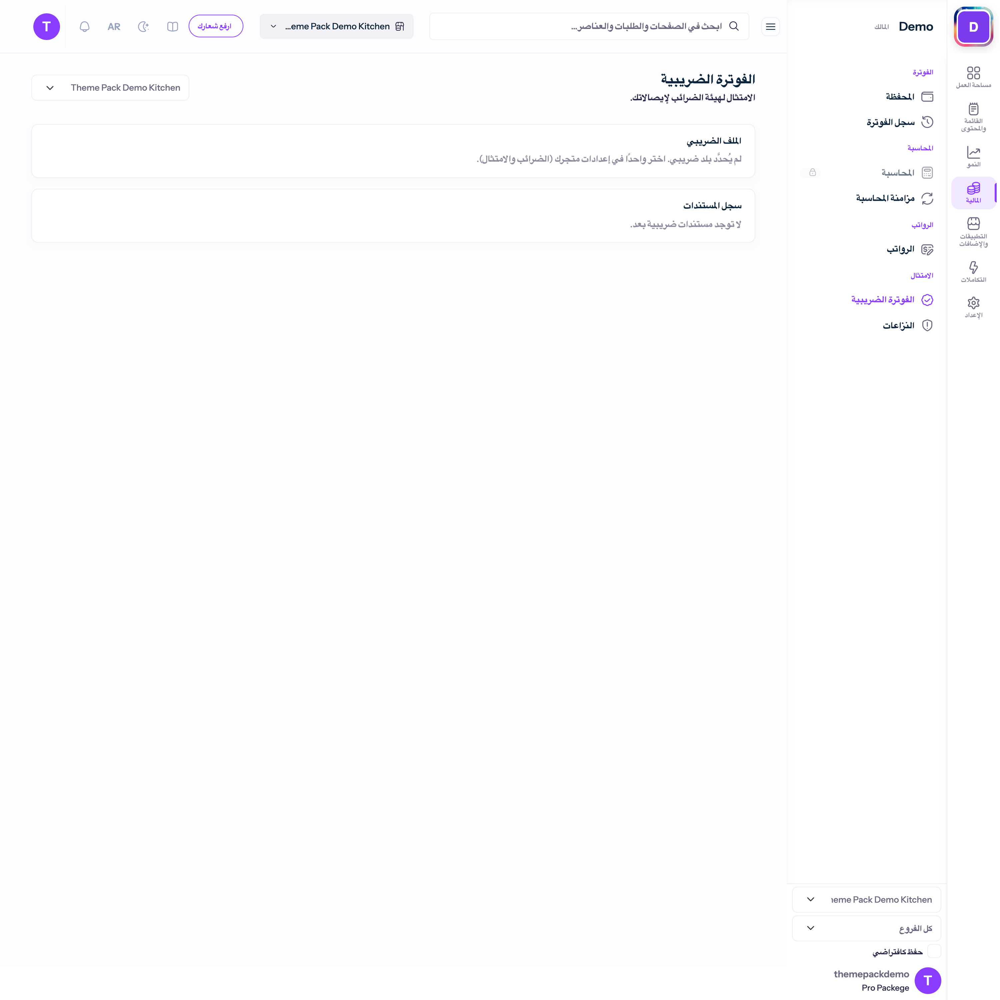

# الفوترة الضريبية (الامتثال لهيئة الضرائب)

تتطلّب بعض الدول تسجيل إيصالات المطاعم لدى هيئة الضرائب — إما بإجازتها قبل
الطباعة، أو الإبلاغ عنها لاحقًا. تعرض وحدة تحكم **الفوترة الضريبية** الملف
الضريبي لمطعمك، وسجل المستندات المُرسَلة إلى الهيئة، ونماذج التسجيل أو
الاعتمادات للدولة التي تعمل فيها.

الفوترة الضريبية ميزة مدفوعة ويجب أيضًا أن تشغّل المنصة كل دولة. إذا كانت
باقتك لا تتضمنها، فسيعرض الشريط الجانبي مدخل **الفوترة الضريبية** مقفلًا. وإذا
لم تُشغَّل دولتك، تُفتَح الصفحة لكنها تعرض "This country is not enabled by
the platform yet." وتبقى نماذج الإعداد مخفية.

## قبل أن تبدأ: هويتك الضريبية

تقرأ الفوترة الضريبية حقول هويتها من صفحة تحرير المطعم، في كتلة **Tax &
Compliance** (التي لا تُعرَض إلا عندما تكون الفوترة الضريبية متاحة في عملية
تثبيتك):

- **الدولة الضريبية** — يختار الملف. الدول التي تُشحَن مع ملف هي المملكة
  العربية السعودية والأردن ومصر والإمارات العربية المتحدة والبحرين والكويت
  وعُمان وقطر والعراق والجزائر والمغرب وتونس.
- **الاسم القانوني** — الاسم المُسجَّل المستخدم على المستندات. إذا تُرك فارغًا،
  يُستخدم عنوان المطعم.
- **VAT / Tax registration number**.
- **Commercial registration (CR) number**.

احفظ المطعم قبل الانتقال إلى وحدة التحكم.

## وحدة التحكم

انقر **الفوترة الضريبية** في الشريط الجانبي ضمن **المالية ← الامتثال**. عنوان
الصفحة **الفوترة الضريبية**؛ استخدم محدد المتجر في ترويسة الصفحة للتبديل بين
المطاعم.

تعرض بطاقة **الملف الضريبي** الدولة ورمزها، ومعدّل ضريبة القيمة المضافة
الافتراضي للملف، ووضع المشغّل — `clear_before_print` (يجب أن تُجيز الهيئة
المستند قبل أن تسلّم الإيصال) أو `report_after_print` (يُطبَع الإيصال
ويُبلَّغ عنه لاحقًا). وبلا دولة ضريبية محددة، تخبرك البطاقة باختيار واحدة في
إعدادات متجرك.

الملفات التي تُشحَن مع مشغّل مباشر هي المملكة العربية السعودية (ضريبة القيمة
المضافة 15٪، وضع الإبلاغ) والأردن (ضريبة القيمة المضافة 16٪، وضع الإجازة)
ومصر (ضريبة القيمة المضافة 14٪، وضع الإبلاغ). أما الدول الأخرى فتوفّر الملف
— معدّل ضريبة القيمة المضافة وحقول الإيصال وQR — دون مشغّل تقديم.

## المملكة العربية السعودية — تسجيل جهاز ZATCA

بالنسبة لمطعم دولته الضريبية **SA**، تظهر بطاقة **ZATCA device onboarding**.
تسجّل جهازًا واحدًا (نقطة بيع فرع) في نظام فاتورة (Fatoora) الخاص بهيئة
الزكاة والضريبة والجمارك.

1. ولّد OTP في بوابة فاتورة (FATOORA).
2. املأ النموذج:
   - **Device key (per branch)** — اسم تختاره لهذا الجهاز. يصبح الاسم الشائع
     (common name) للشهادة.
   - **Branch ID (optional)** — الفرع في لوحة التحكم لديك الذي ينتمي إليه هذا
     الجهاز.
   - **FATOORA OTP** — من 6 إلى 12 حرفًا.
3. انقر **تسجيل**.

ما تفعله المنصة بذلك، في تمريرة واحدة:

1. تنشئ (أو تعيد استخدام) سجل الجهاز.
2. تطلب **compliance CSID** من هيئة الزكاة والضريبة والجمارك باستخدام اسمك
   القانوني ورقم ضريبة القيمة المضافة.
3. تشغّل ستة مستندات امتثال نموذجية.
4. إذا نجحت، تطلب **production CSID**.

يُبلَّغ عن النتيجة بـ "Device onboarded." إضافةً إلى حالة الجهاز الجديدة، أو
"Onboarding failed:" مع الرسالة التي أرجعتها هيئة الزكاة والضريبة والجمارك.
وتُدرَج الأجهزة المُسجَّلة مع حالتها في بطاقة **الأجهزة**.

يستخدم رمز QR للإيصال صيغة TLV بخمس وسوم (اسم البائع، ورقم ضريبة القيمة
المضافة، والطابع الزمني، والإجمالي، ومبلغ الضريبة) حتى يوفّر مشغّل مباشر
مجموعة الوسوم الكاملة.

## الأردن — اعتمادات JoFotara

بالنسبة للدولة الضريبية **JO**، يطلب نموذج **JoFotara credentials** الـ
**Client ID** و**المفتاح السري** و**Activity Number** من بوابة JoFotara.
انقر **حفظ**. تُخزَّن القيم في خزنة الاعتمادات المشفّرة للمنصة، لا كإعدادات
عادية أبدًا.

## مصر — اعتمادات ETA وأجهزة نقاط البيع

بالنسبة للدولة الضريبية **EG** توجد بطاقتان.

يأخذ **ETA credentials** رقم تسجيل المكلّف **RIN** و**Client ID** و**Client
Secret** لجهاز نقاط البيع من بوابة ETA. انقر **حفظ**.

يأخذ **Register POS device**:

- **الرقم التسلسلي للجهاز** (مطلوب)
- **رمز الفرع**
- **Branch ID (optional)**

انقر **إنشاء حساب**. يُخزَّن الجهاز بحالة `registered` ويظهر في بطاقة
**الأجهزة**. ويُنشئ التسجيل أيضًا سرّ استدعاء مرتجع خاصًا بهذا المطعم، وهو ما
يُصادَق به إشعار ETA اللاحق بالصلاحية/عدمها ويُطابَق عائدًا إلى مستنداتك —
إذ يتحوّل المستند إلى **مقبول** أو **مرفوض** عند وصول ذلك الإشعار.

## سجل المستندات

تسرد البطاقة السفلية أحدث 50 مستندًا ضريبيًا للمطعم: الرقم، والنوع،
والحالة، والإجمالي مع العملة، وتاريخ الإنشاء. تعرض الحالات الأخضر لـ
**مقبول**، والأحمر لـ **مرفوض**، والرمادي فيما عدا ذلك.

يظهر زر **إعادة الإرسال** على المستندات المرفوضة. يعيد المستند إلى الطابور
لمحاولة تقديم أخرى. أما المستندات التي هي بالفعل **مقبول** أو
**superseded** فلا يمكن إعادة تقديمها — إذ تحصل على "Document already
finalized."

## النطاق والحدود

- كل ما في هذه الصفحة مقصور على المطعم الحالي. ويُرجع مستند يخص مطعمًا آخر
  "not found".
- الاعتمادات لكل مطعم، لا لكل حساب.
- لا تظهر نماذج الاعتمادات والأجهزة إلا لـ SA وJO وEG، وفقط عندما تكون
  المنصة قد شغّلت تلك الدولة.
- تعكس هذه الصفحة ما تقدّمه المنصة وما تردّ به الهيئة. وهي ليست بديلًا عن
  مشورة محاسبك أو هيئة الضرائب بشأن التزامات تسجيلك الخاصة.

## صفحات ذات صلة

- [المحاسبة](accounting.md) — دفتر أستاذك وتقرير ضريبة القيمة المضافة.
- [الطباعة](printing.md) — طباعة الإيصالات وتوجيهها.
- [الفروع](branches.md) — المواقع التي تُسجَّل الأجهزة مقابلها.
