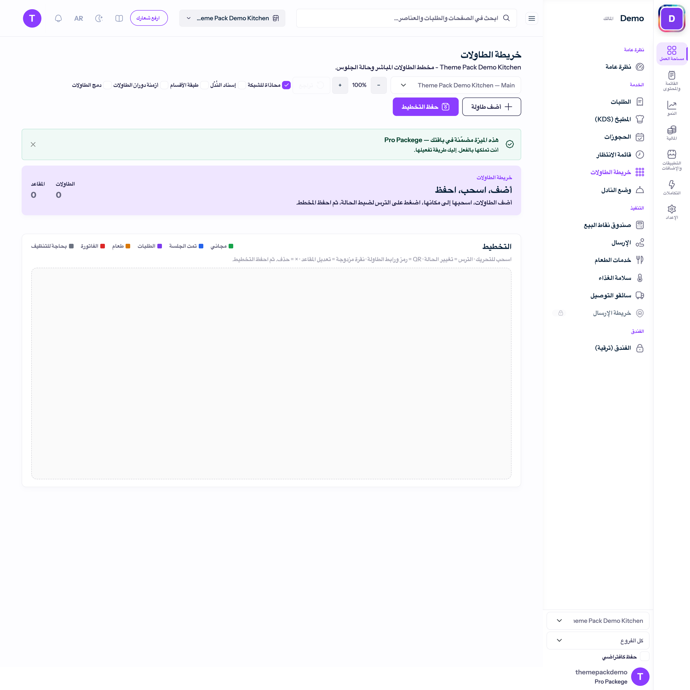

# خريطة الصالة والطاولات

خريطة الصالة محرّر مرئي لصالة طعامك. تسحب الطاولات إلى لوحة رسم لتطابق تخطيطك الحقيقي، وتضبط عدد المقاعد لكل منها، وتجمّعها في غرف وأقسام، وتخصّص نادلًا، وتضبط حالة كل طاولة المباشرة. تستخدم الطاولات نفسها المستخدمة في رموز QR والطلب على الطاولة، معروضةً كمخطط بدلًا من قائمة.

## من يمكنه استخدامها

خريطة الصالة للمالك فقط. تنتمي كل خطة صالة إلى المطعم الذي أُنشئت تحته، ولا يحمّل المحرّر إلا المطاعم التي يملكها الحساب المُسجَّل. ولا يمكن للموظفين أو للمستخدمين الآخرين فتح خريطة صالة مالك آخر.

## فتح خريطة الصالة

في الشريط الجانبي للوحة التحكم، افتح **خريطة الطاولات** (أيقونة الشبكة). يمكنك أيضًا الوصول إليها من شاشة **الطاولات و QR** عبر زر **خريطة الطاولات**.

إذا كنت تدير أكثر من مطعم، يظهر منتقي مطاعم في شريط الإجراءات العلوي كي تبدّل خطة الصالة التي تحرّرها. وتظهر قائمة منسدلة **الفرع** بجواره كلما كانت للمطعم فروع مُعدَّة، كي تبدّل تخطيط أي فرع تحرّره. ويحتفظ كل فرع بتخطيطه المنفصل الخاص، لذا بدّل الفروع قبل ترتيب الطاولات.

تعرض الترويسة إجماليَين جاريَين للفرع الحالي: **الطاولات** (كم طاولة مُوضَعة) و**المقاعد** (مجموع أعداد مقاعدها).

## إضافة الطاولات وترتيبها

- يضع **أضف طاولة** طاولة جديدة على اللوحة. تُرقَّم تلقائيًا (أعلى بواحد من أعلى رقم طاولة لديك)، وتبدأ بـ 4 مقاعد وشكل مربّع، وتظهر قرب أعلى اليسار.
- **اسحب** طاولة لتحريكها. يعمل السحب بالفأرة أو لوحية بشاشة لمس أو قلم.
- يقرّب **محاذاة للشبكة** (مربع اختيار، مفعّل افتراضيًا) كل طاولة إلى شبكة من 20 بكسل عند إفلاتها، فتصطفّ الصفوف بأناقة. أطفئه للوضع الحر.
- يقيس **تكبير / تصغير** اللوحة بين 50٪ و200٪ كي تلائم غرفة كبيرة على الشاشة. ويُعرَض التكبير الحالي كنسبة مئوية.
- يعكس **تراجع** آخر تحريك للطاولة (يتذكّر حتى آخر 50 تحريكًا).
- يحذف زر **×** في زاوية الطاولة الطاولة.

لا تُخزَّن مواضع الطاولات وتعديلاتها حتى تضغط **حفظ التخطيط**. ويكتب الحفظ موضع كل طاولة وشكلها ومقاعدها وغرفتها وقسمها ونادلها وملاحظتها ونطاق سعتها دفعة واحدة، ويعرض الزر تأكيدًا لوجيز.

## تحرير تفاصيل طاولة

انقر نقرًا مزدوجًا على طاولة لتحريرها عبر سلسلة قصيرة من المطالبات:

1. **المقاعد** — عدد المقاعد الفعلي (من 1 إلى 50). يحدّث هذا إجمالي المقاعد في الترويسة.
2. **Capacity range** — حد أدنى وأقصى اختياري لحجم المجموعة، يُدخَل بصيغة `min-max` (مثل `2-4`). اتركه فارغًا لمسحه. ويُبقى النطاق ضمن عدد المقاعد، وإذا أدخلته معكوسًا يُصحَّح تلقائيًا.
3. **الغرفة / المنطقة** — وسم اختياري مثل `Patio` أو `Bar` أو `Main`. اتركه فارغًا لمسحه. وتتيح الغرف تجميع الطاولات على المخطط بشكل مرن.

الطاولات مربّعة افتراضيًا. ويدعم التخطيط المحفوظ أيضًا شكلَي الدائرة والمستطيل، لكن هذا المحرّر لا يعرض حاليًا عنصر تحكم لتبديل شكل طاولة.

## الأقسام والنُّدُل

شغّل مربع اختيار **إسناد النُدُل**، ثم انقر طاولة (نقرة، لا سحبًا) للمرور عبر:

1. **اسم القسم** — تجميع قصير مثل `Terrace` أو `Window` (يمسحه الفراغ).
2. **Assign server** — اختر من قائمة مرقّمة بموظفيك النشطين، أو `0` لعدم وجود.
3. **ملاحظة الطاولة** — ملاحظة قصيرة مثل VIP أو عيد ميلاد أو حساسية. ويظهر دبوس علامة على أي طاولة لها ملاحظة.

شغّل **طبقة الأقسام** لتلوين كل طاولة حسب قسمها وكشف ملخص **تغطية الأقسام** أسفل اللوحة. تسرد التغطية كل نادل (إضافةً إلى مجموعة Unassigned) مع عدد الطاولات وعدد الأشخاص (المقاعد) المسؤول عنهم.

## حالة الطاولة المباشرة

تحمل كل طاولة حالة. انقر الترس على طاولة لفتح منتقي الحالة واختر واحدة:

- **مجاني** (أخضر)
- **تمت الجلسة** (أزرق)
- **الطلبات** (بنفسجي)
- **طعام** (كهرماني)
- **الفاتورة** (أحمر)
- **بحاجة للتنظيف** (رمادي)

يوجد مفتاح ألوان فوق اللوحة. ويُحفَظ ضبط حالة هنا فورًا، فلست بحاجة إلى الضغط على Save layout له. وتُخزَّن الحالة التي تضبطها كحالة الطاولة الخاصة. ويعرض هذا المحرّر تلك الحالة المخزّنة ولا يُحدَّث بمؤقّت. في العروض المباشرة الموجّهة للموظفين، تأخذ الطاولة المتروكة **مجاني** لونها بدلًا من ذلك من أي طلب مباشر عليها (معلّق أو قيد التحضير أو جاهز أو مطلوبة له فاتورة)، فيمكن للمخطط أن يعمل أيضًا كعرض سريع للصالة؛ وتلك العروض الدائمة هي [شاشة صالة POS](pos.md) و[تطبيق الموظفين](staff-app.md)، لا هذا المحرّر.

## رموز QR وروابط الطاولات

لكل طاولة زر **QR**. يفتح قائمة صغيرة بها:

- **فتح منشئ QR** — ينتقل إلى مُنشئ QR لتلك الطاولة تحديدًا، حيث يمكنك طباعة رمزها أو تنزيله.
- **نسخ الرابط** — ينسخ رابط الطلب العام لتلك الطاولة إلى حافظتك.

هذه هي روابط ورموز كل طاولة نفسها الموجودة في شاشة [Tables & QR](qr-codes.md)، فرمز تطبعه من أي من المكانين يوجّه الزبائن إلى الطاولة نفسها.

## أوقات الدوران والاستغلال

شغّل مربع اختيار **أزمنة دوران الطاولات** لتحميل لوحة تحليلات تغطّي آخر 30 يومًا للفرع الحالي. تُبنى من الطلبات على الطاولة المكتملة وتعرض:

- **متوسط الدوران الإجمالي** بالدقائق والعدد الإجمالي للطلبات.
- **أكثر الطاولات ازدحامًا** — الطاولات ذات أكثر الطلبات المكتملة، مع متوسط وقت دوران كل منها.
- **حسب القسم** — التفصيل نفسه مجمّعًا حسب القسم.
- **الطلبات حسب الساعة** — رسم شريطي لحجم الطلبات عبر ساعات اليوم الـ 24، كي ترى أوقات ذروتك خلال اليوم.

## الفروع المتعددة

كل ما في هذه الشاشة مقصور على الفرع المحدد في الشريط العلوي. الطاولات والتخطيط والحالة والأقسام وتحليلات وقت الدوران كلها تخص ذلك الفرع الواحد. لبناء خطة فرع آخر، بدّل القائمة المنسدلة **الفرع** ورتّب طاولاته على حدة.

## صفحات ذات صلة

- [الطاولات ورموز QR](qr-codes.md) — طباعة رموز وروابط الطاولات وإدارتها.
- [شاشة صالة POS](pos.md) و[تطبيق الموظفين](staff-app.md) — عروض الخدمة المباشرة الموجّهة للموظفين.
- [الفروع](branches.md) — إعداد الفروع التي تحرّر خطط صالاتها هنا.
