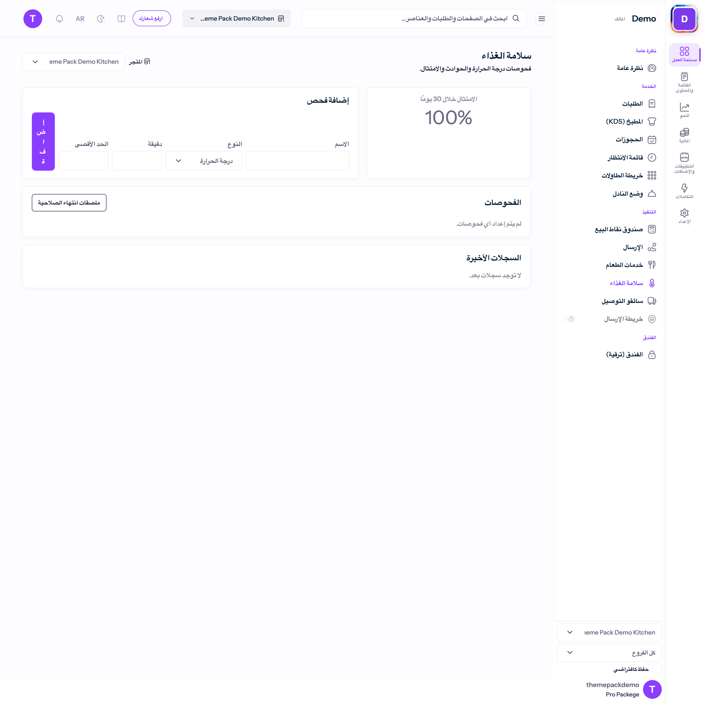

# سلامة الغذاء



تحوّل سلامة الغذاء روتين درجة حرارة ثلاجتك وتنظيفك إلى سجل يمكنك عرضه على
مفتّش. تحدّد الفحوصات التي يجب أن يكملها فريقك، ويسجّل الموظفون القراءات من
هواتفهم، وتُوسَم القراءات خارج النطاق كمخالفات، وتُبلِّغ الصفحة عن معدّل
امتثال متحرّك. كما تطبع ملصقات "يُستخدم قبل" للأصناف المُحضَّرة.

## فتح الصفحة

لا يوجد رابط في الشريط الجانبي. افتحها مباشرة على:

```
/food-safety
```

استخدم منتقي المتجر في شريط الإجراءات للتبديل بين المطاعم. لا يوجد محدد فرع
في هذه الصفحة.

للصفحة أربعة أجزاء: رقم امتثال، ونموذج **إضافة فحص**، وقائمة **الفحوصات**،
و**السجلات الأخيرة**.

## الامتثال

**30-day compliance** نسبة مئوية واحدة في أعلى اليسار. وهي أيام الفحوصات
المكتملة مقسومة على أيام الفحوصات المتوقعة على مدى آخر 30 يومًا، حيث:

- تحتسب المتوقعة كل فحص نشط لكل يوم وُجد فيه داخل الإطار (فحص أضفته أمس يستحق
  يومًا واحدًا فقط، لا ثلاثين)؛
- تحتسب المكتملة كل فحص-ويوم متمايز له سجل واحد على الأقل.

يعرض مطعم بلا فحوصات نشطة 100٪.

## تحديد الفحوصات

املأ **إضافة فحص**:

- **الاسم** (مطلوب، حتى 120 حرفًا) — مثل "Walk-in fridge" أو "Fryer oil".
- **النوع** — **درجة الحرارة** أو **الجهاز** أو **التنظيف**.
- **دقيقة** و**الحد الأقصى** — النطاق المقبول. تُسجَّل القراءة خارج هذا النطاق كمخالفة.
  اترك كليهما فارغين لفحص بلا هدف رقمي (نموذجي لمهام التنظيف).

تُحفَظ الفحوصات بتكرار **يومي** وتُضاف إلى أسفل القائمة.

يعرض كل صف في **الفحوصات** الاسم ونوعه ونطاق min–max كشارة، وشارة "off" عند
تعطيله. زران لكل صف:

- **تعطيل / تفعيل** — يتوقف الفحص غير النشط عن الظهور في قائمة مستحقّات
  الموظفين ويتوقف عن الاحتساب في الامتثال، لكن يُحفَظ تاريخه.
- **حذف** — يزيل الفحص بعد تأكيد.

## تسجيل الموظفين

يسجّل الموظفون القراءات من [تطبيق الموظفين](staff-app.md)، مقابل نقاط
الوصول هذه:

- `GET /staff-app/food-safety` يُرجع الفحوصات **المستحقة اليوم** — كل فحص نشط
  لم يُسجَّل بعد في تاريخ اليوم، بترتيب الموضع، مع اسمه ونوعه وحده الأدنى/الأقصى.
- `POST /staff-app/food-safety/{checkId}` يسجّل قراءة: **القيمة** رقمي اختياري
  و**ملاحظة** اختياري (حتى 500 حرف). ويبيّن الرد ما إذا كانت القراءة مخالفة.
- `POST /staff-app/food-safety-incident` يسجّل **ملاحظة** حرًا (مطلوب، حتى
  1000 حرف) كحادثة. تُوسَم الحوادث دائمًا كمخالفة كي تظهر في السجل، وتُختَم
  بفرع الموظف.

يسجّل كل سجل من قدّمه ومتى. وتتطلّب نقاط الوصول الثلاث موظفًا مُسجَّل الدخول
ومتجرًا مسموحًا له باستخدام سلامة الغذاء؛ ويحصل متجر غير مؤهّل على 403 بدلًا
من قائمة فارغة.

ملاحظة: نقاط الوصول مباشرة، لكن تطبيق الموظفين (PWA) لا يعرض بعد شاشة سلامة
غذاء — إذ لا يوجد تبويب لها في هيكل التطبيق اليوم.

## السجلات الأخيرة

تسرد البطاقة السفلية أحدث 60 سجلًا، الأحدث أولًا: **متى** و**النوع**
و**القيمة** (مع علامة درجة، أو شرطة عند عدم تسجيل رقم) و**ملاحظة**. ويُبرَز أي
صف مخالفة بالأحمر ويحمل شارة "breach". وتظهر الحوادث هنا بالنوع `incident`.

## ملصقات انتهاء الصلاحية

يفتح زر **ملصقات انتهاء الصلاحية** فوق قائمة الفحوصات ورقة ملصقات قابلة للطباعة على:

```
/food-safety/labels
```

املأ:

- **Items (one per line)** — يُطبَع ملصق واحد لكل سطر غير فارغ.
- **تاريخ التحضير** — الافتراضي اليوم.
- **Shelf-life (days)** — الافتراضي 3.

اضغط **عرض** لعرض الورقة، ثم **طباعة**. تُطبَع الملصقات ثلاثة في الصف؛
ويعرض كل منها اسم الصنف وتاريخ التحضير وتاريخ **يُستخدم قبل** بالأحمر (تاريخ
التحضير زائد أيام مدة الصلاحية). ويُخفى النموذج نفسه عند الطباعة.

لا يُحفَظ شيء هنا — إذ تُولَّد الورقة مما تكتبه، في كل مرة.

## تشغيلها

سلامة الغذاء ميزة مقيّدة. لا تعمل إلا عند تحقّق كلا الأمرين:

- مفتاح الإيقاف على مستوى المنصة لـ `food_safety` مفعّل (إعداد للمشرف الأعلى
  — يُشحَن **مُطفأً** افتراضيًا)، و
- تضمّنته باقة مالك المتجر (`food_safety` مقيّد بالباقة؛ تحقّق من قائمة ميزات
  باقتك).

إذا فشل أي من الفحصين، تُحظَر صفحة لوحة التحكم وتُرجع نقاط وصول الموظفين
403. راجع [الباقات والفوترة](plans-billing.md).

## صفحات ذات صلة

- [تطبيق الموظفين](staff-app.md) — حيث يسجّل الموظفون الفحوصات من هواتفهم.
- [الموظفون](staff.md) — من يمكنه تسجيل الدخول إلى تطبيق الموظفين.
- [المخزون](inventory.md) — الأصناف المُحضَّرة التي تضع لها ملصقات.
