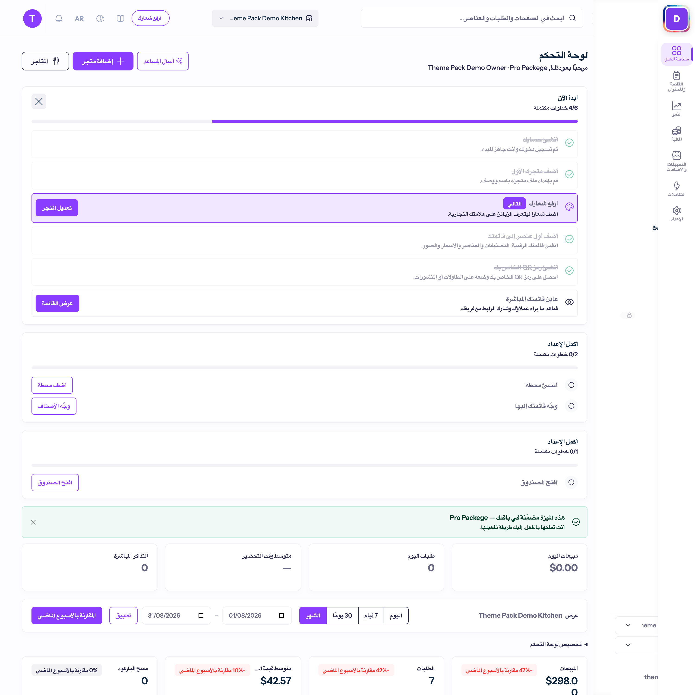

# البدء السريع

يأخذك هذا الدليل من حساب جديد إلى قائمة طعام مباشرة عبر رمز QR يمكن للعملاء
مسحها. تستغرق العملية بأكملها نحو عشر دقائق: أنشئ حسابًا، وأضف مطعمًا، وأضف
صنفًا إلى القائمة، واطبع رمز QR الخاص بك.

## إنشاء حسابك

1. افتح الموقع وانتقل إلى صفحة التسجيل على `/signup` (زر "Sign up" أو
   "Get started" في الصفحة الرئيسية).
2. املأ اسم المستخدم (من 2 إلى 16 حرفًا، حروف وأرقام وشرطات وشرطات سفلية
   فقط)، وعنوان بريدك الإلكتروني، وكلمة مرور (6 أحرف على الأقل). الاسم
   المعروض اختياري؛ إذا تخطّيته فسيُستخدم اسم المستخدم. قد تحتاج أيضًا إلى
   الموافقة على الشروط واجتياز فحص captcha.
3. أرسل النموذج. تُسجَّل دخولك فورًا وتصل إلى لوحة التحكم الخاصة بك.

يُرسَل بريدان إلكترونيان على الفور: أحدهما يتضمن تفاصيل حسابك والآخر يطلب
منك التحقق من عنوان بريدك الإلكتروني. أما الباقة التي تبدأ بها (مجانية، أو
تجريبية، أو باقة محددة) فتحددها إعدادات التسجيل في المنصة — راجع بطاقة
الباقة في لوحة التحكم لمعرفة ما حصلت عليه.

إذا أشارت صفحة التسجيل إلى أن التسجيل مغلق، فهذا يعني أن مالك المنصة قد عطّل
التسجيل العام؛ تواصل معه للحصول على دعوة.

## التحقق من بريدك الإلكتروني

انقر الرابط في بريد التحقق قبل أن تحاول إنشاء مطعم. في معظم عمليات التثبيت،
لا يمكن للحسابات غير المُتحقَّق منها نشر أي محتوى — إذا رأيت "Verify your
email address to post any content"، فإن رابط التحقق هو ما ينقصك. يمكنك طلب
بريد جديد من إشعار التحقق المعروض في لوحة التحكم.

## نظرة أولى: لوحة التحكم

بعد تسجيل الدخول تصل إلى صفحة النظرة العامة (`/dashboard`). تحصل الحسابات
الجديدة على مساعدَين:

- جولة تعريفية قصيرة تُبرز المناطق الأساسية: إضافة أصناف القائمة، ومشاركة
  رمز QR، وتخصيص مظهر قائمتك، ودعوة الموظفين. يمكنك تخطّيها في أي وقت؛
  وتظهر مرة واحدة فقط.
- بطاقة قائمة تحقق "Get started" تتابع تقدّم إعدادك: إنشاء حسابك، وإضافة أول
  مطعم، ورفع شعارك، وإضافة أول صنف في القائمة، وإنشاء رمز QR، ومعاينة قائمتك
  المباشرة. تُوضَّع علامة على الخطوات تلقائيًا عند إتمامها، ولكل خطوة غير
  مكتملة زر ينقلك إلى الصفحة الصحيحة. أغلق البطاقة بعلامة X عند انتهائك.

راجع [نظرة عامة على لوحة التحكم](dashboard-overview.md) لمعرفة معنى الإحصاءات
والرسوم البيانية.

## إنشاء أول مطعم لك

"المطعم" هو صفحة قائمتك العامة: يحصل على عنوان ويب خاص به، ورمز QR، وقائمة،
وإمكانية طلب. لإنشاء واحد:

1. في الشريط الجانبي، افتح Workspace > Restaurants، ثم انقر "New restaurant"
   (أو استخدم زر "Add restaurant" في قائمة التحقق).
2. الخطوة 1 — الأساسيات: أدخل الاسم، ومعرّفًا اختياريًا (slug) يصبح رابطك
   العام، مثل `olive-table`؛ حروف وأرقام وشرطات فقط — وإذا تركته فارغًا فسيُنشأ
   واحد من الاسم، ولونًا للعلامة التجارية، وعنوانًا فرعيًا، وملاحظة توقيت،
   ورقم هاتف، وعنوانًا، ووصفًا قصيرًا. الاسم والعنوان والوصف مطلوبة.
3. الخطوة 2 — القالب: ارفع شعارك وصورة غلاف (PNG أو JPG، حتى 2 ميجابايت لكل
   منهما — كلاهما مطلوب) واختر قالب القائمة. يتحكم القالب في مظهر قائمتك
   العامة؛ ويمكنك تغييره لاحقًا.
4. الخطوة 3 — التأكيد والحفظ.

تصبح صفحتك العامة مباشرة على الفور على `https://your-domain/your-slug`.

يعتمد عدد المطاعم التي يمكنك إنشاؤها على باقتك. إذا رأيت "Limit exceeded,
please upgrade your membership"، فهذا يعني أنك استخدمت جميع خانات المطاعم
لديك — وتُظهر صفحة Restaurants استخدامك ("3 of 5 plan slots used") وزر
"Manage plan".

## إضافة أول صنف في القائمة

تُحفَظ أصناف القائمة داخل فئات، لذا أنشئ فئة أولًا:

1. افتح Workspace > Restaurants وانقر على مطعمك للوصول إلى صفحة "Menu items"
   الخاصة به.
2. املأ حقل "New category" باسم (مثل "Starters" أو "Drinks") وانقر "Add
   Category". يمكنك إضافة فئات فرعية لاحقًا إذا احتجت إليها.
3. انقر زر إضافة الصنف في الفئة واملأ نموذج الصنف. الاسم والسعر فقط مطلوبان.
   كل ما عدا ذلك اختياري: الوصف، والصورة (PNG أو JPG، حتى 2 ميجابايت)، ونوع
   نباتي/غير نباتي، والإشارات الغذائية (نباتي صرف، حلال، خالٍ من الغلوتين)،
   ومستوى الحرارة، وشارتا "popular" و"daily special"، وساعات وأيام التوفر،
   والحقائق الغذائية، وتتبّع المخزون.
4. احفظ. يظهر الصنف على صفحتك العامة على الفور — لا توجد خطوة نشر منفصلة.

تخضع أعداد أصناف القائمة أيضًا لقيود الباقة؛ وتُظهر مقاييس الاستخدام في لوحة
التحكم عدد ما تبقّى لديك.

اختصارات في الصفحة نفسها: يُنشئ "AI generate" مسودة قائمة من صورة أو وصف
لقائمتك الحالية، ويُحمّل "Import CSV" الأصناف بالجملة من جدول بيانات.

## جعل رمز QR مباشرًا

1. افتح Workspace > Restaurants وانقر أيقونة رمز QR على بطاقة مطعمك (أو
   استخدم زر "QR builder" في قائمة التحقق) لفتح مُنشئ رمز QR.
2. تعرض الصفحة رمز QR الخاص بك، الذي يشير دائمًا إلى رابط قائمتك العامة.
   إعدادات اختيارية: اختر طاولة محددة (كي تُوسَم عمليات المسح بها)، وأضف
   وسمًا للمصدر لأغراض التحليلات (مثل `window-sticker`)، وعدّل لون المقدمة،
   ولون الخلفية، والحشو، ونصف قطر الزوايا. انقر "Save settings" للاحتفاظ
   بتنسيقك.
3. انقر "Download PNG" واطبعه، أو "Copy link" لمشاركة رابط القائمة مباشرة
   (WhatsApp، السيرة الذاتية في Instagram، ملف Google Business).

ضع رمز QR المطبوع على الطاولات أو المنضدة أو المنشورات. أي شخص يمسحه يفتح
قائمتك المباشرة — دون الحاجة إلى تطبيق. كما يُتمّ أول مسح آخر خطوات قائمة
التحقق في لوحة التحكم لديك.

## ما التالي

- تابع عمليات المسح والطلبات وهي تَرِد على [لوحة التحكم](dashboard-overview.md).
- أضف المزيد من الفئات والصور وخيارات الأصناف (الأحجام، الإضافات) من صفحة
  Menu items.
- ادعُ فريقك ضمن Team > Staff بأدوار محددة النطاق (مدير، أمين صندوق، مطبخ،
  نادل).
- استكشف Grow > Analytics بمجرد أن تتوافر لديك بضعة أيام من عمليات المسح.
