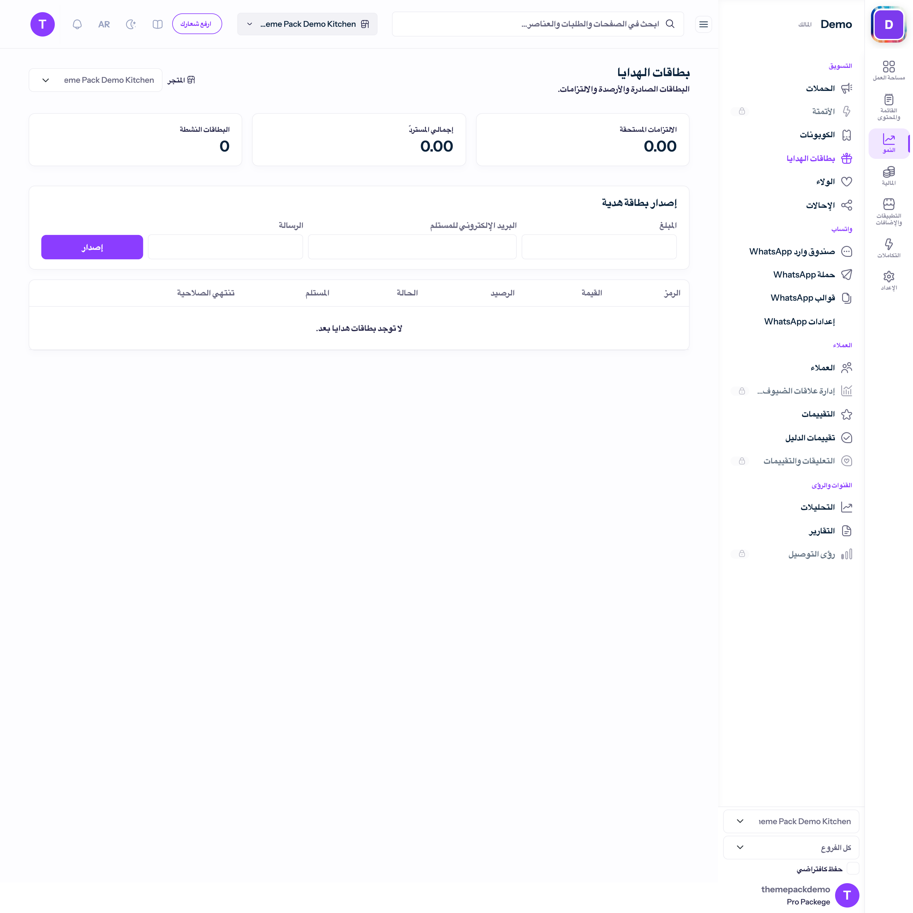

# بطاقات الهدايا

بطاقات الهدايا أرصدة مدفوعة مسبقًا يشتريها عملاؤك على قائمتك العامة
ويُنفقونها عند إتمام الطلب. يمكنك أيضًا إصدار بطاقات يدويًا من لوحة التحكم —
لشكوى، أو عرض، أو بطاقة بيعت عند المنضدة. تحمل كل بطاقة رمزًا فريدًا ورصيدها
الخاص وتاريخ انتهاء اختياريًا.

بطاقات الهدايا ميزة مدفوعة. إذا كانت باقتك لا تتضمنها، فسيعرض الشريط الجانبي
مدخل **بطاقات الهدايا** مقفلًا بدلًا من الصفحة.

## تشغيل بطاقات الهدايا لمطعم

لا تظهر صفحة الشراء ومربع الاستبدال عند إتمام الطلب إلا عند تشغيل الميزة
لذلك المطعم:

1. افتح صفحة تحرير المطعم وانتقل إلى تبويب **الطلبات** ("Checkout and
   service options").
2. اضبط **بطاقات الهدايا** على **نعم**.
3. اضبط المبالغ في الصفحة نفسها:
   - **Gift card amounts (comma-separated)** — الأزرار الجاهزة المعروضة
     للمشتري. الافتراضي `25,50,100`.
   - **الحد الأدنى لمبلغ بطاقة الهدية** — الافتراضي 5.
   - **الحد الأقصى لمبلغ بطاقة الهدية** — الافتراضي 500.
   - **Gift card expiry (months, 0 = never)** — كم تدوم البطاقة من يوم
     إصدارها. الافتراضي 0، أي أن البطاقات لا تنتهي أبدًا.
4. احفظ.

عند إطفاء المفتاح، تُرجع صفحة الشراء العامة "not found" — فالمتجر لا يعلن
أبدًا عن ميزة لم يشغّلها.

## صفحة المالك

انقر **بطاقات الهدايا** في الشريط الجانبي ضمن **النمو ← التسويق**. عنوان
الصفحة **بطاقات الهدايا** وتعرض مطعمًا واحدًا في المرة؛ استخدم محدد المتجر في
ترويسة الصفحة للتبديل.

توجد ثلاثة أرقام في الأعلى:

- **الالتزامات المستحقة** — إجمالي الرصيد غير المُنفَق عبر كل البطاقات
  النشطة لهذا المطعم. وهذا مال ما زلت مدينًا به سلعًا.
- **إجمالي المستردّ** — إجمالي القيمة المُنفَقة بالفعل مقابل الطلبات.
- **البطاقات النشطة** — كم بطاقة حالتها حاليًا `active`.

أسفل ذلك نموذج الإصدار، ثم جدول بكل بطاقة، 30 في كل صفحة، الأحدث أولًا.
يعرض كل صف الرمز، وقيمته الأصلية **القيمة**، والرصيد الحالي **الرصيد**،
والحالة، وبريد المستلم، وتاريخ الانتهاء.

## إصدار بطاقة يدويًا

في **إصدار بطاقة هدية**، املأ:

- **المبلغ** — مطلوب، بين 1 و100000.
- **البريد الإلكتروني للمستلم** — اختياري. إذا ملأته، تُرسَل البطاقة بالبريد إلى ذلك
  العنوان بمجرد إنشائها.
- **الرسالة** — اختياري، حتى 500 حرف، يُضمَّن مع التسليم.

انقر **إصدار**. تُنشأ البطاقة **مموَّلة ونشطة بالفعل** — لا توجد خطوة دفع —
ويُعرَض رمزها في رسالة النجاح. وتُسجَّل الإصدارات اليدوية في
[سجل النشاط](activity-log.md).

## تعديل بطاقة أو إبطالها

كلا الإجراءين متاحان على البطاقات النشطة فقط:

- **تعديل** — اكتب مبلغًا موجبًا أو سالبًا في مربع `±` وانقر **تعديل**.
  يحرّك هذا الرصيد صعودًا أو هبوطًا ويُكتَب في دفتر الأستاذ، فيصبح التغيير
  قابلًا للتتبّع دائمًا.
- **إبطال** — يلغي البطاقة ويزيل رصيدها المتبقي من التزامك. ويُطلَب منك
  التأكيد. ولا يمكن استبدال بطاقة مُبطَلة بعد ذلك ولا إعادة تفعيلها من هذه
  الصفحة.

يقتصر كلا الإجراءين على البطاقات التي تخص مطاعمك؛ ويُرجع معرّف بطاقة ليس
ملكك "not found".

## ما يراه العملاء

توجد صفحة الشراء على `<your menu URL>/gift-cards` — مثل
`https://example.com/my-restaurant/gift-cards`. وترتبط بها سمات القائمة
الحديثة (Aurora وCrave وFeast وGlow وMatcha وNebula وPulse وVelora
وVelvet وVivid) من صفحة القائمة بمجرد تشغيل المفتاح.

يختار المشتري مبلغًا (جاهزًا، أو أي قيمة بين حدك الأدنى والأقصى)، ويختار
طريقة دفع من البوابات التي ثبّتها، ويمكنه اختياريًا تقديم:

- بريده الخاص (**purchaser email**)،
- **البريد الإلكتروني للمستلم** و**هاتف المستلم**،
- **الرسالة**،
- تاريخ ووقت **إرسال مجدوَل** — تُرسَل البطاقة بالبريد عندئذٍ بدلًا من
  الفور.

تُنشأ البطاقة في حالة **معلّقة** ولا يمكن إنفاقها. وتصبح نشطة فقط عندما
تؤكّد بوابة الدفع الدفعة. ولا يموّل استدعاء بوابة مُعاد أو مكرّر بطاقة مرتين
أبدًا.

يعيد المنصة تلقائيًا محاولة التسليمات المجدوَلة والفاشلة سابقًا كل بضع دقائق.

## إنفاق بطاقة

يستبدل العميل بطاقة بإدخال رمزها عند إتمام الطلب. تدفع البطاقة **بعد** أي خصم
كوبون وأي رصيد محفظة — إذ تقلّل المبلغ المستحق لا سعر الأصناف — وتطبّق الأصغر
بين رصيد البطاقة وما هو مستحق. وتعمل البطاقة فقط في المطعم الذي أصدرها.

تبدو الرموز مثل `GC-XXXXXXXXXXXX` وتُولَّد عشوائيًا، فلا يمكن تخمينها من
بطاقة سابقة.

## النطاق والحدود

- تخص البطاقات مطعمًا واحدًا، لا حسابك بأكمله. فإذا كنت تدير عدة مطاعم، لكل
  منها بطاقاته والتزامه وإعداداته الخاصة.
- تُحفَظ قيمة البطاقة في دفتر أستاذ المنصة، ولهذا يتفق دائمًا الرصيد المعروض
  في الصفحة ورقم الالتزام مع ما مُوِّل وأُنفق وعُدِّل فعلًا.
- الإبطال نهائي من هذه الصفحة؛ لا يوجد زر إلغاء إبطال.

## صفحات ذات صلة

- [الكوبونات](coupons.md) — رموز الخصم، التي تقلّل السعر بدلًا من دفع جزء من
  الفاتورة.
- [المحفظة والأرصدة](wallet.md) — رصيد منصتك الخاص، وهو أمر مختلف عن بطاقات
  هدايا العملاء.
- [الباقات والفوترة والاشتراكات](plans-billing.md) — ما تتضمنه باقتك.
