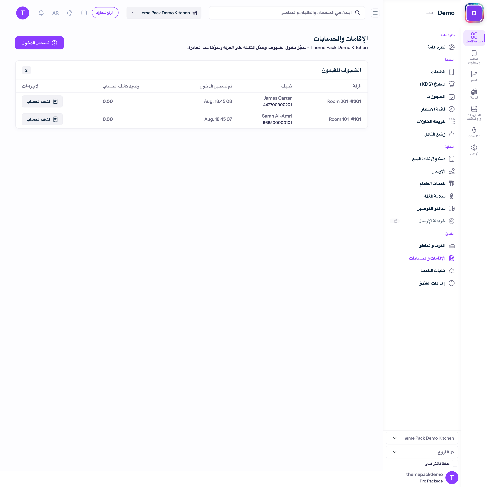

# إقامات الفنادق وفواتير القيد على الغرفة

إذا كنت تقدّم الطعام في فندق أو نزل أو منتجع، تتيح وحدة الفنادق للضيف مسح رمز
QR في غرفته، وطلب خدمة الغرف، وقيد الطلب على غرفته بدلًا من الدفع عند إتمام
الطلب. تصل كل عملية قيد إلى **فاتورة** (folio) لكل إقامة — حساب جارٍ تسوّيه
عند مغادرة الضيف. تغطّي هذه الصفحة تشغيل الوحدة، وتسجيل دخول الضيوف
وخروجهم، وكيفية عمل القيد على الغرفة للضيف، وقراءة الفاتورة وتسويتها.

وحدة الفنادق متاحة على باقة تتضمنها. إذا كانت باقتك لا تتضمنها، فتعرض مجموعة
**الفندق** في الشريط الجانبي مدخلًا مقفلًا يشرح كيفية إضافتها.

## تشغيل وحدة الفنادق

1. افتح **إعدادات الفندق** في مجموعة **الفندق** بالشريط الجانبي.
2. في بطاقة **خدمات ضيوف الفندق**، اضغط **تشغيل**.

بمجرد التشغيل، تظهر بقية مجموعة Hotel: **الغرف والمناطق** و**Stays &
folios** و**طلبات الخدمة**. ويؤدي إطفاء الوحدة إلى إخفاء تلك الصفحات
مجددًا؛ ولا يُحذَف شيء.

## إعداد الغرف

توجد الغرف في صفحة **الغرف والمناطق** وتعمل مثل الطاولات بنوع غرفة: لكل غرفة
رقم، ووسم اختياري، ورمز QR خاص بها يمكنك طباعته ووضعه في الغرفة. والضيف الذي
يمسح رمز QR غرفة يصل إلى قائمتك مرتبطًا بتلك الغرفة بالفعل.

## تسجيل دخول ضيف

1. افتح **الإقامات والحسابات** في الشريط الجانبي.
2. اضغط **تسجيل الدخول**.
3. اختر **غرفة** (تُعرَض الغرف التي لها إقامة نشطة بالفعل كمشغولة ولا يمكن
   اختيارها)، وأدخل **اسم الضيف**، واختياريًا **الهاتف**.
4. اضغط **تسجيل الدخول**.

يُنشئ هذا الإقامة ويفتح فاتورتها برصيد صفري. ويسرد جدول **الضيوف المقيمون**
كل إقامة نشطة مع غرفتها وضيفها ووقت تسجيل الدخول و**رصيد كشف الحساب** المباشر؛
ويحتفظ **الإقامات السابقة الأخيرة** أدناه بآخر 50 إقامة مغلقة. ولكل صف زر **الحساب**
يفتح كشف الحساب.

لا يمكن وجود سوى إقامة نشطة واحدة لكل غرفة في المرة — إذ يُرفَض تسجيل الدخول
إلى غرفة مشغولة.

## كيف يقيّد الضيف على غرفته

عندما يفتح ضيف قائمتك عبر رمز QR غرفته:

- تظهر لافتة ترحيب قابلة للإغلاق تعرض غرفته ("Room 204 · Welcome").
- إذا كان للغرفة إقامة نشطة، يعرض إتمام الطلب خيار **تُحمّل على الغرفة** إلى
  جانب طرق الدفع المعتادة لديك.

للقيد على الغرفة يجب على الضيف إدخال اسم يطابق الضيف المُسجَّل على الإقامة.
والمطابقة متسامحة — "Sam" يطابق "Sam Carter" — لكن الاسم غير المطابق يُرفَض
برسالة واضحة ويُطلَب من الضيف الدفع بطريقة أخرى. وتصل الطلبات المُقدَّمة بهذه
الطريقة إلى قائمة طلباتك كطلبات **خدمة الغرف** وتُرحّل إجماليها إلى
الفاتورة تلقائيًا؛ ولا يدفع الضيف شيئًا عند إتمام الطلب.

إذا لم توجد إقامة نشطة على الغرفة، لا يُعرَض خيار القيد على الغرفة ببساطة،
فلا يمكن لضيف أبدًا القيد على غرفة خالية.

## قراءة الفاتورة وتسويتها

افتح **الإقامات والحسابات** واضغط **الحساب** على إقامة. تعرض صفحة كشف الحساب:

- **كشف الحساب** — كل سطر بتاريخه ووصفه وعمودَي **تحميل** و**دفع**، ثم
  **إجمالي الرسوم** و**إجمالي المدفوعات** و**المبلغ المتبقي**.
- **تسجيل دفعة** — استلم دفعة مقابل الرصيد في أي وقت. أدخل **المبلغ**
  واختر **الطريقة** (Cash أو Card أو Online)، ثم اضغط **تسجيل دفعة**.
  المدفوعات الجزئية مقبولة؛ وتُرفَض دفعة أكبر من الرصيد المستحق، فلا يمكن
  لفاتورة أن تصبح سالبة أبدًا.
- **طباعة** — نسخة قابلة للطباعة من كشف الحساب لتسليمها للضيف.

الرسوم هي ما يدين به الضيف؛ والمدفوعات تعيد الرصيد نحو الصفر. ويُرحَّل كل طلب
خدمة غرف إلى الفاتورة مرة واحدة بالضبط، حتى لو تعثّرت الشبكة وأُعيدت محاولة
الطلب.

## تسجيل الخروج

يتطلّب زر **تسجيل المغادرة** في صفحة الفاتورة رصيدًا صفريًا — سوِّ الفاتورة أولًا
عبر **تسجيل دفعة**. وإذا قررت التنازل عن رصيد متبقٍ بدلًا من ذلك، فاستخدم
**شطب وتسجيل المغادرة**: يصفّر الرصيد بقيد شطب صريح (يُحفَظ في كشف الحساب،
كي يبقى التاريخ نزيهًا) ويغلق الإقامة. تنتقل الإقامات المغلقة إلى **Recent
past stays** ولا يمكن القيد على فواتيرها بعد ذلك.

## من في فريقك يمكنه استخدام هذا

تحرّك إجراءات الفاتورة المال، لذا تقع خلف مفتاح **الوصول إلى حساب النزيل** لكل شخص:

- الموظفون بدور المدير لديهم وصول إلى الفاتورة افتراضيًا.
- لأي شخص آخر، افتح **الموظفون** في الشريط الجانبي وشغّل مفتاح **Folio
  access** في صفه (يظهر المفتاح بمجرد أن تصبح وحدة الفنادق مباشرة).

الموظف بلا وصول إلى الفاتورة لا يرى **الإقامات والحسابات** في شريطه الجانبي
إطلاقًا، ويُرفَض أي محاولة مباشرة لفتح صفحة فاتورة أو تسجيل دفعة. ولا تتأثر
الغرف وطلبات الخدمة وإعدادات الفندق بهذا المفتاح.

## لمطوّرك

الفاتورة حساب على دفتر الأستاذ المزدوج القيد نفسه الذي يشغّل المحافظ ورصيد
المتجر. ويُحسَب الرصيد وكشف الحساب دائمًا من قيود دفتر الأستاذ المُسجَّلة
مقابل حساب فاتورة الإقامة — عامل تلك القيود كمصدر الحقيقة. ولا تعتمد على أي
شيء انطلاقًا من مؤشّر حساب-الفاتورة المخزّن للإقامة: فقد يكون فارغًا في إقامة
فُتحت فاتورتها بشكل كسول، بينما تكون قيود دفتر الأستاذ لتلك الإقامة كاملة
وصحيحة. ورسوم الطلبات عديمة الأثر التكراري لكل طلب (المرجع
`hotel_folio:order:{id}`)، وتحمل التسويات مرجع عدم أثرها التكراري الخاص.

## صفحات ذات صلة

- [خريطة الصالة والطاولات](floor-map.md) — تُدار الغرف مثل الطاولات، بمناطق
  ورموز QR.
- [رموز QR والمشاركة](qr-codes.md) — طباعة رموز كل غرفة.
- [إدارة الطلبات](orders.md) — حيث تظهر طلبات خدمة الغرف.
- [الموظفون والأدوار](staff.md) — الأدوار والأذونات ومفتاح Folio access.
