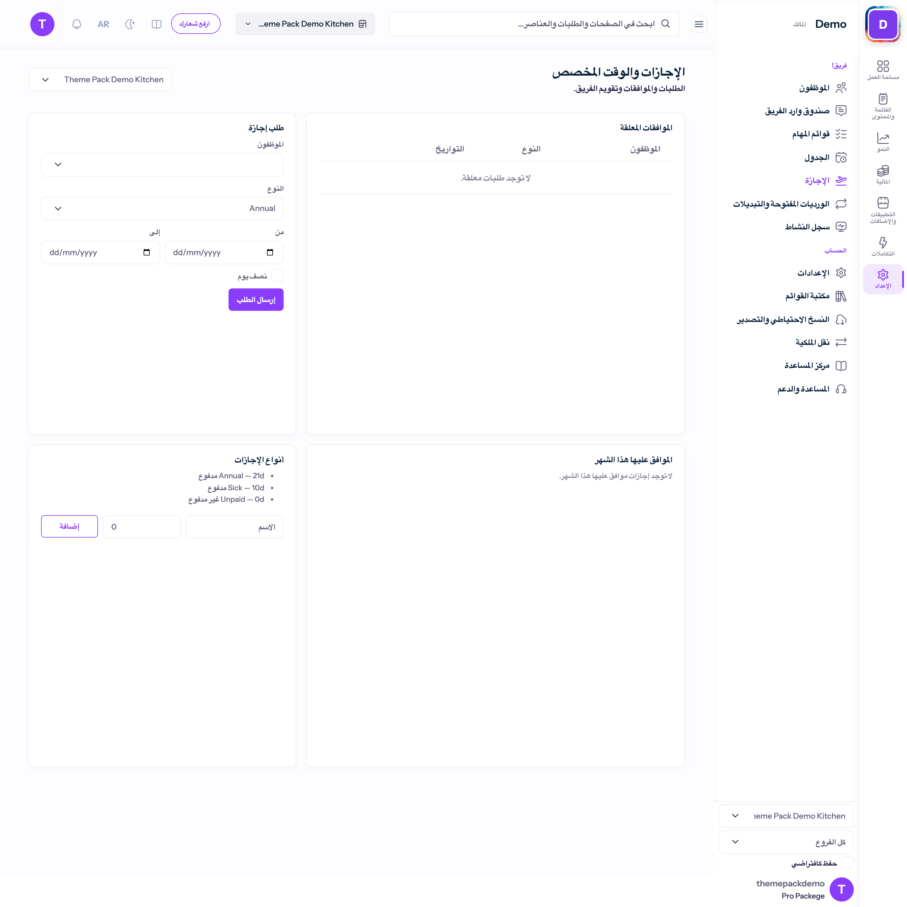

# ملفات الموظفين والإجازات

تغطّي صفحتان جانب الأفراد في فريقك: **ملف موظف** لكل موظف (التفاصيل
الشخصية، والمستندات، ومعدّلات الأجور، والتهيئة) وصفحة **إجازات** لطلبات
الإجازة والموافقات وعرض شهري.

تحتاج كلتاهما إلى تفعيل ميزة **HR & Payroll** (`hrm_suite`) لحسابك. وبدونها
تُرجع الصفحتان "not included in your current plan" أو صفحة الترقية. راجع
[الباقات والفوترة](plans-billing.md).

## فتح ملف موظف

انتقل إلى **الموظفون** في الشريط الجانبي. عندما تكون ميزة HR مفعّلة، يحصل كل صف
موظف على زر **ملف الموارد البشرية**. يفتح `/staff/{id}/hrm` — الرابط المباشر إذا كنت
تفضّله، باستخدام معرّف الموظف. لا يوجد مدخل منفصل في الشريط الجانبي.

لا ترى أبدًا سوى ملفات الموظفين الذين يخصونك؛ وأي شيء آخر يُرجع 404.

الصفحة مقسّمة إلى أربع بطاقات.

### الملف الشخصي

تفاصيل توظيف حرة الصياغة، كلها اختيارية:

- **الهوية الوطنية / الإقامة** (حتى 40 حرفًا)
- **تاريخ الميلاد**
- **العنوان**
- **جهة اتصال للطوارئ** و**هاتف الطوارئ**
- **بداية التوظيف**
- **نوع العقد** — Full time أو Part time أو Casual
- **الأجر الأساسي** — رقم؛ يُستخدم كأجر بالساعة في كشف الرواتب عند عدم تحديد
  معدّل خاص بالدور.

يخزّنها **حفظ الملف**.

### معدّلات الأجور حسب الدور

أسفل ذلك، يمكنك تحديد أجر بالساعة لكل دور: **مدير** أو **كاشير** أو
**المطبخ** أو **نادل**. اختر الدور، واكتب معدّلًا، واضغط **تعيين**. ويؤدي
ضبط دور مرتين إلى استبدال المعدّل السابق. وتُدرَج المعدّلات الموجودة فوق
النموذج.

يستخدم كشف الرواتب المعدّل المطابق لدور الموظف أولًا، ثم أجره الأساسي، ثم أي
أجر بالساعة على سجل الموظف. راجع [كشف الرواتب](payroll.md).

### التهيئة

في المرة الأولى التي تفتح فيها ملف موظف، تُنشأ قائمة تحقق من خمسة عناصر
تلقائيًا:

1. رفع المستندات
2. ضبط رمز PIN
3. التدريب على POS
4. التدريب على KDS
5. صرف الزي الرسمي

انقر الدائرة بجوار عنصر لوضع علامة عليه (وانقر مجددًا لإزالتها). وتعرض الشارة
وشريط التقدّم في أعلى البطاقة الإنجاز كنسبة مئوية. القائمة ثابتة — لا يمكنك
إضافة عناصر أو إعادة تسميتها.

### المستندات

خزنة صغيرة لكل موظف. للرفع، اختر:

- **النوع** — Contract أو Id أو Health cert أو Custom.
- **الانتهاء** — تاريخ اختياري.
- **File** — JPG أو JPEG أو PNG أو PDF، حتى 5 ميجابايت.

تُدرَج المستندات المرفوعة بنوعها وتاريخ انتهائها، مع رابط **عرض** يفتح الملف
في تبويب جديد، و**×** للحذف. ويحصل مستند يقترب من تاريخ انتهائه على شارة
**قارب على الانتهاء** برتقالية.

لاحظ أن الملفات المخزّنة تُقدَّم من تخزين عام، فيمكن لأي شخص لديه رابط الملف
فتحه. لا ترفع مستندات لا تشعر بالارتياح لمشاركتها برابط.

## الإجازات والوقت المستقطع

افتح `/leave` مباشرة — لا يوجد رابط في الشريط الجانبي. استخدم القائمة
المنسدلة للمطاعم في أعلى اليمين إذا كنت تملك أكثر من مطعم.

في المرة الأولى التي تفتح فيها الصفحة لمطعم، تُنشأ لك ثلاثة أنواع إجازة:

- **سنوي** — مدفوعة، 21 يومًا في السنة
- **إجازة مرضية** — مدفوعة، 10 أيام في السنة
- **غير مدفوع** — غير مدفوعة، 0 أيام

### الموافقات المعلّقة

يسرد الجدول الرئيسي كل طلب معلّق للمطعم، الأبكر أولًا: الموظف، ونوع الإجازة،
ونطاق التاريخ. وإذا اصطدمت التواريخ المطلوبة بورديات موجودة بالفعل على
الجدول، تظهر شارة **تعارض في الوردية** برتقالية — وهي تحذير فقط، لا يُحظَر شيء.

يقرّر **إعتماد** أو **رفض** الطلب ويختم من قرّره ومتى. ولا يمكن أن
يُقرَّر الطلب إلا مرة واحدة؛ ويُرفَض تقرير طلب مقرَّر بالفعل.

### الموافق عليها هذا الشهر

أسفل الطابور، قائمة بالإجازات الموافق عليها للشهر الذي تعرضه، بصيغة `staff —
type: from → to`. ويأتي الشهر من معلمة الاستعلام `month` (بصيغة `YYYY-MM`،
والافتراضي الشهر الحالي) — لا توجد أزرار للشهر السابق/التالي في الصفحة، لذا
غيّر الرابط للنظر في شهر آخر، مثل `/leave?month=2026-09`.

### طلب إجازة نيابةً عن شخص

تُنشئ بطاقة **طلب إجازة** طلبًا معلّقًا لأي موظف في المطعم:

- قائمتا **الموظفون** و**النوع** المنسدلتان
- تاريخا **من** و**إلى** — يجب ألّا يكون تاريخ الانتهاء قبل البدء
- مربع اختيار **نصف يوم**
- **إرسال الطلب**

يصل الطلب إلى طابور المعلّقات كي توافق عليه. ولا يمكن للموظفين تقديم طلباتهم
الخاصة — إذ لا توجد شاشة إجازة في جانب الموظف.

### أنواع الإجازات

تسرد البطاقة الأخيرة أنواعك بصيغة `name — Nd paid/unpaid` وتتيح لك إضافة
واحد: **الاسم**، والبدل السنوي بالـ **الأيام**، ثم **إضافة**. الأنواع المُضافة
بهذه الطريقة غير مدفوعة؛ إذ لا تُضبَط إشارة المدفوعة إلا على الأنواع الثلاثة
المُهيَّأة مسبقًا. ولا يمكن تحرير الأنواع أو حذفها من هذه الصفحة.

الإجازة المدفوعة مهمة للأجر: إذ يضيف طلب موافَق عليه على نوع **مدفوع** ساعات
إلى كشف رواتب الموظف، مُقيَّمة بطول اليوم القياسي. ولا تضيف الإجازة غير
المدفوعة شيئًا. راجع [كشف الرواتب](payroll.md).

يحمل كل نوع أيضًا بدلًا سنويًا، ويمكن للنظام حساب رصيد متبقٍ (البدل ناقص
الأيام الموافق عليها هذا العام)، لكن صفحة الإجازات لا تعرض الأرصدة.

## صفحات ذات صلة

- [الموظفون](staff.md) — إنشاء الموظفين وأدوارهم.
- [جدولة الموظفين](staff-scheduling.md) — الجدول الذي تتعارض معه الإجازات.
- [كشف الرواتب](payroll.md) — حيث تتحوّل معدّلات الأجور والإجازة المدفوعة
  إلى أجر.
- [الباقات والفوترة](plans-billing.md) — تفعيل ميزة HR & Payroll.
