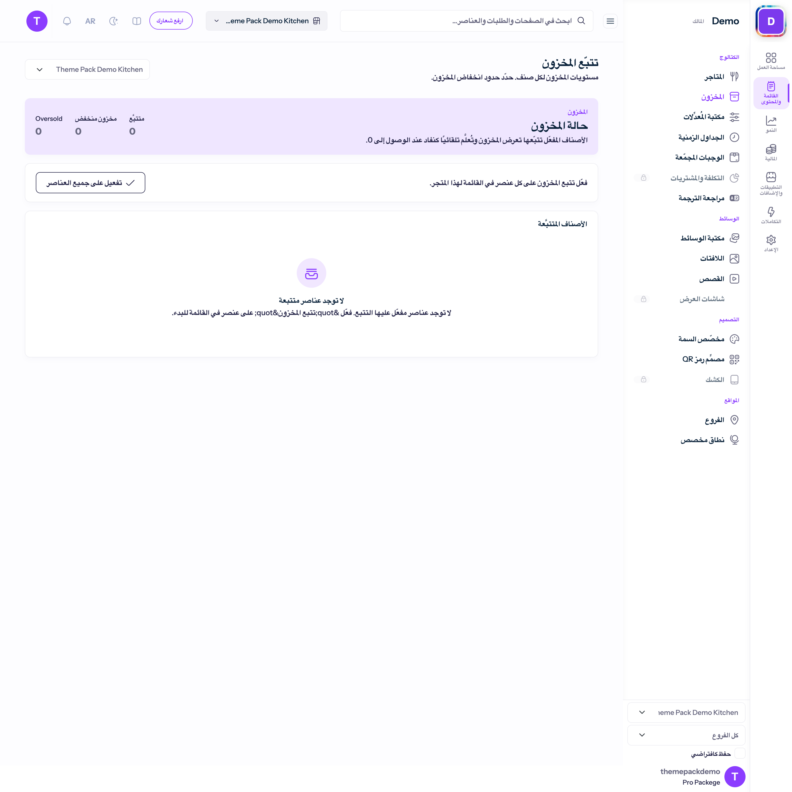

# المخزون والأرصدة

يحافظ المخزون على صحة مستويات مخزونك: إذ يمنعك من بيع ما نفد لديك، ويخبرك بما
يجب إعادة طلبه، و(في الوضع المتقدم) يحسب ما يكلّفك كل طبق لإعداده. افتح
**المخزون** في الشريط الجانبي (تحت أيقونة الطرد)، أو انتقل إلى `/inventory`
مباشرة.

هناك طريقتان لتتبّع المخزون، ويمكنك استخدام أي منهما لكل مطعم:

- **الوضع البسيط** (الافتراضي) يحصي أصناف القائمة الجاهزة. عندما يُباع طبق،
  ينخفض عدّاد مخزونه الخاص بمقدار واحد. جيد إذا كنت تريد فقط "بقي 12 برجرًا،
  وسمه نافدًا عند 0".
- **الوضع المتقدم** يتتبّع المكوّنات الخام. تبني وصفة لكل طبق، ويخصم كل بيع
  المكوّنات التي يستخدمها ذلك الطبق. ويفتح هذا الموردين وأوامر الشراء وجرد
  المخزون وسجل الهدر وتقارير تكلفة الطعام.

إذا كنت تملك أكثر من مطعم، فاستخدم القائمة المنسدلة للمطاعم في أعلى كل صفحة
مخزون لاختيار الذي تعمل عليه. المخزون مقصور على المالك: فلا ترى أبدًا سوى
مخزون المطاعم التي تملكها.

## الوضع البسيط: مخزون كل صنف

تسرد صفحة Inventory الرئيسية كل صنف قائمة مُشغَّل عليه التتبّع، الأقل مخزونًا
أولًا. يعرض كل صف:

- **كمية المخزون** — كم لديك. حرّره في السطر واضغط Save.
- **حد المخزون المنخفض** — عندما يبلغ العدّاد هذا الرقم أو أقل، يُوسَم الصنف
  بأنه منخفض المخزون في الملخص أعلى الصفحة. يُعرَض الحد هنا لكنه يُضبَط عند
  تحرير صنف القائمة (راجع [أصناف القائمة](menu-items.md)).

لا يظهر صنف هنا إلا بمجرد تفعيل **تتبّع المخزون** عليه. فعّله لكل صنف عند
تحرير صنف القائمة (راجع [أصناف القائمة](menu-items.md))، أو استخدم زر
**تفعيل على جميع العناصر** في صفحة Inventory لتشغيل التتبّع لكل صنف في المطعم
المحدد دفعة واحدة.

عندما يبلغ مخزون صنف 0 يُوسَم تلقائيًا بأنه **نافد** ويُخفى من الطلب. وتؤدي
إعادة تخزينه (ضبط الكمية فوق 0) إلى مسح إشارة النفاد تلقائيًا.

### عدّاد البيع الزائد

يعرض ترويسة **حالة المخزون** أعلى صفحة Inventory ثلاثة أرقام: **متتبَّع**
(الأصناف المُشغَّل عليها التتبّع)، و**مخزون منخفض**، و**مُباع بأكثر من المتاح**. يُخصَم
المخزون ذريًا عند تقديم طلب، فلا يمكن أبدًا لطلبين متزامنين أن يأخذا كلاهما
الوحدة الأخيرة — لكن إذا وصل طلب لمخزون لم يكن لدى العدّاد (مثلًا ضُبط
العدّاد مرتفعًا جدًا وبِيع كله)، يُقبَل البيع رغم ذلك، ويُقيَّد الصنف إلى 0
ويُوسَم نافدًا، ويُحتسب الحدث هنا.

**مُباع بأكثر من المتاح** عند 0 مؤشر جيد. والعدد غير الصفري يصبح أحمر، ويعرض متى حدث آخر
بيع زائد ("Last: …")، ويكتسب زر **مسح**. أعِد تخزين الصنف أو صحّح عدّاده،
ثم اضغط **مسح** لإعادة تعيين العدّاد — يقرأ التأكيد "Oversell counter
cleared."

## التبديل إلى الوضع المتقدم (على مستوى المكوّنات)

يُخزَّن وضع المخزون لكل مطعم. في الوضع المتقدم، تخصم المبيعات مكوّنات الوصفة
بدلًا من عدّادات كل صنف، وتنطبق صفحات مستوى المكوّنات الموصوفة أدناه. أما
عنصر التحكم لقلب مطعم بين الوضعين البسيط والمتقدم فلم يظهر بعد على صفحة
Inventory (مخطَّط)؛ ويُوصَل إلى الصفحات المتقدمة نفسها مباشرة عبر الروابط
المذكورة في الأقسام أدناه.

## المكوّنات

المكوّنات هي مخزونك الخام — الدقيق، الجبن، الأكواب، وهكذا. افتحها من صفحة
مخزون المكوّنات (`/inventory/ingredients`). لكل مكوّن تسجّل:

- **الاسم**.
- **الوحدة** — واحدة من غرامات، كيلوغرامات، مليلترات، لترات، حبة، دزينة، أو
  عبوة.
- **الحد الأدنى للمخزون** — نقطة إعادة الطلب لديك. عندما ينخفض المخزون إلى المستوى
  المرجعي أو دونه، يُوسَم المكوّن بأنه **دون المستوى المرجعي**. والمستوى
  المرجعي 0 يعني عدم وجود تنبيه.
- **التكلفة لكل وحدة** — يُستخدم لتقييم المخزون وتكلفة الطعام وتكلفة الهدر.
- **المخزون الافتتاحي** — الكمية المتوفرة لديك عند إضافته.

تعرض ترويسة الصفحة كم مكوّنًا لديك، وكم منها دون المستوى المرجعي، وإجمالي
**قيمة المخزون** (الكمية مضروبة في تكلفة الوحدة عبر كل المكوّنات).

يُكتَب كل تغيير في مخزون مكوّن إلى دفتر أستاذ غير قابل للتغيير، فيطابق الرقم
الذي تراه دائمًا تاريخه المُسجَّل. استخدم **تعديل** لتغيير المخزون يدويًا
بأربع طرق:

- **تحصل على** — أضف مخزونًا (مثلًا، توصيلة)، اختياريًا بتكلفة وحدة.
- **استخدم** — أزِل مخزونًا يدويًا.
- **الهدر** — أزِل مخزونًا وسجّله كهدر.
- **تعيين** — صحّح العدّاد إلى رقم دقيق (يسجّل النظام الفرق).

يعرض رابط **السجل** على كل مكوّن حركات مخزونه الأخيرة — المشتريات
والمبيعات والهدر والتعديلات وتصحيحات العدّاد — مع الرصيد الجاري بعد كل واحدة.

## الوصفات

الوصفة هي قائمة المكوّنات (وكمية كل منها) التي تدخل في حصة واحدة من صنف
قائمة. الوصفات هي ما يتيح لبيع خصم المخزون الخام. افتح الوصفات من صفحة
المكوّنات أو على `/inventory/recipes`، واختر مطعمًا، ثم حرّر وصفة أي صنف
قائمة.

لكل سطر تختار مكوّنًا والكمية المستخدمة لكل حصة. ومن الوصفة يحسب النظام:

- **تكلفة الوصفة** — إجمالي تكلفة المكوّنات لإعداد حصة واحدة.
- **Food-cost percentage** — تكلفة الوصفة مقسومة على سعر القائمة. فحص هامش
  مفيد: الأقل أفضل.

أصناف القائمة بلا وصفة ببساطة لا تُخصَم على مستوى المكوّنات.

## كيف يُخصَم المخزون عند البيع

عند تقديم طلب — عبر متجرك الإلكتروني، أو API، أو [POS](pos.md) — يُخفَّض
المخزون تلقائيًا. ويعتمد أي خصم يُشغَّل على وضع مخزون المطعم:

- **الوضع البسيط:** ينخفض عدّاد مخزون صنف القائمة نفسه بالكمية المطلوبة،
  ويُوسَم الصنف نافدًا عند 0.
- **الوضع المتقدم:** لكل صنف له وصفة، يُخصَم كل مكوّن وصفة بكمية كل حصة
  مضروبة في الكمية المباعة. وتُتخطّى الأصناف بلا وصفة، ولا يُمَسّ عدّاد كل
  صنف.

إنها واحدة أو أخرى لكل مطعم، لا كلتاهما معًا. وإذا أبطلت سطر صنف على POS،
تُضاف كميته مجددًا إلى عدّاد كل صنف لذلك الصنف.

## الموردون

الموردون هم البائعون الذين تشتري منهم المكوّنات. أدِرهم على
`/inventory/suppliers`. لكل مورد يمكنك تسجيل اسم جهة اتصال وبريد وهاتف ومدة
التوريد بالأيام وملاحظات، ووسمه نشطًا أو غير نشط. وتُخفى الموردون غير
النشطين عند إنشاء أمر شراء.

## أوامر الشراء

أمر الشراء (PO) يسجّل مخزونًا تشتريه. أدِرها على
`/inventory/purchase-orders`. سير العمل هو:

1. **أنشئ** مسودة أمر، اختياريًا مقابل مورد.
2. **أضف سطورًا** — اختر مكوّنًا وكمية وتكلفة وحدة. ويُحسَب لك إجمالي السطر
   وإجمالي الأمر.
3. **وسمه كمطلوب** بمجرد إرساله إلى المورد.
4. **استلم** عند وصول التوصيلة. يضيف هذا كمية كل سطر إلى مخزون مكوّناتك
   ويحدّث تكلفة كل مكوّن لكل وحدة إلى السعر الذي دفعته للتو.

يمكنك **إلغاء** أمر في أي وقت قبل استلامه. والأمر المُستلَم مقفل — لا يمكنك
تحريره أو استلامه مجددًا، فلا يُحتسب المخزون مرتين أبدًا.

## جرد المخزون

جرد المخزون هو جرد فعلي يوفّق أرقامك المُسجَّلة مع ما هو موجود فعلًا على
الرفّ. أدِرها على `/inventory/counts`.

1. **ابدأ جردًا.** يلتقط النظام لقطة للكمية المُسجَّلة (النظرية) الحالية لكل
   مكوّن نشط.
2. **أدخل الكميات المعدودة** لكل مكوّن أثناء عدّها. يمكنك الحفظ في المنتصف
   والعودة — يبقى الجرد مفتوحًا. والمكوّنات التي تتركها فارغة لا تُمَسّ.
3. **أغلق الجرد.** لكل مكوّن عددته، يُرحَّل الفرق بين المخزون المعدود
   والمُسجَّل (**التباين**) كتصحيح، فيطابق مخزونك المُسجَّل الآن الواقع.

لا يمكن إعادة فتح جرد مغلق أو إعادة تطبيقه.

## سجل الهدر

يسجّل سجل الهدر (`/inventory/waste`) المكوّنات المُلقاة وما كلّفتك. سجّل
مكوّنًا وكمية وسببًا — تلف، انتهاء صلاحية، خطأ تحضير، سرقة، إفراط في الإنتاج،
أو غير ذلك — مع ملاحظة اختيارية. ويؤدي تسجيل الهدر إلى خصم المكوّن من المخزون
وتسجيل تكلفته (الكمية مضروبة في تكلفة الوحدة الحالية).

تعرض الصفحة إدخالات الهدر الأخيرة وتفصيلًا لمدة 30 يومًا لتكلفة الهدر حسب
السبب، كي ترى أين يُفقَد المال.

## تقارير المخزون

تجمع صفحة التقارير (`/inventory/reports`) بيانات الوضع المتقدم معًا للمطعم
المحدد:

- **قيمة المخزون المتاح** — إجمالي قيمة مخزون المكوّنات الحالي.
- **قائمة المخزون المنخفض** — المكوّنات عند مستواها المرجعي أو دونه.
- **Food cost per item** — تكلفة الوصفة والسعر ونسبة تكلفة الطعام لكل طبق له
  وصفة، إضافةً إلى متوسط تكلفة الطعام عبرها.
- **Waste cost (last 30 days)**.
- **قيمة الانحراف** من أحدث جرد مخزون مغلق لديك — القيمة المالية للفرق بين
  المخزون المُسجَّل والمعدود، وهي مؤشر بديل للتسرّب.

## الفروع المتعددة

إذا كان لمطعم [فروع](branches.md)، يمكنك عرض المخزون وتعديله لكل فرع بدلًا من
المجمّع المشترك. في صفحة المكوّنات، اختر فرعًا لرؤية المتوفر والمستويات
المرجعية لذلك الفرع؛ وتنطبق تعديلات المخزون التي تجريها بينما يكون فرع محددًا
على صف مخزون ذلك الفرع الخاص، وتخصم المبيعات في فرع من مخزون ذلك الفرع.

## صفحات ذات صلة

- [أصناف القائمة](menu-items.md) — تشغيل تتبّع كل صنف وضبط الأسعار.
- [الفروع](branches.md) — مخزون كل فرع.
- [نقاط البيع](pos.md) — كيف تخصم المبيعات الحضورية المخزون.
- [التحليلات](analytics.md) — تقارير المبيعات وهندسة القائمة.
