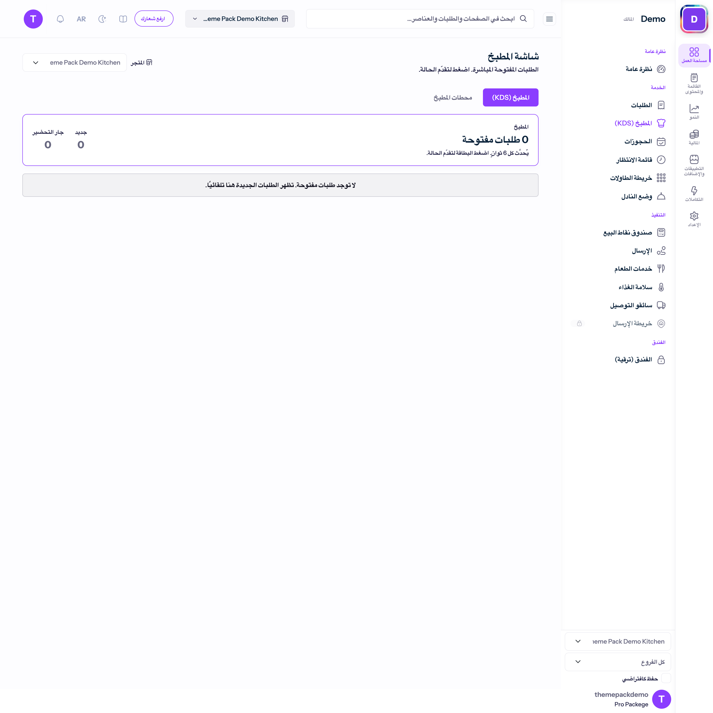

# نظام شاشة المطبخ (KDS)

يحوّل نظام شاشة المطبخ (KDS) الطلبات الواردة إلى تذاكر مباشرة يمكن لمطبخك العمل منها على شاشة، بدلًا من بطاقات ورقية. افتحه من الشريط الجانبي للوحة التحكم ضمن **المطبخ (KDS)**. وتتيح لك صفحة مرافقة **محطات المطبخ** تقسيم قائمة عبر الشوي والقلي والبار ومناطق تحضير أخرى.

تشرح هذه الصفحة لوحة المطبخ اليومية، وكيفية إعداد المحطات، وكيف يعمل توجيه المطابخ المتعددة، وما تفعله الميزات المتقدمة على مستوى الأصناف.

## لوحة المطبخ

تعرض صفحة **المطبخ (KDS)** كل تذكرة مفتوحة كبطاقة. تستطلع تلقائيًا الطلبات الجديدة كل 6 ثوانٍ، فيمكنك تركها تعمل على شاشة في المطبخ وتبقى محدّثة دون تحديث.

تعرض كل بطاقة تذكرة:

- رقم الطلب، إضافةً إلى شارة **رقم** ذات الرمز الموجّه للعميل عندما تكون
  لوحة حالة الطلبات مستخدمة.
- رقم الطاولة (أو قائمة طاولات المجموعة المدمجة)، أو اسم العميل (أو
  "Walk-in" إذا لم يُضبَط أي منهما).
- كل صنف بكميته والمتغير المختار وأي اختيارات لمجموعة خيارات (موسومة بـ »)
  وأي ملاحظة صنف.
- منذ كم دقيقة ورد الطلب، مع هدف وقت التحضير للمتجر كتلميح "~Nm" عند ضبط
  واحد.
- زر **تشغيل الملاحظة الصوتية** (مع النص أسفله) عندما يرفق العميل ملاحظة صوتية،
  وشارة **استلام من السيارة** — تتحوّل إلى "Curbside · ARRIVED" عند تسجيل وصول
  الضيف.

يرنّ صوت عند ظهور تذكرة جديدة فعلًا، فلا يضطر المطبخ إلى مراقبة الشاشة.

في أعلى اللوحة، يعرض شريط العدد الإجمالي للتذاكر المفتوحة وأعدادًا منفصلة لطلبات **جديد** و**جار التحضير**.

لتحريك تذكرة، انقر الزر على البطاقة:

- ينقل **ابدأ** تذكرة جديدة إلى قيد التحضير.
- ينقل **جاهز** تذكرة قيد التحضير إلى جاهز.

هذا هو مسار التذكرة الكاملة ("الأساسي"): زر واحد يدفع الطلب بأكمله عبر جديد إلى قيد التحضير إلى جاهز إلى مُسلَّم، مع ختم الوقت المطابق (قيد التحضير، جاهز، ومكتمل) أثناء تقدّمه. وعندما تُدفَع تذكرة بعد جاهز تغادر اللوحة.

إذا لم توجد طلبات مفتوحة، ترى "No open tickets. New orders appear here automatically." والطلبات المُوقَفة أو المُعلَّقة على POS لا تصل أبدًا إلى لوحة المطبخ، والطلب المُبطَل على POS يغادر اللوحة.

### الطلبات المجدوَلة

تظهر الطلبات المسبقة المجدوَلة لوقت لاحق في شريط **الطلبات المجدولة** منفصل فوق اللوحة بدلًا من كونها تذاكر مباشرة. وتُفرَج إلى المطبخ تلقائيًا في وقت الإطلاق، أو يمكنك الضغط على **أرسل الآن** في صف لإطلاق واحد مبكرًا.

استخدم محدد المطاعم في أعلى الصفحة لتبديل مطبخ أي مطعم تعرضه. وإذا اخترت فرعًا في الشريط الجانبي، تعرض اللوحة طلبات ذلك الفرع فقط.

## أوضاع المطبخ: الأساسي والمتقدم

لكل مطعم وضع مطبخ، مُخزَّن لكل مطعم: **أساسي** (الافتراضي) أو **متقدم**.

- **أساسي** هو لوحة التذكرة الكاملة الموصوفة أعلاه.
- يضيف **متقدم** تذاكر على مستوى الأصناف، ومحطات المطبخ، والتنسيق (expediting)، وترتيب الأطباق (coursing)، وأهداف وقت التحضير، والتحليلات.

يغيّر الوضع المتقدم ما تُرجعه بيانات الاستطلاع: تبقى التذاكر الجاهزة مرئية كي يجمّعها المنسّق، ويحمل كل صنف حالته ومحطته ولونه وهدف وقت تحضيره الخاص.

ملاحظة: شاشة لوحة المطبخ نفسها تعرض حاليًا تخطيط التذكرة الكاملة الأساسي. أما السلوكيات المتقدمة على مستوى الأصناف فتظهر عبر عرض مطبخ الهاتف في **تطبيق الموظفين** وصفحة **تحليلات المطبخ** بدلًا من لوحة سطح مكتب منفصلة (انظر أدناه). يوجد إعداد في الخلفية لتبديل مطعم إلى الوضع المتقدم، لكن لوحة التحكم لا تعرض بعد زرًا له — راجع [الفجوات](#what-is-not-built-yet).

## محطات المطبخ

افتح **محطات المطبخ** من الشريط الجانبي لتوجيه أصناف القائمة إلى مناطق تحضير محددة. لا ترى كل محطة سوى أصنافها، فلا تعرض شاشة الشوي أبدًا المشروبات ولا يعرض البار أبدًا شرائح اللحم.

لإضافة محطة، اختر مطعمًا، ثم املأ:

- **الاسم** — مثل Grill أو Fryer أو Bar.
- **اللون** — عيّنة لون تُستخدم لوسم تذاكر المحطة.
- **Target (min)** — هدف وقت التحضير لألوان التقادم وتحليلات الالتزام
  بالوقت (من 1 إلى 240 دقيقة، الافتراضي 10).
- **الفرع** — اتركه على "All branches" لمحطة على مستوى المطعم، أو اختر فرعًا
  واحدًا لجعلها خاصة بالفرع.
- **الإكسبو** — وسم محطة كمحطة التنسيق/التمرير.

يمكنك تحرير أي محطة لاحقًا لإعادة تسميتها أو تغيير لونها أو هدفها أو تبديلها نشطة أو غير نشطة أو نقلها إلى فرع آخر. ويؤدي حذف محطة إلى إلغاء تخصيص أصنافها — إذ تعود إلى عرض المطبخ الافتراضي — فلا يُفقَد شيء.

### تخصيص الأصناف للمحطات

أسفل قائمة المحطات لوحة **تعيين العناصر للمحطات**. لكل صنف قائمة تختار أي محطة تطبخه:

- بلا فرع محدد، تضبط المحطة **الافتراضية على مستوى المطعم** لذلك الصنف.
- مع فرع محدد في الشريط الجانبي، تضبط **تجاوزًا لكل فرع** — مفيد عندما يحضّر فرع طبقًا في البار وآخر في الشوي. اترك صنفًا على "Default" للاستمرار في استخدام التخصيص على مستوى المطعم.

## توجيه المطابخ المتعددة

عند تقديم طلب، يُوجَّه كل سطر إلى محطة تلقائيًا باستخدام هذه الأولوية:

1. تجاوز لكل فرع لذلك الصنف والفرع، إن وُجد.
2. محطة الصنف الافتراضية على مستوى المطعم.
3. لا محطة (يذهب الصنف إلى عرض الافتراضي/المنسّق).

يُحسَم التوجيه لحظة إنشاء الطلب، فيحتفظ كل صنف طلب بالمحطة التي أُرسل إليها حتى لو أعدت تخصيص أصناف القائمة لاحقًا. ويُخزَّن رقم طبق الصنف أيضًا عند هذه النقطة.

## ترتيب الأطباق (الإطلاق والتعليق)

يمكن أن تحمل أصناف القائمة رقم طبق (من 1 إلى 9)، يُضبَط عند تحرير الصنف. يُطلَق الطبق 1 فورًا عند تقديم الطلب. وتُعلَّق الأطباق اللاحقة — إذ تُسجَّل على التذكرة لكن لا تُرسَل مباشرة إلى محطتها حتى تُطلَق، كي لا تصل المقبّلات والأطباق الرئيسية إلى المطبخ في الوقت نفسه.

يؤدي إطلاق طبق مُعلَّق إلى ختمه مباشرًا فتظهر أصنافه في محطاتها. ويوجد إجراء الإطلاق في النظام لكنه لم يظهر بعد كزر على لوحة المطبخ — راجع [الفجوات](#what-is-not-built-yet).

## التذاكر على مستوى الأصناف والدفع والاسترجاع

في المطابخ المتقدمة، يتحرّك كل صنف طلب عبر حالته الخاصة: **في الطابور** و**جار التحضير** و**جاهز** و**تم التقديم**.

- يدفع **Bump** صنفًا واحدًا خطوة إلى الأمام.
- يتراجع **Recall** عن دفعة، منقلًا الصنف خطوة إلى الوراء وماسحًا الوقت الذي سجّله.

مع دفع الأصناف، تعيد الحالة العامة للطلب مزامنتها من أصنافه: يصبح الطلب قيد التحضير بمجرد أن يكون أي صنف قيد التقدّم، وجاهزًا فقط عندما يكون كل صنف جاهزًا أو مُقدَّمًا (كي يعرف المنسّق أنه يمكنه التقديم)، ومُسلَّمًا بمجرد تقديم كل صنف.

اليوم يُستخدم هذا الدفع والاسترجاع على مستوى الأصناف من عرض مطبخ الهاتف في **تطبيق الموظفين**. يفتح الطاهي تطبيق الموظفين، ويرى الأصناف المفتوحة لمحطته (إما المحطة المثبّت عليها أو محطة مختارة)، وينقر لدفع كل صنف إلى الأمام أو استرجاعه. ويعرض عرض الموظف أيضًا إجماليًا لليوم كله يحصي الوحدات المفتوحة لكل صنف عبر كل التذاكر. راجع [تطبيق الموظفين](staff-app.md) لكيفية تسجيل دخول الموظفين وأي أذونات يحتاجونها (يتطلّب عرض المطبخ إذن KDS).

## تحليلات المطبخ

تُبلِّغ صفحة **تحليلات المطبخ** (المتاحة على رابط تحليلات المطبخ، برابط "Open KDS" عائد إلى اللوحة) عن أداء مطبخك على مدى آخر يوم أو 7 أيام أو 30 يومًا:

- **متوسط زمن التذكرة** — متوسط الدقائق من تقديم الطلب إلى جاهز.
- **متوسط تحضير العنصر** — متوسط الدقائق التي يقضيها صنف قيد التحضير.
- **On-time rate** بفئات **On time / Caution / Late**، مقيسة مقابل هدف كل محطة: ضمن 60٪ من الهدف في الوقت، حتى الهدف تحذير، فوق الهدف متأخر.
- **Orders in the last 15 and 30 minutes** — حِمل المطبخ الحالي.
- **أبطأ العناصر** حسب متوسط وقت التحضير.
- **حسب المحطة** متوسط وقت التحضير.

هذه هي البيانات التي تغذّيها المحطات والأهداف والتوقيت على مستوى الأصناف، لذا فهي أكثر معنى بمجرد أن توجّه الأصناف إلى محطات بأهداف معقولة.

## ما لم يُبنَ بعد

- **مبدّل الوضع في لوحة التحكم.** يمكن ضبط مطعم على الوضع المتقدم في الخلفية، لكن لا يوجد حاليًا زر على صفحة المطبخ لتبديل الأوضاع. وتعرض لوحة المطبخ تخطيط التذكرة الكاملة الأساسي لكل مطعم.
- **لوحة سطح مكتب متقدمة.** تبويبات المحطات والدفع لكل صنف وألوان التقادم وإجماليات اليوم كله والصوت والدفع بلوحة المفاتيح موصوفة في التصميم لكن لوحة سطح المكتب لا تعرضها بعد. والدفع والاسترجاع على مستوى الأصناف متاحان عبر عرض هاتف [تطبيق الموظفين](staff-app.md).
- **زر إطلاق الطبق.** يمكن للنظام إطلاق الأطباق المُعلَّقة، لكن لا يوجد زر على اللوحة يُطلقها بعد.

المحطات والتوجيه لكل فرع وتتبّع الحالة على مستوى الأصناف وتقرير التحليلات كلها مبنية وتعمل.

## صفحات ذات صلة

- [تطبيق الموظفين](staff-app.md) — عرض مطبخ الهاتف المستخدم للدفع والاسترجاع على مستوى الأصناف.
- [الفروع](branches.md) — المحطات المقصورة على فرع والتوجيه لكل فرع.
- [أصناف القائمة](menu-items.md) — ضبط طبق الصنف ومحطته الافتراضية.
- [الطلبات](orders.md) — حالات الطلب التي تتقدّم اللوحة عبرها.
- [التحليلات](analytics.md) — تحليلات المبيعات والمسح إلى جانب أداء المطبخ.
