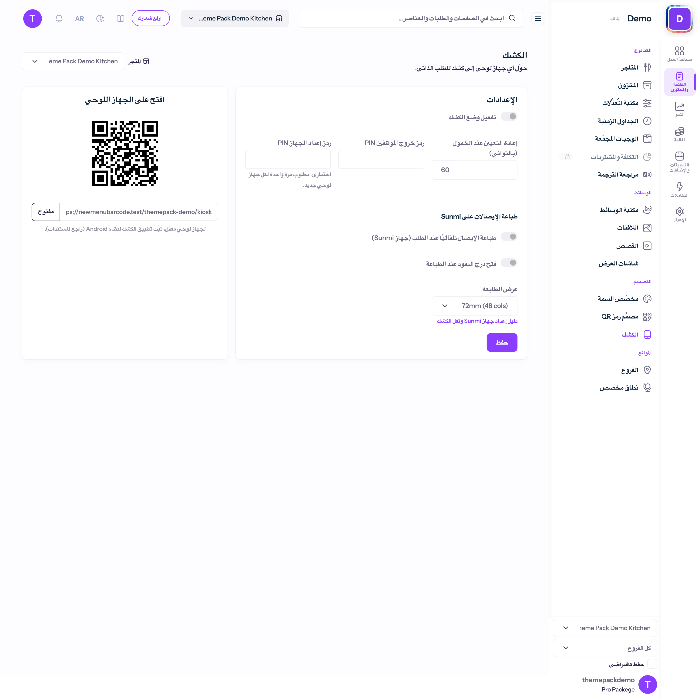

# كشك الطلب الذاتي



يحوّل وضع الكشك أي لوحي إلى محطة طلب ذاتي. يفتح اللوحي شاشة جذب بملء الشاشة
لمطعمك؛ ينقرها العميل، ويطلب من واجهة متجرك المعتادة في وضع الكشك، وتعيد
الشاشة ضبط نفسها بعد فترة من الخمول كي يبدأ العميل التالي من نظافة.

تغطّي هذه الصفحة الإعدادات الموجّهة للمالك. لتركيب جهاز Sunmi وقفل Android
حول الكشك، راجع [دليل تكامل كشك Sunmi](../../integrations/sunmi-kiosk.md).

## فتح صفحة الإعدادات

لا يوجد رابط في الشريط الجانبي. افتحها مباشرة على:

```
/kiosk-settings
```

يمكنك أيضًا الوصول إليها من صفحة **Ticket and receipt printing** — إذ لها زر
**الكشك** في صف إجراءاتها.

استخدم منتقي المتجر في شريط الإجراءات للتبديل بين المطاعم. لا يوجد محدد فرع.

## الإعدادات

البطاقة اليسرى هي نموذج الإعدادات. اضغط **حفظ** لتخزينها.

- **تفعيل وضع الكشك** — المفتاح الرئيسي. لا يعمل رابط الكشك العام إلا أثناء
  تشغيل هذا؛ وعند إطفائه، يُرجع الرابط "not found".
- **Idle reset (seconds)** — كم ينتظر الكشك قبل العودة إلى شاشة الجذب. يقبل
  من 15 إلى 3600 ثانية؛ ويكون الحقل افتراضيًا 60، ولا يستخدم الكشك أبدًا أقل
  من 15 حتى لو خُزِّنت قيمة أصغر.
- **Staff exit PIN** — حتى 12 حرفًا. يُدخله موظف لمغادرة وضع الكشك على
  اللوحي. ويُتحقَّق من الرمز في الخادم، لا في المتصفّح. وإذا تركته فارغًا،
  فلا يمكن لفحص المغادرة أن ينجح أبدًا.
- **Device setup PIN** — حتى 12 حرفًا، اختياري. عند ضبطه، يجب فتح قفل لوحي
  جديد به مرة واحدة قبل أن يشغّل الكشك. ويُتحقَّق منه أيضًا في الخادم؛
  والفراغ يعني أن فحص الإعداد لا يمكن أن ينجح أبدًا.

### طباعة إيصالات Sunmi

هذه الإعدادات الثلاثة لا تهمّ إلا على جهاز Sunmi بطابعة مدمجة:

- **Auto-print receipt on order (Sunmi device)** — اطبع إيصالًا بمجرد تقديم
  طلب في الكشك.
- **فتح درج النقود عند الطباعة** — افتح درج النقد المرفق عند طباعة إيصال.
- **عرض الطابعة** — **72mm (48 cols)** أو **58mm (32 cols)**. يفتح الرابط
  أسفل هذا الحقل دليل إعداد جهاز Sunmi وقفل الكشك.

## فتح الكشك على اللوحي

تعرض البطاقة اليمنى عنوان الكشك ورمز QR له، معروضًا بتصميم QR لمتجرك (يعود
إلى رمز بسيط إذا لم يكن مصمّم QR متاحًا لك — راجع [رموز QR](qr-codes.md)).

رابط الكشك هو:

```
/{your-store-slug}/kiosk
```

انسخ الرابط إلى متصفّح اللوحي، أو امسح رمز QR باللوحي. ويشغّله **مفتوح** في
تبويب جديد من لوحة التحكم.

على اللوحي يعرض الكشك شاشة جذب لمطعمك. ويفتح نقرها واجهة متجرك المعتادة مع
تشغيل وضع الكشك، فتكون القائمة والأسعار والمُعدِّلات وإتمام الطلب تمامًا كما
يراها عملاؤك الآخرون. وللحصول على محطة مقفلة بإحكام لا يمكن الخروج منها إلى
شاشة Android الرئيسية، ثبّت تطبيق الكشك الموصوف في دليل Sunmi.

## تشغيلها

وضع الكشك ميزة مقيّدة. لا يعمل رابط الكشك إلا عند تحقّق الثلاثة كلها:

- مفتاح الإيقاف على مستوى المنصة لـ `kiosk` مفعّل (إعداد للمشرف الأعلى —
  يُشحَن **مُطفأً** افتراضيًا)؛
- تضمّنته باقة مالك المتجر (`kiosk` مقيّد بالباقة؛ تحقّق من قائمة ميزات
  باقتك)؛
- **تفعيل وضع الكشك** مفعّل لذلك المطعم.

يُرجع أي فشل صفحة "not found" بسيطة — فلا يُخبَر زائر مجهول أبدًا بما إذا كان
المتجر موجودًا، أو ما إذا كانت المنصة تسمح بالأكشاك، أو أي باقة عليها
التاجر. وتُحظَر صفحة إعدادات لوحة التحكم نفسها بالفحصين الأولين. راجع
[الباقات والفوترة](plans-billing.md).

## صفحات ذات صلة

- [دليل تكامل كشك Sunmi](../../integrations/sunmi-kiosk.md) — العتاد، ووضع مهمة القفل في Android، والطباعة.
- [طباعة التذاكر والإيصالات](printing.md) — إعداد الطباعة الأوسع.
- [رموز QR والمشاركة](qr-codes.md) — تصميم QR ذو العلامة التجارية المستخدم لرمز الكشك.
- [نقاط البيع (POS)](pos.md) — نقطة البيع التي يشغّلها الموظفون، مقابل كشك الطلب الذاتي.
