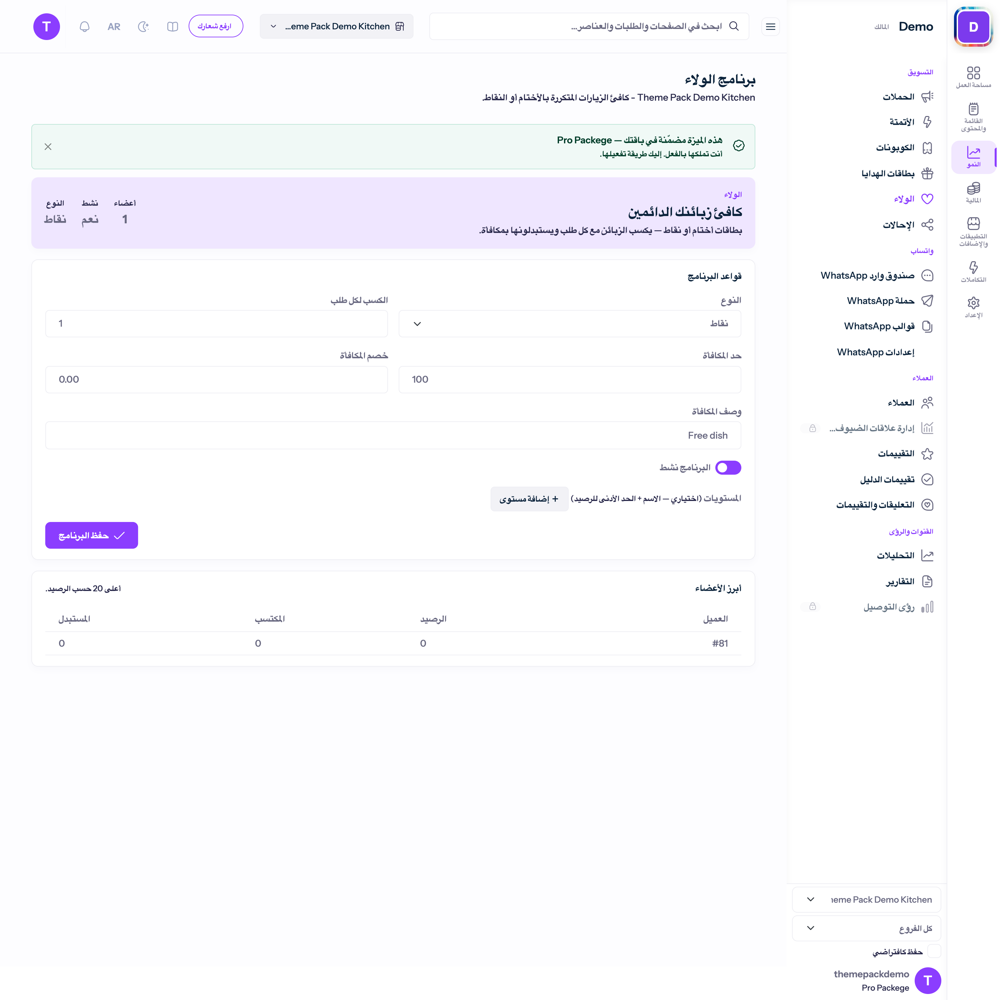

# أختام الولاء

يكافئ برنامج الولاء العملاء المتكررين ببطاقة أختام رقمية أو رصيد نقاط. يكسب
العملاء المُسجَّلون تلقائيًا في كل مرة يقدّمون فيها طلبًا عبر صفحة قائمتك،
ويشاهدون تقدّمهم يمتلئ على الشاشة، ويستبدلون مكافأة بمجرد بلوغهم الحد الذي
تحدّده. يغطّي هذا الدليل إعداد البرنامج، وكيف يعمل الكسب والاستبدال، وما يراه
عملاؤك.

## فتح صفحة الولاء

انقر **الولاء** في الشريط الجانبي للوحة التحكم (أيقونة الهدية). عنوان
الصفحة **برنامج الولاء** وهي للمالك فقط.

إذا كنت تملك أكثر من مطعم، يفتح رابط الشريط الجانبي برنامج أول مطعم لك. ولكل
مطعم برنامجه المنفصل الخاص على عنوانه الخاص (`.../restaurant/<id>/loyalty`).

يعرض شريط ترويسة في الأعلى ثلاثة أرقام مباشرة:

- **أعضاء** — كم حسابًا يظهر في قائمة Top members أدناه (يعدّ حتى 20،
  مطابقًا لتلك القائمة).
- **نشط** — ما إذا كان البرنامج مشغّلًا حاليًا.
- **النوع** — أختام أو نقاط.

## إعداد البرنامج

املأ نموذج **قواعد البرنامج** وانقر **حفظ البرنامج**:

1. **النوع** — اختر **أختام** (ختم واحد لكل طلب، بطاقة "اشترِ 9 واحصل على 1"
   الكلاسيكية) أو **نقاط** (تتناسب النقاط مع مقدار ما ينفقه العميل).
2. **الكسب لكل طلب** — يُستخدم فقط لبرامج النقاط: يكسب العميل هذا العدد من
   النقاط لكل 100 من عملتك تُنفَق (من 1 إلى 1000). مثلًا، معدّل كسب 5 يعطي 5
   نقاط على طلب بـ 100.00 و12 نقطة على طلب بـ 250.00 (تُقرَّب الكسور
   لأسفل). وتتجاهل برامج الأختام هذا الحقل وتعطي دائمًا ختمًا واحدًا بالضبط
   لكل طلب.
3. **حد المكافأة** — كم ختمًا أو نقطة تفتح المكافأة (من 1 إلى 9999).
   الافتراضي 10.
4. **خصم المكافأة** — مبلغ خصم اختياري يُسجَّل مع كل استبدال. لاحظ أن هذه
   القيمة تُخزَّن وتُسجَّل لكنها لا تُخصَم تلقائيًا من طلب مستقبلي — راجع
   [الاستبدال](#how-customers-redeem) أدناه.
5. **وصف المكافأة** — حتى 200 حرف، يُعرَض للعملاء على بطاقة الأختام،
   مثل "Free coffee with 10 stamps".
6. **البرنامج نشط** — ضع علامة على هذا لتشغيل البرنامج. تبدأ البرامج
   الجديدة مُطفأة؛ ولا يُعرَض شيء للعملاء ولا تُكسَب أختام حتى تفعّله.

يمكنك تحرير القواعد في أي وقت. ويسري تغيير الحد فورًا على الجميع، بمن فيهم
العملاء في منتصف بطاقة.

## كيف يكسب العملاء

الكسب تلقائي — لا يوجد شيء لمسحه أو توزيعه:

- يجب أن يكون العميل **مُسجَّل الدخول** في حساب عميل على صفحة قائمتك عند
  تقديم الطلب. ولا تكسب طلبات الضيوف.
- عند تقديم الطلب، يُضيف البرنامج ختمًا واحدًا (نوع الأختام) أو النقاط
  المحسوبة (نوع النقاط، بناءً على إجمالي الطلب شاملًا التوصيل والضريبة
  والإكرامية، بعد أي خصم كوبون).
- لا يمكن أبدًا إضافة رصيد لكل طلب إلا مرة واحدة، حتى لو أُعيدت محاولة شيء
  خلف الكواليس، فلا يمكن تضخيم الأرصدة بالتكرارات.

يُكتَب كل كسب واستبدال إلى دفتر أستاذ دائم، ويتتبّع كل حساب أيضًا إجمالياته
مدى الحياة.

## كيف يستبدل العملاء

عندما يبلغ رصيد العميل حد المكافأة، يظهر زر **استبدال المكافأة** على بطاقة
أختامه. ويؤدي النقر عليه إلى:

1. فحص الرصيد في الخادم (لا يمكن لعميل أبدًا استبدال أكثر مما لديه).
2. خصم الحد الكامل من رصيده وكتابة قيد في دفتر الأستاذ.
3. عرض التأكيد "Reward redeemed! Enjoy your reward."

لا يطبّق الاستبدال خصمًا على طلب من تلقاء نفسه — فالمكافأة هي ما يعد به
**وصف المكافأة** لديك، ويكرّمها موظفوك شخصيًا عندما يُظهر العميل
التأكيد. ويُسجَّل مبلغ خصم المكافأة الذي هيّأته في سجل النشاط لأغراضك. وتُقيَّد
طلبات الاستبدال بمعدّل 10 في الدقيقة لكل عميل لمنع إساءة الاستخدام.

## ما يراه العملاء

تظهر بطاقة الأختام على صفحة قائمتك العامة، لكن فقط عندما يكون البرنامج
**نشطًا** والعميل **مُسجَّل الدخول**. وهي مبنيّة حاليًا في سمتَي القائمة
**Aurora** و**Nebula**؛ ولا تعرضها السمات الأخرى بعد.

في Aurora تظهر البطاقة على شاشة تأكيد الطلب ("Order placed!") وتعرض:

- **رصيد نقاط الولاء** — عدد الأختام أو النقاط الحالي.
- التقدّم نحو المكافأة — صف من نقاط الأختام تمتلئ مع كسب الأختام (نوع
  الأختام) أو شريط تقدّم (نوع النقاط)، إضافةً إلى وصف المكافأة، مثل "7 / 10
  stamps to earn: Free coffee".
- زر **استبدال المكافأة** بمجرد بلوغ الحد.

خلف الكواليس، تصل البطاقة أيضًا إلى آخر عشرة قيود في دفتر أستاذ العميل (كسب
واستبدال بطوابع زمنية).

## تتبّع الأعضاء

أسفل نموذج الإعدادات، تسرد بطاقة **أبرز الأعضاء** أعلى 20 حساب ولاء لديك حسب
الرصيد الحالي، بأعمدة للعميل ورصيده وإجمالييه المكسوب والمُستبدَل. يظهر
الأعضاء هنا بعد أول كسب لهم؛ والقائمة فارغة حتى ذلك الحين.

يُسجَّل كل تغيير إعدادات وكل استبدال أيضًا في سجل النشاط مع المطعم الذي يخصه.

## نصائح

- أبقِ الحد واقعيًا لتكرار زيارتك — بطاقة 10 أختام تناسب مقهى، بينما قد يفضّل
  مطعم للجلوس 5.
- اكتب وصف المكافأة تمامًا كما ينبغي أن يكرّمها الموظفون؛ فهو التعليمة
  الوحيدة التي يراها العميل وفريقك عند الاستبدال.
- بما أن طلبات الضيوف لا تكسب أبدًا، روّج لتسجيل دخول العملاء على صفحة
  القائمة إذا أردت للبرنامج أن يكتسب زخمًا.

## صفحات ذات صلة

- [الطلبات](orders.md) — كيف تَرِد الطلبات وأين يرتبط كسب الولاء بمسار الطلب.
- [نظرة عامة على لوحة التحكم](dashboard-overview.md) — أين يقع Loyalty في
  الشريط الجانبي.
- [رموز QR](qr-codes.md) — إيصال العملاء إلى صفحة قائمتك أصلًا.
