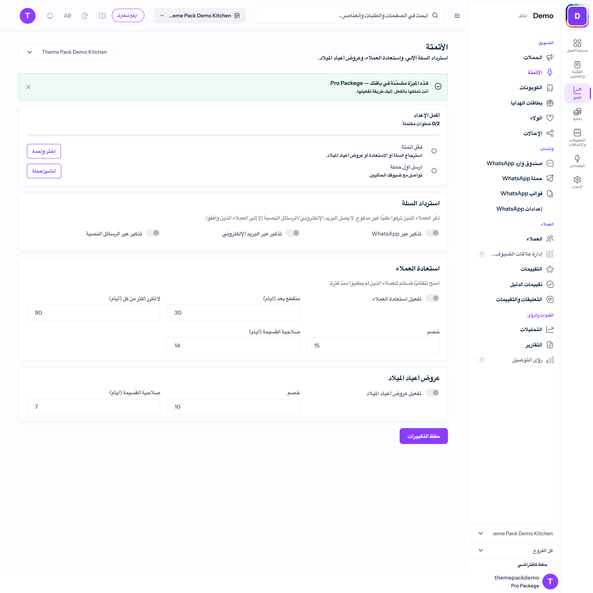

# أتمتة التسويق

الأتمتة هي ثلاث حملات متكررة تديرها المنصة نيابةً عنك في الخلفية: تذكير
العملاء الذين تركوا سلة الشراء، واستعادة العملاء الذين توقفوا عن الطلب،
وإرسال خصم بمناسبة عيد الميلاد. تضبط القواعد مرة واحدة وتتولى المنصة الإرسال
وفق جدول زمني.

أتمتة التسويق ميزة مدفوعة. إذا كانت خطتك لا تتضمنها، يظهر في الشريط الجانبي
مدخل **الأتمتة** مقفلاً بدلاً من الصفحة. كما يتحكم في الحملات الثلاث
مفتاح عام على مستوى المنصة — إذا كان مغلقاً، فلن يُرسل أي شيء بغض النظر عن
إعداداتك هنا.

## فتح الصفحة

انقر على **الأتمتة** في الشريط الجانبي ضمن **النمو ← التسويق**. عنوان
الصفحة **الأتمتة**؛ استخدم محدِّد المتجر في ترويسة الصفحة للتبديل بين
المطاعم. الإعدادات خاصة بكل مطعم.

غيِّر ما تحتاجه وانقر على **حفظ** في الأسفل — زر واحد يحفظ الأقسام
الثلاثة جميعها.

## استعادة السلة

تذكِّر العميل الذي أنشأ طلباً لكنه لم يدفع مقابله أبداً. هناك ثلاثة مفاتيح
للقنوات:

- **WhatsApp reminder**
- **تذكير عبر البريد الإلكتروني**
- **تذكير عبر الرسائل النصية**

يجري المسح **كل ساعة** ويلتقط الطلبات غير المدفوعة التي مضى على إنشائها 30
دقيقة على الأقل ولا يزيد عمرها على 24 ساعة. يُذكَّر كل طلب **مرة واحدة فقط**،
على كل قناة مفعَّلة ومسموح بها.

تذكر الرسالة اسم مطعمك، وتقتبس رقم الطلب، وتربط بصفحة تتبُّع ذلك الطلب حتى
يتمكن العميل من إكمال الدفع.

تحدِّد قواعد الموافقة أي القنوات ستعمل فعلاً:

- **WhatsApp** — يتطلب تفعيل المفتاح ووجود رقم هاتف على الطلب.
- **البريد الإلكتروني** — يتطلب تفعيل المفتاح، وعميلاً معروفاً (مسجَّل الدخول) لديه عنوان
  بريد إلكتروني، وموافقته على التسويق. يتضمن البريد رابط إلغاء الاشتراك.
- **SMS** — يتطلب تفعيل المفتاح، ووجود رقم هاتف، وعميلاً معروفاً موافقاً على
  الرسائل النصية. **طلبات الضيوف لا تتلقى رسائل نصية أبداً.** وتنتهي الرسالة
  بعبارة "Reply STOP to unsubscribe."

## الاستعادة

تمنح تلقائياً قسائم للعملاء الذين لم يطلبوا منذ فترة.

- **تفعيل استعادة العملاء** — المفتاح الرئيسي لهذا المطعم.
- **Lapsed after (days)** — المدة منذ آخر طلب قبل أن يُعدّوا متوقفين. القيمة
  الافتراضية 30، والمدى من 1 إلى 3650.
- **Repeat no more than every (days)** — أقل فاصل زمني بين عروض الاستعادة
  للشخص نفسه. القيمة الافتراضية 90، والمدى من 1 إلى 3650.
- **Discount %** — نسبة القسيمة المئوية. القيمة الافتراضية 15، والمدى من 1
  إلى 100.
- **Coupon validity (days)** — مدة صلاحية القسيمة. القيمة الافتراضية 14،
  والمدى من 1 إلى 365.

يجري المسح يومياً في تمام الساعة **10:00**. ولكل عميل مؤهَّل يُنشئ قسيمة
نسبية للاستخدام مرة واحدة برمز يبدأ بـ `WB`، تنتهي صلاحيتها في نهاية نافذة
الصلاحية، ويسلِّمها عبر البريد الإلكتروني و/أو الرسائل النصية. يُتواصَل فقط مع
العملاء الموافقين على التسويق أو الرسائل النصية، ولا يُذكَّر العميل نفسه
مرتين داخل نافذة التكرار حتى وإن أُعيد تشغيل المهمة.

## عروض عيد الميلاد

ترسل للعميل قسيمة خصم في عيد ميلاده، مرة واحدة في السنة.

- **تفعيل عروض أعياد الميلاد** — المفتاح الرئيسي لهذا المطعم.
- **Discount %** — القيمة الافتراضية 10، والمدى من 1 إلى 100.
- **Coupon validity (days)** — القيمة الافتراضية 7، والمدى من 1 إلى 365.

يجري المسح يومياً في تمام الساعة **09:00** وينشئ قسيمة برمز يبدأ بـ `BDAY`.
ويُتخطى العميل الذي أُرسل إليه عرض هذا العام، فلا يؤدي إعادة التشغيل إلى
الإرسال المزدوج. تقرأ الرسالة "Happy Birthday! Enjoy N% off your next order
with code …, valid until …".

لا يتأهل العملاء إلا إذا زوّدوك بتاريخ ميلادهم ووافقوا على التسويق.

## أين تظهر القسائم

قسائم الاستعادة وعيد الميلاد قسائم حقيقية على حسابك، لذا تظهر في صفحة
[القسائم](coupons.md) إلى جانب الرموز التي تنشئها يدوياً، وتُستبدل بالطريقة
نفسها عند الدفع. وهي قسائم نسبية بحد استخدام واحد.

## النطاق والحدود

- كل إعداد خاص بكل مطعم. يؤدي تبديل المتاجر في الترويسة إلى تبديل المطعم الذي
  تضبطه.
- تعمل عمليات المسح الثلاث وفق جدول المنصة، لا عند الطلب — لا يوجد زر "أرسل
  الآن" في هذه الصفحة.
- تصل استعادة السلة إلى الضيوف عبر WhatsApp فقط؛ أما عروض الاستعادة وعيد
  الميلاد فتصل حصراً إلى العملاء المسجَّلين والموافقين.

## صفحات ذات صلة

- [الحملات](campaigns.md) — رسائل جماعية لمرة واحدة تكتبها وترسلها بنفسك.
- [القسائم](coupons.md) — حيث تظهر الرموز المُنشأة.
- [العملاء](customers.md) — علامات الموافقة وتواريخ الميلاد وتواريخ آخر طلب.
- [WhatsApp](whatsapp.md) — ربط قناة WhatsApp وقوالبها.
