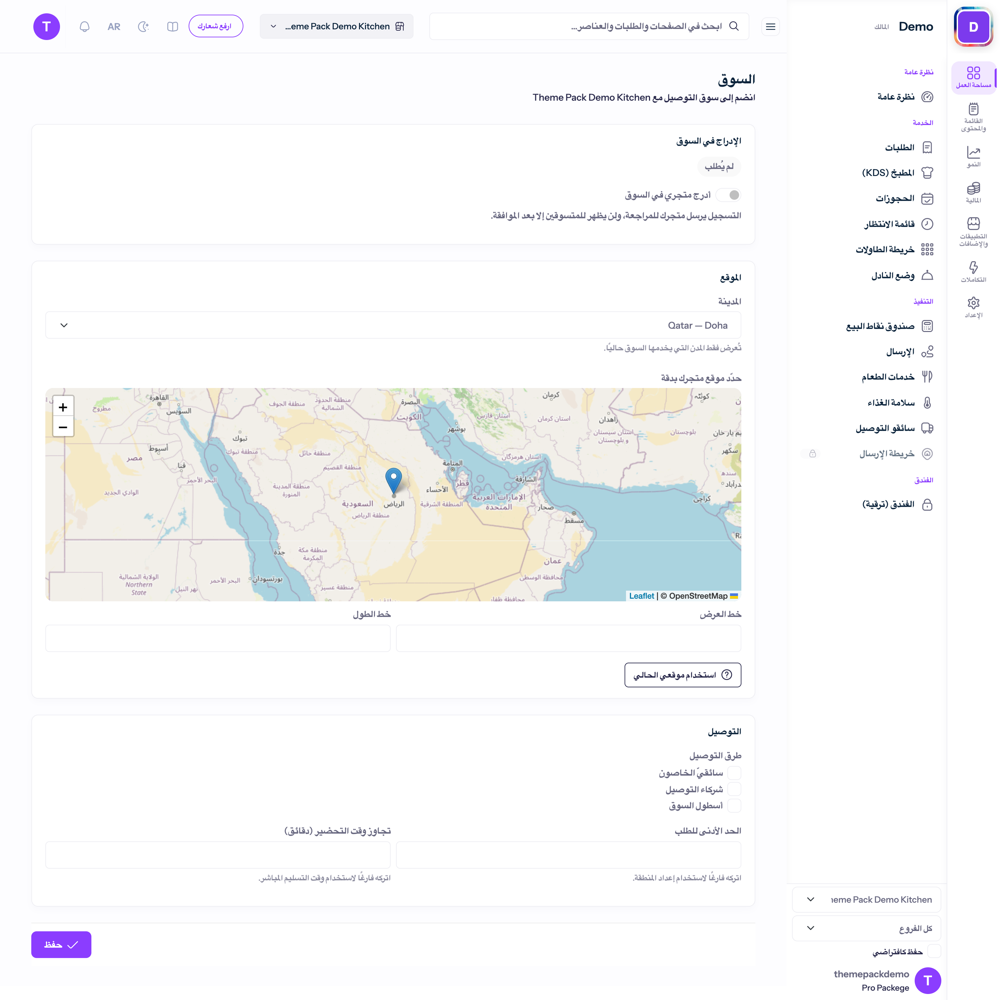

# إدراج في السوق (سوق التوصيل)

سوق التوصيل هو واجهة التسوق متعددة المتاجر في المنصة: يتصفح روّاد الطعام
المتاجر القريبة، ويملؤون سلة لكل متجر، ويطلبون للتوصيل أو الاستلام. إدراج
متجرك هناك اشتراك اختياري لكل متجر مع خطوة مراجعة قصيرة. تغطي هذه الصفحة
الاشتراك، وضبط موقعك وخيارات التوصيل، ودورة حياة الموافقة، وسحب أرباحك.

هذا **ليس** سوق القوالب (حيث تشتري قوالب واجهة المتجر) — لذلك، راجع
[قوالب واجهة المتجر والمُخصِّص](themes.md).

## الاشتراك

1. افتح **المتاجر** في الشريط الجانبي وابحث عن المتجر الذي تريد إدراجه.
2. اضغط على زر **السوق** الخاص به لفتح **إعدادات السوق**.
3. فعِّل **أدرج متجري في السوق** واضغط **حفظ**.

يرسل الاشتراك متجرك للمراجعة؛ ولا يظهر للمتسوقين إلا بعد الموافقة. تعرض
الصفحة دائماً وضعك الحالي:

- **لم يُطلب** — لم تشترك بعد.
- **قيد المراجعة** — تم الإرسال وينتظر فريق السوق.
- **Approved — live on the marketplace** — يمكن للمتسوقين رؤية متجرك والطلب
  منه.
- **مرفوض** — صحِّح تفاصيلك واحفظ من جديد لإعادة التقديم.
- **Suspended by the marketplace team** — إدراجك متوقف مؤقتاً؛ تواصل مع مزوّد
  المنصة لديك.

يمكنك إيقاف **أدرج متجري في السوق** في أي وقت لمغادرة السوق؛
وتُحفظ إعداداتك لحين عودتك.

## الموقع والمناطق

يُنظَّم السوق حسب المدينة، وداخل كل مدينة حسب مناطق التوصيل. في صفحة
الإعدادات نفسها:

- **المدينة** — تُدرج فقط المدن التي يخدمها السوق حالياً. إذا لم تكن مدينتك
  مدرجة، فهي غير مغطاة بعد.
- **حدّد موقع متجرك بدقة** — اسحب دبوس الخريطة إلى متجرك، أو اضغط
  **استخدام موقعي الحالي**. يُملأ حقلا **خط العرض** و**خط الطول** من
  الدبوس.

تتبع المناطق المتاحة لمتجرك المدينة التي تختارها — فاختيار مدينة يحدِّث قائمة
المناطق تلقائياً. تحدِّد المناطق أي المتسوقين يرون متجرك وأي إعدادات توصيل
افتراضية تنطبق.

## خيارات التوصيل

- **طرق التوصيل** — حدِّد أي تركيبة مما يلي:
  - **سائقيّ الخاصون** — تتولى التوصيل بفريقك الخاص.
  - **شركاء التوصيل** — تحمل خدمات التوصيل المتصلة الطلب.
  - **أسطول السوق** — يتولى أسطول السوق الخاص التوصيل نيابةً عنك.
- **الحد الأدنى للطلب** — أصغر سلة تقبلها من السوق. اتركه فارغاً لاستخدام
  الإعداد الافتراضي للمنطقة.
- **Prep time override (minutes)** — وقت تحضير ثابت لعرضه على المتسوقين.
  اتركه فارغاً لاستخدام تقديرك المباشر (راجع قسم ETA في
  [إدارة الطلبات](orders.md)).

## استلام المدفوعات والسحب

تُضاف أرباحك من السوق إلى محفظتك على المنصة. للسحب:

1. افتح **المحفظة** في الشريط الجانبي.
2. إذا كانت المدفوعات على منصتك تمر عبر Stripe، فاربط حساب الدفع الخاص بك
   أولاً (ترشدك صفحة المحفظة خلال ذلك).
3. في نموذج السحب، أدخل **المبلغ** لا يتجاوز رصيدك المتاح وأرسله.

يغادر المبلغ محفظتك فور طلبك السحب، ويُدفع بعد المراجعة — تؤكد صفحة المحفظة
بعبارة "Withdrawal requested. It will be paid out after review." وإذا كان
رصيدك منخفضاً جداً، يُرفض الطلب ولا يُخصم أي شيء.

## صفحات ذات صلة

- [المحفظة والأرصدة](wallet.md) — رصيدك، وعمليات الإيداع، وسجل السحب.
- [التوصيل والسائقون](delivery.md) — إدارة عملية التوصيل الخاصة بك.
- [إدارة الطلبات](orders.md) — حيث تصل طلبات السوق، وتقدير وقت التحضير
  التلقائي.
- [الإدراج في دليل الأعمال](directory.md) — إدراج في الدليل للتصفح فقط،
  منفصل عن سوق الطلبات.
- [قوالب واجهة المتجر والمُخصِّص](themes.md) — سوق القوالب، ميزة مختلفة باسم
  مشابه.
