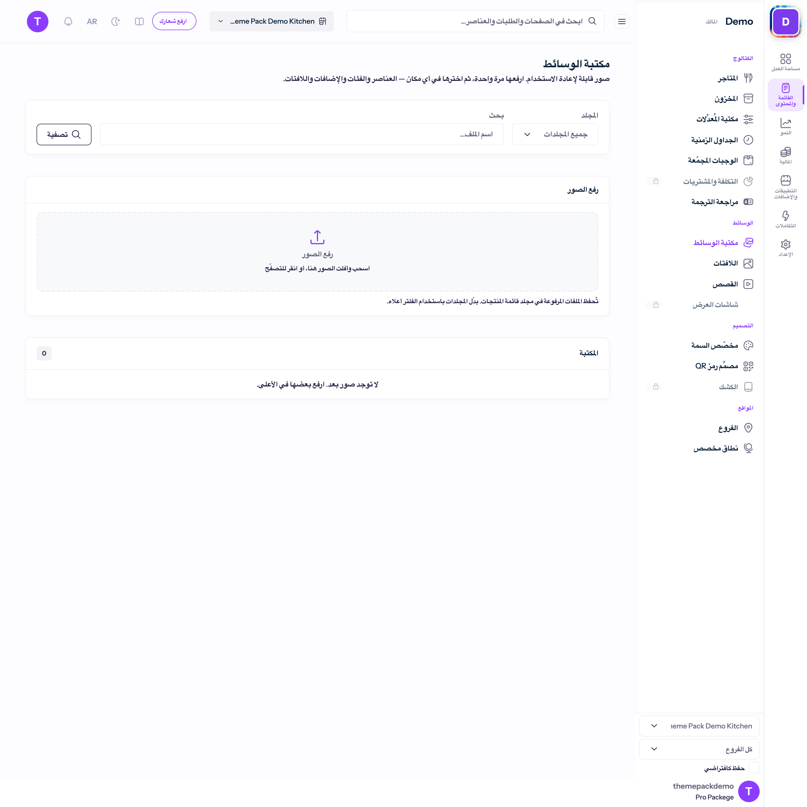

# مكتبة الوسائط

مكتبة الوسائط مكان مشترك واحد لكل الصور التي يستخدمها مطعمك — صور الأطباق،
وصور الفئات، وأيقونات الإضافات، ولافتات العروض. ارفع الصورة مرة واحدة، ثم
اخترها في أي مكان بدلاً من إعادة رفع الملف نفسه لكل عنصر. افتح
**مكتبة الوسائط** في الشريط الجانبي للوحة التحكم (أيقونة الصورة، قرب Banners
وModifier library).

إذا كنت تدير أكثر من مطعم، فلكل مطعم مكتبته الخاصة المنفصلة. اختر المطعم من
القائمة المنسدلة أعلى الصفحة أولاً؛ فالصور المرفوعة تحت مطعم واحد غير مرئية
لمطعم آخر.

## المجلدات

تعيش كل صورة في مجلد يصف الغرض منها. المجلدات هي:

- **قائمة المنتجات** — صور الأطباق والمنتجات.
- **الفئة** — الصور المعروضة على بطاقات الفئات.
- **إضافة** — أيقونات أو صور للإضافات والملحقات.
- **خيار** — صور خيارات العناصر (الأحجام والخيارات).
- **لافتة** — صور العروض والصور الرئيسية لشريط عرض واجهة المتجر.
- **أخرى** — أي شيء لا يندرج ضمن ما سبق.

المجلدات مجرد تسميات للتصفية — فالصورة في أي مجلد يمكن اختيارها في أي مكان.
عندما تفتح المُنتقي من شاشة معينة (على سبيل المثال من عنصر قائمة)، يُفتح على
المجلد المطابق لترى الصور الأكثر صلة أولاً.

## رفع الصور

1. افتح **مكتبة الوسائط** واختر المطعم.
2. في بطاقة **رفع الصور**، اختر المجلد الذي تنتمي إليه الصور.
3. انقر على حقل الملف واختر صورة واحدة أو أكثر. يمكنك اختيار عدة صور دفعة
   واحدة.
4. انقر على **رفع**. يعرض الزر عدد الملفات التي اخترتها.

الصيغ المقبولة هي JPG وPNG وWebP وGIF، حتى 8 MB لكل ملف. تُضاف كل صورة
مرفوعة إلى شبكة **المكتبة** أدناه، الأحدث أولاً.

يمكنك أيضاً الرفع مباشرة من نافذة المُنتقي في الشاشات الأخرى (راجع
[أعد استخدام الصور في أي مكان](#reuse-images-anywhere)) — وكل ما ترفعه هناك
يصل إلى المكتبة نفسها.

## التصفح والبحث

تعرض بطاقة **المكتبة** كل صورة كصورة مصغَّرة مع اسم ملفها الأصلي وعلامة
مجلدها. وتُظهر شارة عدّاد عدد الصور المطابقة للعرض الحالي.

للعثور على صورة معينة:

- استخدم قائمة **المجلد** المنسدلة لعرض مجلد واحد فقط، أو **جميع المجلدات**.
- اكتب جزءاً من اسم الملف في مربع **بحث** وانقر **تصفية**.

يطابق البحث اسم الملف الأصلي الذي رفعته، لذا فإن أسماء الملفات الوصفية تسهّل
العثور على الصور لاحقاً.

## أعد استخدام الصور في أي مكان

أينما احتُجت إلى صورة — عناصر القائمة، والفئات، والإضافات والملحقات،
واللافتات — فأنت تختار من هذه المكتبة نفسها بدلاً من الرفع في كل مرة. انقر على
**اختر صورة** (أو زر المُنتقي المقابل في تلك الشاشة) لفتح نافذة
**اختر من المكتبة**. في النافذة يمكنك:

- البحث باسم الملف.
- النقر على صورة مصغَّرة لاختيارها (تظهر علامة صح).
- اختيار عدة صور دفعة واحدة حيثما يُسمح بصور متعددة، مثل معرض صور عنصر ما.
- رفع ملفات جديدة على الفور بزر **رفع** داخل النافذة.

انقر على **استخدام المحدد** لإرفاق الصورة (الصور) المختارة. ولأن الملف نفسه
يُعاد استخدامه بدلاً من نسخه، فإن تحديث مكتبتك يبقي الأمور مرتبة ويتجنّب
الرفع المكرر.

تشمل الشاشات التي تستخدم المُنتقي المشترك عناصر قائمتك ومعارضها، وفئات
القائمة، ومكتبة الإضافات والملحقات، ولافتات واجهة المتجر. راجع
[عناصر القائمة](menu-items.md) و[فئات القائمة](menu-categories.md)
و[اللافتات والعروض اليومية](banners.md) لمعرفة كيف تظهر الصور في كل منها.

## حذف صورة

انقر على أيقونة سلة المهملات على صورة مصغَّرة وأكِّد. تُزال الصورة من المكتبة
فوراً.

لا يُحذف الملف الأساسي من التخزين إلا إذا لم يعد هناك أي مدخل آخر في المكتبة
يشير إلى الملف نفسه. ولا يؤدي حذف مدخل من المكتبة إلى إزالة الصورة تلقائياً من
العناصر أو اللافتات التي تستخدمها بالفعل، لذا تحقق من تلك الشاشات إذا لم تعد
تريد ظهور الصورة.

## تحسين الصور

لست بحاجة إلى تغيير حجم الصور أو ضغطها قبل الرفع — فالنظام يفعل ذلك نيابةً
عنك. عند الرفع، تُعالَج كل صورة على النحو التالي:

- **تغيير الحجم** ليصبح عرضها 1200 بكسل كحد أقصى (مع الحفاظ على نسبة أبعادها)
  حتى لا تُثقِل صور الهاتف أو الكاميرا كبيرة الحجم قائمتك.
- **التحويل إلى WebP** بجودة 85%، وهي صيغة حديثة تبدو مثل JPG أو PNG لكنها
  تُحمَّل أسرع بكثير على الهواتف.
- **التحميل الكسول** في شبكتَي المكتبة والمُنتقي، بحيث لا تُحمَّل الصور
  المصغَّرة إلا أثناء التمرير.

يبقي هذا قائمتك العامة سريعة التحميل، وهو الأهم على اتصالات الجوال. رفع صورة
JPEG كبيرة أمر لا بأس به — فهي تُحسَّن تلقائياً.

إذا كان مطعمك مُعدّاً بتخزين سحابي خاص به (متوافق مع S3)، فتُخزَّن الملفات
المُحسَّنة هناك وتُقدَّم من CDN الخاص بك؛ وإلا فتُخزَّن على المنصة. وفي كلتا
الحالتين يكون التحسين نفسه.

## صور العلامة التجارية

شعارك وصورة الغلاف جزء من هوية مطعمك، ويُرفعان من شاشات إعداداتهما الخاصة لا
من مكتبة الوسائط، لكنهما يمران بالتغيير التلقائي للحجم وتحسين WebP نفسه. راجع
[البدء](getting-started.md) لمعرفة مكان ضبطهما.

## نصائح

- امنح الملفات أسماء واضحة قبل الرفع (على سبيل المثال `margherita-pizza.jpg`)
  حتى يعثر عليها البحث لاحقاً.
- ضع الصور في المجلد الصحيح عند الرفع — فهذا يجعل المُنتقي يفتح افتراضياً على
  الصور التي تريدها في كل شاشة.
- ارفع دفعات: اختر كل صور قسم القائمة الجديد دفعة واحدة، ثم أرفقها بالعناصر من
  المُنتقي.
