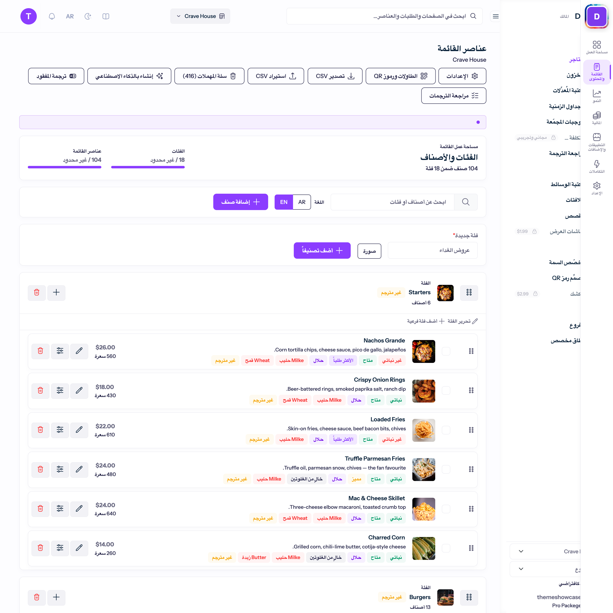

# الفئات وأقسام القائمة

قائمتك منظَّمة على مستويين. **الفئات** (والفئات الفرعية الاختيارية) تجمّع
أطباقك — المقبلات، والأطباق الرئيسية، والحلويات — وتتحكم في ترتيب ظهورها.
**أقسام القائمة** هي اللبنات الأكبر لصفحة القائمة العامة نفسها — اللافتة
الرئيسية، وشريط الفئات، وشرائط العروض، والقائمة الرئيسية — والتي يمكنك إعادة
ترتيبها أو إخفاؤها لكل مطعم.

تغطي هذه الصفحة الأمرين معاً. أما إضافة الأطباق نفسها، فراجع
[البدء](getting-started.md).

## فتح محرِّر القائمة

1. في الشريط الجانبي، انتقل إلى **القائمة والمحتوى ← الكتالوج ← المتاجر** وافتح المطعم.
2. افتح صفحة **قائمة المنتجات** الخاصة به (`/stores/{store}/menu`).

يعرض أعلى الصفحة مقياسَي استخدام: **الفئات** و**عناصر القائمة**، كل منهما
بصيغة "المستخدَم / الحد" مقابل خطتك (أو "Unlimited" حين لا يكون لخطتك حد).
عند بلوغ الحد، يُستبدل بأزرار الإضافة زرُّ **ترقية الباقة**.

ملاحظة: إذا كان المطعم يستخدم قالب الكتيّب (الصور)، فإن هذه الصفحة تدير صور
القائمة المرفوعة بدلاً من الفئات والعناصر.

## إضافة فئة

1. في نموذج **فئة جديدة** قرب أعلى محرِّر القائمة، اكتب اسماً (على سبيل
   المثال "عروض الغداء").
2. اختيارياً، انقر على **الصورة** لاختيار صورة فئة من مكتبة الوسائط.
3. انقر على **أضف تصنيفاً**.

تظهر الفئة كبطاقة في القائمة أدناه، جاهزة لاستقبال العناصر عبر زرها **+**
(Add Menu Item).

## إضافة فئة فرعية

تحتوي كل بطاقة فئة على موسِّع **أضف فئة فرعية**:

1. افتحه، واكتب اسماً (على سبيل المثال "الحلويات")، وأرسله.
2. تظهر الفئة الفرعية داخل بطاقتها الأم مع قائمة عناصرها الخاصة وزر إضافة
   عنصر خاص بها.

تُحتسب الفئات الفرعية ضمن حد الفئات نفسه المُطبَّق على الفئات الرئيسية. يُدعم
مستوى واحد من التداخل (لا يمكن أن يكون للفئة الفرعية فئات فرعية خاصة بها).

## إعادة تسمية فئة أو تغيير صورتها

1. على بطاقة الفئة، افتح موسِّع **تحرير الفئة**.
2. غيِّر الاسم، واستخدم **الصورة** / **إزالة** لتغيير صورة الفئة أو مسحها.
3. انقر على **حفظ**.

إذا كانت قائمتك متعددة اللغات، فإن أزرار اللغة في شريط أدوات القائمة تتحكم في
اللغة التي تحرِّرها. إعادة تسمية فئة أثناء اختيار لغة غير افتراضية تحفظ ترجمة
لتلك اللغة فقط؛ ويبقى الاسم الأصلي كما هو. الفئات التي ما زالت تفتقر إلى ترجمة
تعرض شارة "Untranslated"، والترجمات المُنشأة بالذكاء الاصطناعي تعرض شارة
"AI · review" حتى تؤكدها.

## إعادة ترتيب الفئات

اسحب بطاقة فئة من مقبض الإمساك على يسار ترويستها وأفلتها حيث تريد. يُحفظ
الترتيب الجديد تلقائياً وهو تماماً الترتيب الذي يراه روّاد الطعام على القائمة
العامة. ويمكن سحب العناصر داخل الفئة لترتيبها بالطريقة نفسها.

## حذف فئة

انقر على زر سلة المهملات على بطاقة الفئة (أو الفئة الفرعية). حذف فئة يحذف
نهائياً كل عناصر القائمة داخلها، لذا انقل العناصر أولاً إذا أردت الاحتفاظ بها:
حدِّد العناصر بمربعات الاختيار الخاصة بها واستخدم القائمة المنسدلة
**Move to…** في شريط الإجراءات الجماعية أسفل الصفحة.

## كيف تظهر الفئات على القائمة العامة

على قوالب القائمة الحديثة (Aurora وNebula وPulse وCrave وGlow وMatcha):

- يظهر **شريط فئات** من الرقاقات قرب الأعلى — "All" إضافةً إلى رقاقة لكل فئة.
  ويؤدي النقر على رقاقة إلى تصفية القائمة على تلك الفئة.
- تُعرض كل فئة كقسم خاص بها بعنوانه، وفق ترتيب السحب الذي حددته، مع الفئات
  الفرعية كعناوين فرعية أصغر داخل القسم الأم.
- تُخفى تلقائياً الفئات (والفئات الفرعية) التي لا عناصر مرئية فيها، فلا تظهر
  "قائمة الشتاء" الفارغة لروّاد الطعام أبداً.
- تُعرض العناصر المفعَّلة فقط؛ أما العناصر المنتهية فتُوسم بـ "Sold Out" ولا
  يمكن إضافتها إلى السلة.

## إعادة ترتيب أقسام واجهة المتجر أو إخفاؤها

إلى جانب الفئات، يمكنك إعادة ترتيب الأقسام الكبيرة لصفحة القائمة العامة نفسها:

1. انتقل إلى **القائمة والمحتوى ← الكتالوج ← المتاجر**، وافتح المطعم، وانقر على **تعديل**.
2. افتح علامة التبويب **التصميم** ومرِّر إلى **ترتيب أقسام القائمة العامة**.
3. استخدم سهمَي الأعلى/الأسفل لإعادة ترتيب الأقسام، ومربع **مرئي** لإخفاء
   قسم بالكامل.
4. احفظ الصفحة.

الأقسام الخمسة هي:

- **قسم البداية** — صورة الغلاف، والشعار، واسم المطعم، وتفاصيل التواصل في
  أعلى القائمة.
- **شريط التصنيفات والترتيب** — رقاقات الفئات إضافةً إلى أزرار الترتيب (Default،
  السعر تصاعدياً/تنازلياً، Popular).
- **عروض اليوم** — شريط "Today's Specials". لا يظهر إلا حين يكون هناك
  عنصر واحد على الأقل عليه علامة **عرض اليوم** في محرِّر العنصر.
- **المميز / العروض الخاصة** — شريط "Chef's Specials" مُنسَّق تلقائياً ومبني من
  قائمتك؛ لا يظهر إلا حين تتوفر عناصر كافية.
- **القائمة الرئيسية** — القائمة الكاملة للعناصر فئةً فئة.

يُحفظ الترتيب والظهور لكل مطعم. وإذا لم تمسّ هذا الإعداد أبداً، تستخدم القائمة
الترتيب القياسي المعروض أعلاه. ينطبق الإعداد على القوالب الحديثة المذكورة
سابقاً؛ أما القالب الكلاسيكي وقالب الكتيّب فيحتفظان بتخطيطهما الثابت الخاص.

## حدود الخطة

- عدد الفئات (بما فيها الفئات الفرعية) محدَّد بخطتك.
- ينطبق حد عناصر القائمة **لكل فئة**، لا على القائمة بأكملها، لذا فإن تقسيم
  قائمة كبيرة إلى فئات أكثر يوزّع أيضاً مخصَّص العناصر.
- عند بلوغ حد ما، سترى "Limit exceeded, please upgrade your membership." —
  رقِّ خطتك أو اشترِ إضافة ضمن **التطبيقات والإضافات ← الامتدادات**.

## صفحات ذات صلة

- [البدء](getting-started.md) — إنشاء مطعم وأول عنصر في قائمتك.
- [نظرة عامة على لوحة التحكم](dashboard-overview.md) — مقاييس استخدام الخطة
  والتنقل في الشريط الجانبي.
