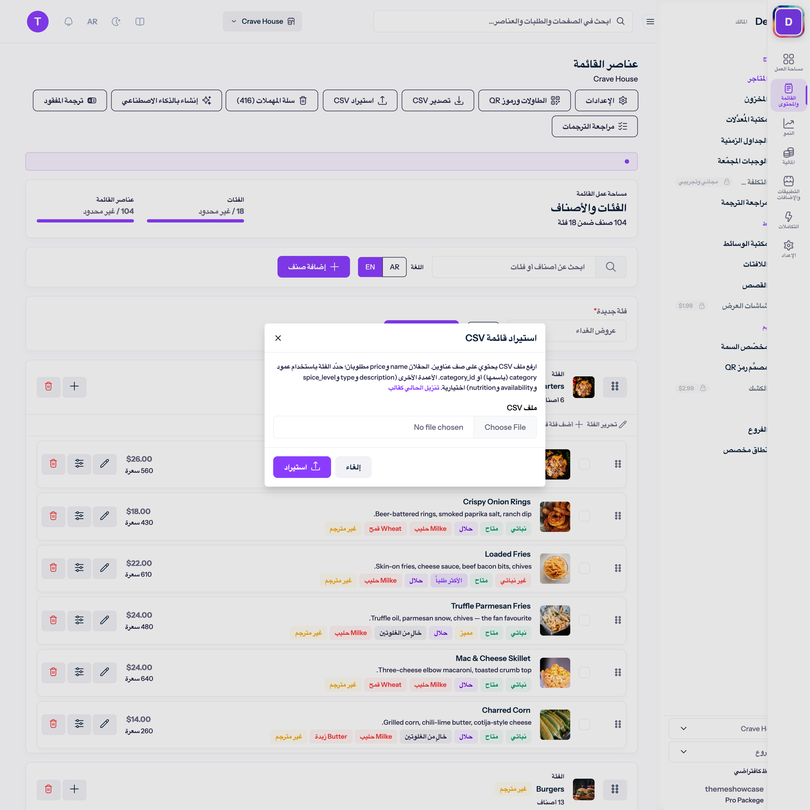

# استيراد القائمة وتصديرها (CSV)

يمكنك تنزيل قائمتك بأكملها كجدول بيانات CSV ورفع ملف CSV محرَّر لإضافة عناصر
كثيرة أو تحديثها دفعة واحدة. هذه أسرع طريقة لبناء قائمة كبيرة، أو إجراء
تغييرات سعرية جماعية، أو نقل قائمة بين الأنظمة.

توجد الأداتان في مساحة عمل القائمة: افتح **المتاجر** في الشريط الجانبي،
وابحث عن المطعم، وانقر على **تعديل القائمة**. في أعلى الصفحة سترى زرَّي
**تصدير CSV** و**استيراد CSV**، بجوار **الطاولات و QR** و**إنشاء بالذكاء الاصطناعي**.

تُدعم ملفات CSV العادية فقط. أما ملفات Excel (.xlsx) فغير مدعومة — إذا كانت
قائمتك في Excel، فاستخدم "Save as CSV" أولاً.

## تصدير قائمتك

انقر على **تصدير CSV**. ينزّل متصفحك ملفاً باسم
`menu-<restaurant>-<date>.csv` يحتوي على كل عنصر في القائمة، مرتَّباً حسب
الفئة والموضع. الملف بترميز UTF-8، لذا يُفتح النص العربي وسائر النصوص غير
اللاتينية بشكل صحيح في Excel وGoogle Sheets.

كل صف عنصرٌ واحد بهذه الأعمدة:

- `id` — الرقم الداخلي للعنصر. احتفظ به إذا كنت تنوي إعادة الاستيراد (راجع
  التحديث أدناه).
- `category_id` — رقم الفئة التي ينتمي إليها العنصر.
- `name` و`description` و`price` — الأساسيات، بلغة قائمتك الافتراضية.
- `type` — `veg` أو `nonveg`.
- `active` — `1` (يظهر على القائمة) أو `0` (مخفي).
- علامات النظام الغذائي — `is_vegan` و`is_halal` و`is_gluten_free` و
  `is_popular` و`is_sold_out` و`is_daily_special`، كل منها `1` أو `0`، إضافةً
  إلى `spice_level` (رقم).
- التوفر — `available_from` و`available_to` و`available_days`.
- التغذية — `calories` و`protein` و`carbs` و`fat` و`allergies`.

إذا كانت قائمتك بأكثر من لغة، يضيف التصدير أيضاً زوجاً من الأعمدة لكل لغة
إضافية، على سبيل المثال `name_ar` و`description_ar` للعربية. راجع الترجمات
أدناه.

لا يوجد قالب فارغ منفصل. سير العمل المقصود هو: صدِّر قائمتك الحالية (حتى وإن
كانت شبه فارغة)، واملأ الصفوف أو حرِّرها في جدول بيانات، ثم استورد الملف من
جديد. ونافذة الاستيراد تربط بالتصدير نفسه باسم **Download current as
template**.

## استيراد ملف CSV

1. انقر على **استيراد CSV** في أعلى مساحة عمل القائمة.
2. في النافذة، اختر ملف CSV الخاص بك (2 MB كحد أقصى) وانقر على **استيراد**.
3. تحصل على ملخص: كم عنصراً استُورد، وكم عنصراً حُدِّث، وكم صفاً تُخطي — مع
   رقم الصف وسبب التخطي لكل صف متخطى (حتى العشرة الأولى) حتى تصحِّح الملف.

يجب أن يكون السطر الأول من الملف صف ترويسة يستخدم أسماء الأعمدة من التصدير.
وتُعالَج تلقائياً علامة ترتيب البايت الاستهلالية (التي تضيفها بعض جداول
البيانات، ويضيفها تصدير هذه المنصة نفسه). ولكل صف بيانات:

- **`name` و`price` مطلوبان.** يُتخطى الصف الذي يخلو من الاسم أو يحمل سعراً
  سالباً ويُبلَّغ عنه (على سبيل المثال "Row 4: skipped — a name and a
  non-negative price are required.")، ويستمر استيراد بقية الملف.
- يمكنك ضبط الفئة بطريقتين: بـ `category_id` رقمي، أو بعمود `category` يحمل
  **اسم** الفئة. الاسم غير الموجود بعد يُنشأ نيابةً عنك؛ أما `category_id`
  فيجب أن ينتمي إلى إحدى فئات هذا المطعم وإلا يُتخطى الصف ويُبلَّغ عنه. الصف
  الذي لا فئة له يُستورد كعنصر غير مصنَّف.
- سائر الأعمدة اختيارية وتأخذ قيماً افتراضية معقولة (`type` يرجع إلى `veg`،
  و`active` إلى `1`، والعلامات إلى الإيقاف).
- الصفوف التي يختلف عدد خلاياها عن الترويسة (فاصلة شاردة، أو فاصل زائد في
  النهاية، أو تصدير جدول بيانات غير منتظم) تُصفّ مقابل الترويسة بدلاً من
  إحباط الاستيراد، وتُتجاهل الأسطر الفارغة.
- قد تحتوي الأوصاف على وسوم تنسيق بسيطة (عريض، مائل، قوائم)؛ وأي شيء آخر
  يُجرَّد.
- تحصل العناصر المستوردة على الصورة النائبة. لا يمكن ضبط الصور عبر CSV —
  أضفها لكل عنصر لاحقاً، راجع [إدارة عناصر القائمة](menu-items.md).

تُنشأ العناصر فور الرفع. لا توجد خطوة معاينة أو تشغيل تجريبي، لذا افحص الملف
قبل الاستيراد — والعادة الآمنة هي التصدير أولاً لتحصل على لقطة يمكنك الاستعادة
منها.

## تحديث العناصر الموجودة بدلاً من إضافة نسخ مكررة

تُجرى المطابقة على عمود `id` فقط:

- الصف **الذي يحمل `id`** ينتمي إلى أحد عناصر هذا المطعم **يحدِّث** ذلك العنصر
  (تكتب كل أعمدة الصف فوق القيم الحالية).
- الصف الذي يحمل `id` فارغاً أو غير معروف **ينشئ عنصراً جديداً**.

إذاً فسير العمل ذهاباً وإياباً هو: صدِّر، وحرِّر الأسعار أو الأوصاف في جدول
البيانات دون المساس بعمود `id`، ثم أعد الاستيراد. لا يتكرر شيء. ولإضافة أطباق
جديدة في الملف نفسه، أضف صفوفاً واترك خلايا `id` الخاصة بها فارغة.

لا يحذف الاستيراد العناصر أبداً. أزِل العناصر في لوحة التحكم، إما واحداً تلو
الآخر أو بأدوات التحديد الجماعي في مساحة عمل القائمة.

## الترجمات في ملف CSV

إذا كانت قائمتك بلغات إضافية، يتضمن التصدير عمودَي `name_<code>` و
`description_<code>` (على سبيل المثال `name_ar` و`description_fr`). وعند
الاستيراد تملأ هذه ترجمات العنصر لتلك اللغات. عند تحديث عنصر موجود، تُكتب
اللغات الموجودة في الملف فوق ما سبق، وتُحفظ اللغات غير الموجودة فيه.

إذا كنت تفضّل عدم ملء الترجمات يدوياً، تصف صفحة
[مولِّد القائمة بالذكاء الاصطناعي](ai-menu-generator.md) أداة الترجمة
بالذكاء الاصطناعي التي تملأ الترجمات الناقصة تلقائياً.

## الأخطاء الشائعة والحدود

- **"Invalid CSV file."** — لا يحتوي الملف على صف ترويسة قابل للقراءة. تأكد
  من أنه ملف CSV حقيقي (مفصول بفواصل) وأن سطره الأول يحتوي على أسماء الأعمدة.
- **"Row N: category X not found."** — استخدم ذلك الصف `category_id` غير
  موجود على هذا المطعم. يُتخطى الصف؛ ويستمر استيراد الباقي. استخدم عمود اسم
  `category` بدلاً منه ليُنشأ نيابةً عنك.
- **"Row N: skipped — a name and a non-negative price are required."** —
  افتقر ذلك الصف إلى الاسم أو حمل سعراً سالباً. صحِّح الصف المذكور وأعد
  الاستيراد.
- **"Menu item limit reached."** — بُلِغ حد عناصر القائمة في خطتك في منتصف
  الاستيراد. أُنشئت العناصر حتى الحد؛ ولم يُعالَج باقي الملف. لا تُحتسب
  تحديثات العناصر الموجودة ضمن الحد. رقِّ خطتك أو احذف عناصر، ثم أعد استيراد
  الصفوف المتبقية.

يبلِّغ الملخص عن عدد الصفوف المتخطاة ويسرد سبب كل منها (حتى العشرة الأولى)،
فنادراً ما تضطر إلى تخمين سبب انخفاض عدد ما.
- **رُفض الملف عند الرفع** — يجب أن يحمل الملف امتداد `.csv` أو `.txt` وأن
  يكون 2 MB أو أصغر. قسِّم القوائم الكبيرة جداً إلى عدة ملفات.

## صفحات ذات صلة

- [إدارة عناصر القائمة](menu-items.md) — نافذة العنصر وكل حقل تُطابقه أعمدة
  CSV.
- [فئات القائمة](menu-categories.md) — أنشئ الفئات التي ستشير إليها بالمعرِّف.
- [مولِّد القائمة بالذكاء الاصطناعي](ai-menu-generator.md) — ابنِ قائمة من
  صورة أو وصف بدلاً من جدول بيانات.
