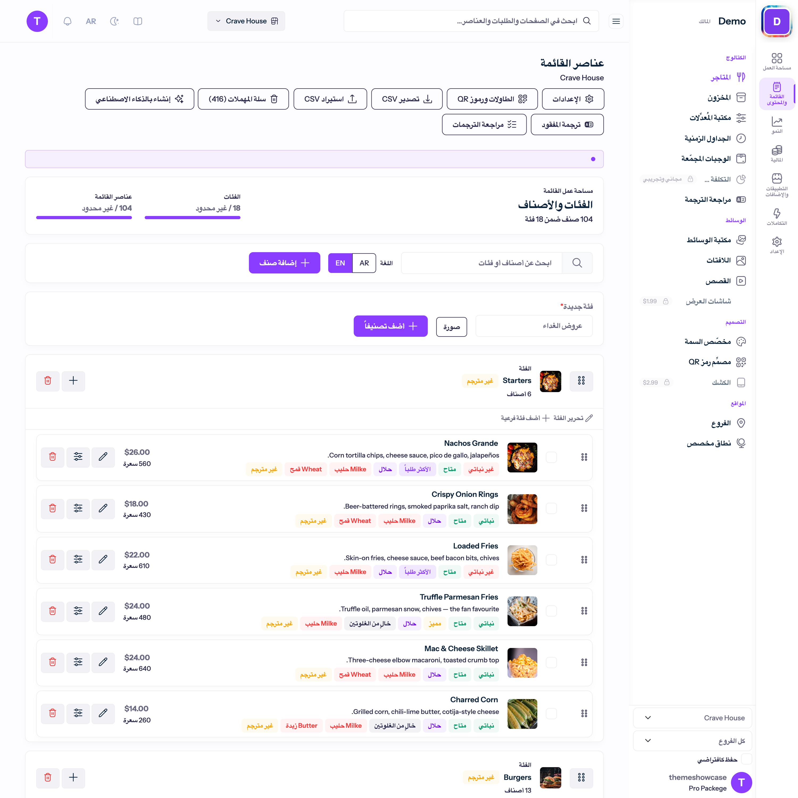

# إدارة عناصر القائمة

عناصر القائمة هي الأطباق والمشروبات التي يراها العملاء على قائمتك العامة.
تديرها في مساحة عمل القائمة: افتح **المتاجر** في الشريط الجانبي، وابحث عن
المطعم، وانقر على **تعديل القائمة**. عنوان الصفحة "Menu items" وتعرض فئاتك مع
العناصر داخل كل واحدة.

في أعلى مساحة العمل سترى عدّادَين لـ **الفئات** و**عناصر القائمة**
مستخدَمَين مقابل خطتك (على سبيل المثال "12 / 50"، أو "Unlimited"). عند بلوغ
حد ما، يُستبدل زرُّ **إضافة صنف** بـ **ترقية الباقة**. وهناك أيضاً مربع بحث
يصفّي العناصر والفئات أثناء الكتابة. للاطلاع على مقاييس الخطة، راجع
[نظرة عامة على لوحة التحكم](dashboard-overview.md).

تعيش العناصر دائماً داخل فئة، لذا أنشئ فئة واحدة على الأقل أولاً (زر
**أضف تصنيفاً** في أعلى مساحة العمل).

## إضافة عنصر أو تحريره

انقر على **إضافة صنف** (أعلى اليمين) أو زر **إضافة صنف** داخل فئة لفتح نافذة
العنصر. ولتغيير عنصر موجود، انقر على أيقونة القلم (Edit) في صفه. تحتوي
النافذة على هذه الحقول:

- **الاسم** و**السعر** — مطلوبان. يقبل السعر الأرقام العشرية.
- **الوصف** — اختياري، حتى 5,000 حرف (راجع التنسيق أدناه).
- **النوع** — Veg أو Non Veg. يظهر هذا كشارة خضراء أو حمراء على القائمة.
- **مستوى الحدة** — رقم يوضح مدى حرارة الطبق.
- **صورة** و**المعرض** — راجع الصور أدناه.
- **النظام الغذائي** — مربعات اختيار Vegan وHalal وGluten free وPopular وDaily
  special.
- **Nutrition (optional)** — Calories وProtein (g) وCarbs (g) وFat (g).
- **Scheduled availability (optional)** — نافذة زمنية From/To إضافةً إلى
  مربعات اختيار أيام الأسبوع.
- **Kitchen (optional)** — رقم الطبق (Course number) ووقت التحضير بالدقائق،
  يستخدمهما عرض المطبخ.
- **Inventory (optional)** — Track inventory وStock quantity وعتبة تنبيه
  المخزون المنخفض (Low stock alert).
- **متاح** — أزِل تحديدها لإخفاء العنصر من القائمة العامة تماماً (يظهر
  عليه شارة "Unavailable" في المُنشئ).

انقر على **حفظ**. تتحدّث القائمة ويظهر العنصر في فئته مع شارات تلخّص حالته
(Available وSold Out وPopular وSpecial وVegan وHalal وGluten Free، وما إلى
ذلك).

لحذف عنصر، انقر على أيقونة سلة المهملات في صفه وأكِّد. ولإدارة خياراته
وإضافاته المدفوعة، انقر على أيقونة المزالق (Extras & variants).

## صور العنصر

لكل عنصر صورة رئيسية واحدة ومعرض اختياري:

- **الصورة الرئيسية** — تُرفع من حقل **صورة** في نافذة العنصر. PNG أو JPG، حتى
  2 MB. يُغيَّر حجمها تلقائياً وتُستخدم كصورة مصغَّرة للعنصر على قائمتك.
- **Gallery (up to 5)** — صور إضافية تُنتقى من مكتبة الوسائط عبر
  **إضافة من المكتبة**. يرى العملاء المعرض عند فتح عرض تفاصيل العنصر. أزِل
  صورة من المعرض بعلامة × الصغيرة على صورتها المصغَّرة.

إذا تركت الصورة فارغة، تُستخدم صورة نائبة افتراضية.

## الأوصاف والتنسيق

مربع الوصف حقل نص عادي، لكن يُحفظ تنسيق بسيط عند عرض القائمة: العريض، والمائل،
والفقرات، وفواصل الأسطر، والقوائم النقطية أو المرقّمة (وسوم HTML التالية:
`<b>` و`<strong>` و`<em>` و`<i>` و` ` و`
` و`<ul>` و`<ol>` و`<li>` و
``). وأي شيء آخر — بما في ذلك النصوص البرمجية — يُجرَّد تلقائياً حفاظاً
على السلامة، فلا يمكنك تعطيل قائمتك بلصق نص منسَّق. لا يوجد شريط أدوات تنسيق؛
اكتب الوسوم مباشرةً أو الصق نصاً منسَّقاً مسبقاً.

على بطاقات القائمة يُختصر الوصف إلى معاينة قصيرة؛ ويظهر النص الكامل في عرض
تفاصيل العنصر.

## علامات النظام الغذائي والشارات

إلى جانب نوع Veg / Non Veg المطلوب، يمكنك تحديد:

- **نباتي صرف** و**حلال** و**خالٍ من الغلوتين** — شارات غذائية تظهر على بطاقة العنصر
  وعرض تفاصيله على القائمة العامة.
- **الأكثر طلباً** و**عرض اليوم** — شارات إبراز.
- **مستوى الحدة** — يظهر كمؤشر حرارة على القوالب التي تدعمه.

إذا كانت "مرشِّحات النظام الغذائي" مفعَّلة في إعدادات مطعمك، يمكن للعملاء
تصفية القائمة بهذه العلامات. تُدار أيقونات الحساسية بشكل منفصل على العنصر
وتأتي من قائمة الحساسية في المنصة.

## التغذية والسعرات الحرارية

املأ **السعرات الحرارية** (kcal) واختيارياً **بروتين** و**كربوهيدرات** و**دهون** بالغرام.
لا تظهر هذه على القائمة العامة إلا عند ملئها — فالحقول الفارغة تبقى مخفية، فلا
فوضى في العناصر التي لم تقِسها. وفي مُنشئ القائمة، يظهر عدد سعرات العنصر بجوار
سعره.

لا يوجد حقل منفصل لحجم الحصة؛ إذا أردت ذكر حصة، ضمّنها في اسم العنصر أو وصفه.

## العناصر المنتهية (86)

يبقى العنصر المنتهي مرئياً على القائمة العامة مع شارة **نفدت الكمية**، لكن لا
يمكن للعملاء طلبه — وإذا أُرسل طلب يتضمن عنصراً منتهياً، يُسقط الخادم ذلك
العنصر من الطلب.

يُحدَّد نفاد المخزون بتتبُّع المخزون:

- فعِّل **تتبّع المخزون** على العنصر واضبط **كمية المخزون**. وعندما يصل
  المخزون إلى صفر من الطلبات، يُوسَم العنصر منتهياً تلقائياً.
- أعِد تخزينه في صفحة **المخزون** في الشريط الجانبي — إدخال كمية مخزون فوق
  الصفر يمسح علامة النفاد.
- تعرض صفحة Inventory أيضاً حالة كل عنصر متتبَّع (OK أو Low أو Sold out)
  وتتيح لك تفعيل التتبُّع على كل عنصر دفعة واحدة.

يمكن للموظفين أيضاً تبديل حالة نفاد العنصر من تطبيق الموظفين، ويمكن تبديلها
عبر واجهة برمجة التطبيقات للمطوّرين. لاحظ أن نافذة تحرير العنصر نفسها لا تحتوي
على مفتاح نفاد، وأن حفظ عنصر من نافذة التحرير يمسح علامة نفاده — لذا بعد تحرير
طبق نفد، أعِد وسمه منتهياً عبر المخزون أو تطبيق الموظفين.

## التوفر المجدوَل

استخدم **الإتاحة المجدولة** في نافذة العنصر لقصر طبق على ساعات معينة —
مثل عنصر إفطار من 07:00 إلى 11:00. اضبط وقتَي **من** و**إلى**. تعرض النافذة
أيضاً مربعات اختيار أيام الأسبوع (Mon–Sun)، لكن الجدولة لكل يوم غير مطبَّقة
بعد وقد يمنع تحديد يوم حفظ العنصر — قيِّد بالنافذة الزمنية فقط في الوقت الحالي.

على القائمة العامة تظهر النافذة الزمنية كرقاقة ساعة صغيرة على بطاقة العنصر.
كما أن القوالب الأحدث (مثل Crave وGlow وMatcha) تُظهِر العنصر باهتاً وتمنع
إضافته إلى السلة خارج نافذته؛ أما القوالب الأقدم فتعرض النافذة كمعلومة فقط.
نوافذ التوفر ميزة عرض — فهي لا تمنع طلباً على الخادم كما يفعل نفاد المخزون.

## إعادة الترتيب بالسحب والإفلات

لكل صف فئة وعنصر مقبض إمساك على حافته اليسرى. اسحب صفاً لأعلى أو لأسفل
وأفلته — يُحفظ الترتيب الجديد تلقائياً دون الحاجة إلى زر Save، وتتبع القائمة
العامة الترتيب نفسه.

- يمكن سحب العناصر داخل فئتها. ولنقل عنصر إلى فئة مختلفة، استخدم إجراء
  **Move to…** الجماعي بدلاً من ذلك.
- يمكن سحب الفئات لإعادة ترتيب القائمة بأكملها.
- يمكن إعادة ترتيب الخيارات والإضافات على صفحة Extras & variants الخاصة
  بالعنصر بالطريقة نفسها.

## الإجراءات الجماعية

لكل صف عنصر مربع اختيار. حدِّد عنصراً أو أكثر فيظهر شريط أدوات أسفل الصفحة
يوضح كم عنصراً محدَّداً، بهذه الإجراءات:

- **تفعيل** / **إلغاء التفعيل** — إظهار العناصر المحددة على القائمة العامة أو
  إخفاؤها.
- **نسخ** — إنشاء نسخة من كل عنصر محدَّد (باسم "… (Copy)") في الفئة
  نفسها، بما في ذلك خياراته وإضافاته.
- **Move to…** — اختر فئة من القائمة المنسدلة لنقل التحديد.
- **حذف** — إزالة العناصر المحددة بعد تأكيد. وتُنظَّف صورها أيضاً.
- **مسح** — إلغاء تحديد كل شيء.

تعمل الإجراءات الجماعية على ما يصل إلى 200 عنصر في المرة الواحدة ولا تمسّ إلا
عناصر المطعم الذي تحرِّره.

## تكرار عنصر أو مطعم بأكمله

- **عنصر واحد** — حدِّده واستخدم إجراء **نسخ** الجماعي الموصوف أعلاه.
  تحمل النسخة خياراتها وإضافاتها معها.
- **مطعم بأكمله** — في قائمة **المتاجر**، استخدم إجراء الاستنساخ على بطاقة
  المطعم. تؤكد نافذة **نسخ المتجر** بعبارة "This will create a full copy"،
  ثم تنسخ المطعم بكل فئاته وفئاته الفرعية وعناصره ومعدِّلاته وإضافاته باسم
  وعنوان ويب جديدين. يُحتسب الاستنساخ ضمن حد المطاعم في خطتك، لذا يُحظر مع
  مطالبة بالترقية إذا كنت عند الحد.

## أدوات ذات صلة

يوفّر شريط أدوات مساحة عمل القائمة أيضاً **تصدير CSV** و**استيراد CSV**
لتحرير قائمتك في جدول بيانات، و**إنشاء بالذكاء الاصطناعي** لبناء قائمة من صورة أو وصف،
و**ترجمة المفقود** لملء ترجمات القائمة بالذكاء الاصطناعي. يعمل كل منها على
العناصر نفسها الموصوفة في هذه الصفحة.
