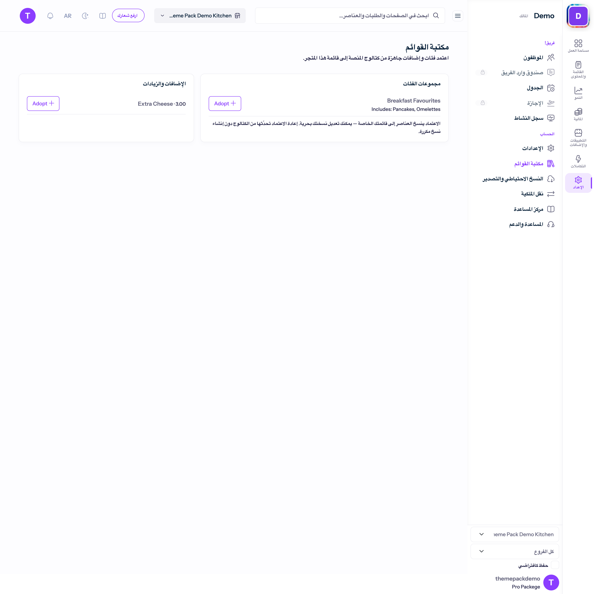

# مكتبة القوائم (كتالوج المنصة)

تنسِّق المنصة كتالوجاً جاهزاً من فئات القائمة (مع عناصرها) والإضافات الشائعة.
فبدلاً من كتابة قائمة قياسية من الصفر، يمكنك تصفُّح هذا الكتالوج واعتماد
مدخلاته مباشرةً في قائمتك الخاصة. افتح **مكتبة القوائم** في الشريط الجانبي
للوحة التحكم ضمن **الإعداد ← الحساب** (أيقونة الكتب)؛ وتوجد الصفحة أيضاً على
`/platform-catalog` على نطاق لوحة التحكم لديك. وهي تعمل على المتجر المحدَّد
حالياً في مبدِّل المتاجر في لوحة التحكم. ويستطيع مالك المتجر وحده الاعتماد.

## التصفح والاعتماد

تسرد الصفحة الكتالوج في جزأين:

- **الفئات** — فئات قائمة منسَّقة، بما فيها الفئات الفرعية، تجمع كل واحدة
  منها عناصر جاهزة.
- **إضافات** — مجموعات إضافات شائعة (الإضافات العلوية، والأطباق الجانبية،
  والخيارات).

انقر على **اعتماد** على مدخل لنسخه إلى قائمة متجرك الحالي. بعد اعتماد فئة،
يعرض التأكيد كم عنصراً أُنشئ وكم من العناصر الموجودة حُدِّث؛ وتصل المدخلات
المعتمَدة إلى محرِّر قائمتك المعتاد فوراً، جاهزة لإعادة التسعير أو التصوير أو
الترجمة أو الحذف مثل أي شيء أنشأته بنفسك.

## النسخ عند الاعتماد

الاعتماد **نسخ** لا ربط:

- بمجرد الاعتماد، يصبح المدخل ملكك. والتعديلات اللاحقة التي تجريها المنصة على
  كتالوجها لا تغيّر نسختك أبداً، وتعديلاتك لا تمسّ الكتالوج أبداً.
- اعتماد المدخل نفسه مرة أخرى يحدِّث نسختك من إصدار الكتالوج الحالي — وتخبرك
  أعداد "المُنشأ/المُحدَّث" في التأكيد بما حدث.

تُعرض فقط مدخلات الكتالوج التي وسمتها المنصة مفعَّلة؛ ويُنسِّق محتويات
الكتالوج مسؤول المنصة.

## صفحات ذات صلة

- [إدارة عناصر القائمة](menu-items.md) — تحرير ما اعتمدته.
- [الفئات وأقسام القائمة](menu-categories.md) — تنظيمه.
- [مولِّد القائمة بالذكاء الاصطناعي ومسح القائمة](ai-menu-generator.md) —
  طريقة سريعة أخرى لبناء قائمة، من صورة أو وصف.
