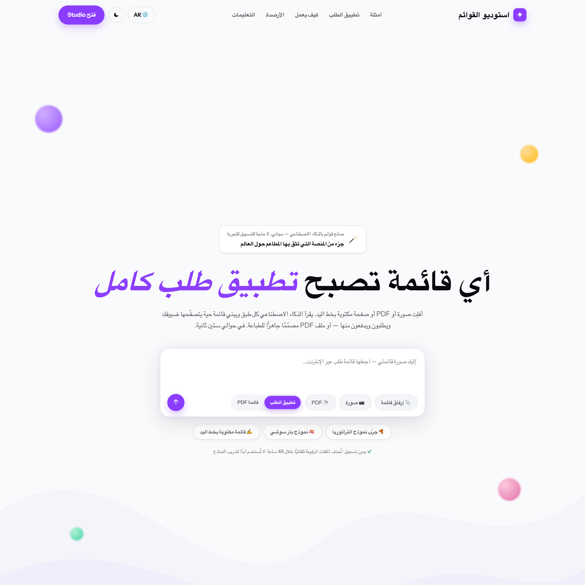

# استوديو القوائم (استوديو التصميم بالذكاء الاصطناعي)

استوديو القوائم أداة تصميم عامة تعمل بالذكاء الاصطناعي لتحويل أي قائمة — صورة أو
ملف PDF أو صفحة مكتوبة بخط اليد أو نصًا ملصوقًا مباشرة — إلى قائمة مصممة جاهزة
للطباعة. لا يحتاج إلى تسجيل: تحصل على جلسة ضيف مؤقتة، تجرّب كل شيء، ولا تسجّل
الدخول إلا إذا أردت نشر النتيجة كقائمة طلب مباشر عبر الإنترنت على المنصة.

افتحه على `/studio` في الموقع الرئيسي (أما مساحة عمل الاستوديو نفسها فتوجد على
`/studio/app`). لا يُحتفظ بأي شيء ترفعه على المدى الطويل: تُحذف جلستك وكل ملفاتها
تلقائيًا بعد 48 ساعة من إنشائها، ويمكنك حذف كل شيء فورًا في أي وقت عبر **حذف كل شيء الآن**.

يختلف استوديو القوائم عن [منشئ القوائم بالذكاء الاصطناعي](ai-menu-generator.md)
داخل لوحة التحكم، الذي يبني القوائم مباشرة داخل مطعمك القائم. الاستوديو هو النسخة
العامة الموجّهة للتصميم من الفكرة ذاتها، ويمكنه تسليم نتيجته إلى المنصة عندما تكون جاهزًا.

## أحضِر قائمتك

في محرّر الإدخال أسفل الاستوديو، اختر أحد الخيارات التالية:

- **أرفق صورة قائمة أو ملف PDF** — صور (PNG أو JPG أو WEBP، حتى 8 ميجابايت لكل صورة،
  وحتى 10 دفعة واحدة) أو ملف PDF تُحوَّل صفحاته إلى صور داخل متصفحك قبل الرفع. تُتجاوز
  الصفحة التي يتعذّر قراءتها، ويمرّ الباقي كالمعتاد.
- **الصق نص القائمة** مباشرة في محرّر الإدخال.
- **جرّبه بقائمة نموذجية** إذا أردت فقط رؤية طريقة عمله.

يقرأ الذكاء الاصطناعي كل طبق ضمن مسودة: الفئات والأصناف والأوصاف والأسعار. تُحصى
الأصناف التي ينقصها سعر وتُميَّز حتى تنقر على حقل السعر وتصحّحها، وتُعلَّم الأسعار
غير المعتادة (أقل من 0.10 أو أكثر من 10,000) للمراجعة.

تُحتسب قراءة قائمتك من استهلاك الذكاء الاصطناعي المشترك نفسه في باقي المنصة. وإذا
كانت خدمة الذكاء الاصطناعي مشغولة، يطلب منك الاستوديو المحاولة مرة أخرى ولا يحتسب عليك أي تكلفة.

## تحرير المسودة

المسودة المستخرجة قابلة للتحرير بالكامل في مكانها — أسماء الأصناف والأوصاف والأسعار
وأسماء الفئات. تُحفظ التعديلات تلقائيًا في جلستك، ويستعيد **تراجع** النسخة السابقة
لآخر حفظ أو تغيير جماعي (خطوة واحدة من السجل).

يوجد أمران جماعيان مدمجان:

- **تعديل جميع الأسعار** — رفع أو خفض كل سعر بنسبة مئوية.
- **وسم الأنظمة الغذائية** — يوسم الأصناف تلقائيًا بأنها نباتية أو نباتية صرفة أو
  حارّة أو تحتوي على مكسرات أو خالية من الجلوتين استنادًا إلى كلمات مفتاحية في
  أسمائها وأوصافها. راجِع النتائج؛ فهي فحص سريع للكلمات المفتاحية وليس تحليلًا كاملًا بالذكاء الاصطناعي.

## قوالب القوائم

يفتح **اختيار قالب** معرضًا لسبعة تصاميم مدمجة: بسترو كلاسيكي، وحديث بسيط، ولوح
طباشيري، ومطعم راقٍ مزخرف، ومقهى باستيل، وأكل شوارع جريء، وفخامة داكنة. اختر واحدًا
لتُعرَض مسودتك فيه كمعاينة مباشرة.

المعاينة والتخصيص مجانيان، وتُعاد المعاينة مع كل تعديل:

- **حجم الصفحة** — A4 أو Letter أو مربّع أو Story. يُصدَّر A4 و Letter بصيغة PDF؛
  ويُصدَّر المربّع و Story بصيغة PNG للمنشورات الاجتماعية.
- **الألوان** — استبدِل لوحة القالب بألوانك الخاصة.
- **خانات النص** — عناوين القالب مثل اسم المطعم والشعار.
- يُطبَّق تخطيط من اليمين إلى اليسار تلقائيًا للعربية واللغات المشابهة، ويمكن تبديله.
- النقر على طبق في المعاينة ينقلك إلى حقله في المحرّر.

يعمل مساعدان بالذكاء الاصطناعي مع القوالب:

- **لائم قائمتي** (مجاني) — يقلّم الأوصاف المفرطة الطول حتى تلائم القائمة الصفحة
  بأناقة، ويعلّم الأطباق المميّزة، ويقترح لونًا مميّزًا. التقليم للعرض فقط:
  **استعادة الأصل** يعيد أي وصف. وإذا كان الذكاء الاصطناعي غير متاح، يلجأ إلى فحص
  آلي أبسط، فيعمل دائمًا.
- **خلفية بالذكاء الاصطناعي** (تُكلّف أرصدة) — تُنشئ عملًا فنيًا زخرفيًا للخلفية
  متوائمًا مع أسلوب القالب ومطبخك، دون نص في الصورة حتى تبقى قائمتك واضحة.
  تُحفظ النتيجة لجلستك؛ وإعادة استخدامها مجانية، أما إعادة توليدها فتُكلّف أرصدة مجددًا.

## القوائم المصممة بالذكاء الاصطناعي

بدلًا من قالب، يمكنك أن تجعل الذكاء الاصطناعي يرسم الصفحة كاملة. اختر **نمطًا جاهزًا**
(مطعم راقٍ، أو مقهى، أو أكل شوارع، أو بسيط) أو **صِف المظهر** بكلماتك — مثلًا "رخام
داكن، خط سيرِف ذهبي، تراتوريا إيطالية" — واختر نسبة الأبعاد ثم ولِّد. يُكلّف هذا أرصدة
(5 افتراضيًا) وقد يستغرق لحظة. لكل جلسة حدّ أقصى 20 توليدة.

يمكن معاينة التصميم النهائي في الاستوديو وتنزيله كملف PDF جاهز للطباعة عبر **تنزيل PDF**.
التنزيل نفسه مجاني — فقد أُنفقت الأرصدة عند التوليد.

## التصدير

تصدير تصميم قالب هو الخطوة المدفوعة؛ أما المعاينة على الشاشة فتبقى مجانية. يُكلّف
**تنزيل PDF** (A4/Letter) أو **تنزيل PNG** (مربّع/Story) العدد نفسه من الأرصدة الذي
تكلّفه القائمة المصممة بالذكاء الاصطناعي (5 افتراضيًا)، وتُقسَّم القوائم الطويلة على
الصفحات بأناقة. وإذا لم تكن خدمة التصدير على جانب الخادم متاحة، يلجأ الاستوديو إلى
نافذة الطباعة في متصفحك مجانًا.

لا تُحتسب عليك التوليدات والتصديرات الفاشلة أبدًا — تُعاد الأرصدة تلقائيًا، ويخبرك
الاستوديو "لم تُحتسب أرصدتك."

## الأرصدة

قراءة قائمتك وتحريرها ومعاينات القوالب والملاءمة والمشاركة كلها مجانية. تدفع الأرصدة
ثمن القوائم المصممة بالذكاء الاصطناعي، وتصديرات القوالب، والخلفيات الفنية بالذكاء الاصطناعي.

يفتح **شحن الأرصدة** منتقي الحزم: حزم Starter و Creator و Pro و Studio (من 30 إلى
1,000 رصيد). هي دفعة بطاقة لمرة واحدة عبر Stripe — دون اشتراك. تُضاف الأرصدة إلى
جلستك بمجرد تسوية الدفع (لا قبل ذلك)، فإذا انقطعت عملية الدفع لا يُحتسب أي شيء.
يعمل الدفع بالبطاقة فقط إذا هيّأ مالك المنصة Stripe؛ وبدونه يخبرك الاستوديو أن الدفع
بالبطاقة غير متاح.

يمكنك أيضًا كسب أرصدة عبر الإحالة: **انسخ رمز الإحالة الخاص بي** وشاركه. عندما يلصق
شخص ما رمزك، يحصل كلاكما على أرصدة مكافأة (5 افتراضيًا). يمكن للجلسة استخدام رمز إحالة
واحد، وتكسب المكافأة مرة واحدة عن كل شخص جديد يستخدم رمزك.

الأرصدة تخص جلستك. ولأن الجلسة تُحذف تلقائيًا بعد 48 ساعة من إنشائها، اشحن عندما تكون
جاهزًا لاستخدام الأرصدة لا قبل ذلك بمدة طويلة. وإذا أردت المتابعة على جهاز آخر، احتفظ
بـ **رابط الاستئناف الخاص** — ولا تنشره علنًا أبدًا، فأي شخص يحصل عليه يمكنه استخدام
جلستك وأرصدتها.

## النشر كقائمة طلبات

عندما تبدو المسودة جيدة، يحوّلها **النشر كقائمة طلبات** إلى مطعم حقيقي مُستضاف على
المنصة. هذه هي الخطوة الوحيدة التي تحتاج إلى حساب: يُطلب منك تسجيل الدخول عبر Google
أولًا، ثم تُربط جلسة الاستوديو بحسابك، وتُنشأ القائمة بكل فئاتها وأصنافها. تحصل على
الرابط المباشر فورًا ويمكنك الاستمرار في إدارته من لوحة التحكم — راجِع
[البدء](getting-started.md) و[إدارة أصناف القائمة](menu-items.md).

يُنشئ النشر مطعمًا جديدًا بهوية بصرية افتراضية (اسم ولون وصور نائبة) يمكنك بعدها
تخصيصها في لوحة التحكم.

## المشاركة والخصوصية

- **نسخ رابط المشاركة العام** يُنشئ معاينة للقراءة فقط بعلامة مائية لقائمتك (على
  `/studio/s/...`) يمكن نشرها في أي مكان بأمان — لا يمكن للمشاهدين التحرير أو
  التنزيل أو إنفاق أرصدتك. إذا اخترت قالبًا، تعرض الصفحة المشتركة النسخة المصممة، مع
  بقاء العلامة المائية. يستخدم الرابط العام رمزًا مستقلًا عن رابط الاستئناف الخاص،
  فمشاركته لا تسلّم جلستك أبدًا.
- **تصدير بياناتي** يُنزّل كل ما يحتفظ به الاستوديو عن جلستك (تفاصيل الجلسة إضافةً
  إلى المسودة المستخرجة) كملف JSON.
- **حذف كل شيء الآن** يزيل جلستك وكل ملف مرفوع أو مولَّد فورًا ويمسح كوكي الاستوديو.
- في كل الأحوال، يُحذف كل شيء تلقائيًا بعد 48 ساعة من إنشاء جلستك.
