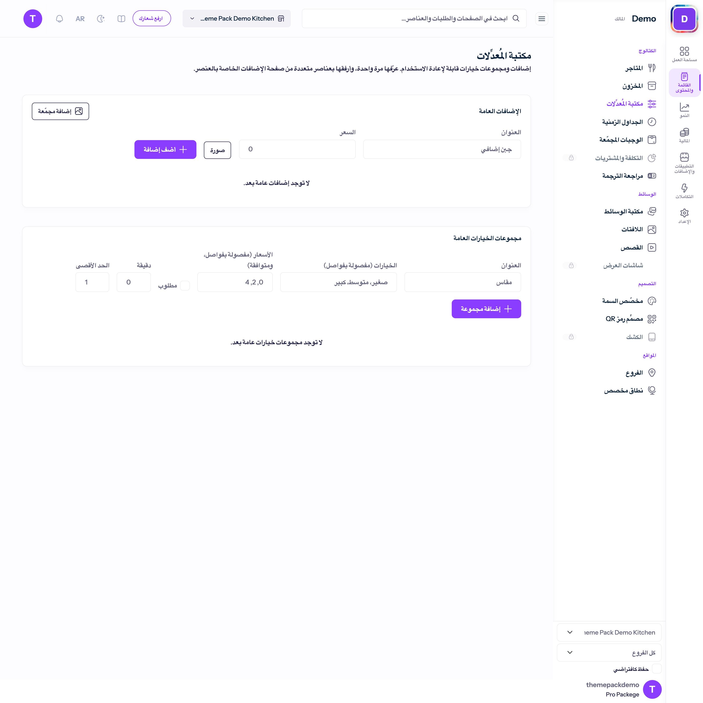

# الإضافات والخيارات

تتيح الإضافات للعملاء تخصيص صنف من القائمة قبل إضافته إلى طلبهم: إضافات علوية، أو اختيار حجم، أو تفضيل طهي، وهكذا. توفّر لك هذه المنصة مكتبة قابلة لإعادة الاستخدام حتى تعرّف الإضافة مرة واحدة وتربطها بأي عدد تشاء من الأصناف. وتحريرها في المكتبة يُحدّث كل صنف يستخدمها.

هناك نوعان من الإضافات:

- **الإضافات العامة** — إضافات مفردة لها سعرها الخاص، مثل "جبن إضافي" بـ 2.00. يمكن للعميل إضافة أي عدد من الإضافات التي تربطها.
- **مجموعات الخيارات العامة** — مجموعة خيارات لها عنوان، مثل مجموعة "الحجم" بخيارات صغير ووسط وكبير. يمكن أن يحمل كل خيار سعره الخاص، وللمجموعة قواعد اختيار (إلزامي، وحد أدنى، وحد أقصى).

## أين تجدها

في الشريط الجانبي للوحة التحكم، افتح **مكتبة المُعدِّلات**. إذا كان لحسابك أكثر من مطعم، اختر المطعم في أعلى الصفحة أولًا؛ فالمكتبة محصورة بمطعم واحد. وعندما يكون لديك مطعم واحد فقط يُختار تلقائيًا.

من هنا تدير القائمتين — الإضافات العامة ومجموعات الخيارات العامة — وترى كم صنفًا يستخدم كلًّا منها.

## إنشاء إضافة عامة

في بطاقة **الإضافات العامة**، املأ صف الإضافة:

- **العنوان** — الاسم الذي يراه العميل، مثل "جبن إضافي".
- **السعر** — المبلغ المُضاف عندما يختار العميل هذه الإضافة. أدخِل 0 للإضافة المجانية.
- **الصورة** (اختياري) — اختر صورة من [مكتبة الوسائط](media-library.md).

اختر **إضافة جديدة** لحفظها. تعرض كل إضافة سعرها، وعدّاد **مستخدَمة في** يبيّن كم صنفًا يشير إليها، وحالة نشطة أو غير نشطة.

استخدم **تحرير** لتغيير العنوان أو السعر أو الصورة أو لتبديل حالة الإضافة إلى نشطة. جعلها غير نشطة يخفيها عن العملاء دون حذفها. أما **حذف** فيزيل الإضافة من كل صنف كانت مرتبطة به، لذا يُطلب منك التأكيد أولًا.

## إنشاء مجموعة خيارات عامة

في بطاقة **مجموعات الخيارات العامة**:

- **العنوان** — اسم المجموعة، مثل "الحجم" أو "تفضيل الطهي".
- **الخيارات (مفصولة بفواصل)** — الخيارات المفردة، مثل `Small, Medium, Large`.
- **الأسعار (مفصولة بفواصل، متطابقة)** — سعر اختياري لكل خيار، بالترتيب نفسه للخيارات. لـ `Small, Medium, Large` قد تُدخل `0, 2, 4` لعدم إضافة شيء للصغير، و2.00 للوسط، و4.00 للكبير. اترك هذا فارغًا إذا كانت كل الخيارات مجانية. أي أسعار تُدخلها تتطابق موضعًا بموضع مع الخيارات؛ وإذا تركت الحقل بأكمله فارغًا كانت المجموعة مجانية.
- **إلزامي** — علّم هذا إذا كان على العميل أن يختار من المجموعة قبل الطلب.
- **الحد الأدنى** و**الحد الأقصى** — كم خيارًا يمكن للعميل اختياره. الحد الأدنى هو أقل عدد يجب أن يختاره (0 يعني اختياريًا)؛ والحد الأقصى هو أكثر عدد (اترك الحد الأقصى فارغًا لعدم وجود سقف أعلى). كلاهما يقبل من 0 إلى 50.

اختر **إضافة مجموعة** للحفظ. تعرض القائمة الخيارات، وشارة قاعدة (إلزامي إضافةً إلى نطاق الحد الأدنى–الأقصى)، وعدّاد **مستخدَمة في**.

يتيح لك **تحرير** تغيير العنوان والخيارات والأسعار وعلامة الإلزامي والحد الأدنى والأقصى، وتبديل حالة المجموعة إلى نشطة. وكما هو الحال مع الإضافات، يزيل **حذف** المجموعة من كل صنف ويطلب منك التأكيد.

## ترجمة الإضافات

إذا كانت قائمتك بأكثر من لغة، يظهر مبدّل **لغة التحرير** في أعلى المكتبة. أنشئ إضافاتك ومجموعاتك بلغتك الافتراضية أولًا، ثم بدّل اللغة واستخدم **تحرير** لترجمة العنوان (وللمجموعات، أسماء الخيارات). الأسعار والصور مشتركة عبر كل اللغات — أنت تترجم الصياغة فقط.

## ربط الإضافات بصنف

تربط الإضافات من الصنف نفسه، لا من صفحة المكتبة.

1. افتح **قائمة المنتجات** واختر المطعم، ثم افتح الصنف الذي تريده وانتقل إلى صفحة **الإضافات والتنويعات** الخاصة به (راجِع [أصناف القائمة](menu-items.md)).
2. مرّر إلى قسم **المكتبة**. يحتوي على لوحتين: **الإضافات العامة** و**مجموعات الخيارات العامة**، تسردان كل ما في مكتبتك لهذا المطعم.
3. اختر **إرفاق** بجانب الإضافة أو المجموعة التي تريدها في هذا الصنف. تظهر فورًا شارة **مربوط**.
4. لإزالتها من هذا الصنف، اختر **إزالة الإرفاق**. هذا يزيلها من الصنف الحالي فقط؛ وتبقى الإضافة في مكتبتك وعلى الأصناف الأخرى.

يقفز رابط **إدارة المكتبة** في تلك الصفحة مباشرةً إلى مكتبة الإضافات إذا احتجت إلى إنشاء شيء أولًا. الإضافة المربوطة تستخدم سعر مكتبتها، والمجموعة المربوطة تستخدم خيارات مكتبتها وأسعارها وقواعد اختيارها.

## كيف تظهر الإضافات للعملاء

في متجرك، عندما يفتح العميل صنفًا مرتبطة به إضافات:

- **مجموعات الخيارات** تظهر كخيارات يختار منها. إذا كانت المجموعة معلّمة كإلزامية أو لها حد أدنى، فعليه استيفاء ذلك قبل أن يُضاف الصنف إلى السلة. يحدّد الحد الأقصى كم خيارًا يمكنه تعليمه. ويُضاف أي سعر لكل خيار إلى إجمالي الصنف أثناء اختياره.
- **الإضافات** تظهر كإضافات اختيارية؛ كل منها يضيف سعره عند اختياره.

يعكس إجمالي الصنف أسعار الخيارات والإضافات التي يختارها العميل، وتُسجَّل الخيارات والإضافات المختارة على الطلب وتُعرض على مطبخك.

## الإضافات والتنويعات لكل صنف

تتيح لك صفحة **الإضافات والتنويعات** نفسها أيضًا بناء إضافات ومجموعات تنويعات تخص ذلك الصنف وحده، منفصلة عن المكتبة المشتركة. لجأ إلى المكتبة عندما تظهر الإضافة أو الخيار نفسه عبر أصناف كثيرة؛ واستخدم إضافات الصنف المفردة للخيارات لمرة واحدة. كلاهما يظهر للعملاء بالطريقة نفسها.

## ملاحظات وحدود

- مكتبة الإضافات محصورة لكل مطعم. الإضافات والمجموعات المُنشأة لمطعم لا تُشارَك مع آخر.
- تبقى الإضافات والمجموعات غير النشطة في مكتبتك وعلى أصنافها لكنها مخفية عن العملاء، وهي طريقة سريعة لإيقاف إضافة موسمية مؤقتًا.
- تتطابق أسعار الخيارات مع ترتيب الخيارات. إذا أعدت ترتيب الخيارات أو غيّرتها لاحقًا، فأعد فحص الأسعار حتى تبقى متطابقة.
- توجد تجاوزات لكل ربط (سعر مختلف أو قواعد اختيار مختلفة لصنف واحد) في النظام لكنها غير قابلة للتحرير من لوحة التحكم الحالية؛ فالإضافة المربوطة تستخدم سعر المكتبة وقواعدها.
