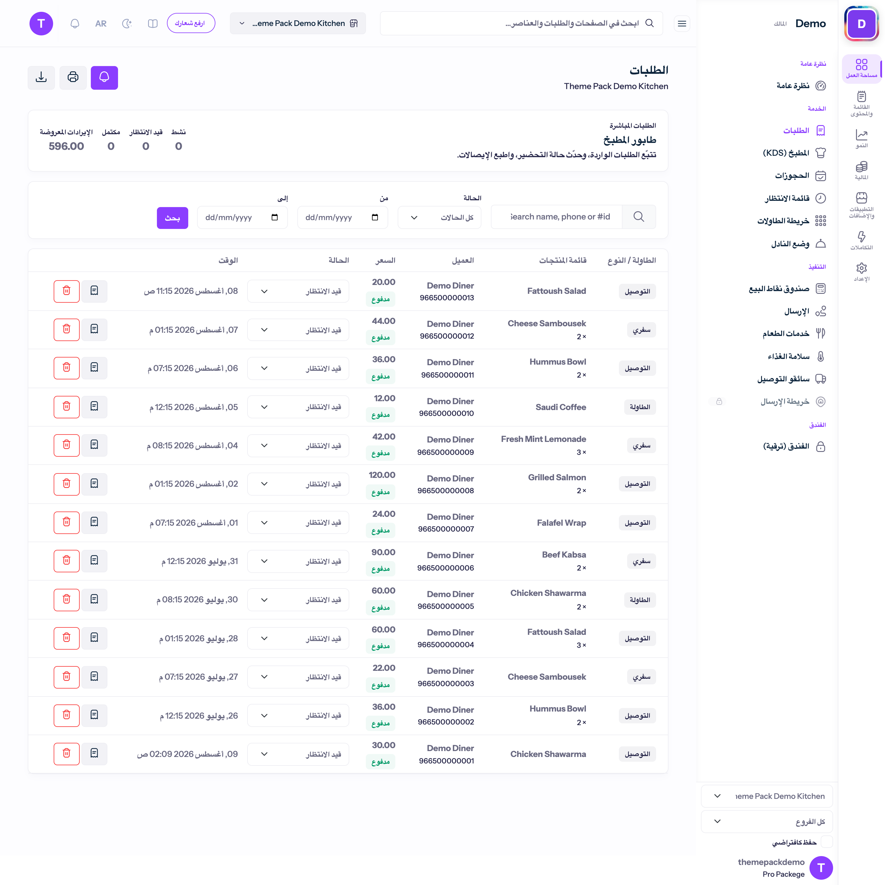

# إدارة الطلبات

عندما يضع عميل طلبًا من قائمتك العامة، يظهر في لوحة التحكم تحت **الطلبات** في
الشريط الجانبي. تشرح هذه الصفحة قائمة الطلبات، وكيف تعمل حالات الطلب، وما يراه
عملاؤك أثناء الانتظار، والإضافات المرافقة للطلب: ملاحظات لكل صنف، والأوقات المجدولة،
وسجل طلبات الضيف.

## قائمة الطلبات

افتح **الطلبات** في الشريط الجانبي. إذا كان لديك أكثر من مطعم، يختار منتقي المطاعم
أيها تشاهد؛ وإذا كنت تعمل بالفروع، تُحصر القائمة أيضًا بالفرع المختار في مبدّل
الشريط الجانبي. تُعرض الطلبات من الأحدث أولًا، 50 في الصفحة.

في أعلى الصفحة تحصل على ملخّص سريع للطلبات المعروضة حاليًا: **نشطة** (قيد الانتظار
أو التحضير أو جاهزة)، و**قيد الانتظار**، و**مكتملة**، و**الإيراد المعروض**. وتحته،
يصفّي مربع بحث القائمة أثناء الكتابة، وتضيّقها قائمة **الحالة** المنسدلة إلى حالة
واحدة. يطابق البحث الطاولة أو نوع الطلب، واسم العميل، والهاتف، والعنوان، والحالة،
ورقم الطلب.

يعرض كل صف:

- **الطاولة / النوع** — رقم الطاولة، أو سفري، أو توصيل.
- **القائمة** — الأصناف المطلوبة مع التنويعة والكمية والإضافات وأي ملاحظة لكل صنف
  (بخط مائل أسفل الصنف).
- **العميل** — الاسم والهاتف والعنوان ورسالة الطلب إن تركها العميل.
- **السعر** — الإجمالي وأي إكرامية وشارة **مدفوع** للطلبات المدفوعة عبر الإنترنت.
- **الحالة** — قائمة منسدلة لتغيير الحالة (انظر أدناه).
- **الوقت** — متى وُضع الطلب.

تتيح لك إجراءات الصف فتح الطلب كإيصال (بزر **طباعة الإيصال**)، أو تعليم طلب قيد
الانتظار كمكتمل، أو حذفه (مع تأكيد).

يستحق مفتاحان في ترويسة الصفحة التشغيل لكاونتر مزدحم:

- **صوت الطلب الجديد** — يشغّل نغمة عند وصول طلب جديد.
- **الطباعة التلقائية للطلبات الجديدة** — يعيد تحميل الصفحة عند وصول طلب جديد ليكون
  جاهزًا للطباعة.

تفحص الصفحة الطلبات الجديدة تلقائيًا كل نحو 25 ثانية، فلا تحتاج إلى التحديث. تبقى
الطلبات التي بدأت بالدفع عبر الإنترنت مخفية حتى تُدفع، وتُنظَّف الطلبات المتروكة غير
المدفوعة تلقائيًا بعد ثلاث ساعات.

## الحالات وكيفية تغييرها

يمرّ كل طلب بدورة حياة بسيطة:

- **قيد الانتظار** — وصل للتو، ولم يُنجَز شيء بعد.
- **قيد التحضير** — المطبخ يعمل عليه.
- **جاهز** — جاهز للاستلام أو التقديم أو الإرسال.
- **مكتمل** — سُلِّم؛ انتهى الطلب.
- **ملغى** — لن يُنفَّذ الطلب.

لتغيير حالة، اختر القيمة الجديدة من قائمة **الحالة** المنسدلة في صف الطلب. يمكنك
نقل الطلب إلى أي حالة في أي وقت — لا تسلسل مفروض — ويسجّل كل تغيير طابعًا زمنيًا (بدأ
التحضير، أصبح جاهزًا، اكتمل، أو أُلغي). لا تُعرض هذه الطوابع الزمنية في صفحة الطلبات؛
فهي تشغّل صفحة التتبّع المباشر للعميل (أدناه).

إذا كنت قد جهّزت SMS أو WhatsApp، فيمكنك أيضًا إخطار العميل تلقائيًا عند كل تغيير
حالة. في **المتاجر ← تعديل ← الطلبات**، تحت **تنبيهات العملاء عبر الرسائل النصية**، شغّل **SMS تحديث
الحالة** (أو خيار WhatsApp المقابل). عندها يتلقى العميل رسالة قصيرة مثل "طلبك رقم 12
أصبح جاهزًا الآن" على رقم الهاتف الذي أعطاه عند الدفع.

## ما يراه العميل (التتبّع المباشر)

يحصل كل طلب على صفحة تتبّع خاصة يُوصَل إليها عبر رابط طويل عشوائي، فلا يستطيع العملاء
تخمين طلبات بعضهم البعض. بعد الدفع يُعطى العميل هذا الرابط، وتعرض الصفحة متتبّعًا
خطوة بخطوة (استُلم الطلب، قيد التحضير، جاهز، مكتمل) يُحدَّث تلقائيًا كل بضع ثوانٍ مع
تغييرك للحالة في لوحة التحكم. تعرض الطلبات الملغاة حالة إلغاء. لا حاجة لتسجيل الدخول —
فالرابط نفسه هو المفتاح.

## تقدير وقت التحضير (ETA)

يمكن لصفحة التتبّع أيضًا أن تعرض للعميل سطرًا مباشرًا "جاهز خلال نحو 20–30 دقيقة"
أثناء تحضير الطلب. التقدير تلقائي: يُبنى من آخر 30 يومًا من طلباتك (كم استغرقت
الأطباق فعليًا بين **قيد التحضير** و**جاهز**)، ثم يُعدَّل حسب انشغال المطبخ حاليًا
وحسب الطلبات الكبيرة على نحو غير معتاد. يُحدَّث تلقائيًا ويختفي لحظة تعليمك الطلب
جاهزًا — ومن ثمّ تعرض الصفحة أوقاتًا فعلية لا تخمينًا.

أمران ينبغي معرفتهما:

- يحتاج التقدير إلى سجل. يبقى صامتًا حتى يتوفر لديه 20 طلبًا مكتملًا على الأقل مسجَّلة
  فيها خطوتا التحضير والجاهزية — فهو لا يعمل إلا إذا كنت (أو موظفوك) تنقلون الطلبات
  فعليًا عبر الحالات بدلًا من القفز مباشرةً إلى مكتمل.
- يمكنك ضبط قيمة احتياطية للفترة الهادئة. في **المتاجر ← تعديل ← الطلبات**، املأ
  **قيمة احتياطية لتقدير وقت التحضير (بالدقائق)** بالصيغة `25-35`. يُعرض ذلك النطاق
  كلما لم يكن هناك سجل كافٍ لتقدير تلقائي. اتركه فارغًا فلن يُعرض تقدير حتى يبدأ
  التلقائي.

## ملاحظات لكل صنف

يمكن للعملاء إرفاق ملاحظة قصيرة بكل سطر في سلتهم (مثلًا "بدون بصل") إضافةً إلى رسالة
الطلب. تُحفظ الملاحظة مع ذلك السطر وتظهر بخط مائل مباشرةً أسفل الصنف في قائمة
الطلبات، فيرى المطبخ الطبق الذي تخصّه. تبدو الطلبات بلا ملاحظات كما كانت تمامًا.

## الملاحظات الصوتية على الطلبات

يمكن للعملاء أيضًا إرفاق رسالة منطوقة قصيرة بالطلب — مفيدة للحساسيات أو التوجيهات أو
أي شيء يسهل قوله أكثر من كتابته.

شغّلها في **المتاجر ← تعديل ← الطلبات** عبر **قبول الملاحظات الصوتية على الطلبات** (وهي
مُطفأة افتراضيًا). عند الدفع يرى العميل عندها مسجّل **ملاحظة صوتية** اختياريًا:
ملاحظة واحدة لكل طلب، حتى 60 ثانية. إذا تعذّر على متصفحه التسجيل أو رفض الميكروفون،
تخفي الأداة نفسها ويستمر الدفع بشكل طبيعي.

من جانبك، يعرض الطلب الذي يحمل ملاحظة صوتية مشغّل صوت صغيرًا في صفّه في قائمة الطلبات —
اضغط تشغيل لسماعها، مع طول الملاحظة بجانبه. يظهر المشغّل نفسه على شاشة عرض المطبخ،
وفي نقطة البيع، وفي تطبيق الموظفين على الجوال، فيستطيع من يتولى الطلب أن يستمع.
تُخزَّن التسجيلات على نحو خاص ولا يمكن تشغيلها إلا لموظفيك المسجَّلين (وللعميل الذي
سجّلها).

هناك إعداد ثانٍ، **تفريغ الملاحظات الصوتية تلقائيًا** (مُشغَّل افتراضيًا)، يحوّل كل
ملاحظة إلى سطر نصي قصير يظهر أسفل المشغّل، فيستطيع الموظفون قراءة الطلب بلمحة دون
سماعات. يحتاج التفريغ إلى مزوّد ذكاء اصطناعي قادر على معالجة الصوت (مثل Groq أو
OpenAI) مهيّأ على حسابك؛ وبدونه يظل مشغّل الصوت يعمل ولا يغيب سوى السطر النصي. لا
يؤخّر التفريغ الطلب أو يعطّله أبدًا.

## جدولة الطلبات (الطلب لوقت لاحق)

يمكن للعملاء وضع طلب الآن لوقت لاحق:

1. اذهب إلى **المتاجر**، وحرّر المطعم، وافتح تبويب **الطلب**، واضبط **جدولة الطلبات**
   على نعم.
2. عند الدفع يرى العميل عندها منتقي تاريخ ووقت اختياريًا **جدولة لوقت لاحق**، محدودًا
   بـ 30 دقيقة مقدّمًا على الأقل.

يُحفظ الوقت المختار مع الطلب. ملاحظة: لا يُعرض الوقت المجدول بعد في صفحة الطلبات أو
على الإيصالات — إبرازه في لوحة التحكم مخطّط له لكنه غير متاح بعد، لذا في الوقت الحالي
أكّد أوقات الطلب المسبق مع العميل مباشرة.

## سجل طلبات الضيف وإعادة الطلب

لا يحتاج العملاء إلى حساب للعثور على طلباتهم السابقة. في قائمتك العامة يوجد قسم
**تتبّع طلباتي السابقة**: يُدخل العميل رقم الهاتف أو البريد الإلكتروني الذي استخدمه
عند الدفع فيحصل على آخر 10 طلبات له في مطعمك، لكل منها تاريخه وحالته وإجماليه ورابط
إلى صفحة تتبّعه. أي شيء أكثر تفصيلًا، كالعنوان أو قائمة الأصناف، يبقى خلف رابط
التتبّع الخاص.

يحصل العملاء المسجَّلون في حساب عميل إضافةً إلى ذلك على زر **أعِد هذا الطلب** في
صفحة حسابهم. يعيد الأصناف نفسها — بالتنويعات والإضافات نفسها — إلى السلة بنقرة واحدة.
تُتجاوز الأصناف التي نفدت أو لم تعد على القائمة مع إشعار؛ وإذا لم يكن أي من الأصناف
متاحًا، تُرفض إعادة الطلب برسالة.

## صفحات ذات صلة

- [نظرة عامة على لوحة التحكم](dashboard-overview.md) — موضع الطلبات في الشريط
  الجانبي وكيف تعمل عدّادات الخطة.
- [إدارة أصناف القائمة](menu-items.md) — مفاتيح النفاد والتوافر، التي تؤثر في ما
  يمكن طلبه وإعادة طلبه.
