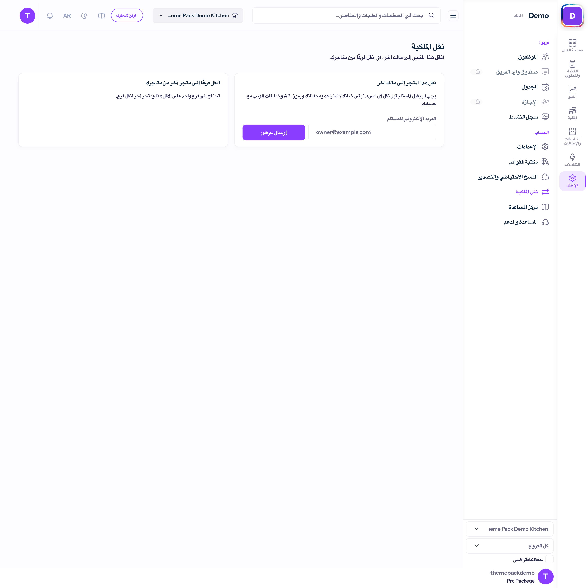

# نقل الملكية

سلّم مطعمًا بأكمله إلى حساب آخر، أو انقل فرعًا بين مطعمين تملكهما. افتح 
**نقل الملكية** في الشريط الجانبي للوحة التحكم تحت **الإعداد ← الحساب** (أيقونة التبادل)؛
كما توجد الصفحة على `/transfer` في نطاق لوحة تحكمك. تعمل دائمًا على المتجر المختار
حاليًا في مبدّل المتاجر بلوحة التحكم. ولا يمكن استخدامها إلا لمالك المتجر.

## نقل متجر إلى مستخدم آخر

نقل المتجر عملية بين طرفين: أنت تقدّم عرضًا، ولا ينتقل شيء حتى يقبله المستلم من حسابه.

1. في صفحة النقل، أدخِل **عنوان البريد الإلكتروني** للمستلم. يجب أن يعود إلى حساب
   قائم على المنصة (وليس حسابك أنت).
2. أرسِل العرض. يتلقى المستلم إشعارًا بالبريد الإلكتروني، ويظهر العرض تحت عروضك
   **الصادرة** كقيد الانتظار.
3. يسجّل المستلم الدخول ويرى العرض تحت العروض **المتاجر المعروضة عليك** في صفحة النقل الخاصة به،
   مع ملخّص لما يحويه المتجر. ويمكنه **القبول** أو **الرفض**.
4. عند القبول، تنتقل ملكية المطعم — قائمته وطلباته وإعداداته وكل ما هو مرتبط به —
   إلى حساب المستلم. تُعاد مراجعة الملكية لحظة القبول، ويُدقَّق كل نقل مُطبَّق.

قواعد ينبغي معرفتها:

- **عرض معلّق واحد لكل متجر.** لا يمكنك إرسال عرض ثانٍ ما دام هناك عرض قائم — ألغِ
  الأول من قائمتك الصادرة.
- **تنتهي صلاحية العروض** بعد 7 أيام إن لم تُقبل.
- يمكنك **إلغاء** عرضك المعلّق في أي وقت؛ ويمكن للمستلم **الرفض**. كلاهما ينهي العرض
  دون تغيير أي شيء.
- نقل المتجر لا ينقل متاجرك الأخرى أو حسابك أو اشتراكك — بل ينقل ذلك المطعم وحده.

## نقل فرع بين متاجرك

إذا كنت تملك أكثر من مطعم، تقدّم الصفحة نفسها **نقل فرع**: اختر أحد فروع المتجر
الحالي ومتجرًا وجهةً من مطاعمك الأخرى، فينتقل الفرع فورًا. لا حاجة إلى خطوة قبول
لأن كلا المتجرين يخصّانك.

## صفحات ذات صلة

- [تعدد الفروع](branches.md) — كيف تعمل الفروع يومًا بيوم.
- [النسخ الاحتياطي والتصدير والاستعادة](backup-export.md) — خذ نسخة كاملة من بيانات
  متجر قبل النقل أو بعده.
